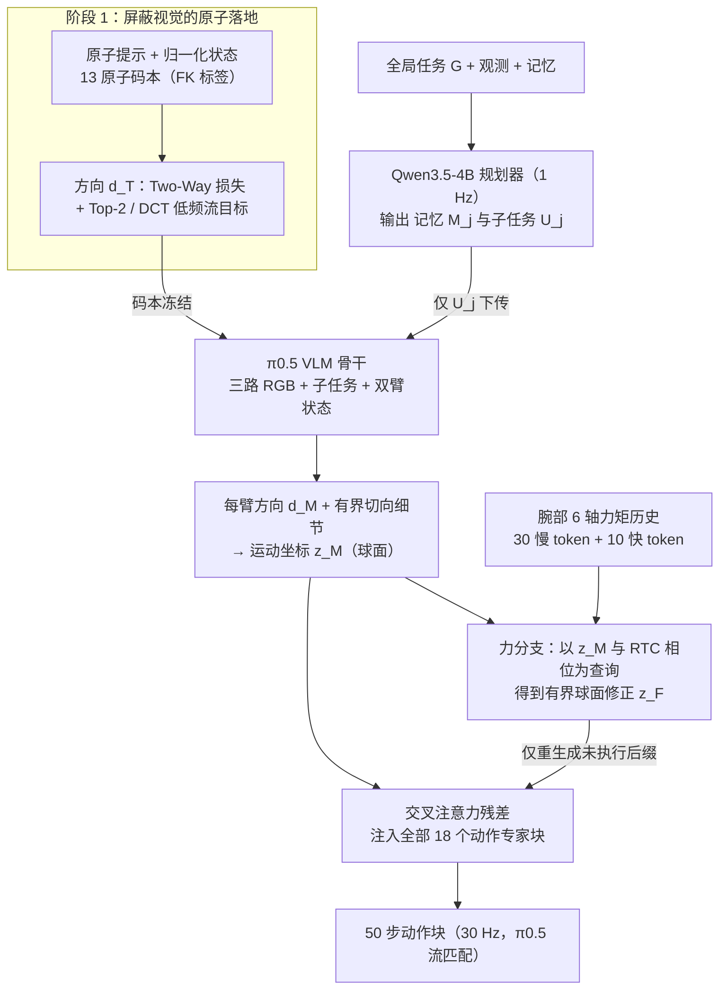

# AMC（arXiv:2609.15012）

**AMC**（*Atomic Motion Coordinate for Language-Steerable and Force-Responsive Manipulation*，[arXiv:2609.15012](https://arxiv.org/abs/2609.15012)，Jiaqi Zhai 等；DEEP Robotics、慕尼黑工业大学、清华大学、浙江大学、上海 AI Lab 等（通讯：Dong Wei、Wei Zhang）；[官方项目页](https://developer.deeprobotics.cn/research/articles/AMC_web_handoff_20261012/index.html)）。

## 流程总览

图依据：论文 §III-A 至 §III-E 与 Fig. 1。

## 一句话定义

**AMC 是注入 VLA 动作专家的几何原子运动坐标：只改语言指令就能重定向末端执行器，并能凭接触历史修正尚未执行的动作段。**

## 英文缩写速查

| 缩写 | 英文全称 | 简要说明 |
|------|----------|----------|
| AMC | Atomic Motion Coordinate | 本文坐标 / 方法 |
| VLA | Vision-Language-Action | 视觉-语言-动作策略 |
| FK | Forward Kinematics | 正运动学，用于落地原子 |
| OOD | Out-of-Distribution | 分布外 |

## 核心方法

- 每臂 13 个平移、旋转、保持原子，经文本与 FK（屏蔽视觉）落地。
- 完整观测下，坐标通过交叉注意力残差注入每个动作专家块。
- 接触历史经有界球面残差调制同一坐标，从固定名义隐变量重算，只再生成未执行的动作后缀。

## 评测要点（项目页自报）

| 评测 | 报告 |
|------|------|
| 离线干预（每策略 7,520 组） | 单 / 双干预反向原子分离 92.5% / 83.1%（LA4VLA-style 39.1% / 24.0%） |
| 真机（每方法-任务 50 次） | OOD 水果进度较微调 π0.5 由 60.5% 到 87.8%；加入力适应后 Plug / Vase 由 59.0% / 71.6% 到 78.5% / 75.2% |

## 与其他工作对比

- **相对 LA4VLA-style 语言转向：** 项目页的离线干预评测以其为对照；AMC 把转向信号落到几何原子坐标并注入每个动作专家块，反向原子分离率明显更高（见上表）。
- **相对直接微调 π0.5：** 真机 OOD 任务以微调 π0.5 为基线；AMC 不改基础策略的训练目标，而是额外提供可由语言编辑的运动坐标，并用接触历史只重算未执行的动作后缀。
- 两组对照分别对应不同评测，勿跨表合并（同下方结论）。

## 开源状态

项目页提供 GitHub 链接；本页未逐文件核验仓库内容与权重。

## 结论

**结论来自作者设定的转向评测与有限任务真机；对比方法随任务不同，勿跨表合并。**

## 关联页面

- [DR-WM](./paper-dr-wm.md) — 云深处同批研究
- [云深处 rl_training](./deeprobotics-rl-training.md) — 同公司 RL 训练工程
- [vla](../methods/vla.md)

## 参考来源

- [项目页归档](../../sources/sites/deeprobotics-amc.md)
- [arXiv 原文](https://arxiv.org/abs/2609.15012)
- [官方项目页](https://developer.deeprobotics.cn/research/articles/AMC_web_handoff_20261012/index.html)
- [云深处前沿探索](https://developer.deeprobotics.cn/research/)
- [arXiv PDF](https://arxiv.org/pdf/2609.15012)：已通读方法部分（实验与附录以略读为准）：§I 引言、§II 相关工作、§III Method（A–E）、§IV 实验设定开头
