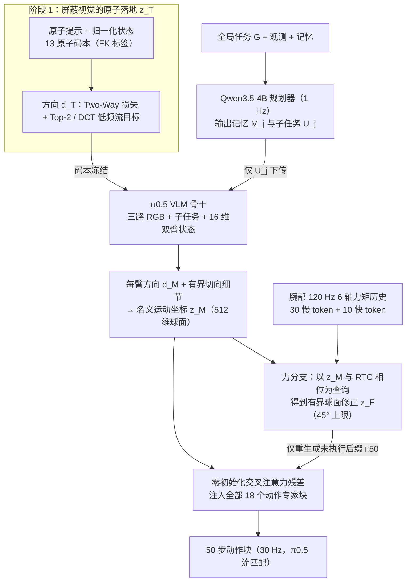
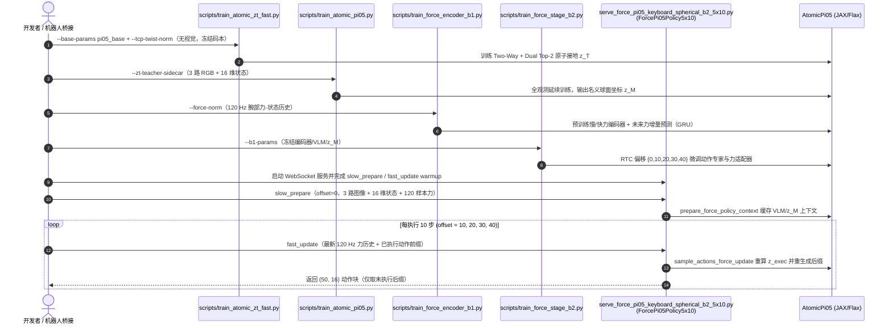

# AMC（arXiv:2609.15012）

**AMC**（*Atomic Motion Coordinate for Language-Steerable and Force-Responsive Manipulation*，[arXiv:2609.15012](https://arxiv.org/abs/2609.15012)，Jiaqi Zhai 等；DEEP Robotics、慕尼黑工业大学、清华大学、浙江大学、上海 AI Lab 等，通讯 Dong Wei、Wei Zhang；[官方项目页](https://developer.deeprobotics.cn/research/articles/AMC_web_handoff_20261012/index.html)、[官方源码](https://github.com/zjq19990202-spec/AMC)）提出了一种基于几何原子运动坐标的 VLA 转向与力响应扩展，在保留 π₀.₅ 骨干的同时把语言指令真正绑定到可执行的三维运动轴，并支持 120 Hz 力矩驱动的块内后缀实时重生成。

## 一句话定义

**AMC 是注入 π₀.₅ 动作专家全部 18 层的每臂几何原子运动坐标：通过屏蔽视觉的文本-正运动学（FK）落地将语言指令绑定到 13 个空间原子，并用固定名义坐标上的有界球面力残差重生成未执行动作后缀，实现语言可转向与接触力自适应。**

## 英文缩写速查

| 缩写 | 英文全称 | 简要说明 |
|------|----------|----------|
| AMC | Atomic Motion Coordinate | 本文提出的每臂 512 维球面几何运动坐标框架 |
| VLA | Vision-Language-Action | 视觉-语言-动作策略（本文基于 π₀.₅ 骨干与流匹配专家） |
| FK | Forward Kinematics | 正运动学，用于与文本解耦地计算末端 TCP 位移/旋转原子标签 |
| RTC | Real-Time Chunking | 实时分块执行，以偏移 `{0, 10, 20, 30, 40}` 重生成未执行后缀 |
| TCP | Tool Center Point | 工具中心点（本文 CR1 平台相对末端带 0.20 m 偏置） |
| OOD | Out-of-Distribution | 分布外（本文中指已知目标/顺序/布局的留出重组合） |

## 为什么重要

- **打破视觉先验对语言的压制：** 常规 VLA 在微调后容易“看图沿示教套路动”而忽略语言改向（微调 π₀.₅ 在反事实单/双干预上仅 18.1% / 8.1% 分离率）；AMC 用无视觉阶段将每臂 13 个基座系原子与 FK 运动学硬绑定并冻结码本，反事实分离率跃升至 **92.5% / 83.1%**。
- **把语言转向与接触力反馈统一到同一球面流形：** 传统力反馈路线（如 ForceVLA）直接把力特征注入动作网络，易与预训练视觉运动先验冲突；AMC 将力残差限制在名义坐标 $z_M$ 的局部球面锥内（$20^\circ$ 自由锥、$45^\circ$ 上限），每次重算都锚定同一 $z_M$ 而不累积漂移。
- **轻量可插拔扩展：** 原子通路与力分支分别仅增 **34.56M** 与 **12.40M** 参数（共 46.96M，仅为 3.353B π₀.₅ 骨干的 **1.40%**），全观测慢环 118.7 ms、力快环 45.5 ms（单张 RTX 4090，满足 10 步 / 333 ms 窗口）。

## 流程总览

图依据：论文 §III-A 至 §III-F 与 Fig. 1。

## 核心原理

- **层级职责隔离（§III-A）：** 上层 `Qwen3.5-4B` 以 1 Hz 维护跨帧摘要记忆 $M_j$，并通过固定提示模板从预设子任务词表输出 $U_j$（无任务微调）；低层仅见 $U_j$、三路 RGB 与 16 维双臂状态，通过 32 维 π₀.₅ 动作专家输出 50 步 30 Hz 动作块（前 16 维控制双 7-DoF 臂与夹爪）。
- **几何词表与无视觉接地（§III-B–III-D）：** 每臂拥有 13 个基座系原子 $\mathcal{A}=\{\pm x,\pm y,\pm z,\pm r_x,\pm r_y,\pm r_z,\mathrm{hold}\}$。标签完全依据 URDF 与 0.20 m TCP 偏置计算，不受物体/任务话术干扰。先做 25k 步无视觉 `z_T` 训练并冻结 512 维码本；再在全观测 `z_M` 阶段结合 Top-5 FK 监督、教师方向余弦对齐与反事实铰链损失学习场景化切向细节。
- **非累积球面力调制与 RTC（§III-E）：** 120 Hz 腕部 6 轴力矩与状态经共享两层时序 Transformer 编成 30 个慢 token（1 s）和最多 10 个快 token（Anchor 后最新 $\le 40$ 样本）。每次 10 步边界（偏移 $i\in\{0,10,20,30,40\}$）都以固定名义坐标 $z_M$ 重新生成 $z_{\mathrm{exec}}^{(i)}=\mathcal{S}(z_M, z_F^{(i)}; \pi/4)$，锁定已提交前缀并仅更新 $i{:}50$ 后缀。

## 源码运行时序图

官方仓库 [`zjq19990202-spec/AMC`](https://github.com/zjq19990202-spec/AMC)（@ `fa13908`）已公开发布四阶段训练脚本与 `5x10` 球面 RTC 推理服务，依赖 OpenPI JAX/Flax 环境（不含数据集与 checkpoint 权重）：

图依据：`zjq19990202-spec/AMC@fa13908`，实读 `README.md`、`scripts/train_atomic_zt_fast.py`、`scripts/train_atomic_pi05.py`、`scripts/train_force_encoder_b1.py`、`scripts/train_force_stage_b2.py`、`scripts/serve_force_pi05_keyboard_spherical_b2_5x10.py` 与 `scripts/serve_force_pi05_keyboard_2x25.py`。硬件侧 WebSocket 相机/力桥接与 `norm_assets` 数据未在仓库内提供，未实际运行训练或服务。

## 工程实践

| 项 | 建议 / 核查结果 |
|----|-----------------|
| **开源状态** | **科研代码已开源**（`fa13908`）：公开完整训练与球面 5×10 WebSocket 推理代码（科研使用，根目录未放独立 LICENSE）；数据、标定统计、`pi05_base` 与微调后权重需自备 |
| **训练配方** | 全流程基于 8×H800、global batch 256：`z_T` 25k 步 → 无力版 `z_M` 25k 步（或有力版 `z_M` 20k 步 + B1 5k 步 + B2 5k 步） |
| **力输入契约** | `ForcePi05Policy5x10` 校验连续 120 帧有效的 120 Hz 双腕 6 轴力矩（`left/right_force_history_120hz`）与 16 维状态历史，`force_history_mask` 需全为 True |
| **推理分频** | 每次 50 步周期开始执行 1 次慢环（~118.7 ms）缓存 VLM 与名义 `z_M`，随后每 10 步触发 1 次快环（~45.5 ms，~3 Hz）更新未执行后缀 |

## 评测要点（论文 §IV 与项目页）

| 评测 | 报告 |
|------|------|
| 离线干预（每策略 7,520 组） | 单 / 双干预反向原子分离 **92.5% / 83.1%**（微调 π₀.₅ 18.1% / 8.1%；LA4VLA-style 39.1% / 24.0%；RSS 60.7% / 22.5%） |
| 真机闭环进度（每方法-任务 50 次） | 水果常规 / OOD：微调 π₀.₅ 82.7% / 60.5% → AMC **88.9% / 87.8%**；Plug / Vase：ForceVLA 30.0% / 40.4%，AMC 59.0% / 71.6%，AMC+Force **78.5% / 75.2%** |
| 力历史消融（50 次 Plug/Vase） | 对齐力历史相比半集位移力历史，后缀加权关节 / TCP RMSE 分别下降 **24.0% / 21.3%**（0.0349 rad / 15.27 mm vs 0.0459 rad / 19.41 mm） |
| 规划器子任务边界可靠性 | 无任务 SFT 下，Qwen3.5-4B 在 5 次连续 1 Hz 查询内给出正确下一子任务达 **94.6% / 92.4%**（Vase / Plug） |

## 与其他工作对比

- **相对 LA4VLA-style 与 RSS：** LA4VLA 在全观测训练后失去固定几何绑定（OOD 水果进度 40.4%）；RSS 只做单分布残差而非分臂坐标，双臂组合转向弱（22.5%）。AMC 保留独立双臂 FK 坐标并在所有动作专家层注入。
- **相对 ForceVLA：** 在作者匹配的 CR1 复现中 ForceVLA 的 Plug/Vase 进度为 30.0% / 40.4%，而 AMC+Force 达 78.5% / 75.2%；作者指出直接力路由可能与预训练视觉运动先验失配，而球面非累积调制保留了名义语义锚点。

## 结论

**一句话总判：** AMC 用“无视觉 FK 原子接地 + 全层交叉注意力注入 + 固定名义坐标上的有界球面力残差”把语言转向和力自适应统一到一个仅增 1.4% 参数的轻量接口中，但实际复用需自备 OpenPI 环境、多任务示范与 120 Hz 力传感器标定数据。

1. **先做无视觉 FK 接地再冻结码本，是抗视觉捷径的关键：** 直接全观测训 VLA 无法建立稳固的语言-方向正交轴。
2. **力反馈必须非累积且有界：** 每次都从名义坐标 $z_M$ 重算（45° 上限）能防止长接触段向不可控方向连续漂移，且可通过 `slow_prepare` + `fast_update` 把力响应放到 ~3 Hz 后缀重生成里。
3. **跨表勿混读指标：** 水果组测的是人工选定子任务下的语言转向，Plug/Vase 组测的是 Qwen3.5-4B 自动规划下的接触操作进度，两组基线互不相同。
4. **代码可检视但无即跑权重：** `zjq19990202-spec/AMC` 已给出训练与 WebSocket 服务脚本，复现前需先在 OpenPI 中准备 `pi05_base` 与 `norm_assets`。

## 局限与风险

- **13 原子仅指定主运动趋势：** 抓握构型与精细局部轨迹仍依赖动作专家从视觉与示教中学得，无法脱离预训练/示范覆盖范围泛化全新语义动作（§V）。
- **标签继承机械臂标定误差：** 原子监督依赖 URDF 正运动学与 0.20 m TCP 偏置，硬件零点或标定误差会直接进入监督信号。
- **力分支不是显式阻抗/力闭环稳控：** 力自适应只是按接触历史修正位置/关节动作流，不保证精确恒力控制或接触稳定性；规划器 94.6% / 92.4% 也只代表边界判定率而非端到端成功率。
- **仓库不含数据集与权重：** 科研代码开源但未附带 CR1 数据集、标定统计与训练好的 checkpoint，硬件接入需自建客户端桥接。

## 关联页面

- [Residual Policy Learning（残差策略学习）](../methods/residual-policy-learning.md) — 语言原子与接触历史通过残差调制动作专家，需区分语义转向和力响应两个信号路径
- [VLA（Vision-Language-Action）](../methods/vla.md) — 视觉-语言-动作骨干与流匹配动作专家基础
- [DR-WM](./paper-dr-wm.md) · [DR-VLA](./paper-dr-vla.md) — 云深处同批具身操作与导航研究
- [云深处 rl_training](./deeprobotics-rl-training.md) — 同公司强化学习训练工程栈

## 参考来源

- [amc_arxiv_2609_15012.md](../../sources/papers/amc_arxiv_2609_15012.md) — arXiv:2609.15012v3 全文通读归档
- [项目页归档](../../sources/sites/deeprobotics-amc.md) — 官方项目页归档
- [源码仓归档](../../sources/repos/deeprobotics-amc.md) — `zjq19990202-spec/AMC`（@ `fa13908`）源码核查

## 推荐继续阅读

- [arXiv 全文 HTML](https://arxiv.org/html/2609.15012)
- [官方项目页](https://developer.deeprobotics.cn/research/articles/AMC_web_handoff_20261012/index.html)
- [官方科研源码](https://github.com/zjq19990202-spec/AMC)
