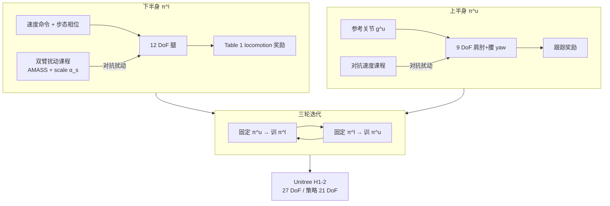
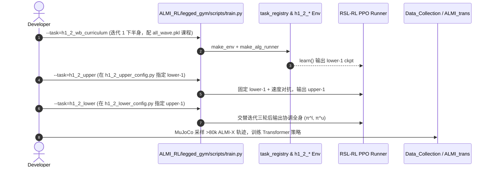

# ALMI：对抗 locomotion 与运动模仿的人形策略学习

**ALMI**（*Adversarial Locomotion and Motion Imitation for Humanoid Policy Learning*，arXiv:2504.14305，NeurIPS 2025）收录于 [AMP 运动先验专题](https://mp.weixin.qq.com/s/YZsm3855iP3TNTTt1aou7w) **第 07/19** 篇（**02 人形走跑**）。策展切入点：**人形上半身与下半身在控制里不是同一种角色**——ALMI 用 **上下半身互相对抗的迭代 RL** 而非单一全身 AMP 判别器笼统约束。

## 一句话定义

**将人形控制分解为下半身 locomotion 策略 π^l 与上半身 motion imitation 策略 π^u，通过固定一方、采样对抗命令/动作的双方迭代优化，在 H1-2 上同时达到稳健走跑与精确上肢跟踪，并发布语言标注 ALMI-X 数据集。**

## 英文缩写速查

| 缩写 | 英文全称 | 简要说明 |
|------|----------|----------|
| ALMI | Adversarial Locomotion and Motion Imitation | 上下半身对抗共训的人形全身框架 |
| RL | Reinforcement Learning | 通过与环境交互最大化长期回报来学习策略的范式 |
| AMASS | Archive of Motion Capture as Surface Shapes | 上半身课程动作来源之一 |
| JPE | Joint Position Error | 上肢跟踪误差指标 |
| PPO | Proximal Policy Optimization | 两策略均用 PPO 训练 |
| HOI | Human–Object Interaction | 全身能力向 loco-manipulation 扩展语境 |

## 为什么重要

- **身体结构感知的「先验」：** 非典型 AMP 论文，但体现专题核心——**下半身**需要速度/平衡 prior，**上半身**需要姿态 mimic prior；硬塞单一判别器易牺牲平衡（策展与 [MoRE #08](./paper-amp-survey-08-more.md) 多判别器路线呼应）。
- **对抗 = 扰动课程：** 学 $\pi^l$ 时上半身按 AMASS 难度扰动；学 $\pi^u$ 时下半身速度命令对抗加大——比手工权重调参更系统。
- **数据资产：** **ALMI-X** >80k 轨迹，语言模板「${movement mode} ${direction} ${velocity level} and ${motion}」；初步 Transformer 全身 foundation model。
- **强基线：** CMU MoCap Hard 存活率 **0.9723** vs Exbody **0.8778**；上肢 JPE **0.2116 m** vs 全身一体 ALMI **0.7022 m**；G1 泛化优于 OmniH2O / Exbody2。

## 流程总览

## 核心机制（归纳）

### 1）分体策略与 DoF

- **π^l：** 12 DoF 腿；速度命令 + 步态相位；丰富 locomotion 奖励（Table 1）。
- **π^u：** 9 DoF 上肢 + 腰 yaw；跟踪 $\bm{g}^u$。
- **平台：** H1-2 共 27 DoF，策略控 21 DoF（腕除外）；Isaac Gym 4096 并行。

### 2）对抗迭代与课程

- **理论：** max-min 交替达 $\epsilon$-近似纳什均衡；实践 **固定一方** 降算力。
- **双臂课程：** 按存活时长排序 AMASS 难度 + motion scale $\alpha_s$ 渐进。
- **速度对抗课程：** 跟踪误差大时加大下半身速度扰动。

### 3）ALMI-X 与基础模型

- MuJoCo 采集 >80k 轨迹；语言标注模板化描述。
- 初步 **Transformer** 全身 foundation model 探索。

## 结论

**ALMI 主张的是结构而非调参：人形上下半身在控制里承担不同角色，与其用单一全身判别器统摄，不如让两个策略互相充当对方的扰动源。**

- 真正起作用的机制是**固定一方、对抗另一方**的迭代：训 $\pi^l$ 时上半身按 AMASS 难度扰动，训 $\pi^u$ 时下半身速度命令加压，等价于自动生成的扰动课程，比手工权重调参更系统。
- 结构分解的收益大到无法用超参解释：全身一体 ALMI 上肢 JPE **0.7022 m** vs 分体 **0.2116 m**；CMU MoCap Hard 存活率 **0.9723** vs Exbody **0.8778**。
- 部署形态别误读：分体只发生在训练期，真机是**协调全身**而非 FSM 切 checkpoint。
- 边界：主实验绑定 H1-2（27 DoF，策略控 21 DoF），G1 有泛化报告但跨形态仍需重训与 retarget。
- 副产物 **ALMI-X**（>80k 轨迹 + 模板化语言标注）与 ALMI-Open 开源，是这篇工作留给下游 Transformer 全身基础模型的实际抵押品。
- 与 [MoRE #08](./paper-amp-survey-08-more.md) 对照：后者是**单策略 + 多判别器 + 深度地形**，ALMI 是**双策略上下半身对抗**，不含多步态 gait command。

## 源码运行时序图

图依据：基于 `TeleHuman/ALMI-Open` `README.md`、`ALMI_RL/README.md` 与 `ALMI_RL/legged_gym/scripts/train.py` 核实（注：官方 TODO 中真机 deployment 代码仍未勾选发布）。

## 工程实践

- **分模块开放范围（`TeleHuman/ALMI-Open`）：** 已开源 `ALMI_RL/` 迭代训练、`Data_Collection/` ALMI-X 采数与 `ALMI_trans/` Transformer 基础模型训练/推理脚本（[HuggingFace ALMI-X](https://huggingface.co/datasets/TeleEmbodied/ALMI-X) / `ALMI-trans` 权重）；**`Release ALMI deployment code` 在官方 README TODO 仍未勾选**。
- **迭代切换配置：** 第一轮下半身用 `h1_2_wb_curriculum` + AMASS 存活率排序文件（`all_wave.pkl` / `mean_episode_length.csv`），随后分别在 `h1_2_upper_config.py` 与 `h1_2_lower_config.py` 手动填入上一轮检查点。
- **算力与环境：** `almi-rl` conda 环境（Python 3.8 + PyTorch 2.3.1 + Isaac Gym + `rsl_rl`），4096 并行环境，三轮迭代总耗时约 **17 h**。

## 常见误区或局限

1. **ALMI = 两个独立真机策略硬切换：** 训练期分体 + 对抗；部署为 **协调全身**，不是 FSM 换 checkpoint（细节见项目页）。
2. **全身 AMP 加权重就行：** 论文显示 **ALMI(whole)** 上肢 JPE **0.7022 m** 远差于分体 **0.2116 m**——结构分解非简单调参。
3. **与 MoRE 重复：** MoRE 是 **单策略 + 多判别器 + 深度地形**；ALMI 是 **双策略 + 上下半身对抗**，无多步态 gait command。
4. **只适用 H1-2：** 主实验 H1-2；G1 泛化有报告，跨形态需重训与 retarget。
5. **原文局限（§7 Conclusion）：** 在强动态全身联动动作（如复杂舞蹈）上表现仍次优；且全量 ALMI-X 离线训练时 Transformer 基础模型性能较单子集退化，数据效率与模型架构仍有提升空间。

## 实验与评测

- **CMU MoCap Hard：** 存活率、上肢 JPE vs Exbody / Exbody2 / OmniH2O / 全身一体 ALMI。
- **G1 迁移（Table 5）：** 存活率 **0.9484**（上肢 JPE **0.2367 m**），显著高于 OmniH2O（`0.3882` / `1.0826 m`）与 ExBody2（`0.8848` / `0.3821 m`）。
- **三轮迭代 ~17 h**（单卡量级，见论文）；Table 6 验证去掉 arm curriculum 或停在 `lower-1` 时 Hard 存活率由 `0.9723` 跌至 `0.8480 / 0.8743`。

## 与其他工作对比

- **对比全身一体策略与单阶段基线：** 在 CMU MoCap Hard 设定下，分体对抗训练的 ALMI 存活率为 **0.9723**、上肢 JPE **0.2116 m**，明显优于 Exbody（`0.8778`）及全身一体训练的 ALMI(whole)（上肢 JPE `0.7022 m`）；在 G1 迁移评测（Table 5）中存活率 `0.9484` / 上肢 JPE `0.2367 m` 亦显著优于 [OmniH2O](./paper-hrl-stack-08-omnih2o.md)（`0.3882` / `1.0826 m`）与 ExBody2（`0.8848` / `0.3821 m`）。
- **对比同专题多判别器与感知步态路线：** [MoRE #08](./paper-amp-survey-08-more.md) 采用「深度base + latent residual MoE + 多判别器 AMP」实现可切换复杂地形步态；[GMP #06](./paper-amp-survey-06-natural-humanoid-robot-locomotion-wi.md) 侧重无对抗的生成式运动流形先验；ALMI 则将上下半身分别作为 locomotion 与 mimic 策略并以双方对抗课程交替优化，重点解决速度追踪与上肢模仿的冲突。

## 关联页面

- 同段姊妹：[GMP #06](./paper-amp-survey-06-natural-humanoid-robot-locomotion-wi.md)、[MoRE #08](./paper-amp-survey-08-more.md)、[Hiking #09](./paper-hiking-in-the-wild.md)
- 任务：[locomotion.md](../tasks/locomotion.md)、[loco-manipulation.md](../tasks/loco-manipulation.md)
- AMP 专题：[humanoid-amp-motion-prior-survey.md](../overview/humanoid-amp-motion-prior-survey.md)（#07/19）

## HMI 开源主表入口

[ALMI-Open](https://github.com/TeleHuman/ALMI-Open) 收录于具身智能研究室 [开源项目主表](https://github.com/RealXiaoze/humanoid-motion-intelligence/blob/main/%E8%AE%BA%E6%96%87%E4%B8%8E%E9%A1%B9%E7%9B%AE/%E5%BC%80%E6%BA%90%E9%A1%B9%E7%9B%AE%E4%B8%BB%E8%A1%A8.md)。

主表代码入口：TeleHuman/ALMI-Open（上下肢分训→联合扰动→蒸馏全身；开放 ALMI-X）。本库以本 ALMI 论文实体页为详情节点，不另建 `almi-open` 实体。

覆盖核对见 [HMI 开源项目主表覆盖索引](../queries/hmi-opensource-projects-coverage.md)。

## 参考来源

- [ALMI（arXiv:2504.14305）](../../sources/papers/almi_adversarial_locomotion_motion_imitation_arxiv_2504_14305.md)
- [humanoid_amp_survey_07_adversarial_locomotion_and_motion_imitation_for.md](../../sources/papers/humanoid_amp_survey_07_adversarial_locomotion_and_motion_imitation_for.md)
- [humanoid_amp_survey_19_catalog.md](../../sources/papers/humanoid_amp_survey_19_catalog.md)
- [wechat_embodied_ai_lab_humanoid_amp_motion_prior_survey.md](../../sources/blogs/wechat_embodied_ai_lab_humanoid_amp_motion_prior_survey.md)
- 原始抓取：[wechat_humanoid_amp_19_survey_2026-05-26.md](../../sources/raw/wechat_humanoid_amp_19_survey_2026-05-26.md)

## 推荐继续阅读

- [ALMI 项目页](https://almi-humanoid.github.io) — 视频与 ALMI-X
- [arXiv:2504.14305](https://arxiv.org/abs/2504.14305) — NeurIPS 2025 正文
- [AMP 专题长文（微信公众号）](https://mp.weixin.qq.com/s/YZsm3855iP3TNTTt1aou7w)
- [MoRE #08](./paper-amp-survey-08-more.md) — 多判别器 + 复杂地形对照
