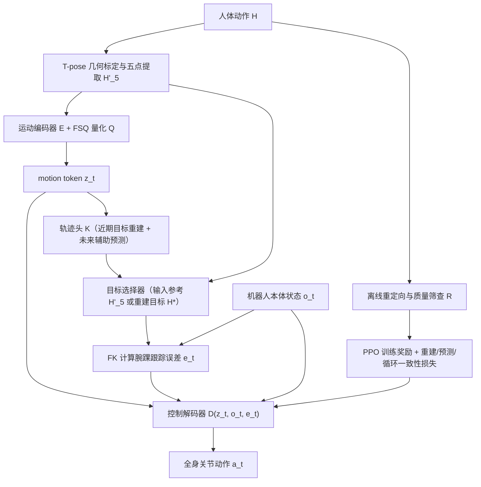

# Anchor 1: Precise and Stable Humanoid Control for Whole-Body Manipulation / 面向全身操作的精确稳定人形控制

**Anchor 1**（*Anchor 1: Precise and Stable Humanoid Control for Whole-Body Manipulation*，[arXiv:2611.00193](https://arxiv.org/abs/2611.00193)，[项目页](https://archon.tech/research/anchor1)）由 **源策未来（Archon Robotics）**（25 名作者）提出，针对全身操作（whole-body manipulation）对末端精度与支撑稳定性的严苛要求，设计了免在线重定向的稀疏五点指令接口、离线分布策展及与运动编码解耦的误差反馈控制器，并配套三轨控制器评测基准。

## 一句话定义

**Anchor 1 通过 T-pose 几何标定把人类动作转为骨盆/双腕/双踝五点稀疏参考（无需在线关节重定向），用离线筛选的配对机器人轨迹引导全身协调，并将显式跟踪误差反馈与运动编码解耦，从而同时支持精确末端控制、遥操作与高层 VLA 的 motion token 接口。**

## 英文缩写速查

| 缩写 | 英文全称 | 简要说明 |
|------|----------|----------|
| PPO | Proximal Policy Optimization | 本文用于仿真训练全身控制解码器的强化学习算法 |
| VLA | Vision-Language-Action | 视觉-语言-动作策略（下游评测微调 GR00T N1.7） |
| IK | Inverse Kinematics | 逆运动学（Reachability 基准构建与传统在线重定向对照） |
| FSQ | Finite Scalar Quantizer | 有限标量量化器，用于把编码器输出离散化为 motion token |
| FK | Forward Kinematics | 正运动学，部署时由关节角反算当前腕/踝位姿以构造误差反馈 |
| MoCap | Motion Capture | 光学/惯性动捕（Chingmu、Nokov、PN-LINK）与真机评测测量系统 |
| SR | Success Rate | 运动级持续成功跟踪率（全窗口不超 10 cm / 25 cm 阈值且不滑步） |

## 为什么重要

- **解决在线重定向的传播失效：** 在线关节空间重定向（如 GMR/UMR）求解失败时会向控制器注入突变或畸变参考；Anchor 1 部署期直接吃标定后的五点人类稀疏参考 $H'_5$（仅需 0.06 s 前瞻），把重定向彻底留在离线训练分布策展阶段。
- **把「误差反馈」从 motion token 中拆出：** 若把瞬时执行误差一起编进 motion token，高层 VLA 很难稳定预测或插值；将显式腕/踝误差 $e_t$ 直接喂给解码器 $D(z_t, o_t, e_t)$（可源自输入参考或重建头 $K$ 的输出），兼顾精度与双接口复用。
- **区分全局误差与局部姿态误差：** 单看局部坐标误差容易掩盖根部漂移导致的任务失败；Anchor 1 提出含 In-house（15,342 条）、Public（2,230 条）、Reachability（3,210 条）的三轨基准，同时用 Global / Local 双口径与步态稳定性检验控制器。

## 核心机制与流程

论文 [arXiv v1](https://arxiv.org/html/2611.00193v1) 以人体与机器人 T-pose 标定分段尺度及坐标偏置得到 $H'$，提取骨盆、双腕、双踝五点位姿 $H'_5$；部署时直接使用稀疏参考，不需要在线关节空间重定向。训练期，每条人类序列配对离线重定向并经自动/人工质量筛查的机器人参考 $R$，构成 406,222 条（1,081.4 小时，含镜像增强；自采 835.7 小时 + 公开 245.7 小时）训练集，以塑造稳定合理的冗余自由度协同。

图依据：论文 §4.1、§4.5（Fig. 10）；图中目标选择器支持稀疏参考模式（`H'_5` 计算 `e_t`）与高层策略直出 motion token 模式（由重建目标 `H*` 计算 `e_t`），未来预测头仅作训练辅助目标，部署时不参与控制。

## 源码运行时序图

**不适用**：截至 2026-11-21 复核，官方项目页的 GitHub 与 Hugging Face 按钮均标注 `Available soon`（模型权重、部署代码、PICO 遥操作与采集工具预计于 2026 年底发布），`ArchonRobotics` 组织尚无公开代码仓；页面列出的 [MimicLite](https://github.com/EGalahad/mimic-lite) 为对比基线而非本文实现。

## 实验与评测

- **三轨仿真基准（MuJoCo，§2.1–2.2）：**
  - In-house（15,342 条、3,247 任务）：Anchor 1 Global 模式 local / global SR 达 **88.4% / 88.7%**；行进间非对称双臂伸展 local SR 为 **91.2%**（ScaleBFM Global 为 57.0%）。
  - Public（2,230 条，来自 BONES-SEED、CIRCLE、OMOMO、AMASS）与 Reachability（3,210 条，覆盖站立、浅蹲、深蹲、交错站立与单膝跪五姿）：Anchor 1 Global 在多数姿态下取得最高任务 SR，且平均滑步 **0.06 次**、额外垫步 **0.53 次**。
- **真机评测（Table 1，均使用 re-locate 模式且无全局根位姿输入）：**
  - Reachability 51 条站立触达：Anchor 1 腕部全局平均位置误差 **44.58 mm**（MimicLite **53.59 mm**、SONIC-G1 **98.15 mm**），仅需 **0.06 s** 前瞻（MimicLite 0.08 s、SONIC-G1 0.90 s）。
  - In-house 72 条：腕部全局位置误差 **75.69 mm**（MimicLite **105.74 mm**），局部腕部位置误差分别为 **29.43 mm** 与 **25.63 mm**（局部指标并非全部最优）。
- **解耦反馈消融与下游任务（§2.4–2.5, Table 4）：**
  - MuJoCo In-house Global 推理下，显式反馈使全局 SR 从 **70.9%** 提至 **88.7%**。
  - 遥操作采数效率：踢箱 **43 条/h**、拾拖鞋 **62 条/h**（SONIC-SMPL 为 9 / 41 条/h）。
  - 下游微调 GR00T N1.7（3 路 RGB + 本体状态 + 语言指令，50 步动作块，20 次试验）：使用重建反馈的 Anchor 1（re-locate + Recon. feedback）在 **motion token 接口**下踢箱 SR **0.90** / Score **0.81**、拾拖鞋 SR **0.45** / Score **0.64**；而仍用编码器参考误差反馈的变体若直接喂入 motion token，两任务 SR 均为 **0.00**。

## 工程实践

- **推理模式与坐标口径分离：** `global` 与 `re-locate` 是两种部署推理模式（前者需外部根定位以对齐初始全局轨迹，后者按上一帧参考根位置平移窗口以消除累积漂移依赖）；评测时的 `global` / `local` 则是两种评分坐标口径，复现与对比时需分别注明。
- **双接口选型建议：** 若上游是遥操作（MoCap/VR 实时五点）或输出 57 维稀疏轨迹的 VLA，可直接走稀疏参考模式获取最高参考精度；若上游 VLA 直接预测紧凑 motion token，必须启用带重建反馈（`Recon. feedback`）的解码器，否则会导致闭环失控（Table 4 SR=0.00）。
- **开源进展跟踪：** 截至 2026-11-21，权重、部署代码及 PICO 遥操作工具预计 2026 年底发布，现阶段无法直接拉仓复现。

## 局限与风险

- **单一本体与无接触力建模（§3.2）：** 原文仅在单一形态人形机器人上验证，未测试跨形态迁移；五点稀疏运动学目标不显式表达物体几何、接触力或抓握稳定性，单靠跟踪精度无法保证复杂接触操作成功。
- **重建误差残留：** 尽管重建反馈打通了 motion token 接口，重建分支自身仍会引入跟踪误差，长程接触切换场景下的精度落差仍有待缩小。
- **数据与代码暂未开放：** 406k 条配对训练分布与控制器权重尚未发布，现阶段不可直接端到端复现。

## 与其他工作对比

- 与 [EgoHumanoid-V2](./paper-egohumanoid-v2.md)：两者均为源策未来参与的人形全身控制/操作工作；EgoHumanoid-V2 侧重以第一视角人类示范结合离线 `H→K→D` 动力学精炼直接迁移 G1 任务 VLA，Anchor 1 侧重构造可被遥操作与 VLA 共用的底层精确稳定五点全身控制器与评估基准。
- 横向索引见 [动作感知量化、失败定位与可验证自主：具身智能小站 11-03 期 49 篇阅读坐标](../overview/embodied-station-2026-11-03-49-papers-technology-map.md)；同 arXiv 不重复造页。

## 结论

**一句话总判：** Anchor 1 通过“T-pose 标定稀疏五点参考 + 离线分布策展 + 与编码器解耦的误差反馈”解决了全身操作中参考突变与 token 耦合两大痛点，但目前代码与权重尚待发布且未验证跨本体与显式力接触。

1. **精度评测必须看全局与持续窗口：** 局部腕部误差小不代表全局不漂移；In-house 真机全局误差 75.69 mm 明显优于基线，而局部误差（29.43 mm）与 MimicLite（25.63 mm）互有胜负。
2. **高层 VLA 若走 motion token 接口，必须配合重建目标反馈：** 实测显示直接用编码器误差的变体在 token 模式下 SR 为 0.00，启用 `Recon. feedback` 后可达踢箱 0.90 SR。
3. **部署免在线重定向 ≠ 训练不需要重定向：** 训练期仍依赖离线重定向与严格质检筛选的配对机器人动作 $R$ 来塑造冗余关节协同先验。
4. **开源时间表待落地：** 关注官方 2026 年底权重、部署及 PICO 遥操作发布，勿将对照基线 MimicLite 误作本文实现。

## 关联页面

- [源策未来（Archon Robotics）](./archon-robotics.md) — 论文署名机构与产品路线
- [Archon 全身智能（WBI）](./archon-whole-body-intelligence.md) — 公司的 S2/S1/S0.5/S0 分层愿景（Anchor 1 对应高精度 S0/S0.5 执行接口）
- [EgoHumanoid-V2](./paper-egohumanoid-v2.md) — 人类示范向人形全身操作迁移的互补路线
- [Imitation Learning (IL, 模仿学习)](../methods/imitation-learning.md) — 离线重定向与质量筛查为控制学习提供监督
- [locomotion](../tasks/locomotion.md) · [motion-retargeting](../concepts/motion-retargeting.md) · [dexterous-kinematics](../concepts/dexterous-kinematics.md)
- [动作感知量化、失败定位与可验证自主：具身智能小站 11-03 期 49 篇阅读坐标](../overview/embodied-station-2026-11-03-49-papers-technology-map.md)

## 参考来源

- [anchor_1_arxiv_2611_00193.md](../../sources/papers/anchor_1_arxiv_2611_00193.md) — arXiv:2611.00193v1 全文通读归档
- [官方项目页归档](../../sources/sites/anchor-1.md) — 项目页核查与开源状态
- [wechat_embodied_station_49_papers_sacq_action_aware_quantization_2026-11-03.md](../../sources/blogs/wechat_embodied_station_49_papers_sacq_action_aware_quantization_2026-11-03.md) — 最初线索来源

## 推荐继续阅读

- [arXiv 全文 HTML](https://arxiv.org/html/2611.00193v1)
- [arXiv PDF](https://arxiv.org/pdf/2611.00193)
- [官方项目页](https://archon.tech/research/anchor1)
