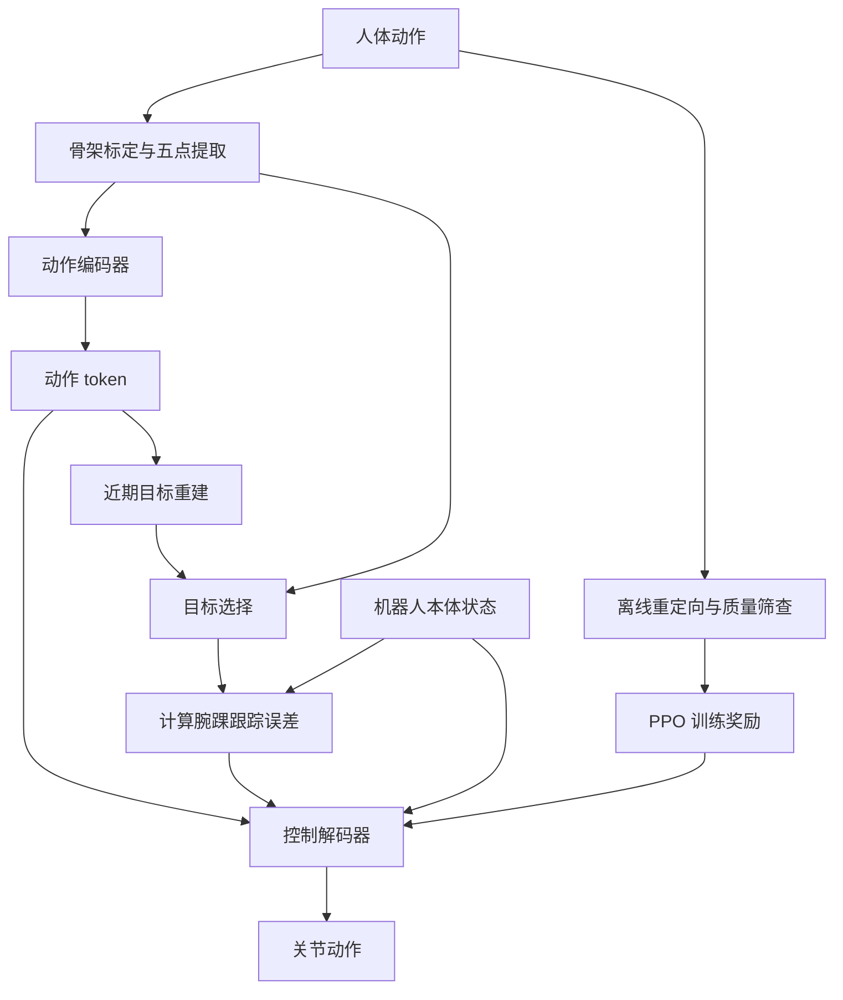

# Anchor 1: Precise and Stable Humanoid Control for Whole-Body Manipulation / 面向全身操作的精确稳定人形控制

**Anchor 1**（*Anchor 1: Precise and Stable Humanoid Control for Whole-Body Manipulation*，[arXiv:2611.00193](https://arxiv.org/abs/2611.00193)，[项目页](https://archon.tech/research/anchor1)）来自 [具身智能小站 2026-11-03 盘点](../../sources/blogs/wechat_embodied_station_49_papers_sacq_action_aware_quantization_2026-11-03.md)，属「人形与灵巧控制」组。

## 一句话定义

**Anchor 1 使用校准后的稀疏动作参考与独立误差反馈，保留全身协调的自由度；评测同时考虑精度、持续稳定和可达性，避免只看动作相似度。**

## 英文缩写速查

| 缩写 | 英文全称 | 简要说明 |
|------|----------|----------|
| PPO | Proximal Policy Optimization | 策略优化算法 |
| VLA | Vision-Language-Action | 视觉语言动作策略 |
| IK | Inverse Kinematics | 逆运动学 |

## 为什么重要

- 全身操作需要精度和稳定性。
- 开源结论：截至 2026-11-06，权重与部署代码尚待发布。
- 同期同组工作见 [动作感知量化、失败定位与可验证自主：具身智能小站 11-03 期 49 篇阅读坐标](../overview/embodied-station-2026-11-03-49-papers-technology-map.md)。

## 核心机制与流程

论文 [arXiv v1](https://arxiv.org/html/2611.00193v1) 以人体与机器人 T 姿态标定尺度及坐标，提取骨盆、双腕、双踝五个位姿；部署时直接使用稀疏参考，不需要在线关节空间重定向。训练时，配对的离线重定向机器人动作经质量筛查后用于奖励监督：不能把部署时免在线重定向误解为训练完全不需要重定向。

图中目标选择使用输入参考或 token 重建结果；未来动作预测仅作为训练辅助目标。训练数据经镜像增强后共 406,222 条、1,081.4 小时。控制器采用 PPO，并辅以近期重建、未来预测和循环一致性损失。高层策略可输出稀疏参考或动作 token；后者通过重建目标产生反馈。

## 源码运行时序图

**不适用**：截至 2026-11-06 官方项目页的 GitHub 和 Hugging Face 按钮不可用，权重与部署代码预计于 2026 年底发布；未发现可核验的 Anchor 1 运行入口。[MimicLite](https://github.com/EGalahad/mimic-lite) 是对比基线，不作为本文实现。

## 实验与评测

- 三条基准：In-house 15,342 条动作、3,247 个任务；Public 2,230 条；Reachability 3,210 条，覆盖站立、浅蹲、深蹲、交错站立及单膝跪姿。
- 真机 Reachability 子集为 51 条站立触达：Anchor 1 腕部全局平均位置误差 44.58 mm，MimicLite 为 53.59 mm；两者前瞻分别为 0.06 s 和 0.08 s。In-house 真机子集为 72 条，腕部全局误差分别为 75.69 mm 和 105.74 mm；但局部腕部误差分别为 29.43 mm 和 25.63 mm，不能说所有指标均最优。
- MuJoCo In-house 消融中，Global 推理且使用原始参考反馈时，解码器显式反馈的全局成功率为 88.7%，无显式反馈为 70.9%。重建参考会降低跟踪精度；re-locate 无需全局定位，但无法显式修正原始全局轨迹的累积漂移。
- 遥操作采集踢箱 / 拾拖鞋分别为 43 / 62 条成功示范每小时，SONIC-SMPL 为 9 / 41；这些结果限于论文所测任务与设置。评测成功率要求整个动作窗口满足阈值，不能与平均位置误差混同。

## 局限与工程实践

- 原文评测仅覆盖一种机器人形态；稀疏运动目标没有显式描述物体几何、接触力或抓取稳定性，目标重建也会引入误差；仿真与真机结果不应直接外推到新硬件和任务。
- Global 与 re-locate 是推理模式；global / local 又是独立的评测坐标口径，比较结果时应分别注明。
- 权重和部署代码尚待发布；项目页列出模型、部署、PICO 遥操作及采集工具预计于 2026 年底发布，具体时间以官方为准。

## 与其他工作对比

- 横向索引见 [动作感知量化、失败定位与可验证自主：具身智能小站 11-03 期 49 篇阅读坐标](../overview/embodied-station-2026-11-03-49-papers-technology-map.md)；同 arXiv 不重复造页。

## 结论

**全身操作需要精度和稳定性：Anchor 1 使用校准后的稀疏动作参考与独立误差反馈，保留全身协调的自由度；评测同时考虑精度、持续稳定和可达性，避免只看动作相似度。**

1. 开源边界：权重与部署代码预计 2026 年底发布；MimicLite 是对比基线。
2. 核心机制：Anchor 1 使用校准后的稀疏动作参考与独立误差反馈，保留全身协调的自由度；评测同时考虑精度、持续稳定和可达性，避免只看动作相似度。
3. 复现与选型前核对任务协议、硬件与基准口径，勿直接横比公众号摘录数字。

## 关联页面

- [locomotion](../tasks/locomotion.md)
- [motion-retargeting](../concepts/motion-retargeting.md)
- [dexterous-kinematics](../concepts/dexterous-kinematics.md)
- [embodied-station-2026-11-03-49-papers-technology-map](../overview/embodied-station-2026-11-03-49-papers-technology-map.md)

## 参考来源

- [anchor_1_arxiv_2611_00193.md](../../sources/papers/anchor_1_arxiv_2611_00193.md)
- [wechat_embodied_station_49_papers_sacq_action_aware_quantization_2026-11-03.md](../../sources/blogs/wechat_embodied_station_49_papers_sacq_action_aware_quantization_2026-11-03.md)
- [官方项目页归档](../../sources/sites/anchor-1.md)
- [arXiv:2611.00193](https://arxiv.org/abs/2611.00193)

## 推荐继续阅读

- [arXiv PDF](https://arxiv.org/pdf/2611.00193)
- [项目页](https://archon.tech/research/anchor1)
