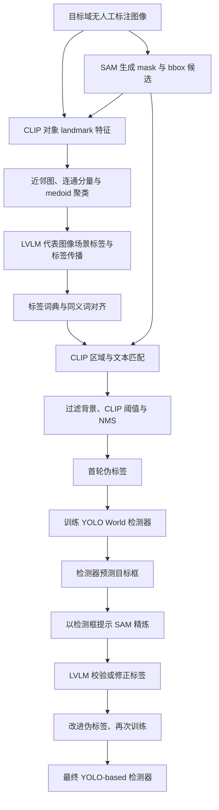

# 通过基础模型协作实现免人工标注的目标检测 / Annotator-Free Object Detection via Foundation Model Collaboration

## 一句话定义

**Annotator-Free Object Detection（arXiv:2611.06195v1）**通过 **SAM 无类别候选框、CLIP 区域-文本匹配、LVLM 语义识别与 YOLO World 自精炼**，从没有人工目标框/类别标注的目标图像中建立检测器；免标注指的是**目标数据集**，不是所有基础模型的预训练。

## 英文缩写速查

| 缩写 | 英文全称 | 简要说明 |
|------|----------|----------|
| SAM | Segment Anything Model | 在图像中生成类别无关 mask 和框候选 |
| CLIP | Contrastive Language–Image Pre-training | 区域视觉特征与文本标签相似度对齐 |
| LVLM | Large Vision-Language Model | 生成场景标签、检查候选语义、归一化同义词 |
| OVD | Open-Vocabulary Detection | 检测训练词表之外的类别 |
| OWD | Open-World Detection | 发现新类并逐步扩展已有类别集合 |
| NMS | Non-Maximum Suppression | 按得分/重叠去除冗余候选框 |
| AP | Average Precision | 检测精度；需注明 IoU 区间与类别匹配协议 |

## 核心信息

| 字段 | 原文核验 |
|------|----------|
| 论文 | [arXiv:2611.06195v1](https://arxiv.org/abs/2611.06195v1)，2026-11-04，预印本 |
| 作者 | Yasiru Ranasinghe、Vishal M. Patel |
| 机构 | 约翰斯·霍普金斯大学（Johns Hopkins University） |
| 主要模块 | SAM、CLIP、GPT-4o、CogVLM、YOLO World |
| 评价 | COCO、LVIS、ODinW-35、Roboflow-100；COCO OVD split；合成域迁移 |
| 官方代码 | 截至 2026-11-23，论文未提供本文管线的独立可运行官方仓库链接；不可将所依赖的基础模型代码误认作作者实现 |

## 为什么重要

机器人进入陌生工业/仓储场景时，新物体类别的检测框人工标注成本较高。本文把 [目标检测](../methods/object-detection.md) 所需的「位置+类别」训练标签拆成**几何候选、语义词表、区域分类**三个子问题，用预训练模型的互补能力自动生成伪标注，再用轻量检测器学习。其价值首先是**离线数据构建**，不能等同已经解决真机零样本感知或在线自主标注。

## 流程总览

依据论文 Fig.3、§2 与 Algorithm 1；虚线概念在此以明确的回路表示，**不是源码执行调用图**。

## 核心原理

### 1. 拆解标注：位置与语义分离（§2.2–2.3）

- **SAM → bbox**：无类别分割提供几何候选，但可能产生背景和细碎部件。
- **LVLM → 类别词表**：GPT-4o 给 scene-level 标签；CogVLM 用于 object-level 标签及词典的同义词重对齐。词典以空集合起步，在一轮数据没有新增类别后冻结。
- **CLIP → 伪标签**：对被 mask 裁切的区域图像与词表文本做归一化向量相似度匹配，把 bbox 指派到类别/背景；论文补充指定 CLIP 阈值 **0.5**、NMS IoU **0.6**，不是通用推荐阈值。

### 2. Landmark 聚类减少昂贵标注（§2.1）

每张图最多取 **32** 个大有效 mask，CLIP 得到 **768 维**对象 landmark；先对每张图平均特征取 **75** 个近邻候选，再以对称 Chamfer 余弦距离构建相互近邻稀疏图。连通分量定义图像簇，选择簇的代表图像（medoid）请求 LVLM，标签向整簇传播，避免逐 proposal 发送多模态查询。

### 3. 训练、重提示与自精炼（§2.4–2.5）

首轮伪标签训练 YOLO World，检测器的 bbox 再作为 SAM 的提示以压缩/细化提议；LVLM 对少量候选重分类，训练第二轮检测器。已有词典中的低置信度检测可触发新类分支。最终部署是 YOLO-based 检测器，昂贵基础模型主要承担**离线**数据准备。

## 实验与评测

论文 Table 1–2：**AP@[0.50:0.95]，严格按 benchmark 类别名匹配**，下述数值均为论文报告，未独立复现。

| 验证集 | 本文 YOLO | 比较模型（同表） |
|-------|----------:|----------------|
| COCO val2017 | **60.8 AP** | T-Rex2 Text 52.2；GDINO-L 48.4 |
| LVIS minival | **47.4 AP** | T-Rex2 Text 45.8；DetCLIPv3 Swin-L **48.8** |
| ODinW-35 val | **32.5 AP** | T-Rex2 Visual 27.8；GDINO-L 22.3 |
| Roboflow-100 val | **23.7 AP** | T-Rex2 Visual 18.5；GDINO-L 8.3 |

- **模型替换**：用 Swin-T 得到 COCO / LVIS **57.2 / 46.2 AP**，ODinW / Roboflow **30.1 / 20.8 AP**；主要结果不是只能绑定某个 YOLO 结构。
- **COCO OVD（Table 3）**：48 base + 17 novel，YOLO 的 Novel / Known / All = **55.9 / 64.6 / 59.1 AP50**。*重要口径*：Table 3 基础类检测器使用了 **ground-truth 基础类标注**来对齐比较；论文另报告完全不采用基础类真值训练的版本，Base **48.9 AP50**、Novel **55.9 AP50**。不能将 Table 3 当成完全无人标注的直接证据。
- **域迁移（补充 Table 4）**：Applied Intuition 模拟数据 Novel / Known / Overall = **43.7 / 32.8 / 38.8 AP50**；该合成场景并非机器人真机部署。
- **耗时（§3.4 与附录）**：原文称 CLIP 预过滤削减高成本标注约 **60×**，landmark 聚类使完整图像标注约从 **15–20 分钟降至 45 秒/图**；附录另提单次 LVLM 平均 **1–2 秒/图**（离线调用），计时对象不同，不可拿 1–2 秒当完整训练或在线推理时延。

## 结论

**这是一条以基础模型协作替代目标域人工框标注、训练轻量检测器的离线工程路线，而不是证明整个视觉系统零监督或整条标注链实时运行。**

1. 先拆开「候选位置」和「语义类别」，比让单个 LVLM 对每个 mask 逐个判断更便于控制成本。
2. 用 CLIP 过滤背景、NMS 去重，降低噪声进入下一轮的机会；仍需定量检查遮挡和细部伪标签质量。
3. 对目标域图像做 landmark 聚类，再查询代表图像，能摊销 LVLM 的离线查询；应额外记录错误标签的簇内传播。
4. 比较检测性能必须固定 AP 指标、类名匹配及基础类监督条件；LVIS 的 **48.8 AP** 对照也高于本文的 **47.4 AP**，不能宣称在所有对照上都领先。
5. 部署端可以继续沿用成熟 YOLO 检测接口，但**代码未公开且缺真机验证**，复现与部署需自行实现并做延迟/内存/误检测试。

## 源码运行时序图

**不适用（截至 2026-11-23）**：论文公开了 Fig.3 和 Algorithm 1，却没有给出本文流程的官方可运行源码、CLI 或数据/模型下载入口。上方 Mermaid 是**论文方法流程图**，不能伪装成已阅读源码的运行时序。

## 工程实践

- **数据构建**：用目标域无标注图像生成 SAM mask；限制候选数，用 CLIP + background 标签过滤，再融合 LVLM 的词典/类别校验。每轮记录伪标签数量、类别占比及对象框质量。
- **成本测量**：分开记录 SAM 生成、CLIP 匹配、聚类、LVLM 请求、YOLO 训练及最终检测推理；离线节约成本不等于在线毫秒级加速。
- **评估**：使用来自独立人工标注验证集的 AP@[.50:.95] 和 AP50，分类同义词映射协议单独标注；目标域训练仍不得偷用验证集真值。
- **机器人迁移推断（非原文实验）**：可尝试针对新场景离线生成检测训练集，最终部署轻量检测器；需另做机载 FPS、漏检/误检、动态遮挡与域差验证。

## 局限与风险

- 「免标注」仅针对目标数据集；SAM、CLIP、LVLM 和 YOLO World 都依赖预训练基础能力。
- SAM 在低对比、拥挤、相互遮挡和细部结构上可错分；LVLM 的错标可能扩大为伪标签系统性误差。
- 模型词典冻结降低同义词漂移，却不能消除类别本身的歧义与 prompt 敏感性。
- Landmark medoid 的类别传播假设簇内语义足够一致，论文未充分量化聚类阈值与错误传播之间的权衡。
- 论文包含基础类真值监督的 OVD 比较实验（Table 3）；跨实验表格的 AP 与 AP50 不可直接混用。
- 未提供本文管线的官方可运行源码；作者报告的合成域迁移效果不等于真机可靠性、安全性或部署时延保证。

## 关联页面

- [机器人视觉感知栈选型闭环](../queries/robot-perception-stack-selection-loop.md) — 本文对应离线 2D 检测数据构建，部署仍需标定、空间提升及下游策略验证

- [目标检测](../methods/object-detection.md) — 定位+分类的视觉感知方法，本论文聚焦降低目标域人工标注需求
- [目标检测评价指标](../concepts/object-detection-metrics.md) — 对齐 AP50、AP@[.50:.95]、IoU 与类别名口径
- [COCO 数据集](./dataset-coco.md) — 核对 val2017 与 COCO OVD 类别划分
- [YOLO v1](./paper-yolo-unified-realtime-detection.md) — 区分实时检测器与离线基础模型协作标注
- [视觉表征作为策略输入](../concepts/visual-representation-for-policy.md) — 机器人物体级语义/几何特征如何供下游策略使用

## 参考来源

- [arXiv v1 原文核对归档](../../sources/papers/annotator_free_object_detection_arxiv_2611_06195.md)
- [论文 HTML 全文 v1](https://arxiv.org/html/2611.06195v1)

## 推荐继续阅读

- [原论文 PDF](https://arxiv.org/pdf/2611.06195)
- [原论文 HTML（含补充实验）](https://arxiv.org/html/2611.06195v1)
