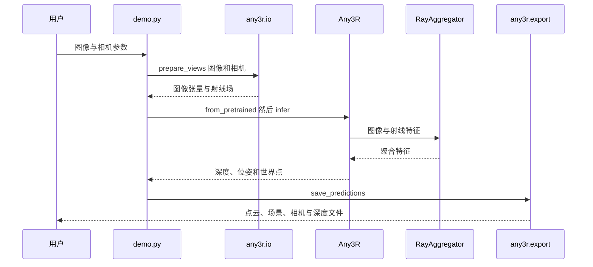

# Any3R: Feedforward 3D Reconstruction from Any Camera Type｜任意相机类型的前馈三维重建

## 一句话定义

Any3R 使用每视角的图像和标定射线场，一次前向预测相机位姿及稠密三维结构，支持混合中心相机。

## 英文缩写速查

| 缩写 | 英文全称 | 简要说明 |
|---|---|---|
| RoPE | Rotary Position Embedding | 旋转位置编码；本文改为按射线角度而非像素索引旋转 |
| ERP | Equirectangular Projection | 等距柱状全景投影；本文中 360° 全景的图像格式 |
| FOV | Field of View | 视场角；决定一个镜头能覆盖多大范围 |
| AUC | Area Under the Curve | 位姿误差曲线下面积，本文取 15° 与 30° 阈值 |
| ICP | Iterative Closest Point | 迭代最近点配准；评测中在相似变换之后细化点云对齐 |
| VGGT | Visual Geometry Grounded Transformer | 前馈几何基础模型，本文骨干的基础结构 |
| KB4 | Kannala–Brandt（四阶多项式） | 鱼眼畸变模型，本文实验中的 200° 镜头 |
| MEI | Mei 统一相机模型 | 反射折射类中心相机模型，本文实验中的 200° 镜头 |
| DS | Double Sphere | 双球面相机模型，本文实验中的 200° 镜头 |

## 核心信息

| 项目 | 内容 |
|---|---|
| 作者 | Jingong Chen、Qingwen Zhang†、Youming Deng†、Chulwoo Pack、Olaf Wysocki、Boris Jutzi、Kwanghee Won*、Kyle Gao |
| 机构 | 南达科他州立大学、阿尔托大学、瑞典皇家理工学院、康奈尔大学、剑桥大学、卡尔斯鲁厄理工学院 |
| 版本 | [arXiv:2610.36150v1](https://arxiv.org/abs/2610.36150v1)，2026-10-26 |
| 输入 | 多视角 RGB 及每像素单位射线；可混合针孔、鱼眼和全景 |
| 输出 | 每像素径向距离、置信度（官方 README 的 `depth_conf`）、相机到世界位姿、局部及世界点云；尺度不确定 |
| 开放状态 | 项目页列出 [GitHub 仓库](https://github.com/Jingong-Chen/Any3R)与 [Hugging Face 权重](https://huggingface.co/Jingong/Any3R)，均已公开。仓库代码为 MIT 许可，但 VGGT-Omega 派生的骨干（`any3r/_vggt_omega/`、`any3r/aggregator.py`）与权重同为 **FAIR 非商业研究许可**，运行模型即需接受该许可。训练代码（未核实）。 |

## 为什么重要

- 几何基础模型（VGGT、π3、Depth Anything 3 等）能从一组图像一次前向得到位姿与稠密几何，但它们默认输入为针孔图像。
- 广角与全景镜头在自动驾驶、室内扫描中已很常见，众包和档案影像的相机类型更杂。要覆盖整个房间或街道，宽视场镜头能减少视角数量。
- 已有适配方法多只支持固定的镜头列表（如按相机类型的离散 token、适配器、立方体贴图、全景专用训练），遇到新镜头需重训或新增转换步骤；把针孔、鱼眼、全景混在同一次重建中更难。
- 论文指出根因在骨干内部：旋转位置编码按像素索引定位图像块，逐像素训练损失等权，二者都隐含针孔假设。Any3R 把这两处改为依赖每像素的射线场，因此无需按镜头重训。

## 核心原理

**输入。** 每个视角 $s$ 给出图像 $I_s$ 和标定 $C_s$。论文把相机抽象为射线场 $R:\mathcal D\to S^2$，即每个像素 $u$ 对应的单位射线方向 $R_u$，并用掩码 $M_u$ 标记有效像素。网络不接收镜头类型或畸变系数，只接收射线场。

**角坐标旋转位置编码。** 不再用图像块的行列索引，而是用块内平均射线的方位角 $\phi_{ij}$ 与仰角 $\theta_{ij}$ 作为坐标，对查询和键做旋转，频率为 $\omega_k = 2\pi\cdot 100^{-k/16}$，$k=0,\dots,15$。同一角度在任何镜头上对应相同的位置单位，因此不同相机的视角可在同一批次中混合。论文还在每个注意力块前，给每个图像块加上 $\alpha\,g(f_{ij})$，其中 $f_{ij}=[-\sin\theta,\cos\theta,\sin\phi,\cos\phi]$，$g$ 为 MLP，$\alpha$ 为可学习标量。

**输出与点的表示。** 密集头每像素只预测一个径向距离 $d_u$，点为 $X_u = d_u R_u$（论文式 2）。相机位姿 $T_s\in SE(3)$ 由位姿头预测。

**立体角加权损失。** 骨干原有点损失对每个像素等权（并带尺度 $\lambda$ 对齐）。Any3R 将其权重改为像素所覆盖的立体角 $d\Omega_u=\|\partial_u R\times\partial_v R\|$，归一化为 $\tilde w_u = w_u\,d\Omega_u/\langle d\Omega\rangle_M$，使广角镜头的每个像素按其覆盖的球面面积计入损失。论文指出，只有在窄针孔极限下该立体角权重才与原损失一致；在 90° 针孔的方形画面中，角落像素与中心像素的立体角之比约为 5.2（即 $1/\cos^3\psi_{max}$）。

**训练。** 训练集包括 Matterport3D、Stanford2D3DS、Structured3D、PanoCity 与 DL3DV 视频，保留测试场景。一半样本为原生全景，另一半由全景按随机采样的相机重采样得到，相机取自 8 种中心模型（针孔、Brown–Conrady、等距、KB4、MEI、双球面、ERP 及裁剪 ERP），视场角在 30° 到 360° 之间，视角数从 $\{2,\dots,8\}$ 抽取。训练 40 个 epoch，使用 32 张 GH200 GPU，约 27 小时。

## 方法与评测

- 每个图像块的平均射线转换为方位角与俯仰角，用于帧内旋转位置编码；绝对位置嵌入同样使用射线角度。训练时，按射线场局部导数计算的立体角对点损失加权。
- 论文的多镜头基准将同一批全景与视角渲染成 13 种中心相机，其中 8 种用于训练、5 种留作未见模型（FOV/ATAN 150°、stereographic 180°、equisolid 与 EUCM 200°、cylindrical 360°）。评测时各方法用自身预测位姿融合每个场景的点云（每场景采样 40,000 个像素），由 PanoVGGT 的评测函数拟合一次相似变换，再做点对点 ICP 细化（室内最大对应距离 0.1 m，PanoCity 为 1.0 m）。
- 在真实鱼眼的零样本实验中，论文报告 FIORD 上优于所比较方法，ScanNet++ 上次于 Wid3R；这些结论只适用于论文评测设置。

## 结论

Any3R 的主要价值是用统一射线表示处理混合镜头，但效果依赖可靠的相机射线场。

1. **先校准镜头，为每张图生成与图像一致的射线。** 不提供射线时，代码与论文都回退为等距柱状网格，90° 针孔图会被当作整个球面来读，画面大部分几何出错。
2. **射线图必须准确。** 论文用小型 CNN 从图像预测射线图，结果比回退方案更准，但只在部分数据上缩小差距，且在其他数据上更差，因此骨干需要准确的射线图而非近似值。
3. **输出尺度不确定，机器人度量建图需要额外尺度信息。** 论文的损失中带有逐样本尺度 $\lambda$，官方 README 也说明重建尺度是任意的。
4. **资源以官方 README 为准。** 权重约 1.15B 参数、4.6 GB；README 报告在 RTX 5090 上 32 个 512×512 视角约 1.1 秒，128 个视角约 9 秒、峰值显存 17.7 GB。其他设备需实测。
5. **项目页的交互点云经过低置信度与多视角一致性筛选，** 不等同于模型的全部原始预测。

## 源码运行时序图

入口还支持 JSON、COLMAP 相机及镜头类型加视场角。时序图依据官方 `demo.py`、`any3r/io.py`、`any3r/model.py`、`any3r/aggregator.py` 与 `any3r/export.py` 的调用关系核对；本页未运行模型。

## 与其他工作对比

| 方法 | 相机信息如何进入模型 | 论文 8 种训练相机中可接受的 | 室内 Acc↓ (m)：针孔 90° / KB4 200° / ERP 360° |
|---|---|---|---|
| **Any3R（本页）** | 每像素射线场 → 射线角度 RoPE + 立体角加权损失 | 全部 8 种，可在一次前向中混合 | 0.076 / 0.056 / 0.054 |
| [Wid3R](./paper-wid3r.md)（给真实射线场） | 按其支持的相机类别建模 | 4 种（不含 B–C、ERP-C、KB4、DS） | 0.144 / – / 0.101 |
| MapAnything（MapA-ray，给真实射线图） | 射线图加在针孔编码器按像素网格读完图像之后的特征上 | 8 种 | 0.092 / 0.274 / 0.405 |
| PanoVGGT | 面向全景，非全景帧也按全景读 | 8 种 | 0.282 / 0.251 / 0.072 |
| [VGGT](./paper-vggt-visual-geometry-grounded-transformer.md)（仅图像） | 按像素索引定位图像块，默认针孔 | 8 种（均按针孔读） | 0.270 / 0.356 / 0.398 |

数值取自论文表 1、表 3 的室内（Matterport3D 与 Stanford2D3DS 平均）列，各方法均用自身预测位姿融合。

- **与针孔几何基础模型：** 论文报告 Any3R 在 8 种训练相机、室内外均比 π3、MapAnything、DA3、VGGT、VGGT-Ω 更准、位姿更好，唯一例外是室内针孔的 AUC@15°（π3 为 76.9%，Any3R 为 74.8%）；这些模型在 360° 上 AUC@30° 不到五分之一。论文把原因归于它们只能按像素索引推断方向。
- **与面向特定镜头的方法：** Wid3R、PanoVGGT、Argus 各覆盖一部分镜头，Any3R 用同一套权重填满表 1 所有列。但在真实鱼眼零样本表 2 中，ScanNet++ 上 Wid3R（在 ScanNet++ 上训练过）Acc 为 0.039 m，优于 Any3R 的 0.055 m；FIORD 上 Any3R 为 0.274 m，为所比较方法中最低。
- **增益来自射线图：** 去掉射线图的 Any3R∗ 按等距柱状网格读所有帧，除 ERP 外误差大幅上升（室内 KB4 为 0.279 m），因此实际使用依赖准确标定。

## 工程实践

| 环节 | 做法 | 依据 |
|---|---|---|
| 环境与权重 | `Any3R.from_pretrained("Jingong/Any3R")`，推荐 GPU bfloat16；也支持 float16 与 CPU，权重首次运行时自动下载（4.6 GB） | 官方 README |
| 镜头描述 | 用 `cameras.from_fov`（已知镜头类型与视场角）、`cameras.from_colmap`、`cameras.ERP()` 或 JSON 标定生成射线图；标定不足时可先按标称镜头类型与视场角估计 | 官方 README、`docs/cameras.md` |
| 输入准备 | `prepare_views(images, cams, size=512)` 生成图像张量与射线图；`model.infer(views.images, views.rays)` 推理 | 官方 README、`demo.py` |
| 输出 | `depth`（沿射线的距离）、`depth_conf`、`camera_poses`（相机到世界，以首视角为参考）、`world_points`（尺度任意）；`save_predictions` 写出 PLY、GLB、位姿 JSON 与深度图 | 官方 README、`any3r/export.py` |
| 命令行与交互 | `python demo.py --images ... --cameras ... --out ...`；`--camera equidistant --fov 190`；`python demo_gradio.py` 提供浏览器界面；`demo.py` 支持置信度百分位过滤（`--conf`） | `demo.py`、官方 README |
| 调试指标 | 首先核对射线图是否与镜头一致，因为错误标定会直接扭曲几何；对比 Any3R∗（去掉射线图）的差异可判断射线图是否起作用；用 `depth_conf` 过滤低置信度点 | 论文 4.4 节与附录，官方 README |
| 机器人应用 | 适合把异构相机（鱼眼、全景、针孔）的离线批量图像合并为同一场景；度量尺度需外部信息（如已知尺寸、里程计或深度传感器）；假设场景静止 | 官方 README 局限说明；尺度需求为本页推断 |
| 开源状态（步骤 2.5） | 项目页列出 GitHub 与 Hugging Face，均可公开获取，属于 **已开源**（推理与评测脚本，许可见「核心信息」）；训练代码（未核实） | 项目页、官方 README、Hugging Face 模型卡 |

## 局限与风险

- **仅适用于中心相机。** 每个像素的射线必须经过同一点。滚动快门、线扫描相机、强非中心反射折射系统不在模型覆盖范围内，不能把标题中的 "any" 理解为任意相机（官方 README 同样说明）。
- **依赖标定。** Any3R 使用给定的射线场，不估计内参。标定错误或镜头类型不符会直接改变几何；论文的回退方案会把针孔图当作全景。
- **尺度不确定，场景假设静止。** 重建尺度任意；动态物体不在建模范围内。
- **学习得到的射线图不能替代准确标定。** 论文中小型 CNN 预测的射线图仍不如真实射线图稳定。
- **精度权衡。** 论文报告，按视角评估的姿态增益以深度精度为代价：Matterport3D 的 log10 深度误差由 0.033 升至 0.045。
- **零样本证据有限。** 真实鱼眼只在 ScanNet++ 与 FIORD 两个数据集上测试，且 ScanNet++ 的 Acc 不如 Wid3R；不能据此推断其他真实镜头上的表现。
- **非商业许可。** 权重与 VGGT-Omega 派生的骨干为 FAIR 非商业研究许可，商业用途需另行确认。
- **评测协议相关。** 各方法用自身预测位姿融合并经相似变换与 ICP 对齐，结论依赖该协议；论文表格中部分基线获得了真实射线场（如 Wid3R、MapA-ray），与其余方法的输入条件并不完全相同。

## 关联页面

- [VGGT 几何基础模型](paper-vggt-visual-geometry-grounded-transformer.md)
- [状态估计](../concepts/state-estimation.md)

## 推荐继续阅读

- [Any3R 项目页](https://jingong-chen.github.io/Any3R/)：交互点云与官方概述。
- [Any3R 官方仓库](https://github.com/Jingong-Chen/Any3R)：demo、评测脚本与许可说明。
- [Any3R 权重（Hugging Face）](https://huggingface.co/Jingong/Any3R)：模型卡列出参数量、许可与推理说明。
- [PanoVGGT, arXiv:2603.17571](https://arxiv.org/abs/2603.17571)：本文评测协议所依据的全景几何重建工作。
- [Fisheye3R, arXiv:2603.28896](https://arxiv.org/abs/2603.28896)：同样面向鱼眼镜头适配几何基础模型的工作。

## 参考来源

- [论文归档](../../sources/papers/any3r_arxiv_2610_36150.md)
- [项目页归档](../../sources/sites/any3r.md)
- [源码归档](../../sources/repos/any3r.md)
- [论文全文 v1](https://arxiv.org/html/2610.36150v1)

核对范围：2026-11-06 通读论文正文（方法、实验、结论）与附录 A（评测细节）、F（射线图消融）、G（相机模型）的正文；附录 B–E 的逐格表格仅抽查了与正文引用的数值。项目页、官方 README 与 Hugging Face 模型卡在同日核对。
