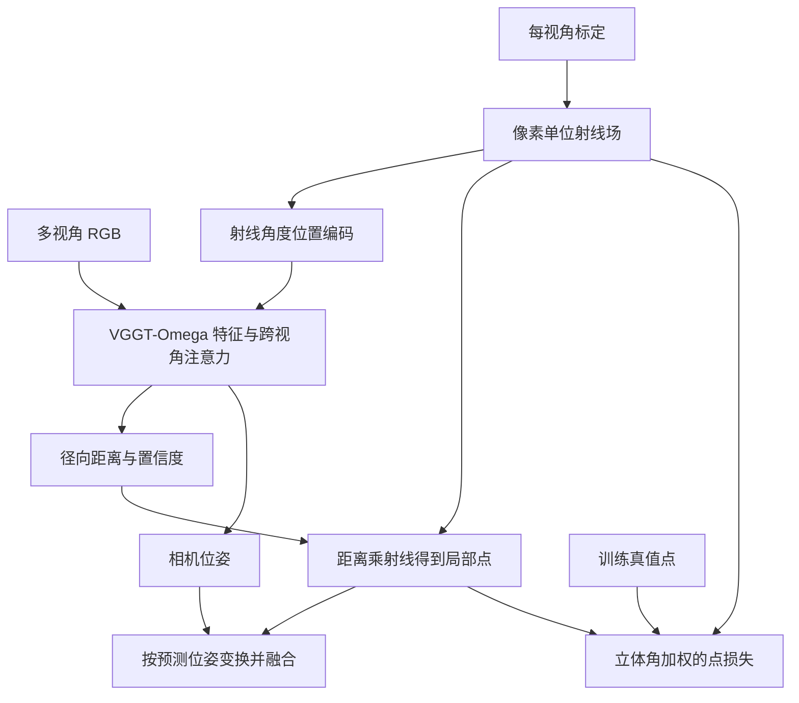
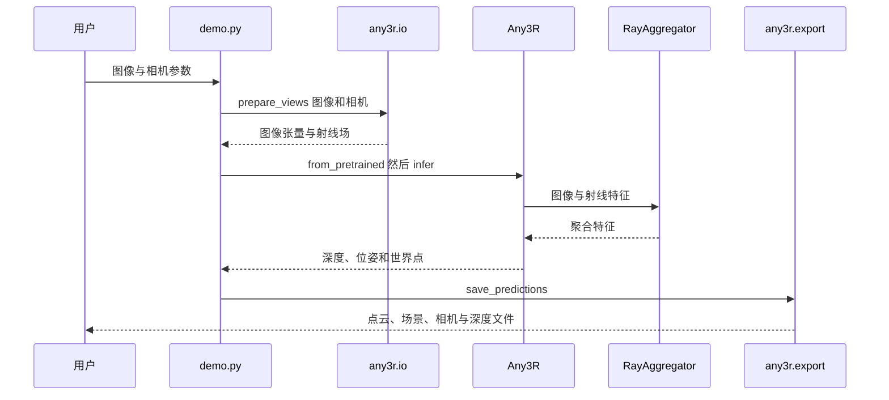

# Any3R: Feedforward 3D Reconstruction from Any Camera Type｜任意相机类型的前馈三维重建

## 一句话定义

Any3R 使用每视角的图像和标定射线场，一次前向预测相机位姿及稠密三维结构，支持混合中心相机。

## 英文缩写速查

| 缩写 | 英文全称 | 简要说明 |
|---|---|---|
| RoPE | Rotary Position Embedding | 旋转位置编码 |
| ERP | Equirectangular Projection | 等距柱状全景投影 |
| AUC | Area Under the Curve | 评测位姿误差的曲线下面积 |
| VGGT | Visual Geometry Grounded Transformer | 前馈几何基础模型 |

## 核心信息

| 项目 | 内容 |
|---|---|
| 作者 | Jingong Chen、Qingwen Zhang†、Youming Deng†、Chulwoo Pack、Olaf Wysocki、Boris Jutzi、Kwanghee Won*、Kyle Gao |
| 机构 | 南达科他州立大学、阿尔托大学、瑞典皇家理工学院、康奈尔大学、剑桥大学、卡尔斯鲁厄理工学院 |
| 版本 | [arXiv:2610.36150v1](https://arxiv.org/abs/2610.36150v1)，2026-10-26 |
| 输入 | 多视角 RGB 及每像素单位射线；可混合针孔、鱼眼和全景 |
| 输出 | 径向距离、置信度、相机到世界位姿、局部及世界点云；尺度不确定 |
| 开放状态 | [推理代码](https://github.com/Jingong-Chen/Any3R)和[权重](https://huggingface.co/Jingong/Any3R)已发布；非商业研究许可 |

## 流程总览

## 方法与评测

- 每个图像块的平均射线转换为方位角与俯仰角，用于帧内旋转位置编码；绝对位置嵌入同样使用射线角度。训练时，按射线场局部导数计算的立体角对点损失加权。
- 论文的多镜头基准涵盖 13 种中心相机，其中 8 种用于训练、5 种留作未见模型；比较时各方法使用自身预测位姿融合，再以一次相似变换对齐真值。
- 在真实鱼眼的零样本实验中，论文报告 FIORD 上优于所比较方法，ScanNet++ 上次于 Wid3R；这些结论只适用于论文评测设置。

## 结论

Any3R 的主要价值是用统一射线表示处理混合镜头，但效果依赖可靠的相机射线场。

- 先校准镜头并为每张图生成与图像一致的射线；不提供射线时代码默认按全景解释。
- 输出尺度不确定，机器人度量建图需要额外尺度信息。
- 官方权重约 1.15B 参数，模型卡报告约 4.6 GB；推理显存应按设备和视角数实测。
- 项目页展示的交互点云经过低置信度及多视角一致性筛选，不等同于全部原始预测。

## 源码运行时序图

入口还支持 JSON、COLMAP 相机及镜头类型加视场角。代码路径按官方 `demo.py`、`io.py`、`model.py`、`aggregator.py` 核对，尚未执行模型。

## 局限与待核查

- 论文主要假设中心相机，不能将标题中的 any 扩展为非中心相机。
- 当前已核对论文方法、部分评测和附录，**尚未通读完整实验及附录**；完整结论待复核，因此此节点和 PR 保持草稿。

## 关联页面

- [VGGT 几何基础模型](paper-vggt-visual-geometry-grounded-transformer.md)
- [状态估计](../concepts/state-estimation.md)

## 参考来源

- [论文归档](../../sources/papers/any3r_arxiv_2610_36150.md)
- [项目页归档](../../sources/sites/any3r.md)
- [源码归档](../../sources/repos/any3r.md)
- [论文全文 v1](https://arxiv.org/html/2610.36150v1)
