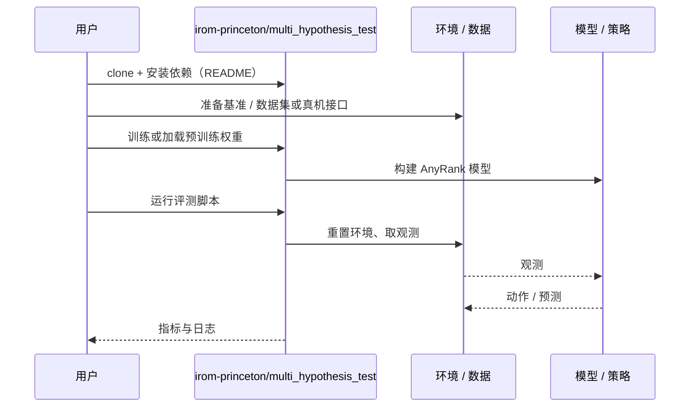

# AnyRank（arXiv:2610.14603）

**AnyRank**（*AnyRank: Reliable Anytime Policy Ranking via Sequential Testing*，[arXiv:2610.14603](https://arxiv.org/abs/2610.14603)，[项目页](https://abadithela.github.io/anyrank-page/)，[代码](https://github.com/irom-princeton/multi_hypothesis_test)）来自 [具身智能小站 2026-10-14 盘点](../../sources/blogs/wechat_embodied_station_41_papers_streamingwam_2026-10-14.md)，属「多机器人协作与评测」组。

## 一句话定义

**用序贯检验把真机试验优先分配给难区分的策略，任意停止时刻都控制错误排名概率；可利用仿真/世界模型先验。**

## 英文缩写速查

| 缩写 | 英文全称 | 简要说明 |
|------|----------|----------|
| SPRT | Sequential Probability Ratio Test | 序贯检验 |
| SR | Success Rate | 成功率 |
| WM | World Model | 可提供先验的世界模型 |

## 为什么重要

- 小样本成功率排名常被误读；需要可随时停止且有统计保证的评测流程。
- 开源结论：**已开源**（步骤 2.5，2026-10-14）。仓库可达（另有 irom-princeton/AnyRank）。
- 同期同组工作见 [流式动作块与世界模型记忆：具身智能小站 10-14 期 41 篇阅读坐标](../overview/embodied-station-2026-10-14-41-papers-technology-map.md)。

## 核心机制

| 项 | 内容 |
|----|------|
| **arXiv** | [2610.14603](https://arxiv.org/abs/2610.14603) |
| **开源** | **已开源** |
| **要点** | 多假设序贯检验 + 自适应分配；先验可不完美。 |
| **文内指标** | 以原文为准。 |

## 源码运行时序图

以下为按仓库入口（`irom-princeton/multi_hypothesis_test`）推断的通用运行链路；入库日仅核实仓库可达，未逐文件阅读，具体脚本名以 README 为准。

## 实验与评测

- 以原文为准。
- **读法：** 本页为索引级摘要，依据公众号转述的官方摘要与仓库信息整理；逐项数字与 baseline 以原文 PDF 为准。

## 与其他工作对比

- 横向索引见 [流式动作块与世界模型记忆：具身智能小站 10-14 期 41 篇阅读坐标](../overview/embodied-station-2026-10-14-41-papers-technology-map.md)；同 arXiv 不重复造页。

## 结论

**策略比较要带统计保证：先验帮分配，序贯检验保结论。**

1. 开源边界：**已开源** — 仓库可达（另有 irom-princeton/AnyRank）。
2. 核心机制：多假设序贯检验 + 自适应分配；先验可不完美。
3. 复现与选型前核对任务协议、硬件与基准口径，勿直接横比公众号摘录数字。

## 关联页面

- [simulation-evaluation-infrastructure](../concepts/simulation-evaluation-infrastructure.md)
- [sim-vs-real-eval-gap](../concepts/sim-vs-real-eval-gap.md)
- [roboarena](../methods/roboarena.md)
- [embodied-station-2026-10-14-41-papers-technology-map](../overview/embodied-station-2026-10-14-41-papers-technology-map.md)

## 参考来源

- [anyrank_anytime_policy_ranking_arxiv_2610_14603.md](../../sources/papers/anyrank_anytime_policy_ranking_arxiv_2610_14603.md)
- [wechat_embodied_station_41_papers_streamingwam_2026-10-14.md](../../sources/blogs/wechat_embodied_station_41_papers_streamingwam_2026-10-14.md)
- [arXiv:2610.14603](https://arxiv.org/abs/2610.14603)

## 推荐继续阅读

- [arXiv PDF](https://arxiv.org/pdf/2610.14603)
- [项目页](https://abadithela.github.io/anyrank-page/)
- [https://github.com/irom-princeton/multi_hypothesis_test](https://github.com/irom-princeton/multi_hypothesis_test)
