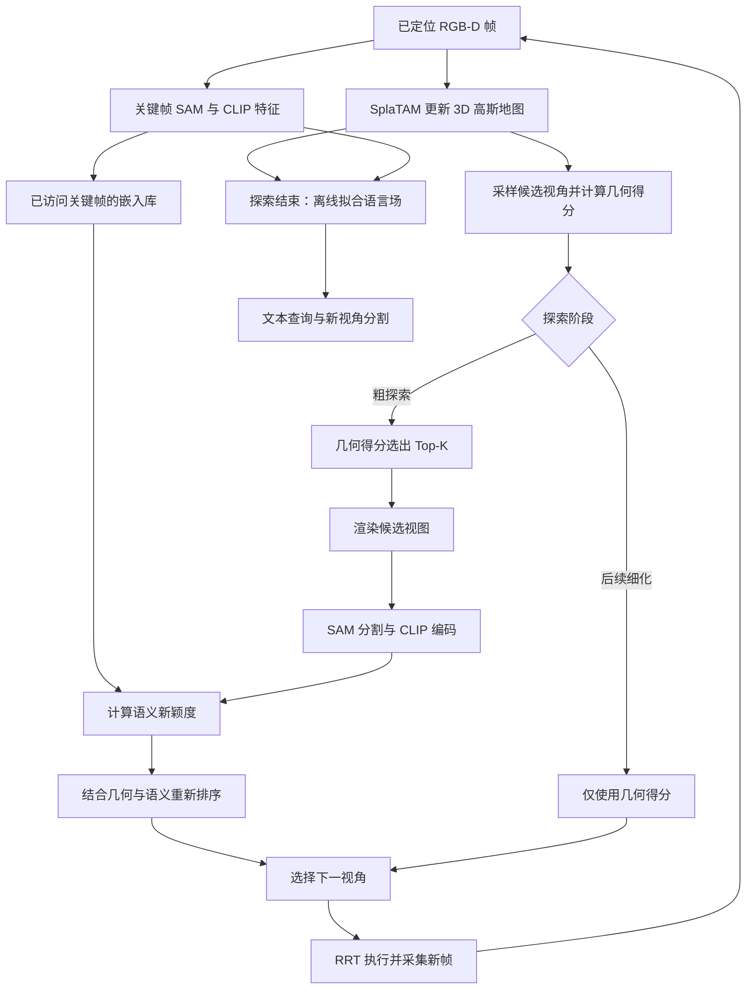
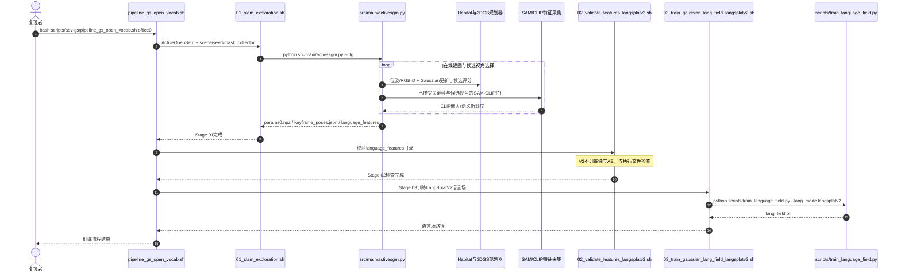

# AOV-GS（arXiv:2610.29374）

**AOV-GS**（*AOV-GS: Active Open-Vocabulary Semantic Mapping with 3D Gaussian Splatting*，[arXiv:2610.29374](https://arxiv.org/abs/2610.29374)，[代码](https://github.com/OptimusFaber/AOV-GS)）的技术机制与下列评测已根据 [arXiv:2610.29374v1](https://arxiv.org/html/2610.29374) 正文核对；先前 [中文盘点](../../sources/blogs/wechat_embodied_station_58_papers_diverse_demonstrations_2026-10-29.md) 仅保留作发现线索。

## 一句话定义

**AOV-GS以冻结的SAM与CLIP为候选视角排序，再拟合开放词汇语言场；室内仿真显示语义地图收益，但实验使用真实相机位姿，尚未覆盖SLAM定位噪声。**

## 英文缩写速查

| 缩写 | 英文全称 | 简要说明 |
|------|----------|----------|
| AOV-GS | AOV-GS: Active Open-Vocabulary Semantic Mapping with 3D Gaussian Splatting | 本文方法 / 基准的简称 |
| 3DGS | 3D Gaussian Splatting | 以可微高斯表示场景 |
| SAM | Segment Anything Model | 生成图像实例掩码 |
| CLIP | Contrastive Language–Image Pretraining | 为实例与文本生成共享语义嵌入 |
| NBV | Next-Best-View | 下一最佳观察视角 |

## 为什么重要

- **关键技术问题：** 仅靠几何增益选视角，可能错过有辨识价值的语义实体；本文把冻结 SAM–CLIP 的语义新颖度融入粗探索的下一视角选择。
- 开源结论：**已开源**（步骤 2.5，2026-10-29）。仓库可达（git ls-remote）。
- **实验边界：** 论文 Replica 与 Matterport3D 实验均以 Habitat 真值位姿作 oracle SLAM；并未验证实际 SLAM 漂移与真实传感器噪声。
- 同期盘点见 [具身智能小站 10-29 期](../overview/embodied-station-2026-10-29-58-papers-technology-map.md)，但数值应以原论文为准。

## 核心机制

| 项 | 内容 |
|----|------|
| **arXiv** | [2610.29374](https://arxiv.org/abs/2610.29374) |
| **开源** | **已开源** |
| **要点** | AOV-GS以冻结的SAM与CLIP为候选视角排序，再拟合开放词汇语言场；室内仿真显示语义地图收益，但实验使用真实相机位姿，尚未覆盖SLAM定位噪声。 |
| **文内指标** | 公众号未给具体数字，本页不引用。 |

## 核心流程图

依据原论文方法部分整理，具体假设和评测条件请参阅原文。

## 源码运行时序图

已对照官方 [README](https://github.com/OptimusFaber/AOV-GS)、`scripts/aov-gs/README.md`、`pipeline_gs_open_vocab.sh`、`01_slam_exploration.sh`、`02_validate_features_langsplatv2.sh`、`03_train_gaussian_lang_field_langsplatv2.sh` 核对**可见的脚本调用链**；SLAM/SAM–CLIP 内部细节采用论文 §3 描述，本次未执行复现。以下是默认 LangSplatV2 模式，并非虚构的通用训练循环。

实际查询/评测可另用 `scripts/query_language_field.py` 与 `scripts/validate_lang_field_traj.py`；训练输出不等于本次已完成真机或模拟复现。
## 实验与评测

论文采用带真值相机位姿的 Habitat 仿真协议、固定的 SAM–CLIP 语义感知栈，以 novel-view 文本查询掩码的 mIoU 为主指标；数值均来自 [论文 v1 原始表格](https://arxiv.org/html/2610.29374)，不是公众号转述。

| 对照条件 | AOV-GS mIoU | 相对同配置几何探索 |
|---|---:|---:|
| Replica 8 场景，SAM–CLIP | **34.6%** | **+1.3 pp** |
| Replica 8 场景，带 CorrCLIP | **35.6%** | **+2.0 pp** |
| Matterport3D 5 场景，SAM–CLIP | **23.1%** | **+1.8 pp** |

- Replica 8 场景重建 PSNR 为 31.19 dB，几何基线为 31.47 dB；提升语义 mIoU 不代表每项重建指标都提高（论文表 3）。
- office0 的 Stage 0 单个候选语义打分约 8 秒（RTX 4070 Ti SUPER）；K=8 全流程约 61 分 23 秒，最大显存约 12.92 GB。并非每个机器人控制周期都调用该语义打分（论文 §4.4）。
- 单场景和单类别存在退化，例如 Replica office2：AOV-GS 对几何基线低 3.9 pp；不能把平均提升解释成所有场景均改善。

## 与其他工作对比

- **几何主导 NBV：** 使用未观测区域和行进距离评分，不考虑语义新颖度；AOV-GS 只在 Stage 0 对几何 Top-K 视角重排，Stage 1+ 仍用几何评分。
- **ActiveSGM：** 使用按场景微调的 OneFormer 封闭类别语义；其 closed-set 指标不可直接与本方法 open-vocabulary mIoU 横比。
- **LangSplatV2：** 属于后续语言场蒸馏组件；不能将离线蒸馏误称为在线语义模型训练。

## 工程实践

1. 按 [官方入口](https://github.com/OptimusFaber/AOV-GS) 执行 `bash scripts/installation/quick_start.sh` 准备 submodules、Conda、SAM 权重与 Replica 数据；需核对第三方许可证与显存。
2. 运行 `bash scripts/aov-gs/pipeline_gs_open_vocab.sh office0`。默认依次执行建图、特征存在性检查、LangSplatV2 场景训练；检查 `params0.npz`、`keyframe_poses.json`、`language_features/` 与 `lang_field.pt` 是否生成。
3. 分开报告语义 mIoU、重建 PSNR、Stage 0 候选评分延迟与峰值显存；先固定 GT 位姿基准，再增加真实 SLAM 噪声测试。

## 局限与风险

- **Oracle 位姿：** 仿真使用 GT 相机位姿输入，不是动态环境中的自主 SLAM 成功率证明。
- **分阶段代价：** SAM/CLIP 候选评分只在 Stage 0 运行，但 GPU 时间并不低；场景语言场训练在探索之后离线进行。
- **不保证单场景改善：** 细物体/掩码碎裂可能退化，CorrCLIP 也可能消除有用实例证据；需逐场景核对。
- **源码执行：** 官方代码、脚本入口已核查，未在本次任务中运行训练或验证。

## 结论

**AOV-GS 用冻结的 SAM–CLIP 语义新颖度补充几何视角选择，在给定位姿仿真实验中提升文本检索语义地图的平均质量，但尚不能证明真机 SLAM 鲁棒性。**

1. 语义探索收益应与同一 SAM–CLIP 感知栈的几何-only 基线比较。
2. Stage 0 Top-K 评分与离线语言场训练的耗时须分别计价。
3. 报告各场景的失败例子，不能只给跨场景平均 mIoU。
4. 下游导航部署必须另验证实际位姿噪声与规划闭环。

## 关联页面

- [locomotion](../tasks/locomotion.md)
- [vision-language-navigation](../tasks/vision-language-navigation.md)
- [目标感知 3D Gaussian 语言地图细化](./paper-target-aware-gaussian-langmap.md) — 建图/主动探索与既有语言地图的目标语义细化互为上下游研究问题
- [sim2real](../concepts/sim2real.md)
- [embodied-station-2026-10-29-58-papers-technology-map](../overview/embodied-station-2026-10-29-58-papers-technology-map.md)

## 参考来源

- [AOV-GS 论文全文核对归档](../../sources/papers/aov_gs_arxiv_2610_29374.md)
- [官方源码归档](../../sources/repos/aov_gs.md) — 入口以官方当前 README 为准
- [wechat_embodied_station_58_papers_diverse_demonstrations_2026-10-29.md](../../sources/blogs/wechat_embodied_station_58_papers_diverse_demonstrations_2026-10-29.md)
- [arXiv:2610.29374](https://arxiv.org/abs/2610.29374)

## 推荐继续阅读

- [arXiv PDF](https://arxiv.org/pdf/2610.29374)
- [https://github.com/OptimusFaber/AOV-GS](https://github.com/OptimusFaber/AOV-GS)
