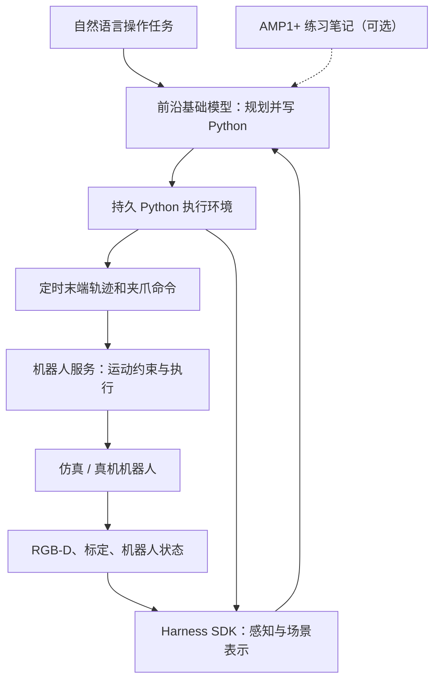
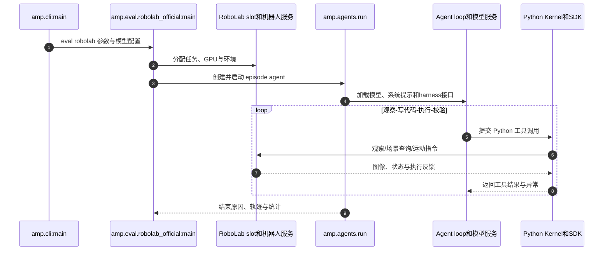

# Apple AMP1：面向机器人操作的智能体策略 / On Agentic Manipulation Policies

**Apple AMP1**（[论文 arXiv:2611.09892](https://arxiv.org/abs/2611.09892)、[项目页](https://apple-aiml-research.github.io/ml-amp/)、[官方源码](https://github.com/apple-aiml-research/ml-amp)）探索一种不同于端到端低层控制的操作范式：把通用模型接进受约束的机器人 API，让它写 Python、边做边看、按结果再编程。**AMP1+** 进一步允许将练习形成的工作笔记在不同 episode 复用。

## 一句话定义

**AMP1 = 通用大模型 + 可执行 Python + 感知/几何/运动 harness + 逐步反馈；AMP1+ = AMP1 + 练习获得的持久记忆。** 它不是 Apple 发布的新基座模型，也不是以 AMP 判别器训练运动模仿的同名方法。

## 英文缩写速查

| 缩写 | 英文全称 | 简要说明 |
|------|----------|----------|
| AMP1 | Agentic Manipulation Policy 1 | 本论文的通用模型驱动机器人操作系统 |
| SDK | Software Development Kit | 机器人观察、场景表示、运动接口 |
| RGB-D | Red, Green, Blue and Depth | 视觉与深度观测 |
| TCP | Tool Center Point | 末端轨迹的工具中心参考点 |
| VLA | Vision-Language-Action | 可直接预测动作的策略范式，用于对照 |
| IK | Inverse Kinematics | 将末端目标转换为可执行关节运动 |

## 核心信息

| 字段 | 内容 |
|------|------|
| 机构 | 苹果公司（Apple） |
| 原文 | [On Agentic Manipulation Policies](https://arxiv.org/html/2611.09892)，arXiv:2611.09892 |
| 项目 / 官方仓 | [项目页](https://apple-aiml-research.github.io/ml-amp/) / [ml-amp](https://github.com/apple-aiml-research/ml-amp) |
| 开放程度 | **评测及主要 agent/harness 代码已开源**；基准依赖和模型服务另行获取 |
| 仿真基准 | RoboLab-120、CaP-Gym（LIBERO-PRO、robosuite、BEHAVIOR-1K）、RoboDojo |
| 真机 | Franka 操作任务；模型代码/机器人硬件/服务分层 |
| 模型角色 | Claude Opus 5.5、Gemini 4 Argon 等通用模型作为 agent planner/coder |

## 为什么重要

传统 VLA 常直接学习从观测和指令到动作分布的映射。AMP1 则测试：**如果通用推理模型能可靠地读取现场、编写小段动作代码、检查结果，是否可以减少任务专属示范与策略训练？** 对工程实践的价值是把模型能力、机器人接口和安全约束分层；对评测的启示是 **同一个模型换一套 harness，成绩可能大幅变化**。

## 核心原理

1. **视觉与状态获取：** 模型经 SDK 读取 RGB-D、相机标定、机器人状态，并使用点云/可修正的物体场景表示。
2. **可执行规划：** 模型在持续存在的 Python 环境中编写代码，计算末端位姿、调用 SDK 的几何/运动能力。
3. **带约束执行：** 经机器人服务发出定时末端轨迹和夹爪命令；基础运动接口与高级“抓取/放置”预制技能不同。
4. **闭环修正：** 执行后重新获取图像和状态，检查接触/完成情况，再继续写代码。程序出错、目标位姿偏差与任务未完成需要重新规划。
5. **AMP1+ 练习：** 将练习经验整理为可复用的文本/代码笔记，跨 episode 加载；不等同于更新基础模型参数。

### 流程总览

**数据流解读：** 模型输出的是可执行计划代码，底层动作由 SDK 和机器人服务实施；再次观测后决定继续、重试或改写步骤，而不是一次性输出完整长程动作。

## 源码运行时序图

下图按官方源码 `src/amp/cli.py`、`src/amp/eval/robolab_official.py`、`src/amp/agents/run.py` 与 `src/amp/agents/loop.py` 的入口整理，而非泛化的 Agent 模板。

复现入口：`uv run amp eval robolab --harness amp1_basic --model gemini-4-argon --reasoning high --task-set benchmark --gpus auto --output runs/robolab`；官方 `docs/reproducing-the-paper.md` 列出其他实验对应配置。

## 实验与评测

| 场景 | 设置/模型 | 论文报告结果 | 正确读法 |
|------|-----------|--------------|----------|
| RoboLab-120 | AMP1 + Gemini 4 Argon | **85.6%** | 120 个任务 × 10 次；模型与 harness 共同构成被测系统 |
| RoboLab-120 | AMP1 + Claude Opus 5.5 | **82.8%** | 相同 AMP1 架构，模型不同 |
| CaP-Gym / LIBERO-PRO | AMP1（论文设定） | **95.2%** | 该基准零样本任务，不与 RoboLab 直接比大小 |
| CaP-Gym / robosuite | AMP1（论文设定） | **100.0%** | 局限于论文选取场景与任务 |
| CaP-Gym / BEHAVIOR-1K | AMP1（论文设定） | **96.0%** | 移动操作相关任务设定 |
| 真机操作 | AMP1 + Opus 5.5 | **104/108（96.3%）** | 12 任务 × 9 次的有限集合 |
| RoboDojo | AMP1（零样本，无持久记忆） | **26.4%** | 多任务复杂操作，明显更难 |
| RoboDojo | AMP1+（few-shot 练习后） | **84.1%** | 包含练习笔记，**不是**纯零样本 |

**速度代价：** 论文的真机成功任务平均约 **280 秒**，其中模型推理约 **211 秒**、机械执行约 **69 秒**。更长的反思与验证有助于精度，但暂不能用于高速连续闭环控制。

## 结论

**AMP1 的主要贡献是将“可编程、可观察、可纠错”的通用模型能力系统化为机器人操作策略，而非证明某一基座模型绝对领先。**

1. **先定 harness，再比较模型** — RoboLab-120 的 85.6%、82.8% 是模型 + 系统联合成绩；不能直接与另一 harness 的 74.8% 做模型能力排序。
2. **用工具协议约束代码执行** — 模型负责几何与步骤逻辑，SDK/机器人服务负责真实运动约束与反馈，减少直接输出底层动作的接口复杂度。
3. **实践记忆是另一种学习机制** — RoboDojo 26.4%→84.1% 依赖训练外的练习与持久笔记，不应说成“模型权重微调后涨分”。
4. **仿真高分不等于实时可部署** — 真机平均约 211 秒推理时间，动态接触与高速移动操作仍是挑战。
5. **复现应固定第三方版本** — 官方同时提供 benchmark commit、运行命令与环境说明；更换 GPU/driver 不保证逐位一致结果。

## 与其他工作对比

| 路线 | 高层决策 | 低层动作来源 | 学习/适应手段 |
|------|----------|--------------|---------------|
| **Apple AMP1** | 通用模型持续写 Python | SDK 几何、轨迹与夹爪原语 | episode 内逐步观察和重新规划 |
| **Apple AMP1+** | 同上，加载练习工作笔记 | 同 AMP1 | 跨 episode 持久记忆 |
| [Harness VLA](paper-harness-vla.md) | LLM 编排固定原语 | 冻结 VLA 接触技能 + 解析原语 | Task/Global Memory 与场景重绑定 |
| [RoboHarness](paper-robo-harness.md) | 选择异构策略/技能 | VLA、RL、TAMP 等多策略 | 能力边界与 Memory Bridge |
| [VLA](../methods/vla.md) | 模型内隐或显式策略 | 模型直接预测动作/chunk | 示范、预训练与微调 |

## 工程实践

- **依赖与开源：** 官方 `ml-amp` 仓已发布主要代码；入口 `amp = amp.cli:main`。官方文档指定 Linux x86_64、NVIDIA GPU、`uv`、第三方基准依赖，RoboLab 需要固定 Isaac Sim/Isaac Lab 配套版本。
- **主路径：** `uv sync --frozen` → 设置模型 API key → `uv run amp doctor` → `uv run amp eval robolab ...`。完整 setup 与 pin 见 [源码归档](../../sources/repos/apple-ml-amp.md)。
- **源码核对：** `amp.cli` 路由到 `amp.eval.robolab_official`；episode runner `amp.agents.run` 初始化 LLM、harness SDK、Kernel 和 Agent loop。
- **评测指标：** 逐任务/逐 episode 成功率、LLM 调用次数/推理耗时、执行耗时、失败恢复、安全约束触发；对比需锁定同一任务、相同视觉/接口、相同 episode 预算。
- **模型选型：** `docs/models.md` 说明 Anthropic/Gemini/兼容服务；论文表中型号仅表示该版本评测条件，不代表永久榜单。

## 局限与风险

- **推理时延较高：** 真机推理时间在作者实验中超过机械运动时间，不适合拿来代替 100 Hz/1 kHz 接触反馈控制器。
- **长程/动态扰动：** 主要在相对静态、可分步验证的操作场景评估；动态物体、失效传感或不可逆接触未获同等证明。
- **视觉与机器人约束：** 对 RGB-D、标定、场景表示、IK、碰撞与执行器可靠性有要求；“模型能编程”不能替代安全执行层。
- **基准协议不可混写：** AMP1 与 Astranomy/GPT-6 Astra 对照同时改变模型及 harness，不能从 85.6% 与 74.8% 断言 Claude/Gemini 本质上“先跑通 AGI”。
- **开源边界：** 仓库公开的是 AMP harness 与评测复现代码；外部基准代码、模型 API/权重、资产、硬件与授权各自独立。未在本仓复现实验。

## 关联页面

- [智能体机器人操作策略：Agentic Manipulation Policies](../methods/agentic-manipulation-policies.md) — 从接口与时延角度理解代码型 agent。
- [VLA](../methods/vla.md) — 直接动作预测的另一条路线。
- [机器人操作（Manipulation）](../tasks/manipulation.md) — 动作执行、接触与泛化任务。
- [Harness VLA](paper-harness-vla.md) — 冻结 VLA 的 agentic 原语编排。
- [RoboHarness](paper-robo-harness.md) — 异构策略协作与切换。

## 参考来源

- [原始论文及详细证据归档](../../sources/papers/apple_amp1_arxiv_2611_09892.md)
- [Apple 官方项目页归档](../../sources/sites/apple-aiml-research-ml-amp.md)
- [Apple 官方代码与复现入口归档](../../sources/repos/apple-ml-amp.md)

## 推荐继续阅读

- [论文 HTML 全文](https://arxiv.org/html/2611.09892)
- [Apple AMP1 官方项目主页](https://apple-aiml-research.github.io/ml-amp/)
- [官方代码 README、docs/quickstart.md 与复现命令](https://github.com/apple-aiml-research/ml-amp)
