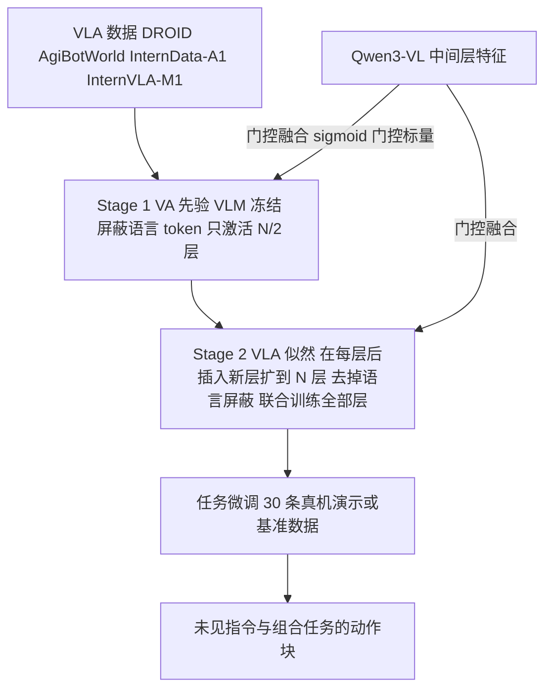

# APT：动作专家预训练提升 VLA 的指令泛化（arXiv:2606.12366）

**APT**（*APT: Action Expert Pretraining Improves Instruction Generalization of Vision-Language-Action Policies*，[arXiv:2606.12366](https://arxiv.org/abs/2606.12366)，浙江大学，Xu、Zhu、Chen、Xiong、Wang）。本页依据 PDF 全文（含附录）整理；归档见 [来源归档](../../sources/papers/apt-action-expert-pretraining_arxiv_2606_12366.md)。

## 一句话定义

**把 VLA 里随机初始化的连续动作专家，先在不含语言的视觉-动作对上预训练成「VA 先验」（VLM 冻结），再通过插入新层加门控融合引入语言做「VLA 似然」，以缓解视觉捷径、提升对未见指令与组合任务的泛化。**

## 英文缩写速查

| 缩写 | 英文全称 | 简要说明 |
|------|----------|----------|
| VLA | Vision-Language-Action | 视觉-语言-动作策略 |
| VLM | Vision-Language Model | 视觉-语言模型，本文用 Qwen3-VL-2B-Instruct |
| VA prior | Vision-Action prior | π^p(a\|v)，不看语言的动作先验 |
| OOD | Out-of-Distribution | 训练分布外，此处指未见指令 / 物体 / 组合 |
| KI | Knowledge Insulation | 停止动作专家到 VLM 的梯度（π0.5 采用） |
| FiLM | Feature-wise Linear Modulation | 把扩散时间步注入各注意力层 |
| PRoPE / mRoPE | Projective / Multimodal Rotary Position Embedding | Stage 1 与新插入层分别使用的位置编码 |
| SO / UO / UC / UOUE | Seen Object / Unseen Object / Unseen Container / Unseen Object & Environment | 抓放基准的评测分档 |

## 为什么重要

- **问题（作者自述，§1、§3.1）：** VLA 数据中一条指令对应一整条轨迹的 T 个视觉-动作帧，语言多样性远低于视觉与动作；随机初始化的动作专家倾向只看视觉，既绕开语言，又向 VLM 回传噪声梯度。
- **思路：** 离散动作路线靠视觉-语言共训保护语言能力；连续动作专家没有对应的预训练与共训数据。APT 的做法是只用现有 VLA 数据里的视觉-动作对给动作专家做预训练，不引入额外推理数据。
- **作者结论（§4.1.3）：** 在其基准上，停梯度（KI）不是语言泛化的必要条件，动作先验初始化好后联合微调 VLM 反而更好。这是作者在自家设置下的结论，是否推广到其他骨干与数据需要独立验证。

## 核心原理与流程总览

**贝叶斯分解（§3.2，式 2）：** π(a|v,ℓ) ∝ π^p(a|v)·L(ℓ|v,a)。视觉-动作对每帧都有独一的动作标注，作者认为这部分数据是「平衡」的，不产生捷径激励。

要点（均见 §3.3 与附录 A）：

- **动作专家：** 20 层扩散 Transformer，对视觉、语言、动作 token 做块状因果自注意力；动作 token 含历史动作、本体状态与带噪动作；扩散时间步经 FiLM 注入。
- **层级门控融合：** h_in^(i+1) = h_out^(i) + σ(ŵ_i)·φ_i(v,ℓ)，ŵ_i 为可学习标量，从 Qwen3-VL 等间隔取 N 个中间层特征。
- **两阶段落在同一网络：** Stage 1 只激活 N/2 层且屏蔽语言；Stage 2 在每层后插入新层，原层从 Stage 1 初始化，新层用 mRoPE 专管语言对齐。与 BayesVLA 冻结先验不同，APT 联合优化全部层。
- **动作表示：** 相机坐标系下 3 维平移 + 6D 旋转 + 夹爪宽度共 10 维，动作块长 32。

## 工程实践

- **训练配置（附录 A）：** AdamW，动作专家学习率 1e-4，VLM 联合微调时 1e-5；batch 256；Stage 1 与 Stage 2 各 100k 迭代；DDPM 100 步训练，DDIM 20 步推理；输入图像 256×256（腕部与第三视角）。
- **预训练数据（附录 A）：** DROID、AgiBotWorld-Alpha、InternData-A1、InternVLA-M1，采样权重 5:5:4:1。
- **真机（附录 E.1）：** Agilex Cobot + Piper 臂 + 两台 ORBBEC DaBai 相机；每任务 30 条遥操作演示微调。基线 π0.5 用关节空间动作微调，APT 用相机系动作表示，两者动作表示并不一致，对比时需留意。
- **复现提示：** 文中只给出项目页，本次未发现公开仓库；超参与数据权重已在附录给出，但预训练算力规模与耗时文中未见说明（推测需要大规模算力）。

## 与清单说法的对比核对

清单（Glen Berseth 的 CoRL 2026 阅读清单第 084 条，P2，分组 VLAs & Generalist Policies；摘要为 LLM 据摘要起草）说：*Pretrains the VLA action expert as a language-agnostic vision-action prior to stop visual shortcuts and improve instruction generalization.* 逐项核对：

| 清单措辞 | 论文情况 |
|----------|----------|
| 预训练 VLA 动作专家 | 属实（§3.2）。 |
| 与语言无关的视觉-动作先验 | 属实：Stage 1 屏蔽语言 token、VLM 冻结（§3.3）。注意只有 Stage 1 与语言无关，Stage 2 起联合训练、先验会被改写（§3.3）。 |
| 「stop」视觉捷径 | 偏强。论文没有直接测量捷径程度；附录 B 是在「P(ℓ\|v) 近似 one-hot」假设下的信息论论证，主要证据是下游成功率。写「缓解」更贴切。 |
| 提升指令泛化 | 有数据支持但不均匀：LIBERO-PRO 平均 19（APT）/ 27（Ft VLM）对 π0.5 的 11（Table 1），但 Object-Pos、Goal-Pos、Long-Pos 并不占优；抓放仿真各档均高于 π0.5 或接近（Table 2）。 |
| 仿真还是真机 | 清单未提。论文二者都有：仿真（LIBERO-PRO、IsaacSim UR5 抓放）与真机（两个单任务加组合任务，Table 3）。真机基线只有 π0.5，每格 10 到 40 次试验，样本小。 |
| 会场 | 清单标注 CoRL 2026；本次只见 arXiv v1（2026-06-10）正文，未核实录用状态。 |

## 实验要点（带出处）

- **LIBERO-PRO（§4.1.3，Table 1）：** OpenVLA 与 π0 全 0；π0.5 在 Task 扰动近 0；LangForce 在 Task 上较高但 Pos 下降；APT 与 APT(Ft VLM) 平均 19 与 27，π0.5 为 11，LangForce 为 14。作者称 Ft VLM 超过 CaP-X 的可比平均，但 CaP-X 在 Long 子套件无数据，不可严格比较（推测）。
- **IsaacSim 抓放（Table 2）：** 2-Stage 加 Ft VLM 的变体在 SO/UO/UC/UOUE 为 98/84/92/58，π0.5 为 84/70/86/50；UOUE 上 KI+2-Stage（62）高于 2-Stage+Ft VLM（58）。
- **消融（§4.1.4）：** 两阶段在 π 式、GR00T 式动作专家上也大多有益；去掉大规模预训练或改成 Token Insertion 都下降。
- **真机（Table 3、7、8，Figure 6）：** 抓放 90/110 对 63/110，杂乱推抓放 60/80 对 43/80；单条拼接指令下 T1+T2 为 65% 对 0%（每组 20 次）。已见语言逐条下达时二者相当。
- **附录补充：** 原 LIBERO 平均 96.1（π0.5 为 96.9）；LIBERO-Plus 总分 71.6（X-VLA 71.4），作者自述不意在宣称优越（D.2、D.3）。

## 结论

APT 表明先学习视觉动作先验再引入语言值得测试，但并未证明视觉捷径已被彻底消除。

- 按两阶段训练与层级融合复现，分别评估已见任务和未见指令，避免只看原 LIBERO 平均分。
- 对照 KI 或 π0.5 时对齐数据、动作坐标系和微调预算，再判断动作专家初始化的贡献。
- 把 LIBERO-PRO 的位置扰动低分及长程记忆缺口列入部署验收，不能用平均提升替代逐子套件检查。

## 局限

**论文自述（§5）：** 不显式建模长程记忆，难以跟踪多步进度；只评桌面操作，运动与移动操作未探索。

**本页观察到的未验证之处（作者判断之外）：**

- 真机基线仅 π0.5 一个，且动作表示不同（关节空间对相机系）；每格试验次数 10 到 40，无置信区间或多种子。
- 消融里 π0.5 同时带 VL 共训，APT 没有，因此「无需推理数据」的结论与二者数据量差异混杂；预训练数据规模与 π0.5 并不匹配。
- LIBERO-PRO 上多个子套件绝对成功率仍低（平均 19 与 27），并非「已解决」；Goal-Pos 上不及 π0.5。
- 杂乱任务 UC 的试验数在 Table 3（30）与附录 E.2（10）不一致，原因文中未解释。
- 视觉捷径的因果链（捷径 → 噪声梯度 → 语言泛化差）靠假设与下游结果支撑，未做直接测量。
- 本次未运行代码，也未找到公开仓库，数值未复现。

## 关联页面

- [VLA 方法页](../methods/vla.md)
- [扩散策略](../methods/diffusion-policy.md)
- [模仿学习](../methods/imitation-learning.md)
- [OOD 泛化](../concepts/out-of-distribution-generalization.md)
- [基础策略（Foundation Policy）](../concepts/foundation-policy.md)
- [Knowledge Insulation（对照：停梯度路线）](paper-knowledge-insulation.md)
- [π0（动作专家架构）](paper-pi0.md)
- [OpenVLA（基线）](paper-openvla.md)
- [Isaac GR00T（GR00T 式架构）](isaac-gr00t.md)
- [Qwen3-VL（骨干）](qwen3-vl.md)
- [LIBERO 基准](libero-benchmark.md)
- [LIBERO-Pro2.0（同系扰动基准，注意与本文用的 LIBERO-PRO 不同）](paper-libero-pro2-0.md)
- [LIBERO-Plus 鲁棒性分析](paper-rcl-2510-13626-libero-plus-in-depth-robustness-analysis-of-visi.md)

## 参考来源

- [来源归档（本页依据）](../../sources/papers/apt-action-expert-pretraining_arxiv_2606_12366.md)
- [arXiv:2606.12366](https://arxiv.org/abs/2606.12366)
- 项目页：<https://xukechun.github.io/papers/APT>

## 推荐继续阅读

- [arXiv PDF](https://arxiv.org/pdf/2606.12366v1)
- 文中对照工作：BayesVLA（arXiv:2512.11218）、LIBERO-PRO（arXiv:2510.03827）、LangForce（文中 [54]）；wiki 暂无对应页。
