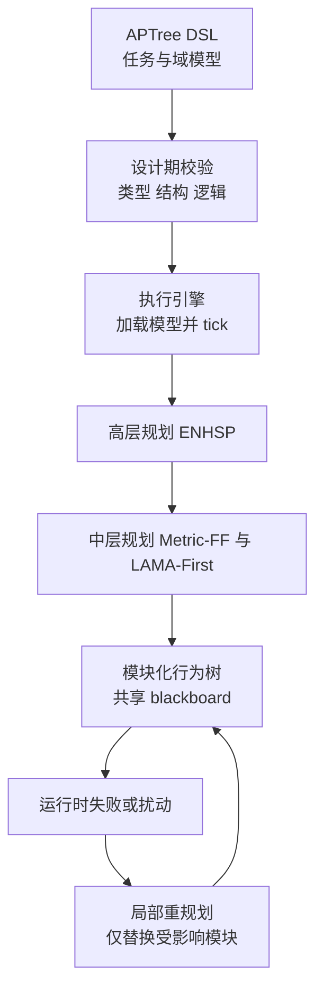
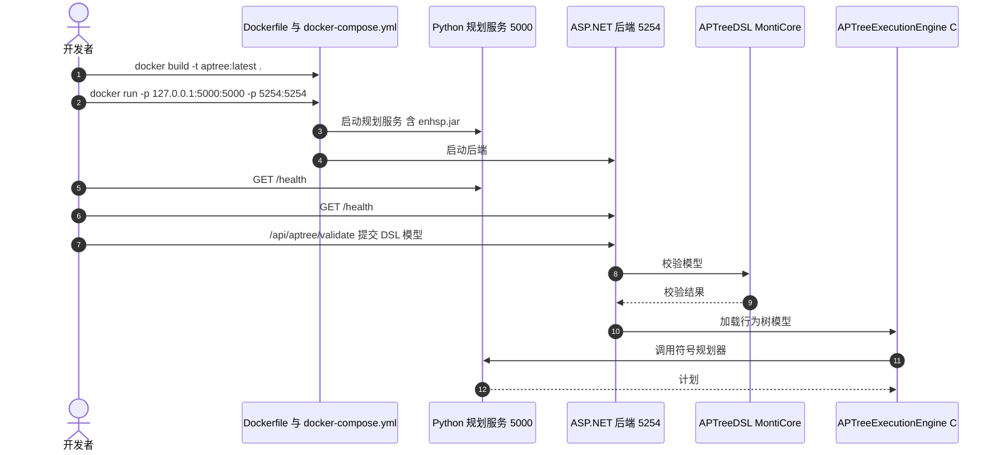

# APTree：用扩展行为树把符号规划器接入建筑预制

**APTree 是一个模型驱动框架：用领域 DSL 描述建筑预制任务，运行时调用多个符号规划器（PDDL 系）生成模块化计划，拼成扩展行为树执行，并在出错时只替换受影响的计划模块。**

论文 *APTree: Extended Behavior Trees for Adaptive and Scalable Automated Robotic Task Planning in Construction*（[arXiv:2610.18523](https://arxiv.org/abs/2610.18523)，[代码](https://github.com/shshermin/APTree-automated-planning-tree)），已被 The Journal of Systems and Software 接收。

## 英文缩写速查

| 缩写 | 英文全称 | 简要说明 |
|------|----------|----------|
| BT | Behavior Tree | 执行层结构，APTree 扩展其元模型 |
| DSL | Domain-Specific Language | 用 MontiCore 实现的文本语言，校验模型并生成执行引擎代码 |
| PDDL | Planning Domain Definition Language | 规划器输入格式；论文用 2 个域文件（高层、中层） |
| TPR | True Positive Rate | 注入错误的检出率，论文以此对比 PlanSys2 |

## 为什么重要

- 建筑预制的机器人任务规划多靠人工，论文把它作为机器人普及的障碍；APTree 让实践者不必深懂符号规划。
- 与单一规划器方案不同，APTree 在运行时组合多个规划器，并把计划切成可局部替换的模块。
- 把「安全」写成明确假设（规划器可靠、计划互不干扰），而非隐含在实现里。

## 核心信息

| 项 | 内容 |
|----|------|
| **机构** | 斯图加特大学 ICD/CA；Sherkat 与 A. Wortmann 另属 ISW |
| **平台** | 案例：livMatS Biomimetic Shell 展亭（FIT Freiburg Center），机器人预制壳体 cassette |
| **规划器** | 高层 ENHSP；中层 Metric-FF、LAMA-First |
| **开源** | **已开源**（2026-10-17 核查）：[仓库](https://github.com/shshermin/APTree-automated-planning-tree)含 DSL、C# 执行引擎、编辑器与 Docker 说明，见 [仓库归档](../../sources/repos/aptree.md)；许可证页面未显示；无独立项目页 |

## 核心原理

### 流程总览

任务模型用 DSL 写成并在设计期校验；执行引擎逐层调用规划服务得到模块化计划，嵌入行为树；运行中若某模块失败，只对该模块重规划。

- 元模型四个包：领域类型、基于图的任务计划、规划服务、动态流程节点；节点状态新增 Uninitialized 与 ReadyToTick。
- 安全论证：摘要称机器校验分析在规划器可靠与计划互不干扰假设下，组合执行与局部重规划是安全的；校验工具名未核实。

## 源码运行时序图

时序对齐仓库 `DOCKER_README.md` 的两个服务（Python 规划服务端口 5000，ASP.NET 后端端口 5254）。模块间调用细节仓库页面未给出，图中仅画文档化的接口。

- **复现路径（README）：** 先把 `enhsp.jar` 放入 `APTreeExecutionEngine/python_service/`，再 `docker build` 与 `docker run`，或 `docker compose up --build`。
- 仓库自带 `DemonstratorFinal.bt` 与 `DemonstratorFaults.json`（用途为推测：演示模型与注入故障，未核实）。

## 与其他工作对比

| 维度 | APTree（本文） | [LLM+P](./paper-llm-p.md) | [硬件感知 LLM-VLM 规划](./paper-hardware-aware-llm-vlm-zero-shot-task-planning.md) | [行为树 × VLA 编排](../concepts/behavior-tree-vla-orchestration.md) |
|------|------|------|------|------|
| 任务模型来源 | 实践者用领域 DSL 编写，设计期做类型 / 结构 / 逻辑校验 | LLM 把任务写成 PDDL 问题 | LLM 输出符号任务，VLM 确认语义 | 人工编排 BT 任务图（XML / 可视化） |
| 求解 / 执行核心 | 运行时组合 ENHSP、Metric-FF、LAMA-First 三个符号规划器 | 经典 PDDL 符号规划器 | 确定性模块处理坐标、抓取、碰撞与可达性 | VLA 在推理相位内输出连续动作 chunk |
| 行为树角色 | 扩展 BT 元模型承载模块化计划，出错只替换受影响模块 | 不涉及 | 不涉及 | BT 负责策略加载 / 暂停 / 复位等宏流程 |
| 验证场景 | 建筑预制展亭案例，1,149 个动作节点 | 原文 PDDL 任务（本库为索引级页） | Isaac Sim FR3 数字孪生 | 部署编排模式，非单篇评测 |

- **相对 LLM+P：** 二者都把求解交给符号规划器保证可行性，但 LLM+P 由 LLM 写 PDDL，APTree 由人写 DSL 并在设计期校验，且多规划器分层调用。
- **相对硬件感知 LLM-VLM 规划：** 后者用语言 / 视觉模型做零样本任务分解，APTree 不含学习组件，靠领域建模换取可校验性与局部重规划。
- **相对行为树 × VLA 编排：** 同样用 BT 做执行骨架，但 BT×VLA 的叶子是学习式连续技能，APTree 的子树来自符号规划器且可在运行时局部重生成。
- 各文场景与指标不同（APTree 报节点变化率与错误检出率），数字不可横比。

## 工程实践

| 项 | 建议 |
|----|------|
| 先跑通 | 用 Docker 起两个服务并访问 `/health`，再用 DSL 校验接口 |
| 安全配置 | 规划服务无认证且会跑规划器进程，只绑定 127.0.0.1；勿开 `PLANNER_DEBUG=1`（会启用可远程执行代码的调试器） |
| 规划器选择 | 论文称累计延迟主要由规划器选择驱动；三规划器单次调用均值约 1,746 ms，ENHSP + Metric-FF 约 360 ms |
| 许可证 | 页面未显示，使用前自行确认 |
| 平台依赖 | 需要 ENHSP jar、.NET、Java/Gradle（由 Docker 封装） |

## 实验与评测

- **规模：** 12 个 cassette，3 批，每批 4 个，每个 6 梁 2 板；最终执行模型 1,149 个动作节点，深度 6；372 个高层动作实例。
- **重规划开销：** 有重规划共 1,098 次事件，生成 6,507 个动作实例；执行 13 分 29 秒对无重规划的 5 分 06 秒；规划延迟 8 分 53 秒对 2 分 20 秒。
- **局部性：** 节点变化均值 0.80%（0–6.50%），宽度变化 0.38%，树深恒为 6；PlanSys2 每次重生成整棵树（100%）。节点保留率 17.7%，重规划频率 81.4 次/分。
- **错误检出：** APTree TPR 76%，PlanSys2 25%；类型错误 100% 对 0%；预防于设计期的比例 APTree 10%、PlanSys2 36.8%。
- 全部 372 个高层任务在两种配置下都达成目标。

## 结论

**APTree 的卖点是「多规划器 + DSL 校验 + 局部重规划」的工程组合，适合装配流程固定、可用 PDDL 建模的预制场景，不是通用的感知-规划方案。**

1. **局部重规划确实局部** — 平均 0.80% 节点变化，对比整树重生成。
2. **代价在规划延迟** — 三规划器配置的规划延迟占总时间 89.9%。
3. **DSL 的收益在设计期** — 类型错误检出 100%，但仅 10% 的错误被设计期阻止，其余靠运行时。
4. **安全结论有前提** — 依赖规划器可靠与计划互不干扰；违反时无保证。
5. **复现从 Docker 起步** — 仓库已公开，先确认许可证与 enhsp.jar 来源。

## 局限与风险

- **假设依赖：** 安全分析成立于规划器可靠与计划互不干扰，现实装配中的干涉可能破坏后者。
- **单案例：** 评测集中在一个展亭项目；是否泛化到其他建造任务未核实。
- **论文局限节未读到：** Section 8.2 与 Appendix B/C 未核实。
- **部署风险：** 规划服务无认证；调试开关可导致远程代码执行。
- **复现边界：** 本次未构建运行仓库，运行路径仅依据 `DOCKER_README.md`。

## 关联页面

- [行为树与 VLA 编排](../concepts/behavior-tree-vla-orchestration.md) — 行为树作为执行层的另一类用法
- [LLM 机器人控制接口](../concepts/llm-robotics-control-interfaces.md) — 对照：用语言模型而非符号规划器做任务分解
- [硬件感知 LLM/VLM 零样本任务规划](paper-hardware-aware-llm-vlm-zero-shot-task-planning.md) — 对照：学习式任务规划
- [操作任务](../tasks/manipulation.md) — 预制装配的任务语境

## 参考来源

- [aptree_arxiv_2610_18523.md](../../sources/papers/aptree_arxiv_2610_18523.md) — 论文摘录与开源核查
- [aptree.md](../../sources/repos/aptree.md) — 官方仓库归档
- [arXiv:2610.18523](https://arxiv.org/abs/2610.18523) — 原文

## 推荐继续阅读

- [论文 HTML](https://arxiv.org/html/2610.18523v1)
- [APTree 仓库 DOCKER_README](https://github.com/shshermin/APTree-automated-planning-tree/blob/main/DOCKER_README.md)
