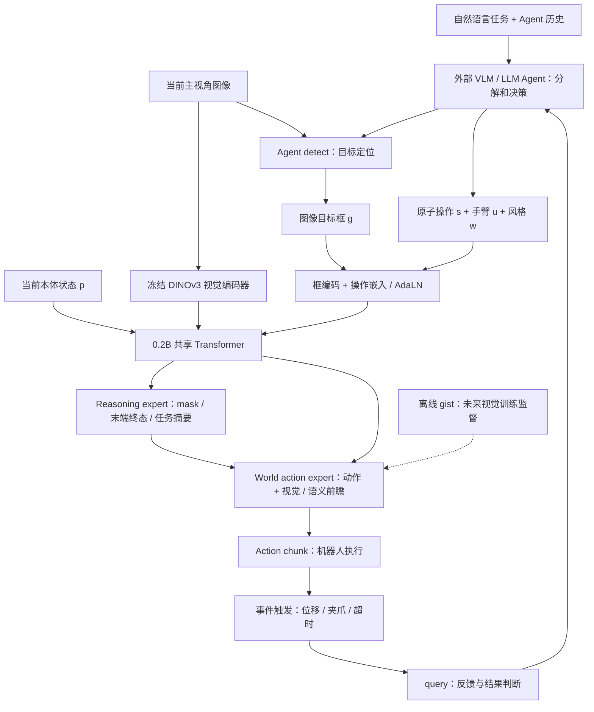
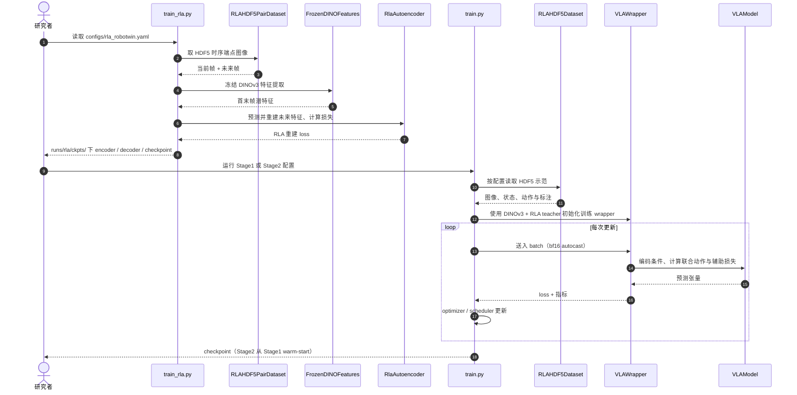

# AR-WAM：不靠语言指令的视觉框与原子动作世界–动作模型（A Visual-Conditioned Agent-Ready World Action Model for Robotic Manipulation）

**原文：** [arXiv:2609.23578v2](https://arxiv.org/html/2609.23578) · [项目主页](https://ar-wam.github.io/) · [官方代码](https://github.com/AR-WAM/AR-WAM) · [数据集](https://modelscope.cn/datasets/Jasonggg15/AR-WAM-RoboTwin-Dataset)。  
**作者：** Yicheng Jiang、Zesen Gan、Xiaobo Wang 等 11 人。**机构：** 香港科技大学、深圳理工大学、深信服、明略科技、香港中文大学 MMLab、不列颠哥伦比亚大学、星尘智能（Astribot）。**版本：** 2026-10-02 v2。

## 一句话定义

**AR-WAM 将“看哪一个物体、做什么动作”变成目标图像框 + 原子操作 token，由无语言编码器的轻量世界–动作策略执行；任务分解、历史记忆、抓取失败后的重试由外部大模型 Agent 管理。** 这里“不靠语言”是指**低层策略不接收语言条件**，不意味着整个系统没有语言模型。

## 英文缩写速查

| 缩写 | 英文全称 | 简要说明 |
|---|---|---|
| AR-WAM | Agent-Ready World Action Model | 支持外部 Agent 直接给出空间与技能条件的 WAM |
| WAM | World Action Model | 将未来变化与可执行动作共同建模的策略 |
| VLA | Vision-Language-Action | 以视觉与自然语言指令为条件生成机器人动作的对照模型 |
| VLM | Vision-Language Model | Agent 可用来定位物体、分解任务、判断失败的视觉语言模型 |
| AdaLN | Adaptive Layer Normalization | 将视觉框与操作 token 等条件调制到策略骨干的机制 |
| IDM / FDM | Inverse / Forward Dynamics Model | 离线用首末帧特征压缩和重建未来潜特征 |
| RLA | RLA（官方代码模块命名） | train_rla.py 的离线端点帧潜表征训练，未在本次核对代码中确认缩写全称 |
| KV | Key-Value Cache | 多步去噪重用注意力缓存以缩短 chunk 推理时延 |

## 为什么重要

- **同类物体歧义：** 自然语言如“拿第二个瓶子”不直接规定目标的图像位置；Agent 可先定位目标再交付归一化框。
- **能力解耦：** 把语言理解、开放词汇感知与长时记忆放在 Agent；低层策略复用固定的动作词表，避免在机器人策略内部重复训练语言编码器。
- **失效可诊断：** reasoning head 输出目标 mask、结束时末端位姿和任务摘要；可以区别“选错对象/意图”与“操作执行不当”。
- **WAM 而非纯 reactive VLA：** 同一策略联合预测动作块与视觉、语义双层未来潜表示，并非只在图像上画框就叫世界模型。

## 核心原理

1. **条件输入（§III-A）：** Agent 以 detect(y) 获取图像框 g（归一化四坐标）；向策略下发原子技能 s（pick/place/handover/click/pull 等），可选参与手臂 u（左/右/双臂）和风格 w。当前主视角图像 o 与本体状态 p 同时输入。双臂任务允许两个框。固定长度动作块与由事件划分的技能持续时间**不是一回事**。
2. **共享 0.5B 骨干（§III-B/C）：** 冻结约 0.3B DINOv3 提取视觉特征；约 0.2B 共享 Transformer 中的 reasoning expert 先得到可监督的目标 mask、双臂技能结束位姿、结构化任务摘要；world action expert 再以 flow matching 联合去噪动作块、视觉 foresight、语义 foresight。目标框是输入，mask 是预测结果。
3. **双层前瞻（§III-B/D）：** 离线预训的 latent IDM/FDM 用演示片段两端帧压缩变化为 foresight gist，提供训练期视觉未来监督；未来帧 reasoning token 提供语义监督；两种目标的梯度被截断。离线 gist 提取器**不**参与线上推理，而策略在推理时仍预测前瞻潜变量，不能写成“仅训练时有未来分支”。
4. **Agent 闭环（Algorithm 1）：** detect 定位，execute 执行到末端位移/夹爪开合/超时触发，query 回传事件、夹爪状态和观测。历史 H 保存在 Agent 侧；Agent 根据反馈重定位落物并重试，低层策略为当前观测条件下的 Markov 策略。

## 流程总览

**层级边界：** 图中 Agent 的 detect/execute/query 是论文描述的外部运行接口，**不是**官方仓库已经公开的完整真机 Agent 部署程序；点线 gist 仅表示训练监督。

## 源码运行时序图

官方仓库实际可辨识的**训练时序**如下（核对 README、train_rla.py、train.py、models/model_runner.py 和 dataloader）；与上方论文在线 Agent 控制概念图明确区分。

**官方入口：** 先运行 RLA 150k steps，再 Stage 1 550k，最后 Stage 2 warm-start 200k；[具体命令与配置](../../sources/repos/ar-wam.md)。目前仓库给出了训练脚本，**不能**据此认定 Agent 三原语真机 API 已随代码发布。

## 工程实践

| 项目 | 可操作结论 / 核对点 |
|---|---|
| 输入/输出 | 单主相机 320×240、16 维本体状态、图像框和技能条件 → 14 维动作、H=32 chunk（官方 RoboTwin Stage1 配置）；双臂时有参与手臂字段 |
| 训练 | ModelScope RoboTwin 数据，校验 100 个 ZIP，约 455 GiB 压缩 + 616 GiB 解压；另获取 DINOv3 ViT-L/16 权重 |
| 环境 | README 示例 Python 3.10 / PyTorch 2.7.1 / CUDA 12.8，8 GPU 分布式训练；global batch 128 需被卡数整除 |
| 顺序 | train_rla.py → train.py Stage1（550k）→ train.py Stage2（200k，--warm-start）；恢复训练用 --resume |
| 部署设计 | Agent 的目标框应测定位误差、漏检/重检延迟；短期验证时按事件重规划，不应把 14.09 ms 模型耗时视为整个闭环时延 |
| 开源状态 | 2026-11-22 官网可找到训练代码及 RoboTwin 数据；README 未给独立预训练 AR-WAM 策略权重/完整真机 Agent harness 一键入口；未在本机跑 GPU 训练 |

## 实验与评测

| 项目 | AR-WAM | 对照 / 口径 |
|---|---:|---|
| RoboTwin 2.0 clean | **87.2%** | Fast-WAM 87.8%；每任务 50 次 |
| RoboTwin 2.0 randomized | **84.2%** | Fast-WAM 82.5%；AR-WAM 此组最优 |
| Clean + randomized 均值 | **85.7%** | 只对应上述两种设置的平均，不是另一独立评测 |
| RMBench 长记忆 M(n) | **63.5%（AR-Q） / 52.5%（AR-K）** | 最强记忆基线 Goal2Skill 38.7% |
| Astribot S1 三项真机长任务 | **71.7%** | π₀.₅ 35.0%；三任务各 20 次；每任务 100 条真机示范微调 |
| RTX 4090 bf16 推理 | **14.09 ms / action chunk** | π₀.₅ 62.09 ms / chunk；不含外部 Agent API 耗时 |

**受控消融（RoboTwin，论文表 II/III）：** 视觉框 87.2% → 文本 74.2%（**下降 13.0 个百分点**）；去 reasoning 79.4%；去 foresight 78.6%；将 gist 换未来 patch 76.4%；把 AdaLN 换 cross-attention 73.4%。各数值仅对本论文相同训练设置成立。

## 结论

**最重要的不是“彻底淘汰语言”，而是让 Agent 做语义与长程决策、让轻量 WAM 用明确空间目标完成可诊断的短程动作，且不丢掉潜空间未来监督。**

1. 遇到多个相似目标，优先比较**文字指令 vs 目标框**的同数据消融，不用不同论文成功率直接证明视觉框必然更优。
2. 检验模型是否真为 WAM，查看动作与视觉/语义未来分支是否联合建模，而不仅是是否有 Agent 或边界框。
3. 调试抓空优先记录目标框、reasoning mask/末端终态、事件回执，再决定是重新定位还是修正执行。
4. 验算数据与延迟时区别：RoboTwin 的评测 vs RMBench Agent 记忆任务 vs S1 真机微调；14.09 ms/chunk 不等于整机延迟。
5. 如果目标涉及电缆插入、狭窄接触区域或微小物体，框的几何表示不足；先做定位精度/末端姿态与失败恢复压力测试。

## 局限与风险

- **空间提示粒度有限：** 小物体检测和 Swap T 高精度任务暴露 2D 框的局限，尚不能取代 3D 接触几何/触觉。
- **词表由人定义：** 原子 skill 偏桌面操作，复杂接触任务需更细分；有时 homing 依赖外部传统轨迹规划。
- **依赖上游 Agent：** 视觉框质量、任务进度记忆与恢复判断会决定系统成败；策略不保存长程历史意味着 Agent 侧必须可靠。
- **复现界限：** 数据量、预训视觉权重与多 GPU 资源门槛高；官方代码公开的是训练入口，缺少 README 可直接执行的完整真机 Agent 部署流程。
- **评测外推：** 论文实机范围仅 Astribot S1 的三项长任务，不可据此宣称各种机器人/场景皆能达到 71.7%。

## 与其他工作对比

- [WAM 概念](../concepts/world-action-models.md) / [WAM Stage 3](../../roadmap/depth-wam.md)：AR-WAM 采用共享骨干、动作 + 双层潜未来联合预测，属于轻量 Joint WAM；与训练时纯 future auxiliary loss 的方法需看在线分支再区分。
- [模仿学习](../methods/imitation-learning.md)：动作监督仍来自专家轨迹，创新主要在空间接口、reasoning 可监督输出与未来潜监督。
- **论文比较：** 相比 π₀.₅ 依赖文字条件与大模型骨干，AR-WAM 将开放词汇感知上移到 Agent；相比 Fast-WAM / LiLa-WAM，突出外部 Agent detect–execute–query 及失败恢复接口。不能说所有对照在所有任务上都败给 AR-WAM。

## 关联页面

- [World Action Models（WAM）](../concepts/world-action-models.md)
- [机器人操作任务](../tasks/manipulation.md)
- [模仿学习方法](../methods/imitation-learning.md)
- [WAM 纵深路线 Stage 3](../../roadmap/depth-wam.md)

## 参考来源

- [原论文 v2 全文与实验表归档](../../sources/papers/ar-wam-arxiv-2609-23578.md)
- [官方主页与开源状态](../../sources/sites/ar-wam.md)
- [官方代码与训练运行入口](../../sources/repos/ar-wam.md)

## 推荐继续阅读

- [arXiv HTML（§III/§IV）](https://arxiv.org/html/2609.23578)
- [AR-WAM GitHub 训练代码](https://github.com/AR-WAM/AR-WAM)
- [AR-WAM 官网示范](https://ar-wam.github.io/)
