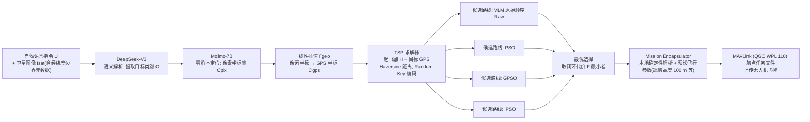

# ARIES-Mission2（arXiv:2608.12763）

**ARIES-Mission2**（[arXiv:2608.12763](https://arxiv.org/abs/2608.12763)）收录于 [多模空间 · 一周 VLA 研究趋势简析（2026.08.10–08.16）第三篇](../../sources/blogs/wechat_duomo_vla_weekly_trends_2026-08-10_part3.md) **类 Agent/导航** 段。

## 一句话定义

**LLM 理解任务、VLM 定位目标转 GPS，专用路线算法重排访问顺序生成省路闭环航线，比直接 VLA 顺序更短、规划更快。**

## 英文缩写速查

| 缩写 | 英文全称 | 简要说明 |
|------|----------|----------|
| VLA | Vision-Language-Action | 视觉–语言–动作策略 |
| VLM | Vision-Language Model | 视觉–语言多模态模型 |
| VLN | Vision-Language Navigation | 视觉–语言导航 |
| GRPO | Group Relative Policy Optimization | 组内相对策略优化（FIRE-VLA / Temporal GRPO 语境） |
| RL | Reinforcement Learning | 强化学习后训练 |

## 为什么重要

- LLM 理解任务、VLM 定位目标转 GPS，专用路线算法重排访问顺序生成省路闭环航线，比直接 VLA 顺序更短、规划更快。
- 策展机构：澳门理工大学、华南师范大学、南昌大学
- 与 [第三篇技术地图](../overview/vla-weekly-trends-2026-08-10-part3-technology-map.md) 同批工作可横向对照。

## 流程总览

图依据：论文 §II.A–§II.G / Fig.1、Fig.2

## 核心机制

| 项 | 内容 |
|----|------|
| **arXiv** | [2608.12763](https://arxiv.org/abs/2608.12763) |
| **文内评测** | UAV-VLPA-nano-30 |
| **开源** | **待核实**（2026-09-26） |

## 源码运行时序图

**不适用**（截至入库日未提供可运行官方代码入口，或仓库尚未公开）。

## 实验与评测

- **文内口径：** UAV-VLPA-nano-30
- **读法：** 本页为 [公众号策展](../../sources/blogs/wechat_duomo_vla_weekly_trends_2026-08-10_part3.md) 摘要；逐项指标以 **原文 PDF** 为准。

## 与其他工作对比

| 对照 | 差异读法 |
|------|----------|
| [Temporal GRPO](./paper-temporal-grpo.md) | 同周「训练范式」线：阶段信用 vs 失败驱动 teacher（若适用） |
| [VLA 方法页](../methods/vla.md) | 本页为单篇索引；机制细节以原文为准 |

## 结论

**ARIES-Mission2 适合作为本期「类 Agent/导航」路线的快速索引页。**

1. 核心贡献：LLM 理解任务、VLM 定位目标转 GPS，专用路线算法重排访问顺序生成省路闭环航线，比直接 VLA 顺序更短、规划更快。
2. 开源结论：**待核实** — 以项目页/仓库实际链接为准。
3. 横向对照见 [第三篇技术地图](../overview/vla-weekly-trends-2026-08-10-part3-technology-map.md)。

## 关联页面

- [VLA（Vision-Language-Action）](../methods/vla.md)
- [一周 VLA 趋势技术地图（第三篇）](../overview/vla-weekly-trends-2026-08-10-part3-technology-map.md)

## 参考来源

- [wechat_duomo_vla_weekly_trends_2026-08-10_part3.md](../../sources/blogs/wechat_duomo_vla_weekly_trends_2026-08-10_part3.md)
- [arXiv:2608.12763](https://arxiv.org/abs/2608.12763)
- [arXiv PDF](https://arxiv.org/pdf/2608.12763)：已通读方法部分（实验与附录以略读为准）：§I Introduction、§II.A 视觉语言语义推理、§II.B TSP 求解器、§II.C–E PSO/GPSO/IPSO、§II.F 最优选择、§II.G 动作生成与 MAVLink 部署、§III 实验设定

## 推荐继续阅读

- [VLA 方法页](../methods/vla.md)
- [arXiv PDF](https://arxiv.org/pdf/2608.12763)
