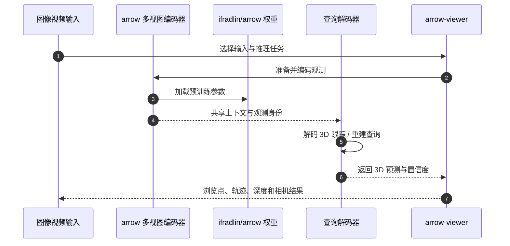

# ARROW：任意观测集合的 4D 重建与跟踪

**ARROW**（*Arbitrary Reconstruction and Tracking of 4D Observations in the Wild*，[arXiv:2610.01314](https://arxiv.org/abs/2610.01314)，[项目页](https://ifradlin.github.io/arrow/)，[代码](https://github.com/ifradlin/arrow)）由 **亚琛工业大学（RWTH Aachen University）**团队提出。它用一个共享场景表示处理无序图像集、视频和多视角流，再用查询预测跨观测的 3D 点位置，使 3D 重建与点跟踪共享同一推理框架。

## 一句话定义

**ARROW 将 D4RT 式时空点查询扩展到没有固定顺序的图像集合：先编码共享上下文和内容派生的观测身份，再按需查询源点在目标观测与参考坐标系中的 3D 位置。**

## 英文缩写速查

| 缩写 | 英文全称 | 简要说明 |
|------|----------|----------|
| ARROW | Arbitrary Reconstruction and Tracking of 4D Observations in the Wild | 论文与模型名称 |
| ID token | Identity token | 从图像内容预测的观测身份嵌入 |
| DA3 | Depth Anything 3 | 初始化多视图编码器的预训练骨干 |
| TAPVid-3D | — | 动态视频 3D 点跟踪评测 |
| MVTracker | Multi-View Tracker | 多视角点跟踪评测基准 |

## 核心信息

| 字段 | 内容 |
|------|------|
| **机构** | 亚琛工业大学（RWTH Aachen University） |
| **论文** | [arXiv:2610.01314](https://arxiv.org/abs/2610.01314)，2026-10-01 |
| **输入** | 任意图像集合、视频、多路视频流，或它们的组合 |
| **主要输出** | 3D 点轨迹、3D 重建几何、深度与相机相关预测 |
| **推理代码** | [GitHub](https://github.com/ifradlin/arrow)；含 CLI、Python API 与交互式 Web 查看器 |
| **权重** | [Hugging Face](https://huggingface.co/ifradlin/arrow) |
| **许可** | ARROW 代码 MIT；部分改编模型源码 Apache-2.0；权重 CC BY-NC 4.0 并受 Waymo 非商业条款约束 |

## 为什么重要

- **输入不必是时间序列：** 单段视频、多相机流和无序照片都可进入同一场景表示，适合观测顺序不固定的重建与多视角跟踪。
- **把观测身份作为查询条件：** 模型从内容生成每张图像的身份 token，避免用固定帧位置来区分图像；查询能够跨训练时长与多视角观测建立关联。
- **跟踪和重建共享接口：** 编码一次后，每个查询独立读取共享上下文，支持稀疏点跟踪和稠密重建。
- **可直接复现检查：** 官方交互查看器可选择图像或视频运行推理，也可加载已保存的预测并查看 3D 点、轨迹、深度和相机姿态。

## 流程总览

## 核心原理

### 1. 顺序无关的观测表示

D4RT 使用视频时间位置标识观测；ARROW 面向任意输入集合，改用模型从观测内容预测的身份 token。这样，多路视频可以共享拍摄时间，无序照片也不需要人为指定时间序列。

### 2. 源点与目标观测查询

查询包含源图像上的像素位置，以及源、目标和参考观测的索引。查询编码器将坐标和观测身份组合成 query token；稀疏解码器通过 cross-attention 读取共享场景上下文，逐查询预测 3D 位置。各查询独立解码，编码结果可复用于多种任务。

### 3. 与 D4RT 的方法关系

ARROW 明确借鉴 D4RT 的查询式接口。两者的差别在观测组织：D4RT 的时间编码适合有序视频，ARROW 用内容派生身份来支持无序图像集和多视角输入。因此 ARROW 是另一个项目的扩展路线，不是 D4RT 的官方开源实现。

## 源码运行时序图

官方推理代码与交互查看器已发布：

本地复现入口为 `uv sync --extra viewer` 后运行 `uv run arrow-viewer`；命令行也可用 `arrow infer` 写出预测，再通过查看器载入结果。

## 评测要点

| 任务 | 论文报告 |
|------|----------|
| **3D 点跟踪** | WorldTrack 与 TAPVid-3D 上报告新的最佳结果 |
| **多视角跟踪** | 适配为 RGB-only 输入的 MVTracker 上超过专用多视角跟踪器 |
| **3D 重建** | 多类重建任务保持有竞争力 |
| **相机位姿** | 论文评测并报告有竞争力的相机位姿估计结果 |

这些是论文对其评测设置的报告；跨论文比较时应同时检查观测数量、坐标系、尺度对齐和基准划分。

## 与其他工作对比

| 工作 | 输入组织 | 输出 / 定位 | 开放状态 | 与 ARROW 的关系 |
|------|----------|-------------|----------|-----------------|
| [D4RT](./paper-d4rt.md) | 有序视频；以时间位置标识观测 | 共享场景表示 + 独立时空查询，统一深度、相机、3D 跟踪与 4D 重建 | 截至入库日未开源 | ARROW 借用其查询接口，把时间编码换成内容派生身份，扩展到无序图像集与多视角流 |
| [Track4World](./paper-track4world.md) | 单目视频 | VGGT 风格全局表示 + 2D-to-3D correlation，前馈估计全像素世界系稠密 3D 轨迹 | 代码与权重已开源 | 同为前馈 3D 跟踪；Track4World 面向稠密单视频轨迹，ARROW 面向任意观测集合的稀疏 / 稠密查询 |
| [TAPVid-MV](./paper-tapvid-mv.md) | 多台同步移动相机 | 多视角长时 3D 任意点跟踪**基准** | 基准部分发布 | 评测侧邻域：ARROW 在 MVTracker 基准上报告多视角结果，跨基准比较需核对相机设置与指标 |

- **选型提示：** 输入是固定顺序单目视频时，D4RT / Track4World 的问题设定更直接；需要混合多路相机或无序照片时，ARROW 的顺序无关身份编码是主要差异点。
- **比较边界：** 上表各项的 SOTA 声明来自各自论文的评测设置，不能跨论文直接比数值。

## 结论

**ARROW 的主要贡献是用内容派生的观测身份，把查询式 4D 几何从有序视频扩展到无序图像集和多视角流，并提供了可运行的代码与查看器。**

- 需要混合相机视角或无序照片时，优先关注它的顺序无关查询和多视角跟踪能力。
- 对比 D4RT 时，重点检查输入组织与身份编码；两者共享查询思路，但项目与开源实现彼此独立。
- 仓库提供 CLI、Python API 和交互查看器，适合先用示例输入验证推理与可视化流程。
- 商用集成前分别核对代码、改编模型源码和权重的许可；权重带非商业限制及 Waymo 条款。
- 将其作为动态视觉几何上游评估；论文尚未证明其可直接作为机器人闭环控制器。

## 局限与风险

- **许可分层：** 自有代码与查看器为 MIT，部分改编模型源码为 Apache-2.0；预训练权重为 CC BY-NC 4.0，并且受 Waymo 非商业使用条款约束。
- **机器人部署验证不足：** 论文以视觉几何和跟踪基准为主，真机延迟、传感器标定和控制闭环效果仍需单独测量。
- **资源与依赖：** 推理需安装 PyTorch 等运行依赖并下载权重；实际显存、吞吐和输入规模应在目标硬件上验证。

## 参考来源

- [ARROW 论文摘录](../../sources/papers/arrow_arxiv_2610_01314.md)
- [ARROW 官方项目页](../../sources/sites/arrow-project.md)
- [ARROW 官方仓库归档](../../sources/repos/arrow.md)

## 关联页面

- [D4RT](./paper-d4rt.md) — ARROW 查询接口的相关工作；有序视频与无序观测的建模差异
- [Track4World](./paper-track4world.md) — 前馈全像素世界系 3D 跟踪
- [State Estimation](../concepts/state-estimation.md) — 几何与相机估计在机器人状态链路中的位置
- [Visual Representation for Policy](../concepts/visual-representation-for-policy.md) — 视觉表征接入机器人策略的方式

## 推荐继续阅读

- [ARROW 官方交互式查看器与项目页](https://ifradlin.github.io/arrow/) — 查看论文方法与交互示例
- [ARROW GitHub](https://github.com/ifradlin/arrow) — 安装、运行推理与许可文件
- [ARROW arXiv 论文](https://arxiv.org/abs/2610.01314) — 方法与评测细节
