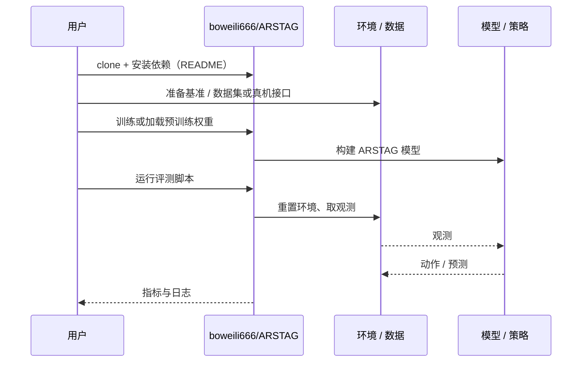

# ARSTAG（arXiv:2609.24563）

**ARSTAG**（*ARSTAG: An Agentic Real2Sim2Real System for Task-Specific Robot Data Generation*，[arXiv:2609.24563](https://arxiv.org/abs/2609.24563)，[项目页](https://boweili666.github.io/ARSTAG/)，[代码](https://github.com/boweili666/ARSTAG)）来自 [具身智能小站 2026-10-18 盘点](../../sources/blogs/wechat_embodied_station_26_papers_embodiedswe_2026-10-18.md)，属「数据生成与示范」组。

## 一句话定义

**协调场景重建、专家生成与数据扩增，把单张图像和任务指令转成仿真训练示范。**

## 英文缩写速查

| 缩写 | 英文全称 | 简要说明 |
|------|----------|----------|
| Real2Sim2Real | Real-to-Sim-to-Real | 真实→仿真→真实流程 |

## 为什么重要

- 围绕任务构建仿真可减少逐任务的工程量，是单图到示范的自动化路径。
- 开源结论：**已开源**（步骤 2.5，2026-10-18）。项目页链接的仓库可达（git ls-remote）。
- 同期同组工作见 [编程智能体造数据与 VLA 闭环评测：具身智能小站 10-18 期 26 篇阅读坐标](../overview/embodied-station-2026-10-18-26-papers-technology-map.md)。

## 核心机制

| 项 | 内容 |
|----|------|
| **arXiv** | [2609.24563](https://arxiv.org/abs/2609.24563) |
| **开源** | **已开源** |
| **要点** | 单张图像 + 指令 → 场景重建 → 专家示范生成 → 数据扩增，由智能体协调。 |
| **文内指标** | 公众号称真机验证覆盖抓取、放置和堆叠，仍有初始姿态限制；未给具体数字。 |

## 源码运行时序图

以下为按仓库入口（`boweili666/ARSTAG`）推断的通用运行链路；入库日仅核实仓库可达，未逐文件阅读，具体脚本名以 README 为准。

## 实验与评测

- 公众号称真机验证覆盖抓取、放置和堆叠，仍有初始姿态限制；未给具体数字。
- **读法：** 本页为索引级摘要，依据公众号转述的官方摘要与仓库信息整理；逐项数字与 baseline 以原文 PDF 为准。

## 与其他工作对比

- 横向索引见 [编程智能体造数据与 VLA 闭环评测：具身智能小站 10-18 期 26 篇阅读坐标](../overview/embodied-station-2026-10-18-26-papers-technology-map.md)；同 arXiv 不重复造页。

## 结论

**Real2Sim2Real 数据生成适合任务窄而重复的场景；初始姿态范围是主要边界。**

1. 开源边界：**已开源** — 项目页链接的仓库可达（git ls-remote）。
2. 核心机制：单张图像 + 指令 → 场景重建 → 专家示范生成 → 数据扩增，由智能体协调。
3. 复现与选型前核对任务协议、硬件与基准口径，勿直接横比公众号摘录数字。

## 关联页面

- [manipulation](../tasks/manipulation.md)
- [sim2real](../concepts/sim2real.md)
- [imitation-learning](../methods/imitation-learning.md)
- [embodied-station-2026-10-18-26-papers-technology-map](../overview/embodied-station-2026-10-18-26-papers-technology-map.md)

## 参考来源

- [arstag_arxiv_2609_24563.md](../../sources/papers/arstag_arxiv_2609_24563.md)
- [wechat_embodied_station_26_papers_embodiedswe_2026-10-18.md](../../sources/blogs/wechat_embodied_station_26_papers_embodiedswe_2026-10-18.md)
- [arXiv:2609.24563](https://arxiv.org/abs/2609.24563)

## 推荐继续阅读

- [arXiv PDF](https://arxiv.org/pdf/2609.24563)
- [项目页](https://boweili666.github.io/ARSTAG/)
- [https://github.com/boweili666/ARSTAG](https://github.com/boweili666/ARSTAG)
