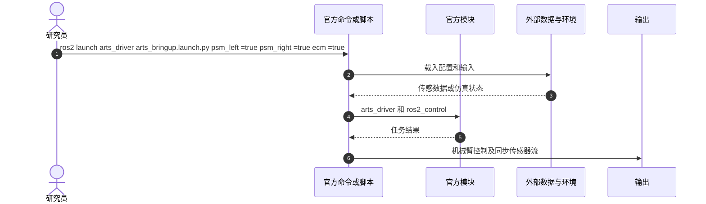

# ARTS: An Open-Source, Reproducible Three-Arm Platform for Autonomy Research in Minimally Invasive Surgery｜ARTS：可重建的三机械臂微创手术研究平台

## 一句话定义

**ARTS：可重建的三机械臂微创手术研究平台**：用可采购的机械臂、手术器械、同步成像与 ROS 2 控制链构建可复现的手术自主研究平台。

## 英文缩写速查

| 缩写 | 英文全称 | 简要说明 |
|---|---|---|
| RCM | Remote Center of Motion | 手术器械远心约束 |
| ROS2 | Robot Operating System 2 | 机器人中间件 |
| MCAP | Message Capture Format | ROS bag 记录封装 |

## 为什么重要

用可采购的机械臂、手术器械、同步成像与 ROS 2 控制链构建可复现的手术自主研究平台。 比起单一 benchmark 排名，研究与工程落地需要分清楚是否具有动作控制闭环、是否能复现以及硬件/数据前提。

## 核心信息

| 条目 | 原始证据 |
|---|---|
| 论文 | [arXiv:2611.15135v1](https://arxiv.org/abs/2611.15135) |
| 开源入口 | [官方源码](https://github.com/MRE-Lab-UMD/arts)（详见源码归档的部分/整体边界） |

## 核心原理

两台 UR5e 操作 da Vinci X/Xi 器械，一台 UR5 托举双目镜；ROS 2 Jazzy/ros2_control 分臂控制，末端位姿目标进入 RCM 约束 QP 和 Ruckig 轨迹约束；FLIR 硬件时间同步并用 MCAP 录制。

### 流程总览

流程图来自一手论文方法链；与实际源码包之间的映射如下。

## 源码运行时序图

源码运行入口按 [README 和脚本核对归档](../../sources/repos/arts-surgery-2611-15135.md) 标注，以下只代表已发布模块的调用范围。

## 工程实践

1. 依据原文方法核对输入传感器、控制/评估接口、样本分布及实验硬件。
2. 执行前检查[源码归档](../../sources/repos/arts-surgery-2611-15135.md)提到的实际可运行入口、外部依赖与许可。
3. 将论文成绩、真机误差、系统延迟与安全要求分开验收，复现前明确失败标准。

## 实验与评测

总物料约 137,320 美元；两台 PSM 500 Hz、ECM 125 Hz；双目相机曝光偏差 12 微秒以内、手到臂约 58 毫秒（作者台架结果）。

## 结论

**用可采购的机械臂、手术器械、同步成像与 ROS 2 控制链构建可复现的手术自主研究平台。**

1. 保留相同模型与数据预算下的可比口径，不跨基准简单求平均。
2. 优先复核最可能出现数据泄漏、接触失败或部署延迟的环节。
3. 对论文未检验的部署条件单列验证计划。

## 与其他工作对比

- **对比现有开源手术研究平台（论文 Table I）：** **Raven-II** 依赖定制机械臂（后由衍生公司销售）；最广泛使用的 **dVRK** 依赖受赠退役临床 da Vinci 硬件且部分 dVRK-Si 固件闭源；基于工业臂的 **MOPS**（UR 驱动腕式 da Vinci 器械）、**Rodriguez 等**（UR 驱动非腕式器械 + Karl Storz 立体内窥镜）和 **DASH**（G1/Franka 适配 da Vinci 器械，未公开发布完整系统）各自覆盖链条局部。ARTS 在单一可公开采购系统内同时集成机器人立体内窥镜臂（UR5 + 硬件同步双 FLIR）、腕式 da Vinci X/Xi 器械（双 UR5e）、电外科能量输出与 Apache 2.0 开源控制栈。
- **对比定位重复精度实测（Table II）：** 在相同 ISO 9283:1998 协议下，ARTS 单臂姿态重复精度实测 **0.14–0.25 mm**，优于论文同协议对照测得的 dVRK Classic（**0.09–1.24 mm**），并给出 54–58 ms 手到臂延迟与 2.7 ± 3.2 μs 双目同步偏差。

## 局限与风险

论文测试为台架、遥操作与少量训练任务，不能证明临床安全性；无人从独立实验室完全复现安装链，部分摄像头 SDK 为专有依赖。

## 关联页面

- [本期 29 篇具身论文选型地图](../overview/embodied-frontier-29-papers-2026-11-16.md)
- [ManiLadder：任务难度分层评测](./paper-maniladder-manipulation-benchmark.md)

## 参考来源

- [原论文核对归档](../../sources/papers/arts-surgery-2611-15135.md)
- [源码及运行入口](../../sources/repos/arts-surgery-2611-15135.md)

## 推荐继续阅读

- [arXiv HTML](https://arxiv.org/html/2611.15135v1)
- [官方源码仓](https://github.com/MRE-Lab-UMD/arts)
