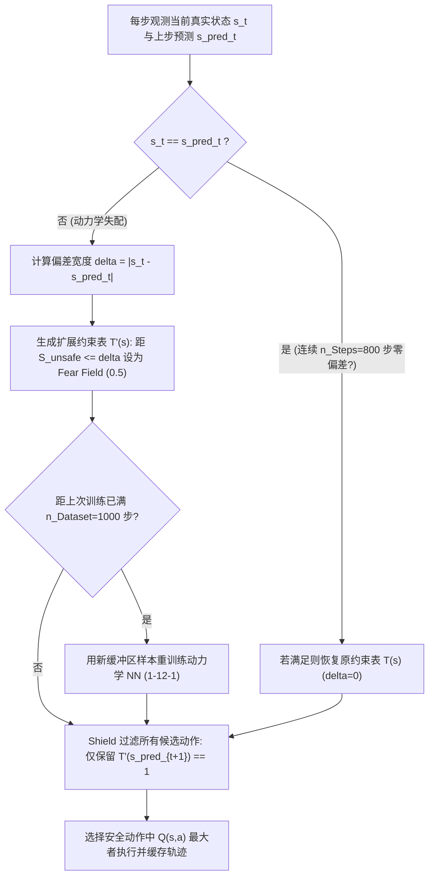

# Fear Field

**Fear Field: Adaptive constraints for safe environment transitions in Shielded Reinforcement Learning**（IJCAI-23 AISafety-SafeRL Workshop，CEUR-WS Vol-3505，Ikerlan & Mondragon Unibertsitatea）收录于 [AwesomeSim2Real](https://github.com/LongchaoDa/AwesomeSim2Real) **第 017/139** 篇，分组 **Action / Action Space Scale**。本页基于论文全文完成结构化精读与核实。

## 一句话定义

**Fear Field（FF）** 是一种面向屏蔽强化学习（Shielded RL）的自适应安全约束框架：当 Shield 内置的环境动力学模型预测状态与真实到达状态出现偏差时，动态在已知不安全状态周围扩张宽度正比于预测误差的“恐惧场”禁区以保守拦截高风险动作，直至模型采集新数据重训练并连续多步零偏差后才恢复原始边界。

## 英文缩写速查

| 缩写 | 英文全称 | 简要说明 |
|------|----------|----------|
| SRL / Shielded RL | Safe / Shielded Reinforcement Learning | 安全/屏蔽强化学习，在执行前由 Shield 过滤通往不安全状态的动作 |
| FF | Fear Field | 本文提出的自适应约束扩张区域，随动力学预测偏差动态伸缩 |
| MDP | Markov Decision Process | 马尔可夫决策过程 $\langle S, A, P, R, \gamma \rangle$ |
| NN | Neural Network | 神经网络，本文用单隐藏层 12 神经元网络预测相对状态转移 |
| Sim2Real | Simulation to Real | 仿真策略迁移到真实环境时面临的动力学不一致（reality gap）问题 |

## 为什么重要

- 传统 Shielded RL 依赖预建环境动力学模型 $P(s_{t+1}|s_t, a_t)$ 预判动作是否安全；一旦环境动力学发生突变（如机器人从仿真迁往真机，或仓库地面突然湿滑），旧模型预测失准，在模型重训练完成前的窗口期内 Shield 会放行危险动作。
- **Fear Field** 模拟人类在陌生/不确定环境下的谨慎行为，在逻辑名义安全（nominal safety）层面把“模型误差”直接映射为空间安全裕度扩张，无需人为整定固定保守超参（如 RTSA 中的固定收缩半径 $\delta$），且模型重训练过程独立于 RL 策略学习。

## 核心信息

| 字段 | 内容 |
|------|------|
| 编号 | 017/139 |
| 分组 | Action / Action Space Scale |
| 出处 | IJCAI-23 AISafety-SafeRL Workshop (CEUR-WS Vol-3505, pp. 1–9) |
| 作者与机构 | Haritz Odriozola-Olalde, Nestor Arana-Arexolaleiba, Maider Zamalloa, Jon Perez-Cerrolaza, Jokin Arozamena-Rodríguez（Ikerlan Technology Research Centre; Mondragon Unibertsitatea） |
| 论文 | <https://ceur-ws.org/Vol-3505/paper_3.pdf> |

## 核心机制

1. **前置 Shield 与相对位移动力学模型**
   - 假设在可达–避障（reach-avoid）设定下安全集 $S_{\text{safe}}$ 与不安全集 $S_{\text{unsafe}}$ 已知，基础约束表 $\mathcal{T}(s)$ 在 $s \notin S_{\text{safe}}$ 时取 $0$、其余取 $1$。
   - Shield 维护一个轻量化动力学预测网络（结构为 `1-12-1`、ReLU 激活），直接预测智能体的**相对位移**以降低复杂度与样本需求：
     $$s^{\text{pred}}_{t+1} = s_t + \mathrm{NN}(a_t)$$
2. **偏差触发 Fear Field 动态扩边（Algorithm 1）**
   - 每步比对上一步真实状态 $s_t$ 与模型预测状态 $s^{\text{pred}}_t$。一旦偏差超过阈值 $\lambda$（实验取 $\lambda = 0$，即 $s_t \neq s^{\text{pred}}_t$），立即计算恐惧场宽度：
     $$\delta_{t+1}(s) = |s_t - s^{\text{pred}}_t|$$
     （若跨时间步出现不同偏差，取历史最坏情况最大值）。
   - 将所有与任意不安全状态欧氏距离不超过 $\delta(s)$ 的状态划入恐惧场 $S_{\text{FF}}$，生成扩展约束表 $\mathcal{T}'(s)$：
     $$\mathcal{T}'(s) = \begin{cases} 0, & s \notin S_{\text{safe}} \\ 0.5, & s \in S_{\text{FF}} \\ 1, & \text{otherwise} \end{cases}$$
   - Shield 检查所有候选动作的预测落点，屏蔽所有导致 $\mathcal{T}'(s^{\text{pred}}_{t+1}) \in \{0, 0.5\}$ 的动作，仅从 $\mathcal{T}'=1$ 的安全动作中选 Q 值最高者执行。
3. **独立在线重训练与滞后消退**
   - 策略学习（表格 Q-Learning）与动力学模型更新解耦：在 Fear Field 介入期间，智能体持续收集过渡样本存入缓冲区；每累积 $n_{\text{Dataset}} = 1000$ 步新样本，用 Adam（lr=0.001，batch=6，100 epochs）重训练 NN。
   - 只有当模型在连续 $n_{\text{Steps}} = 800$ 步内预测状态与真实状态完全一致后，才将 $\delta$ 归零并恢复原始约束表 $\mathcal{T}(s)$。

### 方法流程图

## 评测与指标

在基于 **OpenAI Gym 修改版 10×10 确定性 Frozen Lake**（含 16 个陷阱洞）与 **skrl** 框架的对比实验中（50 次独立试验 × 每轮 700 episodes，包含“常规 1 格/步 → 湿滑 2 格/步 → 恢复常规 1 格/步”三阶段动力学突变；惩罚设置：步 -0.01、撞墙 -1、掉洞 -100、到达终点 +100、Shield 拦截 -10、FF 拦截 -2）：

| 方法 | 实验设定 | 平均不安全状态访问率 ↓ | 关键现象与补充说明 |
|------|------|------|------|
| **Q-Learning**（无 Shield） | 表格 Q-Learning（$\epsilon=0.4, \gamma=0.999, \alpha=0.4$） | **0.77192%** | 前 150 episodes 持续踩入危险状态，突变期同样频繁违规 |
| **Shielded Q-Learning**（静态约束） | 表格 Q-Learning + 动力学 NN Shield | **0.0156%** | 初始阶段收敛快 ~5 倍且零违规（约比无 Shield 降 50 倍）；但动力学刚突变时因模型过时而违规 |
| **Fear Field (FF)**（本文自适应约束） | 表格 Q-Learning + Shield + Fear Field | **0.00179%** | 比纯 Shield **再降低约一个数量级**；**60% 的试验全程 0 次**访问不安全状态 |

## 与其他工作对比

- **对比重合成 Shield（Zhu et al. [22]）与模型预测屏蔽（MPS, Bastani [2]）**：重合成新 Shield 在等待合成期间无法保证安全；MPS 虽能维持安全保证但累计回报显著下滑；Fear Field 在重训练缓冲期内即时扩张禁区以保底安全。
- **对比静态安全包络切换（RTSA, Lazarus et al. [15]）**：RTSA 依赖手工超参 $\delta$ 收缩安全包络且无自适应性，越界后直接执行停桨开伞等硬恢复策略；FF 的 $\delta_t$ 由在线预测误差自动驱动，并在模型收敛后自动撤销。同分组横向对照见 [技术地图](../overview/lc-awesome-sim2real-technology-map.md)。

## 常见误区或局限

1. **突变后策略重新收敛变慢**：由于 Fear Field 收紧了可行动作集合，旧路径可能被封锁，智能体必须重新探索绕行安全路径，导致动力学切换后的策略收敛回合数增加。
2. **重训练死循环风险**：在从“湿滑”切回“常规”的 **50 次试验中有 2 次**未观测到策略收敛——由于模型未能及时正确更新，智能体反复坠入不安全状态而无法攒够高质量重训练数据。
3. **仅在确定性离散网格验证名义安全**：当前实验基于确定性 10×10 离散状态空间、已知 $S_{\text{unsafe}}$ 与单步预测 $h=1$；随机环境、连续高维机器人状态（如仓库 AGV 轮地摩擦突变）及功能安全标准（IEC 61508 / ISO 5469）尚待后续验证。

## 结论

**Fear Field 通过将动力学模型的实时预测误差转化为不安全边界的自适应扩张半径，在动力学突变期间把 Shielded RL 的不安全状态访问率再降一个数量级（0.0156% → 0.00179%）。**

- 在 Sim2Real 或存在物理参数突变的受控场景中，即使模型能够在线微调，也必须在“模型发现失配到重训练收敛”的空窗期内叠加类似 Fear Field 的临时安全裕度扩张机制。
- 用神经网络预测相对状态增量（而非绝对状态）有助于压缩模型体积（`1-12-1`）并加速在线重训练响应。
- 部署前需针对“环境参数回切时新模型学坏导致卡死”设计兜底探索策略（如原文建议在找不到可行路径时临时注入小幅 $\epsilon$ 探索）以及独立重采样缓冲机制。

## 关联页面

- 列表实体：[AwesomeSim2Real](../entities/awesome-sim2real.md)
- 技术地图：[AwesomeSim2Real 技术地图](../overview/lc-awesome-sim2real-technology-map.md)
- 方法/任务：[sim2real.md](../concepts/sim2real.md)、[reinforcement-learning.md](../methods/reinforcement-learning.md)、[locomotion.md](../tasks/locomotion.md)、[manipulation.md](../tasks/manipulation.md)

## 参考来源

- [`sources/papers/lc_awesome_sim2real_noarxiv_017_fear-field-adaptive-constraints-for-safe.md`](../../sources/papers/lc_awesome_sim2real_noarxiv_017_fear-field-adaptive-constraints-for-safe.md) — 本条目策展摘录
- [`sources/papers/lc_awesome_sim2real_catalog.md`](../../sources/papers/lc_awesome_sim2real_catalog.md) — 列表总表
- [`sources/repos/awesome-sim2real.md`](../../sources/repos/awesome-sim2real.md)
- 论文：<https://ceur-ws.org/Vol-3505/paper_3.pdf>

## 推荐继续阅读

- [AwesomeSim2Real 仓库](https://github.com/LongchaoDa/AwesomeSim2Real)
- [原文](https://ceur-ws.org/Vol-3505/paper_3.pdf)
