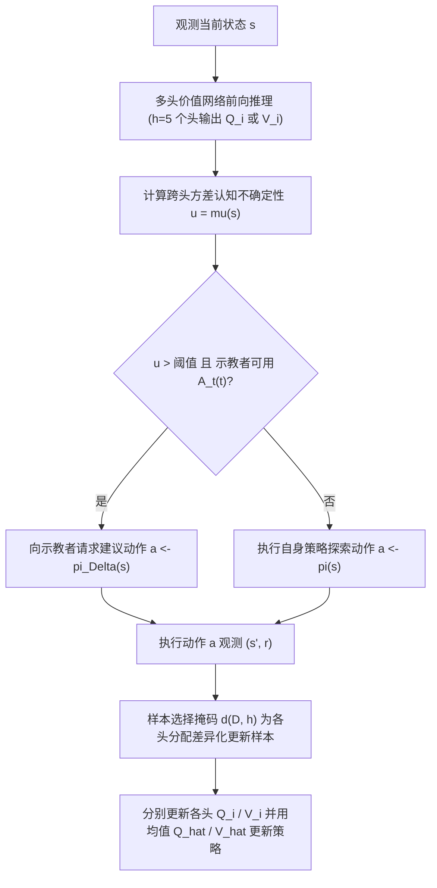

# Uncertainty-aware action advising for deep reinforcement learning agents

**Uncertainty-Aware Action Advising for Deep Reinforcement Learning Agents**（AAAI-20，pp. 5792–5799，University of São Paulo & Borealis AI）收录于 [AwesomeSim2Real](https://github.com/LongchaoDa/AwesomeSim2Real) **第 025/139** 篇，分组 **Action / Action Uncertainty**。本页基于论文全文完成结构化精读与核实。

## 一句话定义

**RCMP（Requesting Confidence-Moderated Policy advice）** 是一种面向深度强化学习的**不确定性感知动作建议框架**：学习者通过多输出头价值网络跨头方差实时估计自身的**认知不确定性（Epistemic Uncertainty）**，仅在不确定性高于阈值且示教者可用时主动请求单步动作建议用于探索，既节省有限的示教预算，又保留超越次优示教者的能力。

## 英文缩写速查

| 缩写 | 英文全称 | 简要说明 |
|------|----------|----------|
| RCMP | Requesting Confidence-Moderated Policy advice | 本文提出的由学习者不确定性触发请求动作建议的框架 |
| LfD | Learning from Demonstration | 从示教中学习，通常监督模仿整条轨迹且难超越示教者 |
| DQN | Deep Q-Network | 深度 Q 网络，本文用多头版本与样本掩码扩展以估计不确定性 |
| A3C | Asynchronous Advantage Actor-Critic | 异步优势演员–评论家算法，本文对 Critic 增加多头以估计 $V(s)$ 方差 |
| LSTM | Long Short-Term Memory | 长短期记忆网络，本文 Pong 实验中接在卷积层与多头输出层之间 |

## 为什么重要

- 传统模仿学习（LfD）通过监督拟合完整示教轨迹，往往无法通过探索超越次优示教者；而既有动作建议（Action Advising）主流指标 **Importance Advising**（$I(s) = \max_a Q_D(s,a) - \min_a Q_D(s,a)$）完全从**示教者**视角出发，不仅要求示教者拥有 Q 表且全程盯梢每一步，还会在学习者早已收敛的状态上白白消耗有限的建议预算。
- **RCMP** 把主动权交还给学习者本身：只需对 DQN 或 A3C 的末层做轻量多头改造，就能让智能体只在真正“拿不准”的状态向示教者（人类或旧系统，甚至黑盒次优策略 $\pi_\Delta$）求助，在真机部署或人机协作教学场景中大幅降低人类介入时长与通信开销。

## 核心信息

| 字段 | 内容 |
|------|------|
| 编号 | 025/139 |
| 分组 | Action / Action Uncertainty |
| 出处 | Proceedings of the AAAI Conference on Artificial Intelligence (AAAI-20, pp. 5792–5799) |
| 作者与机构 | Felipe Leno Da Silva（University of São Paulo）, Pablo Hernandez-Leal, Bilal Kartal, Matthew E. Taylor（Borealis AI） |
| 论文 | <https://cdn.aaai.org/ojs/6036/6036-13-9261-1-10-20200513.pdf> |

## 核心机制

1. **以学习者为中心的选择性请求机制（Algorithm 1）**
   - 假设存在黑盒示教策略 $\pi_\Delta$（仅可查询采样 $\pi_\Delta(s)$，不要求最优也不要求暴露内部 Q 函数）及可用性函数 $A_t(t)$（受预算上限或物理通信条件约束）。
   - 在每个学习步 $t$，智能体先计算当前状态 $s$ 的认知不确定性 $u \leftarrow \mu(s)$；若 $u$ 超过预设阈值（Gridworld 取 $0.11$，Pong 取 $0.1$）且 $A_t(t)$ 为真，则采纳示教动作 $a \leftarrow \pi_\Delta(s)$；否则按智能体自身探索策略 $\pi(s)$ 执行。
   - **可超越次优示教者**：由于建议动作仅作为探索样本进入更新（而非纯监督行为克隆），当不确定性下降后智能体停止求助并继续自主优化，最终可收敛到优于 $\pi_\Delta$ 的策略。
2. **基于多头价值网络的认知不确定性估计（Algorithm 2）**
   - 借鉴 Bootstrapped DQN 思想，将价值网络末端改为 $h$ 个独立预测头（主实验取 $h=5$），利用随机初始化与随机探索产生的分歧度作为**认知不确定性**（随采样充分而趋于收敛，区别于环境固有随机性导致的偶然不确定性 Aleatoric Uncertainty）：
     $$\mu(s) = \frac{\sum_{a \in A} \mathrm{var}(Q(s, a))}{|A|}, \quad \hat{Q}(s, a) = \frac{1}{h}\sum_{i=1}^{h} Q_i(s, a)$$
   - **独立样本选择函数 $d: D \times h \to \{0,1\}^{h \times |D|}$**：为防止所有头用完全相同的 mini-batch 更新而过早坍缩导致方差被低估，为每个头独立采样二值掩码 $p \sim d(D, h)$ 做逐元素加权更新（DQN 对每个头计算目标 $r + \gamma \max_{a'} Q_t[i](s', a')$ 并掩码计算 MSE；A3C 则为 Critic 配备多头 $V_i(s)$ 计算回报误差 $(R_i - V_i(s))^2$，Actor 仍使用均值 $\hat{V}$）。

### 方法流程图

## 评测与指标

本文在两大复杂度差异显著的基准上与 **No Advice**、**Random**（均匀随机索取建议）、**Importance Advising** 进行对比（原文以学习曲线与累计回报图呈现定量趋势，下表汇总核实自正文的实验设置与实测结果）：

| 实验域 | 基础算法 / 示教者 | 关键超参与预算设定 | 核心实测结果 |
|------|------|------|------|
| **Gridworld**（含陷阱 4 邻域 25% 滑落率；200 次重复） | DQN（2×25 FC + 5 头） 示教者：最优策略 | 1000 episodes（每 10 ep 评测 10 ep），预算上限 **700 步**，$\alpha=0.01, \gamma=0.9, h=5$，阈值 **0.11** | RCMP 在约 **200 步后自动停止求助**（远未耗尽 700 步预算），Random 与 Importance 均耗尽预算；折扣回报与总累计回报上 RCMP **显著优于 No Advice / Random，并与 Importance 并列最优** |
| **Atari Pong**（20 次重复） | A3C（4 层 Conv+MaxPool + LSTM + 5 头 Critic） 示教者：训练至 +21 分的 A3C（不保证全局最优） | 训练 **300 万步**（每 3 万步评测 1 ep），$\alpha=0.0001, \gamma=0.99, h=5$，阈值 **0.1** | RCMP 仅在早期短时间内请求建议，约 **100 万步**后起在无折扣得分上超越 No Advice，**累计无折扣总回报全面优于 No Advice、Random 与 Importance**，且消耗建议量远少于后两者 |
| **头数 $h$ 敏感性分析**（Gridworld） | DQN（$h \in [2, 100]$） | 200 次重复统计平均不确定性曲线 | $h=2$ 时遇到新状态（约 120 与 200 ep）出现明显尖峰抖动；$h$ 增大至 $100$ 曲线最平滑但参数开销增加，**$h=5$** 即可兼顾平滑度与计算效率 |

## 与其他工作对比

- **对比 Importance Advising（Torrey & Taylor 2013; Amir et al. 2016）**：Importance 依赖示教者暴露 Q 表且要求示教者全程监控所有时间步，容易在已收敛状态浪费预算；RCMP 仅要求黑盒动作采样接口，在 Gridworld 上用更少建议打平最优回报，在 Pong 上以更少建议全面反超。
- **对比基于访问计数的 Ad Hoc Advising（Silva & Costa 2017; Ilhan et al. 2019）与监督不确定性示教（Thakur et al. 2019）**：状态访问次数不等于价值模型真实不确定性；Thakur 等人通过监督学习模仿示教，无法像 RCMP 那样通过后续自主探索超越次优示教者。同分组横向对照见 [技术地图](../overview/lc-awesome-sim2real-technology-map.md)。

## 常见误区或局限

1. **硬阈值需要按任务域手工调参**：文中判定“高不确定性”的阈值在 Gridworld 取 `0.11`、Pong 取 `0.1`，随奖励尺度与环境变化需重新标定，尚无自适应阈值机制。
2. **仅捕获了基于多头分歧的启发式不确定性**：正如作者在 Future Work 指出，更严格区分认知不确定性与偶然不确定性仍可引入 Deep Ensembles 或 Distributional RL；此外当前建议仅用于替换当步探索动作，未结合示范损失函数或优先经验回放（PER）进一步加速收敛。
3. **无公开数值汇总表与开源链接**：原文主要以带 90%/60% 置信区间的折线与柱状图展示回报对比，且正文未给出公开代码仓库地址，复现需依据 Algorithm 1/2 自行实现。

## 结论

**RCMP 证明了只需为 DQN/A3C 增加轻量多头输出与样本选择掩码，就能以跨头方差准确捕捉认知不确定性，让智能体只在最需要时向黑盒示教者请求动作建议。**

- 在人机协作或真机样本受限场景下，应优先采用**学习者主导的按需求助**（RCMP）而非固定频率或示教者视角的 Importance Advising，避免把宝贵示范预算浪费在已收敛状态。
- 多头数量取 $h=5$ 左右并配合随机样本选择掩码 $d(D, h)$，即可在不显著增加显存的情况下避免头间坍缩与极少头数（如 $h=2$）带来的方差尖峰。
- 将示教建议保留在探索层而非纯监督模仿层，使策略既能享受早期安全引导，又保留在后期超越次优示教者的上升空间。

## 关联页面

- 列表实体：[AwesomeSim2Real](../entities/awesome-sim2real.md)
- 技术地图：[AwesomeSim2Real 技术地图](../overview/lc-awesome-sim2real-technology-map.md)
- 方法/任务：[sim2real.md](../concepts/sim2real.md)、[reinforcement-learning.md](../methods/reinforcement-learning.md)、[locomotion.md](../tasks/locomotion.md)、[manipulation.md](../tasks/manipulation.md)

## 参考来源

- [`sources/papers/lc_awesome_sim2real_noarxiv_025_uncertainty-aware-action-advising-for-de.md`](../../sources/papers/lc_awesome_sim2real_noarxiv_025_uncertainty-aware-action-advising-for-de.md) — 本条目策展摘录
- [`sources/papers/lc_awesome_sim2real_catalog.md`](../../sources/papers/lc_awesome_sim2real_catalog.md) — 列表总表
- [`sources/repos/awesome-sim2real.md`](../../sources/repos/awesome-sim2real.md)
- 论文：<https://cdn.aaai.org/ojs/6036/6036-13-9261-1-10-20200513.pdf>

## 推荐继续阅读

- [AwesomeSim2Real 仓库](https://github.com/LongchaoDa/AwesomeSim2Real)
- [原文](https://cdn.aaai.org/ojs/6036/6036-13-9261-1-10-20200513.pdf)
