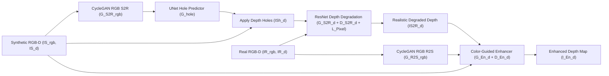

# Coupled real-synthetic domain adaptation for real-world deep depth enhancement

**Coupled Real-Synthetic Domain Adaptation for Real-World Deep Depth Enhancement**（Xiao Gu, Yao Guo, Fani Deligianni, Guang-Zhong Yang，Imperial College London / University of Glasgow / SJTU，*IEEE Transactions on Image Processing* 2020，DOI: `10.1109/TIP.2020.2988574`）收录于 [AwesomeSim2Real](https://github.com/LongchaoDa/AwesomeSim2Real) **第 030/139** 篇，分组 **Observation / Domain Adaptation**。本页基于论文全文完成精读与数据核实。

## 一句话定义

一种耦合「合成到真实退化（$F_{\text{Degrad}}$）」与「彩色引导深度增强（$F_{\text{En}}$）」的像素级域适应框架，通过对抗式真实深度噪声建模让仅在合成数据上监督训练的深度增强网络无需真实配对真值或二次微调即可泛化到真实 RGB-D 传感器。

## 英文缩写速查

| 缩写 | 英文全称 | 简要说明 |
|------|----------|----------|
| RGB-D | Red, Green, Blue and Depth | 彩色图像与深度图同步感知模态 |
| Sim2Real | Simulation to Real | 仿真器训练模型或策略向真实传感器域迁移 |
| LSGAN | Least Squares Generative Adversarial Network | 最小二乘生成对抗网络，用于真实深度噪声域对齐与增强域对齐 |
| FID | Fréchet Inception Distance | 特征分布距离指标，用于衡量合成退化深度与真实深度间的域偏移 |
| SSIM / PSNR | Structural Similarity / Peak Signal-to-Noise Ratio | 结构相似性与峰值信噪比，用于评估深度图结构保持与恢复精度 |

## 为什么重要

- **突破真实深度增强缺少完美真值的瓶颈**：商业深度相机（结构光、双目、ToF）受反光、弱纹理、光照干扰与分辨率不足影响严重；传统方案要么在合成深度上叠加简单的下采样/距离高斯噪声（与真实退化差距大），要么用多视角三维重建网格渲染“真值”（如 ScanNet，存在边缘重影与对齐误差，拖累端到端监督收敛）。
- **无配对真实真值下的跨相机泛化**：利用 UnrealCV 高质量合成场景与无配对 ScanNet 真实深度构建耦合退化–增强闭环，推理阶段无需真值、无需微调即可迁移到未见 RealSense D435 与 Kinect V1（NYU-V2）。
- **面向机器人操作与导航的实时端到端增强**：相比传统迭代优化（JBU / JBF / AD / MRF）或两阶段全局优化（DC），测试期单次前向推理仅需 **0.0288 s**（640×480），可同时完成非空洞去噪与空洞补全，可衔接 [Sim2Real 概念页](../concepts/sim2real.md) 与 [操作任务页](../tasks/manipulation.md)。

## 核心信息

| 字段 | 内容 |
|------|------|
| 编号 | 030/139 |
| 分组 | Observation / Domain Adaptation |
| 出处 | IEEE Transactions on Image Processing (2020), DOI: 10.1109/TIP.2020.2988574 |
| 作者与机构 | Xiao Gu, Yao Guo, Fani Deligianni, Guang-Zhong Yang（Imperial College London / University of Glasgow / Shanghai Jiao Tong University） |
| 论文与项目 | <https://ieeexplore.ieee.org/document/9076884> · <http://eprints.gla.ac.uk/214086/> · <https://xiaogu.site/RDE> |

## 核心机制

论文将真实深度增强显式分解为串行耦合的**退化子网络 $F_{\text{Degrad}}$** 与**增强子网络 $F_{\text{En}}$**（式 2：$\min \mathcal{L}_{\text{En}}(F_{\text{En}}(F_{\text{Degrad}}(I_{\text{gt}}^d, I^{\text{rgb}}), I^{\text{rgb}}), I_{\text{gt}}^d)$）：

1. **深度退化模块 $F_{\text{Degrad}}$（合成 $\to$ 真实噪声建模，§III-C）**
   - **RGB 域迁移与空洞预测**：先用 CycleGAN（$G_{S2R}^{\text{rgb}}, G_{R2S}^{\text{rgb}}$）缩小合成 RGB（$I_S^{\text{rgb}}$）与真实 RGB（$I_R^{\text{rgb}}$）的风格与光照差异（RGB FID 由 `0.6564` 降至 `0.5062`）；再由 UNet 结构的空洞预测网络 $G_{\text{hole}}$ 结合交叉熵 $\mathcal{L}_{\text{CE}}^{\text{hole}}$ 与 Jaccard 距离 $\mathcal{L}_{\text{J}}^{\text{hole}}$（式 3）预测无效像素掩码 $H_{\text{pred}} = G_{\text{hole}}(G_{S2R}^{\text{rgb}}(I_S^{\text{rgb}}))$，通过 Hadamard 乘积叠加缺失区域：$I_{Sh}^d = I_S^d \odot (\text{Sigmoid}(H_{\text{pred}}) > 0.5)$。
   - **结构保持的对抗深度噪声迁移**：针对几何畸变与传感器信噪比等难以仅从 RGB 推断的噪声，使用带 ResNet 残差块的生成器 $G_{S2R}^d$ 与 Patch 判别器 $D_{S2R}^d$（式 4），在 LSGAN 对抗损失（$\mathcal{L}_D^{S2R}, \mathcal{L}_G^{S2R}$）之外加入像素级保结构损失 $\mathcal{L}_{\text{Pixel}}^{S2R} = \|G_{S2R}^d(I_{Sh}^d) - I_{Sh}^d\|_2^2$，避免直接用 CycleGAN 做深度风格迁移时破坏深度数值范围与场景几何结构，生成逼真退化深度 $I_{S2R}^d$。

2. **彩色引导深度增强模块 $F_{\text{En}}$（退化 $\to$ 高质量合成域，§III-D）**
   - **双分支编解码结构（表 VIII）**：$G_{\text{En}}^d$ 以预训练 ResNet-34 编码器为基础，分别提取高分辨率彩色 $I^{\text{rgb}}$（3 通道 $\to$ 48 通道）与低质量深度 $I^d$（1 通道 $\to$ 48 通道）特征并拼接后逐层下采样、带跳跃连接反卷积上采样，输出联合去噪与补全后的深度图 $I_{\text{En}}^d$。在真实测试阶段，先通过 $G_{R2S}^{\text{rgb}}$ 将真实 RGB 迁移至高质量合成 RGB 域，减轻单网络同时恢复 RGB 与深度的负担。
   - **多几何约束 + 对抗损失（式 5、7）**：在合成监督配对 $\{I_{S2R}^d, I_S^d\}$ 上联合优化像素 L2 损失 $\mathcal{L}_{\text{Pixel}}^{\text{En}}$、一阶梯度总变分损失 $\mathcal{L}_{\text{Grad}}^{\text{En}}$、表面法向余弦损失 $\mathcal{L}_{\text{Norm}}^{\text{En}}$ 以及针对干净合成深度域的 LSGAN 对抗损失（$D_{\text{En}}^d$）。

### 方法流程图

## 评测与指标

实验在 **UnrealCV**（2000 训练 / 300 测试，640×480）、**ScanNet**（3000 训练仅用于退化域对齐 / 500 经 SSIM 过滤后的测试对，640×480）以及无真实微调的跨数据集 **RealSense D435**（132 帧）与 **NYU-V2 Kinect V1**（600 帧）上进行（表 II–VI，单位：米）：

| 数据集与设定 | 方法 | RMSE ↓ | $\text{RMSE}_\phi$（空洞）↓ | $\text{RMSE}_{\bar{\phi}}$（非空洞）↓ | SSIM ↑ | PSNR ↑ | FID ↓ |
|---|---|---|---|---|---|---|---|
| UnrealCV 退化测试（表 III） | JBU / JBF / AD / MRF | 0.1129 / 0.1025 / 0.1565 / 0.1007 | 0.4472 / 0.3580 / 0.6497 / 0.3572 | 0.0729 / 0.0739 / 0.1016 / 0.0727 | 0.9549 / 0.9581 / 0.8502 / 0.9636 | 21.4093 / 22.1794 / 18.1911 / 22.3032 | 0.6420 / 0.5340 / 1.0465 / 0.6023 |
| UnrealCV 退化测试（表 III） | **Proposed** | **0.0907** | **0.2205** | **0.0704** | **0.9817** | **22.6439** | **0.3490** |
| ScanNet 真实测试（表 IV） | JBU / AD / MRF | 0.1663 / 0.1562 / 0.1567 | 0.3724 / 0.4436 / **0.3015** | 0.1304 / 0.1354 / 0.1396 | 0.9350 / 0.9306 / **0.9397** | 17.7865 / 18.8562 / 18.3025 | 0.6125 / 0.8257 / 0.7012 |
| ScanNet 真实测试（表 IV） | Refiner [35] / DC [28] | 0.1831 / 0.1564 | 0.4076 / 0.3069 | 0.1469 / 0.1364 | 0.9110 / 0.9352 | 16.8948 / 18.8591 | 0.6760 / 0.8518 |
| ScanNet 真实测试（表 IV） | Cycle* / Cycle†（仅用 CycleGAN 退化） | 0.2479 / 0.2322 | 0.4992 / 0.7273 | 0.2168 / 0.1480 | 0.8798 / 0.8839 | 13.9847 / 15.1609 | 0.5732 / 0.6695 |
| ScanNet 真实测试（表 IV） | $G_{\text{En}}^d$ 仅用真实配对训练（2k / 3k） | 0.1838 / 0.1648 | 0.4107 / 0.3682 | 0.1470 / 0.1310 | 0.9188 / 0.9368 | 17.3607 / 18.6400 | 0.7463 / 0.7136 |
| ScanNet 真实测试（表 IV） | **Proposed（渐进训练 / 端到端）** | **0.1511** / 0.1543 | 0.3032 / 0.3217 | 0.1332 / 0.1326 | 0.9310 / 0.9347 | 18.5234 / **18.9693** | **0.5411** / 0.5422 |

- **域迁移距离验证（表 II）**：UnrealCV 原始深度到 ScanNet 的 FID 为 `1.3188`，经本文退化网络 $I_{S2R}^d$ 处理后降至 **`0.6878`**（同时对未参与训练的 RealSense 与 NYU-V2 分别从 `1.6005`/`1.8890` 降至 `1.0407`/`1.2604`）。
- **推理速度（表 V，640×480，Titan XP）**：本文方法单帧耗时 **`0.0288 s`**，快于 Refiner（`0.0967 s`）、MRF（`1.9086 s`）及带全局优化的 DC（`0.6901 + 25.4189 s`）。
- **消融实验（表 VI，ScanNet）**：去掉 $G_{\text{hole}}$ 后 RMSE 恶化至 `0.2795`、去掉 $G_{S2R}^{\text{rgb}}$ 恶化至 `0.2474`、去掉 $G_{S2R}^d$ 恶化至 `0.1834`、去掉 $G_{R2S}^{\text{rgb}}$ 恶化至 `0.1564`；损失函数消融（无 $D_{\text{En}}^d$）显示仅用像素损失 RMSE 为 `0.1953`，加入梯度损失降至 `0.1842`，再加入法向损失降至 `0.1636`。

## 与现有工作的对比

- **对比通用风格迁移（CycleGAN）**：直接用无配对 CycleGAN 迁移深度（表 IV 的 `Cycle*` 与 `Cycle†`）虽能降低部分 FID（如 NYU-V2 上 `0.8275`），但会引入严重纹理伪影与绝对距离偏移（ScanNet RMSE 升至 `0.2322–0.2479`）；本文显式拆分「RGB 引导空洞预测 + 保结构 LSGAN 残差噪声」从而保持深度尺度与几何边界。
- **对比真实配对监督路线（Refiner [35] / 真实数据直训 $G_{\text{En}}^d$）**：即使直接用 3000 对 ScanNet 真实配对训练同结构增强网络 $G_{\text{En}}^d$，RMSE 仍劣于本文（`0.1648` vs `0.1511`），印证真实多视角重建真值的边缘错位会限制上限，而高质量合成真值配合逼真退化反而更易学出锐利表面法向。
- **对比单目深度估计（RSI [55]）**：纯 RGB 深度估计缺少原始深度尺度先验，难以匹配真实绝对深度范围；同分组工作可对照 [AwesomeSim2Real 技术地图](../overview/lc-awesome-sim2real-technology-map.md)。

## 常见误区或局限

1. **逐帧静态处理，未利用时序一致性**：作者在 §VI 指出，模型独立增强单帧 RGB-D，未引入视频帧间时序信息来消除连续帧的深度闪烁。
2. **仅面向室内近距 RGB-D，不适用于室外稀疏 LiDAR**：论文在 §II-C 明确区分了 RGB-D 稠密噪声与 KITTI/Cityscapes 等室外 LiDAR 稀疏点云重建任务。
3. **跨数据集泛化仅做了定性验证**：RealSense D435 与 NYU-V2 上因无真值，仅提供了深度图与法向图定性对比（Fig. 9），未报告量化误差表。
4. **合成数据集表现含同域先验红利**：作者在 §V-B 坦承，UnrealCV 测试集与训练噪声分布同源（表 III），跨到真实 ScanNet/RealSense 的表现才是检验退化泛化力的核心依据。

## 结论

**《Coupled Real-Synthetic Domain Adaptation for Real-World Deep Depth Enhancement》证明：用「RGB 域对齐 + 空洞预测 + 保结构对抗噪声」把高质量仿真深度退化成真实传感器分布，再训练彩色引导增强网络，比直接在有对齐误差的真实重建数据上做监督学习效果更好。**

1. **深度域适应必须加结构保持约束** — 直接套用 CycleGAN 会污染绝对深度尺度和几何结构，必须结合像素 L2、梯度与法向约束。
2. **先做空洞预测、再叠加传感器噪声** — 消融显示去掉 $G_{\text{hole}}$（RMSE `0.2795`）与去掉 $G_{S2R}^{\text{rgb}}$（`0.2474`）退化最剧烈，说明反光/弱纹理空洞的视觉先验是真实深度建模的首要瓶颈。
3. **输入增强器的 RGB 质量不能妥协** — 用 $G_{R2S}^{\text{rgb}}$ 先对齐 RGB 域优于把低质 RGB 直接喂给深度增强器（`0.1511` vs `0.1906`），因为相机本身的 RGB 分辨率与信噪比通常远高于深度通道。
4. **法向与梯度损失对下游 3D 感知至关重要** — 仅看深度 RMSE 容易被过平滑或微震荡欺骗（如 AD/DC 在法向图上噪声明显），加入梯度与法向损失显著改善表面几何质量。

## 关联页面

- 列表实体：[AwesomeSim2Real](../entities/awesome-sim2real.md)
- 技术地图：[AwesomeSim2Real 技术地图](../overview/lc-awesome-sim2real-technology-map.md)
- 方法/任务：[sim2real.md](../concepts/sim2real.md)、[locomotion.md](../tasks/locomotion.md)、[manipulation.md](../tasks/manipulation.md)

## 参考来源

- [`sources/papers/lc_awesome_sim2real_noarxiv_030_coupled-real-synthetic-domain-adaptation.md`](../../sources/papers/lc_awesome_sim2real_noarxiv_030_coupled-real-synthetic-domain-adaptation.md) — 本条目策展摘录
- [`sources/papers/lc_awesome_sim2real_catalog.md`](../../sources/papers/lc_awesome_sim2real_catalog.md) — 列表总表
- [`sources/repos/awesome-sim2real.md`](../../sources/repos/awesome-sim2real.md)
- 论文：<https://ieeexplore.ieee.org/document/9076884> · <http://eprints.gla.ac.uk/214086/>

## 推荐继续阅读

- [AwesomeSim2Real 仓库](https://github.com/LongchaoDa/AwesomeSim2Real)
- [原文](https://ieeexplore.ieee.org/document/9076884)
- [项目页面](https://xiaogu.site/RDE)
