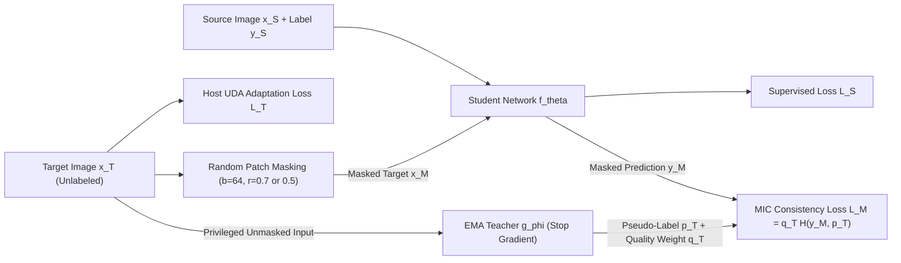

# MIC

**MIC: Masked Image Consistency for Context-Enhanced Domain Adaptation**（CVPR 2023，arXiv:2212.01322v2）收录于 [AwesomeSim2Real](https://github.com/LongchaoDa/AwesomeSim2Real) **第 033/139** 篇，分组 **Observation / Domain Adaptation**。本文提出面向无监督域自适应（UDA）的通用上下文学习插件 **MIC**，且不增加任何推理期计算开销。

## 一句话定义

MIC 通过在训练期随机遮挡目标域图像块，并强制学生网络对掩码图像的全图预测与指数移动平均（EMA）教师基于完整目标图像生成的置信度加权伪标签保持一致，从而迫使模型利用目标域空间上下文而非仅靠局部纹理完成跨类判别。

## 英文缩写速查

| 缩写 | 英文全称 | 简要说明 |
|------|----------|----------|
| MIC | Masked Image Consistency | 掩码图像一致性模块，本文提出的 UDA 上下文增强训练插件 |
| UDA | Unsupervised Domain Adaptation | 无监督域自适应，利用有标注源域与无标注目标域迁移模型 |
| EMA | Exponential Moving Average | 指数移动平均教师网络，用于生成稳定高质量的完整图伪标签 |
| MIM | Masked Image Modeling | 掩码图像建模（如 MAE），对比实验表明仅靠 ImageNet MIM 无法替代目标域 MIC |
| Sim2Real | Simulation to Real | 仿真策略或感知模型向真实环境迁移 |

## 为什么重要

- 传统 UDA 方法在目标域（如仿真到真实街道、晴天到黑夜/恶劣天气）常混淆局部外观相近的类别（如人行道 vs 道路、骑行者 vs 行人），根因在于无监督损失缺乏足够监督去发掘目标域空间上下文（如路缘石、头盔与自行车先验）。
- MIC 作为正交插件无需改动主干架构，仅在训练阶段启用、**推理零开销**，即可在语义分割（GTA→Cityscapes 达 **75.9 mIoU**，达到有监督上限的 **90.6%**）、图像分类（VisDA-2017 达 **92.8%**）与目标检测（CS→Foggy CS 达 **47.6 mAP**）全面刷新 SOTA。
- 横向位置与同组方法对照见 [AwesomeSim2Real](../entities/awesome-sim2real.md) 与 [技术地图](../overview/lc-awesome-sim2real-technology-map.md)。

## 核心信息

| 字段 | 内容 |
|------|------|
| 作者 | Lukas Hoyer（ETH Zurich）, Dengxin Dai, Haoran Wang（MPI-INF）, Luc Van Gool（ETH Zurich / KU Leuven） |
| 编号 / 分组 | 033/139 · Observation / Domain Adaptation |
| 出处 | CVPR 2023（arXiv:2212.01322v2） |
| 论文链接 | <https://ieeexplore.ieee.org/document/10203852> / <https://arxiv.org/abs/2212.01322> |
| 官方代码 | <https://github.com/lhoyer/MIC>（基于 HRDA / mmsegmentation / SDAT / SADA） |

## 核心机制

MIC 挂载在任意包含源域监督损失 `L^S` 与宿主 UDA 适应损失 `L^T` 的训练框架上，总目标为 `\min_θ (1/N_S) Σ L^S_k + (1/N_T) Σ (λ^T L^T_k + λ^M L^M_k)`（默认 `λ^M = 1.0`）：

1. **目标域随机分块掩码**：按均匀分布 `v ~ U(0, 1)` 以块大小 `b`（默认全分辨率 `b = 64`，半分辨率方法取 `32`）和遮挡率 `r`（分割/分类 `r = 0.7`，目标检测 `r = 0.5` 以防稀疏前景被完全遮没）生成二值掩码 `M`，构造掩码目标图 `x^M = M ⊙ x^T`（晴天/常规场景施加颜色增强，夜间 DarkZurich/ACDC 禁用以免破坏暗部纹理）。
2. **特权完整图 EMA 教师伪标签**：教师网络 `g_φ` 按 `φ_{t+1} ← α φ_t + (1 - α) θ_t` 更新（分割 `α = 0.999`，分类/检测 `α = 0.9`），接收**未遮挡的完整图像 `x^T`** 生成伪标签 `p^T` 与质量权重 `q^T`（分类取最大 Softmax 概率；分割取超过阈值 `τ = 0.968` 的像素占比；检测取置信度 `> δ = 0.8` 经 NMS 过滤的框）。
3. **全图掩码一致性损失 `L^M`**：学生网络 `f_θ` 对掩码图预测 `ŷ^M = f_θ(x^M)`，在**所有像素块（含被遮挡块与未遮挡块）**上以 `L^M = q^T H(ŷ^M, p^T)` 监督（Table S1 证明同时约束被遮挡块与未遮挡块比单侧约束额外提升约 +0.8 mIoU）。推理阶段完全移除掩码与教师分支。

### 方法流程图

## 评测与指标

### 1. 语义分割与多任务 UDA 基准表现（Tables 1–5, S5）

| 任务与基准 | 宿主 UDA 方法 / 骨干 | w/o MIC | w/ MIC | 净提升 |
|------------|----------------------|---------|--------|--------|
| 语义分割：GTA → Cityscapes (Val, mIoU %) | DeepLabV2 + Adversarial | 44.2 | 48.2 | +4.0 |
| 语义分割：GTA → Cityscapes (Val, mIoU %) | DeepLabV2 + Entropy Min. | 44.3 | 49.0 | +4.7 |
| 语义分割：GTA → Cityscapes (Val, mIoU %) | DAFormer (MiT-B5) | 68.3 | 70.6 | +2.3 |
| 语义分割：GTA → Cityscapes (Val, mIoU %) | HRDA (MiT-B5) | 73.8 | **75.9** | +2.1 |
| 语义分割：Synthia → Cityscapes (Val, mIoU %) | HRDA | 65.8 | **67.3** | +1.5 |
| 语义分割：CS → DarkZurich (Test, 昼夜迁移) | HRDA | 55.9 | **60.2** | +4.3 |
| 语义分割：CS → ACDC (Test, 恶劣天气) | HRDA | 68.0 | **70.4** | +2.4 |
| 语义分割：CS → Foggy Zurich (Test v2, mIoU %) | HRDA | 46.0 | **49.7** | +3.7 |
| 图像分类：VisDA-2017 (Acc %) | SDAT (ResNet-101 / ViT-B/16) | 84.3 / 89.8 | **86.9 / 92.8** | +2.6 / +3.0 |
| 图像分类：Office-Home (12 域对平均 Acc %) | SDAT (ViT-B/16) | 84.3 | **86.2** | +1.9 |
| 目标检测：CS → Foggy CS (mAP@0.5 %) | SADA (Faster R-CNN R50-FPN) | 44.0 | **47.6** | +3.6 |

### 2. 上下文探测、消融与开销（Sec. 4.5, Tables 7, 9, 10）

- **纯上下文推断验证**：将 Cityscapes 验证集划为 `256×256` 非重叠遮挡块并仅凭可见上下文预测其语义，MIC(HRDA) 取得 **52.5 mIoU**，远超 HRDA 基线的 **22.8 mIoU**。
- **关键消融（DAFormer, GTA→CS）**：完整 MIC 达 `70.6 mIoU`；移除分块掩码（仅保留增广一致性）暴跌 `-20.0` 至 `50.6`；移除伪标签置信度权重 `q^T` 下降 `-1.6`（`69.0`）；移除 EMA 教师下降 `-0.7`（`69.9`）；单独在有监督 Cityscapes 训练上 MIC 仅带来 `+0.3 mIoU`（`77.6 → 77.9`），说明增益主要来自无标注目标域 UDA。
- **计算与显存开销（Table 10）**：在已含 EMA 教师的 DAFormer / HRDA 中，MIC 仅使训练吞吐下降约 24%（`0.71 → 0.57 it/s` / `0.36 → 0.29 it/s`）、显存增加 1%（`+0.09~0.10 GB`），**推理速度与显存保持完全不变（`8.6` / `0.8 img/s`）**。

## 与其他工作对比

- **对比 ImageNet MAE 预训练（Table 3）**：在 VisDA-2017 上给 SDAT 换用 MAE 预训练反而使准确率从 `89.8%` 降至 `88.4%`（`-1.4`），证明 ImageNet 上学到的上下文不会自动迁移至目标域，必须在 UDA 适应阶段用目标域掩码一致性在线学习。
- **对比 CrDA / HRDA 等结构化上下文模块**：即便骨干网（如 SegFormer/DAFormer）与多尺度架构（HRDA）本身具备长程注意力，缺少强目标域上下文监督仍会漏掉关键共现关系；MIC 属于损失层正交增强，与上述架构完全兼容。

## 结论

**MIC 用极其简单的「完整图 EMA 教师伪标签 + 目标域随机分块掩码学生一致性」证明：阻止 UDA 混淆相似外观类别的关键不是更复杂的网络头，而是在目标域上显式强迫网络依赖空间上下文推理。**

1. **只作用于目标域通常更安全**：当源–目标域上下文分布差距大（如合成 GTA → 真实 CS）时，对源域也加掩码会掉点 `-2.7 mIoU`（`73.8 → 71.1`）；仅当源–目标共享真实域上下文（如 CS → ACDC）时，源+目标双域掩码才额外增益（`66.9 → 68.0`）。
2. **必须与宿主 UDA 损失协同**：移除 `L^T` 仅靠 MIC 单打独斗时，GTA→CS 会从 `70.6` 降至 `62.5 mIoU`（但仍比无 `L^T` 的 DAFormer 高 `+10.5`）。
3. **块大小与遮挡率需匹配任务稀疏度**：分割在 `b = 64, r = 0.7` 最优（`b = 256` 过大会伤及性能），稀疏目标检测需下调至 `r = 0.5`，分类需加快教师更新 `α = 0.9`。
4. **低照度场景禁用颜色增强**：在 CS→ACDC 上开启颜色抖动会损坏夜图微弱对比度，使 mIoU 从 `59.8` 降至 `58.7`。

## 常见误区或局限

1. **依赖上下文有效性假设**：对于主要依靠自身局部纹理即可区分的类别（如 `building`、`vegetation`）提升微弱；对极少见类别（如 CS→DarkZurich 中的 `truck`），可能学到虚假上下文共现偏置导致单类掉点。
2. **异常共现（Out-of-Context）脆弱性**：补充材料 Sec. G 指出，若推理时目标出现在非常规上下文中，强依赖上下文先验的模型可能受误导；且当前 UDA 性能仍不足以无监督直接安全部署于真车自动驾驶极端长尾场景。
3. **非独立 UDA 算法**：MIC 依赖 EMA 教师提供的合理初始伪标签与宿主 `L^T` 域对齐，伪标签严重坍塌时无法凭空完成跨模态对齐（虽对 20% 人工类别置换噪声仅掉点 `-4 mIoU`）。

## 关联页面

- 列表实体：[AwesomeSim2Real](../entities/awesome-sim2real.md)
- 技术地图：[AwesomeSim2Real 技术地图](../overview/lc-awesome-sim2real-technology-map.md)
- 方法/任务：[sim2real.md](../concepts/sim2real.md)、[locomotion.md](../tasks/locomotion.md)、[manipulation.md](../tasks/manipulation.md)、[reinforcement-learning.md](../methods/reinforcement-learning.md)

## 参考来源

- [`sources/papers/lc_awesome_sim2real_noarxiv_033_mic-masked-image-consistency-for-context.md`](../../sources/papers/lc_awesome_sim2real_noarxiv_033_mic-masked-image-consistency-for-context.md) — 本条目策展摘录
- [`sources/papers/lc_awesome_sim2real_catalog.md`](../../sources/papers/lc_awesome_sim2real_catalog.md) — 列表总表
- [`sources/repos/awesome-sim2real.md`](../../sources/repos/awesome-sim2real.md)
- 论文：<https://ieeexplore.ieee.org/document/10203852>（预印本 <https://arxiv.org/abs/2212.01322>）

## 推荐继续阅读

- [MIC 官方代码仓库](https://github.com/lhoyer/MIC)
- [AwesomeSim2Real 仓库](https://github.com/LongchaoDa/AwesomeSim2Real)
- [原文](https://ieeexplore.ieee.org/document/10203852)
