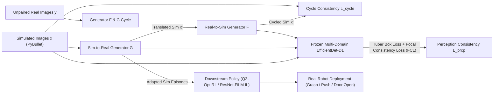

# Retinagan

**RetinaGAN: An Object-aware Approach to Sim-to-Real Transfer**（ICRA 2021，arXiv:2011.03148v2）收录于 [AwesomeSim2Real](https://github.com/LongchaoDa/AwesomeSim2Real) **第 034/139** 篇，分组 **Observation / Domain Adaptation**。本文提出结合目标检测语义一致性损失的像素级 Sim2Real 生成对抗网络 **RetinaGAN**。

## 一句话定义

RetinaGAN 在无配对 CycleGAN 训练中接入一个预训练并冻结的多域目标检测器（EfficientDet），通过约束原图、跨域迁移图与循环重建图之间的检测框回归及连续概率类别输出一致性，迫使 Sim2Real 图像翻译严格保留操控物体的结构与纹理。

## 英文缩写速查

| 缩写 | 英文全称 | 简要说明 |
|------|----------|----------|
| GAN | Generative Adversarial Network | 生成对抗网络，本文采用双向 CycleGAN 架构做像素级域转换 |
| FCL | Focal Consistency Loss | 本文推导的连续概率版 Focal Loss，用于惩罚跨域检测类别 logit 漂移 |
| Q2-Opt | Quantile QT-Opt | 分布式视觉强化学习算法，用于实例抓取与 3D 推物策略训练 |
| IL / BC | Imitation Learning / Behavioral Cloning | 模仿学习与行为克隆（ResNet-18 FiLM），用于开门任务验证 |
| Sim2Real | Simulation to Real | 仿真策略迁移到真机 |

## 为什么重要

- 纯粹无监督像素迁移（CycleGAN）常在真实样本不足时扭曲或抹除任务关键物体几何（如把手、门框、易拉罐轮廓），带来真机安全风险；而 RL-CycleGAN 绑定特定任务的 Q 值一致性，无法跨任务复用且必须采集与目标策略同分布的真机轨迹。
- RetinaGAN 用**任务解耦（task-agnostic）的目标检测感知一致性**替代特定任务 Q 损失：同一垃圾分拣域检测器不仅让实例抓取达到 **80.0%**（超出 CycleGAN / RL-CycleGAN 11–12 个百分点，且 10K 小样本超越 135K+ 的 Sim+Real 基线），还能零微调复用至推物（**90.0%**）乃至跨环境迁移到会议室开门任务（Ensemble-RetinaGAN 达 **96.6%**）。
- 横向位置见 [AwesomeSim2Real](../entities/awesome-sim2real.md) 与 [技术地图](../overview/lc-awesome-sim2real-technology-map.md)。

## 核心信息

| 字段 | 内容 |
|------|------|
| 作者 | Daniel Ho, Kanishka Rao, Zhuo Xu, Eric Jang, Mohi Khansari, Yunfei Bai（Everyday Robots / Robotics at Google / UC Berkeley） |
| 编号 / 分组 | 034/139 · Observation / Domain Adaptation |
| 出处 | ICRA 2021（arXiv:2011.03148v2） |
| 论文链接 | <https://ieeexplore.ieee.org/document/9561157> / <https://arxiv.org/abs/2011.03148> |
| 项目主页 | <https://retinagan.github.io> |

## 核心机制

1. **多域目标检测器预训练（冻结复用）**：
   - 在混合 PyBullet 仿真图像（625,000 张）与真实回收站/桌面图像（44,000 + 37,000 张带框标注，共 59 类）上预训练单个 `EfficientDet-D1`（输入 `512×640` 填充至 `640×640`，90,000 步）。训练 RetinaGAN 时全程冻结该检测器参数。
2. **感知一致性损失与 Focal Consistency Loss（FCL）**：
   - 给定无配对仿真图 `x`、真实图 `y` 及 CycleGAN 双向 U-Net 生成器 `G: Sim → Real`、`F: Real → Sim`（判别器带 Spectral Normalization，权重 `λ_GAN = 1`, `λ_cycle = 10`, `λ_prcp = 0.1`），对全部 6 张图 `{x, G(x), F(G(x))}` 与 `{y, F(y), G(F(y))}` 运行冻结 `EfficientDet`。
   - 对每对图像 `(p_1, p_2)`（循环项权重取 `0.5`），总感知损失 `L_prcp = L_Huber(box_1, box_2) + FCL(cls_1, cls_2)`。其中 **FCL** 将传统 Focal Loss 的二值标签扩展至连续预测概率 `y ∈ [0, 1]`：`FCL(y, p) = |y - p|^γ BCE(y, p)`，并按锚框前景总概率归一化。
3. **任务策略训练与 Ensemble-RetinaGAN**：
   - 先用 RetinaGAN 将海量仿真回合图像离线/在线翻译为逼真图像，再纯用迁移后仿真数据（或混合真实数据）训练下游 Q2-Opt RL 或 ResNet-18 FiLM 模仿学习策略。
   - 针对低真实数据量导致的生成光照/颜色震荡，用不同随机种子与一致性权重训练 3 个 RetinaGAN 模型混合生成训练数据（**Ensemble-RetinaGAN**）以扩充视觉多样性。

### 方法流程图

## 评测与指标

### 1. 真实机器人 RL 实例抓取（Q2-Opt，6 台机器人分拣站共 90 次试验，Table I）

| 训练数据源与真实回合数 | 真实抓取成功率 | 估计标准差 |
|------------------------|----------------|------------|
| `Sim-Only`（仿真内 92% 成功率） | 18.9% | 4.1% |
| `Randomized Sim`（纹理与光照随机化） | 41.1% | 5.2% |
| 10K 真实数据：`Real` / `RetinaGAN` / `RetinaGAN+Real` | 22.2% / 47.4% / **65.6%** | 4.4% / 5.3% / 5.0% |
| 135K GAN + 211K RL：`Real` / `Sim+Real` | 30.0% / 54.4% | 4.9% / 5.3% |
| 135K GAN + 0 RL 真实回合：`CycleGAN` / `RL-CycleGAN` | 67.8% / 68.9% | 5.0% / 4.9% |
| **135K GAN + 0 RL 真实回合：`RetinaGAN`（纯迁移仿真）** | **80.0%** | **4.2%** |
| **135K GAN + 211K RL：`RetinaGAN+Real`** | **80.0%** | **4.2%** |

### 2. 跨任务复用推物（Table II）与跨环境开门（Table III）

- **RL 3D 竖直茶瓶推至目标 5 cm 内（10 次试验，零新增推物真实数据）**：直接复用抓取任务训练的 RetinaGAN，`Sim-Only` 从仿真 90% 跌至真实 **0.0%**，而 `RetinaGAN` 达到 **90.0%**（±10.0%）。
- **IL 会议室开门（ResNet-18 FiLM，1,500 仿真 + 29,000 真实演示，30 次试验，仍复用回收站检测器）**：`Sim-only`（仿真 98%）真机 **0.0%** → `Real` **36.6%** → `Sim+Real` **75.0%** → `RetinaGAN+Real` **76.7%** → `Ensemble-RetinaGAN+Real` **93.3%** → `Ensemble-RetinaGAN`（策略训练零真机演示）**96.6%**（±3.4%）。

## 与其他工作对比

- **对比 CycleGAN / RL-CycleGAN**：在相同 135K 真实图像规模下，纯迁移仿真策略 `RetinaGAN`（80.0%）超出 `CycleGAN`（67.8%）与 `RL-CycleGAN`（68.9%）逾两个标准差；且 RL-CycleGAN 为通用抓取训练的 Q 损失在实例抓取等新目标上泛化受限，而 RetinaGAN 的检测一致性完全独立于任务奖励。
- **对比 Domain Randomization（Randomized Sim）**：随机化材质光照仅将抓取提升至 41.1%，10K 小样本下 `RetinaGAN+Real`（65.6%）已显著超越混合 135K+ 真实样本的 `Sim+Real`（54.4%），样本效率提升超 **10 倍**。

## 结论

**RetinaGAN 证明「预训练冻结目标检测器提供的任务无关感知一致性」足以充当 Sim2Real GAN 的几何与语义锚点，使像素域适应器能够脱离单一策略并在不同任务乃至跨视觉域中复用。**

1. **纯迁移仿真数据即可匹配混合真机策略**：在 135K 规模下，纯 RetinaGAN 翻译仿真数据训练的 Q2-Opt（80.0%）与混合 211K 真机回合的 `RetinaGAN+Real`（80.0%）完全持平。
2. **连续概率 FCL 是无标签一致性核心**：利用 `|y - p|^γ BCE(y, p)` 直接对齐多尺度 FPN 预测 logits，无需任何真实标签即可保持低置信度背景结构（如跨城域的门框）。
3. **小样本域适应靠集成抗震荡**：少样本下单个 GAN 会在多种合理光照/色彩模式间震荡，多模型集成（Ensemble-RetinaGAN）可把开门成功率从 76.7% 推高至 96.6%。
4. **检测一致性兼具安全护栏价值**：无一致性的 CycleGAN 在少样本开门图像上出现严重结构扭曲（Fig. 8），存在实机碰撞风险。

## 常见误区或局限

1. **仍依赖前期多域检测标注成本**：虽然下游任务无需标注，但冻结检测器本身使用了 625K 仿真图与 81K 真实带框标注图像训练（作者指出直接用纯真实域训练的现成检测器可能因 sim/real 预测不均衡而破坏 GAN 稳定性）。
2. **未解决未见测试环境与物理动力学差距**：开门实验仅在训练见过的 3 间会议室门上评估，无法泛化到训练时未采集过任何图像的全新视觉场景；且该方法仅处理视觉外观差距。
3. **框级监督粒度粗于像素分割**：对于缺乏前景类别标注的背景区域（如开门中的门框），框级检测器仅靠低置信度背景 logits 维持一致性，理论上弱于语义分割模型但标注成本更低。

## 关联页面

- 列表实体：[AwesomeSim2Real](../entities/awesome-sim2real.md)
- 技术地图：[AwesomeSim2Real 技术地图](../overview/lc-awesome-sim2real-technology-map.md)
- 方法/任务：[sim2real.md](../concepts/sim2real.md)、[locomotion.md](../tasks/locomotion.md)、[manipulation.md](../tasks/manipulation.md)、[reinforcement-learning.md](../methods/reinforcement-learning.md)

## 参考来源

- [`sources/papers/lc_awesome_sim2real_noarxiv_034_retinagan-an-object-aware-approach-to-si.md`](../../sources/papers/lc_awesome_sim2real_noarxiv_034_retinagan-an-object-aware-approach-to-si.md) — 本条目策展摘录
- [`sources/papers/lc_awesome_sim2real_catalog.md`](../../sources/papers/lc_awesome_sim2real_catalog.md) — 列表总表
- [`sources/repos/awesome-sim2real.md`](../../sources/repos/awesome-sim2real.md)
- 论文：<https://ieeexplore.ieee.org/document/9561157>（预印本 <https://arxiv.org/abs/2011.03148>）

## 推荐继续阅读

- [RetinaGAN 项目主页](https://retinagan.github.io)
- [AwesomeSim2Real 仓库](https://github.com/LongchaoDa/AwesomeSim2Real)
- [原文](https://ieeexplore.ieee.org/document/9561157)
