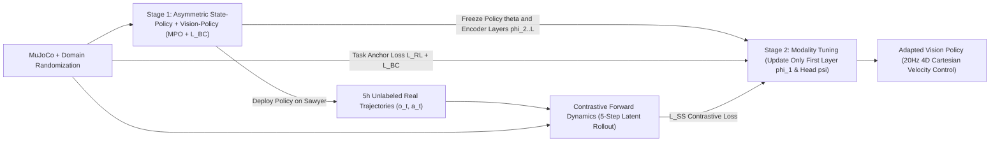

# Self-supervised sim-to-real adaptation for visual robotic manipulation

**Self-supervised sim-to-real adaptation for visual robotic manipulation**（ICRA 2020，arXiv:1910.09470v1）收录于 [AwesomeSim2Real](https://github.com/LongchaoDa/AwesomeSim2Real) **第 036/139** 篇，分组 **Observation / Domain Adaptation**。本文面向真机无奖励、无配对图像的像素级闭环操作，提出基于动作条件潜空间动力学对比的自监督域适应方法（SSDA with CFD）。

## 一句话定义

本文采用「仿真非对称状态–视觉蒸馏预训练 + 冻结高层权重仅微调视觉编码器首层（Modality Tuning）」的两阶段流程，并提出联合利用动作与多步时序转移的**对比前向动力学（CFD）**自监督目标，仅凭 5 小时无标注真机轨迹即可显著提升长程视觉方块堆叠的 Sim2Real 迁移成功率。

## 英文缩写速查

| 缩写 | 英文全称 | 简要说明 |
|------|----------|----------|
| CFD | Contrastive Forward Dynamics | 本文提出的动作条件潜空间多步对比前向动力学自监督损失 |
| SSDA | Self-Supervised Domain Adaptation | 自监督域适应，在无真实奖励下对齐仿真与真实特征空间 |
| MPO | Maximum a Posteriori Policy Optimization | 本文用于连续控制策略优化的离策略强化学习算法 |
| TCN | Time-Contrastive Networks | 时间对比网络基线，仅利用多视角/时序外观而不利用动作动力学 |
| DANN | Domain-Adversarial Neural Network | 域对抗神经网络，本文用于特征级无监督域对齐对比基线 |

## 为什么重要

- 长程视觉操作（如方块堆叠）在真机上极难自动获取密集奖励，而像素级 GAN 或纯特征域对抗（DANN）往往忽略机器人自身的动作–结果物理动力学约束。
- Jeong 等证明：**直接端到端联合优化自监督目标容易破坏已学策略表示**（TCN 端到端甚至从 DR 46% 跌至 38%）；唯有冻结策略头与高层编码器、仅微调首层视觉感知（`φ_1`）并保留仿真 `L_RL + L_BC` 锚点，再结合动作条件多步对比前向动力学（CFD），才能以 **5 小时无标注真机数据**将 7-DoF Sawyer 方块堆叠成功率从 **46.0%（DR）** 提升至 **62.0%**。
- 横向位置见 [AwesomeSim2Real](../entities/awesome-sim2real.md) 与 [技术地图](../overview/lc-awesome-sim2real-technology-map.md)。

## 核心信息

| 字段 | 内容 |
|------|------|
| 作者 | Rae Jeong, Yusuf Aytar, David Khosid, Yuxiang Zhou, Jackie Kay, Thomas Lampe, Konstantinos Bousmalis, Francesco Nori（DeepMind London） |
| 编号 / 分组 | 036/139 · Observation / Domain Adaptation |
| 出处 | ICRA 2020（arXiv:1910.09470v1） |
| 平台与任务 | MuJoCo 仿真 → 真实 7-DoF Sawyer 机械臂（双目 64×64 RGB + 本体感知，20 Hz 4D 笛卡尔速度+夹爪控制，200 步方块堆叠） |
| 论文链接 | <https://ieeexplore.ieee.org/document/9197326> / <https://arxiv.org/abs/1910.09470> |

## 核心机制

1. **第一阶段：仿真非对称状态–视觉联合学习**：
   - 在带域随机化（DR）与分段成型奖励（reaching / touching / lifting / stacking）的 MuJoCo 环境中，同时训练可读取仿真真值状态的**状态策略 `π_τ`**与接收双路 `64×64` RGB 图像及本体感知的**视觉策略 `(φ, θ)`**。
   - 二者通过共享离策略回放缓冲区（MPO + DDPGfD 人类演示）加速探索，并额外对视觉策略施加行为克隆损失 `L_BC` 蒸馏状态策略，优化目标为 `\min_{φ, θ, τ} L_RL + L_BC`。
2. **第二阶段：模态微调（Modality Tuning）+ 联合任务锚定**：
   - 将第一阶段视觉策略直接部署到真实 Sawyer 上收集约 **5 小时**无奖励、无配对的轨迹序列 `{o_t, a_t}`。
   - **冻结策略网络 `θ` 以及视觉编码器高层 `φ_{2..L}`**，仅放开编码器首层 `φ_1` 与自监督头 `ψ`，联合仿真与真实轨迹最小化 `\min_{φ_1, ψ} L_RL + L_BC + L_SS`（仿真数据提供 `L_RL + L_BC` 防止灾难性遗忘）。
3. **对比前向动力学（CFD）自监督损失**：
   - 编码 `z_t = φ(o_t)` 后，潜空间前向模型预测下一时刻状态 `ẑ_{t+1} = f(z_t, a_t)`，并连续滚动展开 **5 步**（轨迹切片长度 32）。
   - 为避免直接回归 `||ẑ - z||` 塌缩为零向量，采用多类 InfoNCE 对比损失：将同一步预测–真实对 `(ẑ_i, z_i)` 作为正样本，同 batch 内其余观测 `z_k (k ≠ i)` 作为负样本，同时对齐真机与仿真中的动作因果表征。

### 方法流程图

## 评测与指标

所有真机实验均在 7-DoF Sawyer 上执行 **50 次**随机初始位置方块堆叠试验（每回合 200 步 @ 20 Hz，评估用 AR tag 仅用于判定成功，绝不输入策略）：

### 1. 真机方块堆叠成功率对比（Table I）

| 训练方式 | 适应方法 | 真机任务成功率 |
|----------|----------|----------------|
| End-to-End | Domain Randomization（基线） | 46.0% |
| End-to-End | DANN（域对抗） | 50.0% |
| End-to-End | SSDA with TCN | 38.0% |
| Two-Stage（Modality Tuning） | DANN | 50.0% |
| Two-Stage（Modality Tuning） | SSDA with TCN（本文两阶段改写） | 54.0% |
| **Two-Stage（Modality Tuning）** | **SSDA with CFD（本文完整方法）** | **62.0%** |

### 2. 第二阶段是否保留任务目标消融（Table II）

| 第二阶段优化目标 | 真机任务成功率 |
|------------------|----------------|
| SSDA without Task Objective（仅优化 `L_SS`） | 12.0% |
| **SSDA with Task Objective（联合优化 `L_RL + L_BC + L_SS`）** | **62.0%** |

- **第一阶段消融发现（Sec. V-B）**：纯视觉 MPO 从零学习在简单抓取抬起（lifting）任务上难以收敛；引入状态策略共享回放缓冲区后可正常求解，叠加 `L_BC` 蒸馏进一步大幅加速堆叠任务收敛并稳住后续加挂 `TCN` / `DANN` 的训练稳定性。

## 与其他工作对比

- **对比 Domain Randomization（46.0%）与早期 IL+DR 堆叠工作（35%）**：仅用 5 小时无标注真机数据即带来 +16.0 个百分点的真机成功率跃升。
- **对比 DANN（50.0%）与 TCN（54.0%）**：DANN 仅做边缘特征分布对抗而缺乏时序动力学约束；TCN 仅做帧间外观对比而忽略机器人动作输入 `a_t`；CFD 引入动作条件多步预测，在同等两阶段设定下再高出 +8.0 至 +12.0 个百分点。

## 结论

**面向闭环视觉控制的无监督 Sim2Real 适应，需要「动作感知的动力学表征对齐（CFD）」、「仅调底层视觉特征（Modality Tuning）」与「仿真任务损失防遗忘」三者缺一不可。**

1. **动作条件动力学对齐优于纯视觉对比**：将动作 `a_t` 纳入 5 步对比前向预测（CFD 62.0%）显著优于只看图像时序的 TCN（54.0%）与判别式对抗 DANN（50.0%）。
2. **两阶段冻结高层策略至关重要**：端到端放开全网用 TCN 适应会破坏决策逻辑导致掉点至 38.0%（低于 DR 的 46.0%）；冻结 `θ` 和 `φ_{2..L}` 仅调首层 `φ_1` 方能稳步提升至 54.0% / 62.0%。
3. **适应期不能丢掉仿真 `L_RL + L_BC`**：只优化自监督损失 `L_SS` 会引发严重灾难性遗忘，真机成功率暴跌至 12.0%。
4. **共享回放 + BC 蒸馏解决像素 RL 冷启动**：双路视觉 RL 从零难学长程堆叠，借助特权状态策略共享样本并做行为克隆是高效训练前提。

## 常见误区或局限

1. **受限于第一阶段 DR 策略的数据采集质量**：第二阶段的无标注真机数据由第一阶段仿真策略直接执行采集；若初期零样本策略在真机完全无法触发有效交互，5 小时回放数据将缺乏任务相关动力学覆盖。
2. **仅适应浅层视觉特征 `φ_1`**：Modality Tuning 假设仿真与真实之间的主要差距集中在低层视觉渲染（光照、材质、颜色），无法直接补偿严重的物理动力学失配或相机几何大幅偏移。
3. **任务与观测规模较受限**：实验仅在双固定视角 `64×64` 低分辨率 RGB 下的双色方块堆叠验证，绝对成功率 62.0% 距离高可靠工业部署仍有距离，且未发布公开代码仓库。

## 关联页面

- 列表实体：[AwesomeSim2Real](../entities/awesome-sim2real.md)
- 技术地图：[AwesomeSim2Real 技术地图](../overview/lc-awesome-sim2real-technology-map.md)
- 方法/任务：[sim2real.md](../concepts/sim2real.md)、[locomotion.md](../tasks/locomotion.md)、[manipulation.md](../tasks/manipulation.md)、[reinforcement-learning.md](../methods/reinforcement-learning.md)

## 参考来源

- [`sources/papers/lc_awesome_sim2real_noarxiv_036_self-supervised-sim-to-real-adaptation-f.md`](../../sources/papers/lc_awesome_sim2real_noarxiv_036_self-supervised-sim-to-real-adaptation-f.md) — 本条目策展摘录
- [`sources/papers/lc_awesome_sim2real_catalog.md`](../../sources/papers/lc_awesome_sim2real_catalog.md) — 列表总表
- [`sources/repos/awesome-sim2real.md`](../../sources/repos/awesome-sim2real.md)
- 论文：<https://ieeexplore.ieee.org/document/9197326>（预印本 <https://arxiv.org/abs/1910.09470>）

## 推荐继续阅读

- [AwesomeSim2Real 仓库](https://github.com/LongchaoDa/AwesomeSim2Real)
- [原文](https://ieeexplore.ieee.org/document/9197326)
