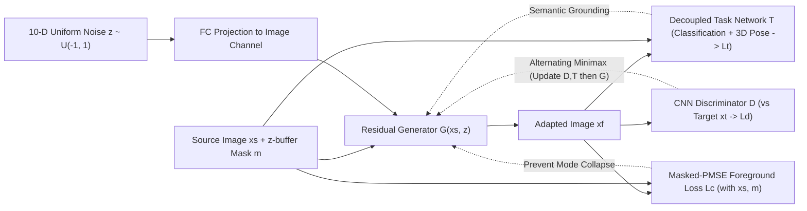

# Unsupervised pixel-level domain adaptation with generative adversarial networks

**Unsupervised pixel-level domain adaptation with generative adversarial networks（PixelDA）**（Konstantinos Bousmalis, Nathan Silberman, David Dohan, Dumitru Erhan, Dilip Krishnan；Google Brain / Google Research）收录于 [AwesomeSim2Real](https://github.com/LongchaoDa/AwesomeSim2Real) **第 040/139** 篇，分组 **Observation / Domain Adaptation**。本文提出了像素级无监督域适应框架，将域适应过程与下游识别/位姿估计网络解耦，在数字识别与合成–真实物体 3D 位姿估计任务上显著刷新了当时最先进水平。

## 一句话定义

PixelDA 训练一个同时以源域合成图像和随机噪声向量为条件的 GAN 生成器，在像素空间将源域图像无监督地重绘为目标域风格图像，并通过双域任务损失与前景掩码内容相似性损失锚定语义、稳定对抗训练。

## 英文缩写速查

| 缩写 | 英文全称 | 简要说明 |
|------|----------|----------|
| PixelDA | Pixel-Level Domain Adaptation | 像素级域适应，在图像空间而非仅在特征空间迁移分布 |
| GAN | Generative Adversarial Network | 生成对抗网络 |
| PMSE | Pairwise Mean Squared Error | 成对均方误差，本文提出基于 z-buffer 掩码的 masked-PMSE |
| DANN | Domain-Adversarial Neural Network | 域对抗神经网络（特征级无监督域适应代表方法） |
| Sim2Real | Simulation to Real | 仿真策略或感知模型迁移到真实世界 |

## 为什么重要

- 传统特征级域适应（如 DANN、MMD、DSN）将域适应与特定任务网络结构强耦合，更换任务网络必须重新训练整个域适应流程，且受限于源/目标域标签空间一致。
- PixelDA 在像素空间生成与目标域无异的图像样本，输出天然具备可视化可解释性，可无缝替换任务网络、利用随机噪声做无限风格增强，并支持测试时泛化至训练未见物体类别。
- 顺着列表实体 [AwesomeSim2Real](../entities/awesome-sim2real.md)、[AwesomeSim2Real 技术地图](../overview/lc-awesome-sim2real-technology-map.md) 与站内 [sim2real.md](../concepts/sim2real.md) 页面，可将该视觉 Sim2Real 范式衔接至后续机械臂抓取扩展 [GraspGAN](paper-as-042-using-simulation-and-domain-adaptation-to-improv.md)。

## 核心信息

| 字段 | 内容 |
|------|------|
| 编号 | 040/139 |
| 分组 | Observation / Domain Adaptation |
| 作者 | Konstantinos Bousmalis, Nathan Silberman, David Dohan, Dumitru Erhan, Dilip Krishnan |
| 机构 | Google Brain & Google Research |
| 出处 | CVPR 2017 |
| 预印本 | `arXiv:1612.05424v2` |
| 论文 | <https://ieeexplore.ieee.org/document/8099501> |
| 实现参考 | TensorFlow（原文脚注代码入口 `https://goo.gl/fAwCPw`；LineMod 单图迁移推理约 30 ms on K80 GPU） |

## 核心机制（归纳）

### 1. 条件残差生成器与全卷积判别器

- **条件生成器 $G(x_s, z; \theta_G) \to x_f$**：输入带标注源域图像 $x_s$ 以及 10 维均匀分布随机噪声 $z \sim U(-1,1)$（经全连接层投影为同分辨率通道并拼接至图像通道）。$G$ 采用保持原图分辨率的卷积残差网络（USPS/MNIST-M 用 6 个 64 通道残差块，LineMod 用 4 个），由同一张仿真图配合不同 $z$ 可合成无限随机目标风格样本（包含真实背景与传感器噪声模式）。
- **判别器 $D(x; \theta_D)$**：先经 `1×1` 卷积，再连续堆叠通道数翻倍（64→128→256→512）的 `stride 2×2` 卷积降采样至 $\le 4\times 4$，判断图像来自生成集 $X_f$ 还是真实无标注目标域 $X_t$。

### 2. 三重联合目标与训练稳定性设计（原文式 1–5）

$$\min_{\theta_G, \theta_T} \max_{\theta_D} \; \alpha L_d(D, G) + \beta L_t(G, T) + \gamma L_c(G)$$

- **域对抗损失 $L_d$**：经典 GAN 交叉熵博弈，交替更新 $(\theta_D, \theta_T)$ 与 $\theta_G$。
- **双域任务损失 $L_t$（兼作互信息正则）**：任务网络 $T$ 同时在**原始源域图 $x_s$ 与生成图 $x_f$** 上计算任务损失（分类交叉熵；在 LineMod 中叠加 3D 旋转四元数对数度量 $\xi \log(1 - q_s^\top \hat{q}_s)$）。若只在生成图上训练 $T$，模型容易发生整体类别置换漂移（如类 1 变成类 2）；联合训练等价于变分最大化类别与样本间互信息（Appendix C），显著压低初始化方差。
- **前景掩码内容相似性损失 $L_c$（masked-PMSE）**：利用渲染器提供的 z-buffer 前景掩码 $m$，仅在前景像素上计算生成图与源图的成对均方误差，允许前景物体整体亮度或色调协同跟随真实光照变化而锁定几何轮廓与局部结构，从而有效抑制模式坍塌。

### 方法流程图

## 评测与指标

以下定量指标均直接摘自原文 Tables 1–6 与 Appendix B.3：

| 任务与数据集 | Source-Only | DANN | DSN | CoGAN | **PixelDA (本文)** | Target-Only |
|--------------|-------------|------|-----|-------|--------------------|-------------|
| `MNIST → USPS` 分类准确率 | 78.9% | 85.1% | 91.3% | 91.2% | **95.9%** | 96.5% |
| `MNIST → MNIST-M` 分类准确率 | 63.6% | 77.4% | 83.2% | 62.0% | **98.2%** | 96.4% |
| `Synth LineMod → Real LineMod` 分类准确率 | 47.33% | 99.90% | 100.00% | — | **99.98%** | 100.00% |
| `Synth LineMod → Real LineMod` 3D 姿态平均角度误差 | 89.2° | 56.58° | 53.27° | — | **23.5°** | 6.47° |

*(注：LineMod 实验包含 11 类室内物体，训练用 109,208 张合成 RGB-D 渲染图与 9,673 张无标注真实图，验证 1,000 张，测试 2,655 张；其中姿态误差一项 DSN 为 `53.27°`，PixelDA 将先前最佳无监督误差削减过半至 `23.5°`。)*

- **稳定性消融（Table 5，LineMod 10 次随机初始化标准差）**：仅用生成图训练 $T$ 时，分类准确率标准差达 `22.32%`、姿态误差标准差 `17.48°`；加入源域任务损失 $L_t^{source}$ 后分别降至 `2.04%` / `3.24°`；再叠加 masked-PMSE（$L_c$）后，分类标准差进一步降至 **1.60%**（角度误差标准差 `6.97°`）。
- **未见类别跨类泛化（Table 4）**：仅在 11 个 LineMod 类别中的 6 类上训练生成器 $G$，冻结 $G$ 后生成全 11 类数据训练 $T$，在其余 5 个未见类别上分类准确率达 **98.98%**、平均角度误差 **31.69°**（全测试集 99.28% / 32.37°）。
- **背景与数据扩增（Table 3，仅 RGB）**：无论源域采用黑底还是随机 ImageNet 背景裁剪，PixelDA 均显著优于 Source-Only（ImageNet 背景下准确率由 91.15% 提至 **96.95%**，姿态误差由 50.18° 降至 **36.79°**）。
- **半监督扩展（Table 6）**：加入 1,000 个带标注真实样本后，PixelDA 将 LineMod 平均角度误差从无监督的 23.5° 进一步压低至 **13.31°**（分类 **99.93%**），显著优于 `1000-only`（25.26°）与 `Synth+1000`（23.50°）。

## 与其他工作对比

- 相较于同期的特征级域对抗代表工作 [ADDA](paper-as-111-adversarial-discriminative-domain-adaptation.md) 与 DANN，PixelDA 不强求特征提取器在两个域之间共享权值或绑定分类头，且生成的适应图像可通过像素空间 L2 最近邻检索验证模型并未死记硬背目标训练集（Fig. 3–4）。
- 相较于耦合生成模型 CoGAN，PixelDA 以源域渲染图像为条件而非从纯噪声生成全图，在域差异较大的 RGB-D 真实物体姿态估计上收敛更稳且精度远超特征对抗方法。
- 后续 [GraspGAN](paper-as-042-using-simulation-and-domain-adaptation-to-improv.md) 直接继承并扩展了 PixelDA，将其分辨率从 LineMod 级别推进到 472×472 真机机械臂抓取场景。

## 结论

**PixelDA 通过以“源图+噪声”为条件的 GAN 在像素层弥合仿真实景差距，配合双域任务损失与前景掩码 PMSE，实现了可解释、与任务架构解耦且可跨未见类别泛化的高精度无监督迁移。**

- **适用判断**：当仿真与真实图像差异主要集中在纹理、光照、噪声和背景等低层外观因素，且拥有前景掩码或合成标注时，PixelDA 是比纯特征对齐更直观高效的方案。
- **稳态训练要点**：务必保留对原始源域图像的监督损失 $L_t^{source}$ 并约束前景一致变化（如 masked-PMSE），否则 GAN 极易出现类标签翻转与初始化方差爆炸。
- **超参数校准现实**：尽管训练过程无监督，文内仍使用约 1,000 个带标注目标域验证样本筛选最优超参数（如学习率与各损失权重）。
- **向机器人控制延伸**：在闭环视觉控制或高分辨率场景中，可将 PixelDA 作为前端域迁移渲染器再衔接特征级对齐（如 GraspGAN 中的 DANN+DBN）。

## 常见误区或局限

1. **误以为 PixelDA 适合所有类型的域偏移**：作者在 Section 3 与脚注 1 明确假设源/目标域差异主要在**低层视觉属性**（光照、噪声、分辨率、色彩），而物体几何结构或类别定义一致；面对高层语义/标签污染较大的跨域数据集（如 Office）并不适用。
2. **忽视无监督调参对少量目标验证集的依赖**：不同任务对损失权重（$\alpha, \beta, \gamma$）较为敏感（如 Appendix B 中 MNIST-M 与 LineMod 权重相差一个数量级），完全盲调难以保证最优性能。
3. **固定分辨率与推理计算开销**：生成器维持原图分辨率输出，单张 LineMod 样本迁移在 K80 GPU 上耗时约 30 ms；若扩展到高帧率高分辨率闭环策略，需改用更轻量 U-Net 或缓存适应后离线数据集。

## 关联页面

- 列表实体：[AwesomeSim2Real](../entities/awesome-sim2real.md)
- 技术地图：[AwesomeSim2Real 技术地图](../overview/lc-awesome-sim2real-technology-map.md)
- 方法/任务：[sim2real.md](../concepts/sim2real.md)、[locomotion.md](../tasks/locomotion.md)

## 参考来源

- [`sources/papers/lc_awesome_sim2real_noarxiv_040_unsupervised-pixel-level-domain-adaptati.md`](../../sources/papers/lc_awesome_sim2real_noarxiv_040_unsupervised-pixel-level-domain-adaptati.md) — 本条目策展摘录
- [`sources/papers/lc_awesome_sim2real_catalog.md`](../../sources/papers/lc_awesome_sim2real_catalog.md) — 列表总表
- [`sources/repos/awesome-sim2real.md`](../../sources/repos/awesome-sim2real.md)
- 论文：<https://ieeexplore.ieee.org/document/8099501>

## 推荐继续阅读

- [arXiv 全文（1612.05424v2）](https://arxiv.org/abs/1612.05424)
- [AwesomeSim2Real 仓库](https://github.com/LongchaoDa/AwesomeSim2Real)
- [原文（IEEE Xplore）](https://ieeexplore.ieee.org/document/8099501)
