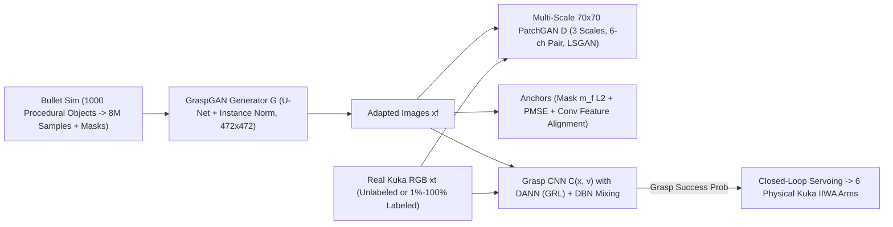

# Using simulation and domain adaptation to improve efficiency of deep robotic ...

**Using simulation and domain adaptation to improve efficiency of deep robotic grasping（GraspGAN）**（Konstantinos Bousmalis, Alex Irpan, Paul Wohlhart 等；Google Brain & X）收录于 [AwesomeSim2Real](https://github.com/LongchaoDa/AwesomeSim2Real) **第 042/139** 篇，分组 **Observation / Domain Adaptation**。本文面向仅依靠肩部过肩单目 RGB 相机的闭环抓取问题，用超大规模真机实验系统研究了仿真资产形态、虚拟场景随机化与像素/特征两级域适应对真机泛化的影响。

## 一句话定义

本文提出结合高分辨率像素级域适应（GraspGAN）与带域专属批归一化（DBN）的特征级域对抗（DANN）的混合迁移方案，仅利用程序化生成的随机 3D 几何体仿真数据即可将达到同等真机抓取精度所需的真实标注量削减高达 50 倍，或在零真机标签下媲美近百万条真实标注。

## 英文缩写速查

| 缩写 | 英文全称 | 简要说明 |
|------|----------|----------|
| GraspGAN | Pixel-level Domain Adaptation for Robotic Grasping | 面向 472×472 抓取图像的 U-Net + 多尺度 PatchGAN 迁移网络 |
| DBN | Domain-Specific Batch Normalization | 域专属批归一化（混合批中对仿真与真实样本分别计算均值/方差） |
| DANN | Domain-Adversarial Neural Network | 基于梯度反转层（GRL）的特征级域对抗训练 |
| LSGAN | Least-Squares Generative Adversarial Network | 最小二乘 GAN 目标函数，提升高分辨率对抗训练稳定性 |
| PMSE | Pairwise Mean Squared Error | 成对均方误差，用于语义内容锚定 |

## 为什么重要

- 此前真实大规模抓取收集（Levine et al. 使用 6 台 Kuka IIWA 采集约 100 万次抓取 / 940 万图像）时间与硬件成本极高，而深度相机又受限于透明或反光物体及成本问题，纯单目 RGB Sim2Real 抓取当时尚无对未见日常杂物的成功实证。
- 本文推翻了“仿真必须精雕细琢真实 3D 模型”的直觉，证明仅用 1,000 个程序化随机棱柱拼装体反而全面胜过 51,300 个精细 ShapeNet 模型。
- 顺着列表实体 [AwesomeSim2Real](../entities/awesome-sim2real.md)、[AwesomeSim2Real 技术地图](../overview/lc-awesome-sim2real-technology-map.md) 与站内 [sim2real.md](../concepts/sim2real.md)、[manipulation.md](../tasks/manipulation.md) 页面，可将前作 [PixelDA](paper-as-040-unsupervised-pixel-level-domain-adaptation-with.md) 的像素域适应完整延续到真实机械臂闭环抓取系统。

## 核心信息

| 字段 | 内容 |
|------|------|
| 编号 | 042/139 |
| 分组 | Observation / Domain Adaptation |
| 作者 | Konstantinos Bousmalis, Alex Irpan, Paul Wohlhart, Yunfei Bai, Matthew Kelcey, Mrinal Kalakrishnan, Laura Downs, Julian Ibarz, Peter Pastor, Kurt Konolige, Sergey Levine, Vincent Vanhoucke |
| 机构 | Google Brain & X |
| 出处 | ICRA 2018 |
| 预印本 | `arXiv:1709.07857v2` |
| 论文 | <https://ieeexplore.ieee.org/document/8460875> |
| 硬件/仿真 | 6 台 Kuka IIWA + 两指柔顺夹爪 + 单目肩部 RGB（472×472）；Bullet 物理仿真（1,000–2,000 虚拟臂并发采样约 800 万样本） |

## 核心机制（归纳）

### 1. 基础视觉抓取框架与仿真数据构造（Section III-A & IV-A）

- **抓取预测与伺服**：抓取预测 CNN $C(x_i, v_i)$ 接收初始无臂空箱图 $x_{i0}$、当前时刻图 $x_{ic}$（472×472）以及 5 维夹爪相对运动指令 $v_i$（3 维平移 + 2 维竖轴旋转正余弦编码），输出抓取成功概率；配合伺服函数连续下发动作。
- **程序化对象 vs ShapeNet**：在 Bullet 中对比了 1,000 个随机拼装矩形棱柱体（经 Blender 平滑与随机纹理上色）和 51,300 个 ShapeNetCore.v2 真实感模型（缩放至 12–23 cm，质量 10–500 g）。仿真采集还向水平电机指令加入 $\varepsilon \sim \mathcal{N}(0, 1)\text{ cm}$ 的动作噪声。

### 2. GraspGAN + DANN/DBN 两级混合域适应（Section IV-C & Fig. 4）

1. **像素级适应（GraspGAN）**：分辨率（472×472）达到 PixelDA 的两倍以上，为此将生成器 $G$ 改造为带平均池化、双线性上采样与**实例归一化（IN）的 U-Net**；判别器 $D$ 为 3 尺度（472×472、236×236、118×118）全卷积 **70×70 PatchGAN**，同时将 $x_{s0}$ 与 $x_{sc}$ 堆叠为 6 通道输入以保证跨帧背景纹理一致与机械臂阴影真实感，目标函数采用 **LSGAN**。
2. **三重内容锚定防止位移篡改**：$G$ 的训练结合了：(a) PMSE 像素相似性损失；(b) 强制 $G$ 额外重建渲染器导出的背景/托盘/机械臂/物体四类**像素级语义分割掩码 $m_f$**（L2 重建损失）；(c) 对齐抓取网络 $C$ 末层卷积特征并协同优化抓取成功二分类损失 $L_{task}$，确保机械臂与物体位置绝不漂移。
3. **特征级适应（DANN + DBN Mixing）**：固定训练好的 $G$ 将仿真图转绘为 $x_f$ 后，与真实样本组成混合批次训练抓取 CNN $C$：在 $C$ 最后卷积层接入梯度反转层（GRL）与两层 100 单元域分类器；并提出 **域专属批归一化（DBN）**，共享卷积权重但分别为仿真图与真实图维护独立的批归一化均值与方差。

### 方法流程图

## 评测与指标

所有真机评估均在 **36 个训练完全未见的实物**（含透明瓶、小球、可变形体、杂乱场景）上进行，每次配置在 6 台 Kuka IIWA 上共执行 **612 次抓取**（全篇累计 **25,704 次真机测试抓取**），结果直接摘自原文 Tables I–III：

### 1. 仿真物体真实感与随机化对比（原文 Table I，10% 真机数据 + DANN + DBN）

| 仿真随机化设置 | 程序化随机物体（1,000 个） | ShapeNet（51,300 个） |
|----------------|----------------------------|------------------------|
| None（仅随机相机/箱位/6 背景图） | **71.93%** | 69.61% |
| Visual（托盘/物体/臂纹理颜色与光照） | **74.88%** | 68.79% |
| Dynamics（质量与滑动/滚动/自旋摩擦） | **73.95%** | 68.62% |
| Both（Visual + Dynamics） | **72.86%** | 69.84% |

### 2. 不同真机标注比例下的物理抓取成功率（原文 Table III，搭配 800 万程序化仿真样本）

| 方法 | All (9,402,875) | 20% (1,880,363) | 10% (939,777) | 2% (188,094) | 1% (93,841) |
|------|-----------------|-----------------|---------------|--------------|-------------|
| `Real-Only`（仅真机） | 67.65% | 64.93% | 62.75% | 35.46% | 31.13% |
| `Naïve Mix.`（朴素混合） | 73.63% | 69.61% | 65.20% | 58.38% | 39.86% |
| `Rand.`（视觉随机化 + DBN） | 75.58% | 70.16% | 73.31% | 63.61% | 50.99% |
| `DANN`（DBN + DANN） | 76.26% | 68.12% | 71.93% | 61.93% | 59.27% |
| `DANN-R.`（视觉随机化 + DBN + DANN） | 72.60% | 66.46% | **74.88%** | 63.73% | 43.81% |
| **`GraspGAN`（像素适应 + DBN + DANN）** | **76.67%** | **74.07%** | 70.70% | **68.51%** | **59.95%** |

### 3. 零真机标注（完全无监督）抓取成功率（原文 Table II）

- `Sim-Only`（无随机化纯仿真）：**23.53%**
- `Rand.`（纯仿真视觉随机化）：**35.95%**
- **`GraspGAN`（仅用无标注真机图像适应）**：**63.40%** —— 在**不使用任何一条真实抓取标签**的情况下，达到与 **939,777 条带标注真机数据**（`Real-Only 10%` = 62.75%）相当的物理抓取率！

## 与其他工作对比

- 相较于前作 [PixelDA](paper-as-040-unsupervised-pixel-level-domain-adaptation-with.md)（仅评估 2D/姿态静态数据集且需已知目标物体 CAD 模型扫描），GraspGAN 将输入分辨率翻倍至 472×472（U-Net + 多尺度 PatchGAN + LSGAN + 语义掩码重建），首次在**未知真实物体**与**无 CAD 模型**的闭环视觉机械臂抓取上跑通 Sim2Real，并叠加特征级 DANN + DBN 进一步榨取多域数据效率。
- 对比纯特征级 [ADDA](paper-as-111-adversarial-discriminative-domain-adaptation.md)，本文发现混训仿真与真实数据时，即便不加 DANN 损失，仅引入 **DBN（域专属批归一化）** 分开统计两域均值方差就能显著提升迁移性能。

## 结论

**结合程序化随机仿真（800 万样本）、像素级 GraspGAN 与特征级 DANN+DBN，可在不构建精细 3D 资产的前提下将真实机械臂抓取标注需求压缩 50 倍，甚至在零真机标签下实现可用泛化。**

- **资产构建避坑**：在通用抓取场景中，低成本生成的程序化随机几何体配合适当随机化比费力导入高保真 3D 库（ShapeNet）效果更好（Table I 全胜）。
- **混合训练必加 DBN**：同时输入仿真图与真机图训练带 BN 的网络时，务必按域隔离批归一化统计量（DBN）再共享卷积核权重，切忌朴素混合同一 batch 的 BN 统计量。
- **低/零真实标注场景优先 GraspGAN**：在 1%–2% 极少标注及 0 标注无监督场景下，像素级迁移叠加特征级对齐带来最显著增益（2% 数据达 68.51% 反超全量 Real-Only 67.65%）。
- **验证集需求提示**：本文最优模型选择仍使用了 94,000 条真实校验集样本；且方法侧重过肩单目 RGB，若结合深度/腕部视角及显式动力学适应仍有进一步提升空间。

## 常见误区或局限

1. **误区：视觉随机化 + DANN 叠加一定比单独用更好**：Table III 实测表明 `DANN-R.` 在 5 个数据档位中有 3 档差于不加随机化的 `DANN`（如 1% 真机数据下 43.81% vs 59.27%），随机化与特征对抗之间存在不稳定的交互作用。
2. **仅聚焦外观与特征不变性，未显式处理物理动力学偏差**：虽然证明动力学随机化有收益，但 GraspGAN 与 DANN 本身未对接触物理、摩擦或延迟做显式推理或在线补偿。
3. **传感器与构型假设**：仅验证了顶抓 5 维指令与过肩单目 RGB 相机，在极高密度杂物或需要侧抓/多指灵巧操作场景中的绝对成功率（最高 76.67%）仍有较大改进余地。

## 关联页面

- 列表实体：[AwesomeSim2Real](../entities/awesome-sim2real.md)
- 技术地图：[AwesomeSim2Real 技术地图](../overview/lc-awesome-sim2real-technology-map.md)
- 方法/任务：[sim2real.md](../concepts/sim2real.md)、[locomotion.md](../tasks/locomotion.md)

## 参考来源

- [`sources/papers/lc_awesome_sim2real_noarxiv_042_using-simulation-and-domain-adaptation-t.md`](../../sources/papers/lc_awesome_sim2real_noarxiv_042_using-simulation-and-domain-adaptation-t.md) — 本条目策展摘录
- [`sources/papers/lc_awesome_sim2real_catalog.md`](../../sources/papers/lc_awesome_sim2real_catalog.md) — 列表总表
- [`sources/repos/awesome-sim2real.md`](../../sources/repos/awesome-sim2real.md)
- 论文：<https://ieeexplore.ieee.org/document/8460875>

## 推荐继续阅读

- [arXiv 全文（1709.07857v2）](https://arxiv.org/abs/1709.07857)
- [AwesomeSim2Real 仓库](https://github.com/LongchaoDa/AwesomeSim2Real)
- [原文（IEEE Xplore）](https://ieeexplore.ieee.org/document/8460875)
