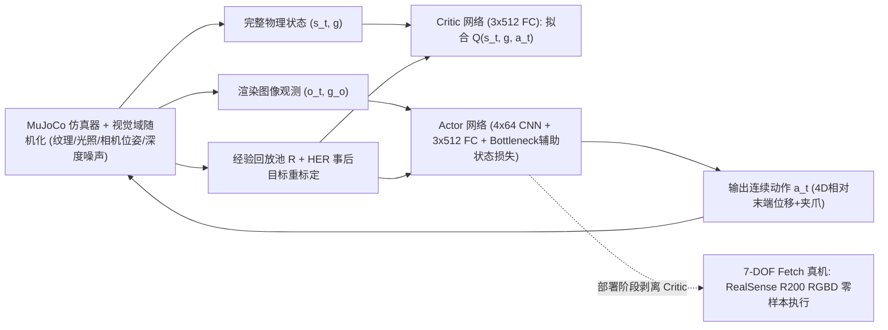

# Asymmetric Actor Critic for Image-Based Robot Learning

**Asymmetric Actor Critic for Image-Based Robot Learning**（arXiv:1710.06542v1 / IEEE，OpenAI & CMU）收录于 [AwesomeSim2Real](https://github.com/LongchaoDa/AwesomeSim2Real) **第 044/139** 篇，分组 **Observation / Domain Randomization**。本页基于论文全文完成结构化精读与核实。

## 一句话定义

**Asymmetric Actor Critic（非对称演员–评论家）** 是一种面向视觉机器人策略学习的 Sim2Real 训练范式：在仿真训练阶段让 **Critic** 直接读取底层完整物理状态（关节角/速度、物体位姿）以快速精确估值，而让 **Actor** 仅接收带域随机化的 RGB/RGBD 图像观测，从而在真机部署时无需任何状态估计器即可零样本执行复杂精细操作。

## 英文缩写速查

| 缩写 | 英文全称 | 简要说明 |
|------|----------|----------|
| DDPG | Deep Deterministic Policy Gradients | 深度确定性策略梯度，本文采用的基础离策略 Actor-Critic 算法 |
| HER | Hindsight Experience Replay | 事后经验回放，通过重标定达成目标解决稀疏奖励难探索问题 |
| DR | Domain Randomization | 域随机化，随机渲染纹理、光照、视角与深度噪声实现零样本 Sim2Real |
| BC / DAgger | Behavior Cloning / Dataset Aggregation | 行为克隆与在线聚合模仿学习，作为全状态专家蒸馏的强基线 |
| DOF | Degree of Freedom | 自由度，本文真机实验平台为 7-DOF Fetch 机械臂 |

## 为什么重要

- 基于图像端到端训练机器人操作策略面临“两难困境”：真机上难以获取精确完整物理状态（视觉检测器有误差且存在复合误差）；而在仿真里直接让 Critic 和 Actor 同时看高维像素又会因部分可观测与稀疏奖励导致学习极慢甚至失败。
- 本文率先在机器人视觉操作中系统确立了 **“训练期特权状态给 Critic、部署期纯图像给 Actor”** 这一非对称架构（即后世广泛沿用的 Asymmetric Actor-Critic / Teacher-Student 特权信息范式），配合 HER 与视觉域随机化，在 **没有任何真机训练数据** 的情况下完成了真机抓放、前推与移块，并自发涌现出推抓（push-grasping）与重抓（re-grasping）等灵巧行为。

## 核心信息

| 字段 | 内容 |
|------|------|
| 编号 | 044/139 |
| 分组 | Observation / Domain Randomization |
| 出处 | CoRR (arXiv:1710.06542v1) / IEEE |
| 作者与机构 | Lerrel Pinto, Marcin Andrychowicz, Peter Welinder, Wojciech Zaremba, Pieter Abbeel（OpenAI, Carnegie Mellon University） |
| 论文与视频 | <https://ieeexplore.ieee.org/abstract/document/10077454> · <https://arxiv.org/abs/1710.06542> |

## 核心机制

1. **非对称演员–评论家训练（Algorithm 1）**
   - 仿真器每步同时提供完整底层状态 $s_t \in \mathcal{S}$、渲染图像 $o_t = \text{renderer}(s_t)$ 以及目标状态 $g$ 与目标图像 $g^o = \text{renderer}(g)$，回放池 $\mathcal{R}$（容量 $10^5$）存储完整元组 $(s_t, o_t, a_t, r_t, s_{t+1}, o_{t+1}, g, g^o)$。
   - **Critic 网络**：全连接网络（3 个 512 维 ReLU 隐藏层），输入拼接后的 $(s_t, g, a_t)$，在低维精确状态空间快速拟合 Q 值并给出高质量策略梯度。
   - **Actor 网络**：4 层 $2\times 2$ 卷积（每层 64 通道）分别编码当前观测 $o_t$ 与目标观测 $g^o$，拼接后接 3 层 512 维 ReLU 全连接层与 $\tanh$ 输出动作（含防饱和预激活惩罚）。测试部署时完全丢弃 Critic，Actor 仅需 $(o_t, g^o)$。
2. **多目标稀疏奖励、HER 与状态瓶颈加速**
   - 采用基于欧氏距离的稀疏二值奖励 $r(s_t, a, g) = [d(s_t, g) < \epsilon]$（+1 / 0），避免复杂手工奖励塑形；通过 **HER** 用轨迹后续到达状态替换目标，并结合 DDPG（16 路并行采样、每轮 40 次 batch 128 更新、Polyak 0.98、$\gamma=0.98$、$T=50$）优化。
   - **辅助瓶颈层（Bottleneck）**：在 Actor 中间层加入低维瓶颈并附加预测完整状态 $s_t$ 的 $L_2$ 辅助损失，在 Particle 与 Reacher 上明显加速收敛，在 Fetch Pick 上显著降低跨种子方差。
3. **面向真机的视觉域随机化与深度预处理**
   - 在渲染器中同时随机化 **物体/机械臂/桌面纹理**（纯色、渐变、棋盘格）、**光源开关/位置/朝向/高光特性**、**单目相机位置/朝向/焦距** 以及 **深度均匀噪声**。
   - 真机采用 **7-DOF Fetch 机械臂** 与 **Intel RealSense R200**（100×100×4 RGBD），针对真实深度传感器在黑色物体表面易产生空洞的问题，采用最近邻空洞填充（hole filling）并将黑色臂身/夹爪贴覆改色。

### 方法流程图

## 评测与指标

在 MuJoCo 仿真（Particle 2D、Reacher 2D、Fetch Pick 3D，5 种子）验证了 **Asym HER** 显著超越 Sym HER、Asym/Sym DDPG 与全状态专家蒸馏基线 DAgger（DAgger 因单帧图像缺失关键全状态信息而过早饱和）。在 **7-DOF Fetch 真机**三项精细操作任务（每项不同初始位姿与目标共测 **5 次**，零真机微调，Table I）上的成功率如下：

| 真机任务（Table I） | **Asym HER**（本文） | Sym HER | Asym DDPG | Vanilla BC | DAgger BC | w/o Any DR | w/o Viewpoint DR |
|------|------|------|------|------|------|------|------|
| **Pick**（抓取并悬停至目标） | **5/5** | 0/5 | 0/5 | 0/5 | 3/5 | 0/5 | 0/5 |
| **Forward Push**（锁爪前推方块） | **5/5** | 0/5 | 0/5 | 1/5 | 0/5 | 0/5 | 0/5 |
| **Block Move**（桌面移块至目标） | **5/5** | 0/5 | 0/5 | 0/5 | 0/5 | 0/5 | 4/5 |

> 注：在抓取干扰物测试（Fig. 8）中，仅在单红块上用域随机化训练的 `Pick` 策略在真机桌面出现多色干扰方块时仍能稳定抓起目标红块。

## 与其他工作对比

- **对比对称视觉 RL（Sym HER / Sym DDPG）**：在真机三项任务上均仅获 `0/5`；Critic 缺少特权状态导致 Q 值估计方差大、稀疏奖励下几乎无法学出有效策略。
- **对比全状态专家模仿学习（Vanilla BC / DAgger）**：即便先用特权状态练出完美专家再通过 DAgger 蒸馏给视觉 Actor，其在仿真中最终成功率仍低于 Asym HER，真机仅 Pick 拿到 `3/5`、推块和移块均为 `0/5`——因为专家动作可能依赖图像里不可见的状态细节。
- **对比无视角随机化（w/o Viewpoint DR）与无随机化（w/o Any DR）**：去掉所有随机化后真机全部 `0/5`；去掉相机视角随机化导致 Pick 与 Forward Push 跌至 `0/5`，证明相机外参微扰随机化对 3D 空间对齐至关重要。同分组横向对照见 [技术地图](../overview/lc-awesome-sim2real-technology-map.md)。

## 常见误区或局限

1. **单帧图像观测缺失速度信息**：因为 Actor 仅接收单帧 RGB/RGBD 图像而不包含历史帧或循环记忆，实验特地将动作空间设为速度或相对位置控制（Particle/Reacher 用速度控制，Fetch 用相对夹爪增量控制），无法直接处理必须依赖多帧推断速度的动力学任务。
2. **真机深度空洞与颜色工程依赖**：真实 Intel RealSense R200 对黑色表面反射差、易出深度空洞，作者在真机实验前对 Fetch 躯干与夹爪黑色部件进行了手工贴覆改色并加装最近邻空洞填充，并非完全免工程适配。
3. **任务与观测配置简化**：Fetch Pick 锁定了夹爪旋转自由度（仅 4D 动作），且训练时借鉴 HER 将一半回合初始于“已抓起方块”状态以缓解探索难度；此外测试时目标图像 $g^o$ 默认由仿真器渲染提供以保持评测一致性。

## 结论

**Asymmetric Actor Critic 通过“仿真特权状态训 Critic + 域随机化 RGBD 图像训 Actor + HER”，成功打通了稀疏奖励下的零样本真机视觉精细操作闭环。**

- 只要仿真器可获取物理真值状态，就不应让 Critic 和 Actor 一样忍受高维图像与部分可观测性；非对称结构能以极低改造成本大幅提升值函数收敛速度与策略上限。
- 面向真机 3D 操作做视觉域随机化时，**相机位置/朝向/焦距随机化**与纹理、光照随机化同等重要（缺失视角随机化会使 Pick 与 Forward Push 从 5/5 跌至 0/5）。
- 在真机部署 RGBD 策略前，务必对传感器深度空洞（尤其是深色/高反光夹爪本体）做填充与材质预处理，并优先选用相对末端位置/速度动作空间降低单帧观测的速度盲区。

## 关联页面

- 列表实体：[AwesomeSim2Real](../entities/awesome-sim2real.md)
- 技术地图：[AwesomeSim2Real 技术地图](../overview/lc-awesome-sim2real-technology-map.md)
- 方法/任务：[sim2real.md](../concepts/sim2real.md)、[reinforcement-learning.md](../methods/reinforcement-learning.md)、[locomotion.md](../tasks/locomotion.md)、[manipulation.md](../tasks/manipulation.md)

## 参考来源

- [`sources/papers/lc_awesome_sim2real_noarxiv_044_asymmetric-actor-critic-for-image-based.md`](../../sources/papers/lc_awesome_sim2real_noarxiv_044_asymmetric-actor-critic-for-image-based.md) — 本条目策展摘录
- [`sources/papers/lc_awesome_sim2real_catalog.md`](../../sources/papers/lc_awesome_sim2real_catalog.md) — 列表总表
- [`sources/repos/awesome-sim2real.md`](../../sources/repos/awesome-sim2real.md)
- 论文：<https://ieeexplore.ieee.org/abstract/document/10077454>

## 推荐继续阅读

- [AwesomeSim2Real 仓库](https://github.com/LongchaoDa/AwesomeSim2Real)
- [原文](https://ieeexplore.ieee.org/abstract/document/10077454)
