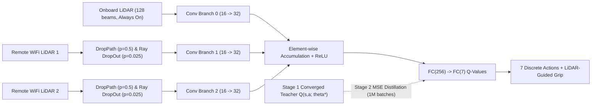

# Sensor fusion for robot control through deep reinforcement learning

**Sensor fusion for robot control through deep reinforcement learning**（Steven Bohez, Tim Verbelen, Elias De Coninck, Bert Vankeirsbilck, Pieter Simoens, Bart Dhoedt；根特大学 Ghent University - imec / IDLab）收录于 [AwesomeSim2Real](https://github.com/LongchaoDa/AwesomeSim2Real) **第 063/139** 篇，分组 **Observation / Sensor Fusion**。本文基于 V-REP 仿真与 Kuka YouBot 实机平台，研究如何在深度强化学习（DQN）中融合机载与外部无线传感器观测并抵抗运行时传感器失效。

## 一句话定义

本文对比了深度强化学习控制中的早融合与晚融合多传感器架构，并提出结合两阶段 Q 值重建蒸馏的 DropPath 正则化（`Acc + DP`），使移动操作机器人在利用环境传感器扩大视野的同时能够容忍无线传感器掉线。

## 英文缩写速查

| 缩写 | 英文全称 | 简要说明 |
|------|----------|----------|
| DQN | Deep Q-Network | 深度 Q 网络，以卷积神经网络近似动作价值函数 `Q(s, a)` |
| Sim2Real | Simulation to Real | 仿真策略迁移到真机 |
| ROS | Robot Operating System | 机器人操作系统，本文用于统一仿真器与真机的传感器及控制接口 |
| V-REP | Virtual Robot Experimentation Platform | 本文用于分布式经验采集与策略训练的物理仿真器 |
| MDP | Markov Decision Process | 马尔可夫决策过程（状态–动作–转移–奖励形式化） |

## 为什么重要

- 真实物联网（IoT）机器人环境中，除机载传感器外，部署在环境中的外部传感器通常通过不可靠无线链路接入，随时可能掉线或丢包。
- 仅依靠简单拼接传感器输入的传统多模态网络参数量随传感器数膨胀，且在缺失某路输入时缺乏明确退化行为，往往导致策略崩溃。
- 顺着列表实体 [AwesomeSim2Real](../entities/awesome-sim2real.md)、[AwesomeSim2Real 技术地图](../overview/lc-awesome-sim2real-technology-map.md) 与站内 [sim2real.md](../concepts/sim2real.md) 方法页，可将本工作接回多传感器感知融合与 Sim2Real 学习主线。

## 核心信息

| 字段 | 内容 |
|------|------|
| 编号 | 063/139 |
| 分组 | Observation / Sensor Fusion |
| 作者 | Steven Bohez, Tim Verbelen, Elias De Coninck, Bert Vankeirsbilck, Pieter Simoens, Bart Dhoedt |
| 机构 | Ghent University - imec, IDLab |
| 出处 | IEEE/RSJ International Conference on Intelligent Robots and Systems (IROS 2017) |
| 预印本 | `arXiv:1703.04550v1` |
| 论文 | <https://ieeexplore.ieee.org/document/8206048> |
| 硬件/仿真 | Kuka YouBot（全向底盘 + 5-DOF 机械臂 + 两指软夹爪）、3× Hokuyo 1D LiDAR、Jetson TX1 + 2× Raspberry Pi 2（WiFi）；V-REP + ROS + DIANNE/Torch |

## 核心机制（归纳）

### 1. 任务设定与传感器配置

- **搜索与抓取场景**：在 1.8 m × 2.7 m 矩形围栏内，Kuka YouBot 需导航至随机放置的易拉罐前并执行抓取。1 个 Hokuyo URG-04LX-UG01 1D 激光雷达安装在机器人前方，另外 2 个安装在场地对角角落（均配置 180° 视场角，仿真限制为 128 个扫描点，步长 100 ms）。
- **状态、动作与奖励**：状态为 3 路 1D 激光扫描数据；动作离散化为 7 个指令（左移、右移、前进、后退、顺时针旋转、逆时针旋转、硬编码抓取）。奖励为易拉罐到机器人理想抓取点位置的归一化负距离（范围 `[-1, 0]`，抵达可抓位姿得 0，碰撞围栏或易拉罐得 `-1`，单回合上限 100 步）。

### 2. 早融合与晚融合架构对比（原文 Table I）

| 模型 | 架构设计 | 参数量 | 关键特性 |
|------|----------|--------|----------|
| `Single` | `conv(16)->conv(32)->fc(256)->fc(7)` | 266,887 | 仅使用机载前向激光雷达基线 |
| `Early (small)` | 3 路作多通道输入接 `conv(16)->conv(32)->fc(256)->fc(7)` | 267,047 | 最简早融合，通道容量受限 |
| `Early (large)` | 3 路作多通道输入接 `conv(48)->conv(96)->fc(256)->fc(7)` | 812,391 | 通道与特征数扩至 3 倍 |
| `Late (concat)` | 3 路各自 `conv(16)->conv(32)` 后拼接再接 `fc(256)->fc(7)` | 796,551 | 拼接于高维特征处导致参数剧增 |
| `Late (conv)` | 3 路拼接后加 `1×1` 卷积（32 通道）降维 | 275,367 | 压缩拼接后全连接输入参数 |
| `Late (acc)` | 3 路各自 `conv(16)->conv(32)` 后逐元素累加再 ReLU | 272,263 | 参数量恒定且天然支持任意传感器缺省 |
| `Acc + DP` | 在 `Late (acc)` 累加前引入 DropPath | 272,263 | 兼具多传感融合增益与掉线鲁棒性 |

### 3. 两阶段 DropPath 蒸馏与真机鲁棒化

- **为何采用两阶段训练**：作者实测发现，直接在标准 DQN 时序差分（TD）损失（式 2）中施加 DropPath 效果不佳。因此先在全传感器完整可用的条件下，使用 Double Q-learning 与伪 Huber 损失（pseudo-Huber loss，RMSProp 学习率 0.0001，经验池容量 100 万，40 台 2CPU/4GB 虚拟机并发在 V-REP 中采样，在 DIANNE 框架上训练 150 万个 batch size=32）使 `Late (acc)` 收敛至最优参数 $\theta^*$。
- **阶段 2 Q 值重建**：固定 $\theta^*$ 作为教师目标，以概率 `p=0.5` 随机丢弃两个无线环境传感器的卷积特征分支（机载前向传感器始终保留），再在 500 万条 `Late (acc)` 采样经验上以均方误差损失 $L_j(\theta_j) = \mathbb{E}[(Q(s,a;\theta^*) - Q(s,a;\theta_j))^2]$ 精调 100 万个 mini-batch，重建完整传感器的 Q 值估计。
- **真机激光缺失缓解**：部署到真机时，除对底盘贴附美纹纸胶带提高激光反射率，并在微调阶段对激光雷达单束射线施加概率 `0.025` 的 DropOut，同时利用最后一次激光扫描反馈闭环微调硬编码抓取动作。

### 方法流程图

## 评测与指标

以下定量与实机结果均直接来自原文 Section V 与 Fig. 3–6：

- **早融合 vs 晚融合（100 组随机起止构型，Fig. 4）**：
  - `Single` 显著优于纯随机基线，但在易拉罐位于机器人后方（前向 180° 视野盲区）时无法正确导航。
  - 引入 2 个环境传感器后，所有融合模型回报分布均实现明显跃升；早融合与晚融合整体性能无显著差异，参数量更大的 `Early (large)`（812,391）与 `Late (concat)`（796,551）略占优。
  - **最终距离精度（Fig. 6）**：所有模型在超过 50% 的测试回合中最终停在距最优抓取位姿 10 cm 半径内；多传感器融合显著减少了后方盲区导致的远距离失败。
- **DropPath 抗掉线能力（Fig. 5）**：
  - 未经 DropPath 正则化的 `Late (acc)` 在移除环境传感器后，性能**大幅跌落甚至差于纯随机动作**。
  - 经过第二阶段 DropPath 精调的 `Acc + DP` 在仅保留机载单传感器时可恢复至与 `Single` 相当的水平，而在 3 传感器同时在线时与原始 `Late (acc)` 性能几乎无差。
- **训练效率与平台**：在 V-REP 仿真器中性能瓶颈在于 CPU 仿真采样而非 GPU 训练（1.5M 步收敛，`Single` 与 `Early (small)` 收敛到的最大 Q 值略低于其余大模型）。

## 与其他工作对比

- 同分组的横向对照可回到 [AwesomeSim2Real 技术地图](../overview/lc-awesome-sim2real-technology-map.md) 的 **Observation / Sensor Fusion** 分组展开（如对比侧重特征/像素域适应的 [PixelDA](paper-as-040-unsupervised-pixel-level-domain-adaptation-with.md) 与 [GraspGAN](paper-as-042-using-simulation-and-domain-adaptation-to-improv.md)）。
- 传统状态估计多采用扩展卡尔曼滤波（EKF）融合先验已知状态（如位姿），而本文端到端学习直接从原始激光雷达序列映射到控制 Q 值，无需预先规定中间特征含义；同时通过 `Late (acc)` 累加与两阶段 DropPath 克服了简单拼接扩展性差和传感器缺失崩溃的缺陷。

## 结论

**`Late (acc)` + 两阶段 DropPath 蒸馏以极小且恒定的参数开销，成功解决了多源无线传感器强化学习控制中的“融合增益”与“运行时掉线崩溃”矛盾。**

- **工程选型建议**：当外部传感器数量不固定或无线连接不可靠时，优先选用独立特征编码 + 逐元素累加（`Late (acc)`）而非直接高维特征拼接。
- **训练策略落地**：切勿直接在原始 TD 残差训练中硬加高比例特征分支丢弃；先在全传感器下训出稳定教师 Q 网络，再用固定教师输出做 MSE 蒸馏重建。
- **Sim2Real 感知补丁**：真机传感器存在材质吸光/零值缺测问题时，可在精调阶段叠加单射线级随机 DropOut（文中 0.025）配合物理表面处理与末段闭环微调。
- **任务适用边界**：本文仅验证了 7 维离散移动操作动作与 1D 激光雷达，向连续控制与 RGB-D 视觉融合扩展仍需替换控制头与异构编码分支。

## 常见误区或局限

1. **直接在 DQN 原生 Bellman 损失上加 DropPath 即可奏效**：原文明确指出在阶段 1 直接使用 DropPath 未能取得良好结果，必须先收敛出 $\theta^*$ 再做阶段 2 的 Q 值重建蒸馏。
2. **累加融合（Accumulate）没有任何代价**：`Late (acc)` 虽然参数恒定且便于容错，但限制了不同传感器特征通道间的交叉非线性连接；若传感器始终稳定在线，高参数量的 `Early (large)` 或 `Late (concat)` 略微更优。
3. **仅靠离散移动动作即可稳定抓取**：真机测试表明开环硬编码抓取成功率受停靠误差制约，必须借助末次激光扫描做抓取相对位姿闭环修正。
4. **遗留极值构型长尾失败**：所有模型在 100 组测试箱线图中均存在较大负向长尾，表明部分极端起止构型下仍会失败或碰撞。

## 关联页面

- [强化学习](../methods/reinforcement-learning.md) — 延伸阅读，理解策略优化、奖励与部署时延问题。
- 列表实体：[AwesomeSim2Real](../entities/awesome-sim2real.md)
- 技术地图：[AwesomeSim2Real 技术地图](../overview/lc-awesome-sim2real-technology-map.md)
- 方法/任务：[sim2real.md](../concepts/sim2real.md)、[locomotion.md](../tasks/locomotion.md)

## 参考来源

- [`sources/papers/lc_awesome_sim2real_noarxiv_063_sensor-fusion-for-robot-control-through.md`](../../sources/papers/lc_awesome_sim2real_noarxiv_063_sensor-fusion-for-robot-control-through.md) — 本条目策展摘录
- [`sources/papers/lc_awesome_sim2real_catalog.md`](../../sources/papers/lc_awesome_sim2real_catalog.md) — 列表总表
- [`sources/repos/awesome-sim2real.md`](../../sources/repos/awesome-sim2real.md)
- 论文：<https://ieeexplore.ieee.org/document/8206048>

## 推荐继续阅读

- [arXiv 全文（1703.04550v1）](https://arxiv.org/abs/1703.04550)
- [AwesomeSim2Real 仓库](https://github.com/LongchaoDa/AwesomeSim2Real)
- [原文（IEEE Xplore）](https://ieeexplore.ieee.org/document/8206048)
