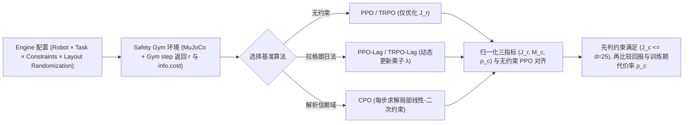

# Benchmarking Safe Exploration in Deep Reinforcement Learning

**Benchmarking Safe Exploration in Deep Reinforcement Learning**（Alex Ray, Joshua Achiam, Dario Amodei，OpenAI）收录于 [AwesomeSim2Real](https://github.com/LongchaoDa/AwesomeSim2Real) **第 065/139** 篇，分组 **Other Benchmarks**。本页基于 OpenAI 技术报告全文完成精读与数据核实。

## 一句话定义

**Benchmarking Safe Exploration in Deep Reinforcement Learning** 倡导将**约束马尔可夫决策过程（CMDP）**确立为深度强化学习安全探索的统一形式化框架，并发布高维连续控制基准与环境构建器 **Safety Gym**（18 个带随机化障碍约束的基准环境 + 9 个无约束调试环境），系统暴露出当前无模型安全 RL 算法（Lagrangian、CPO）在训练期安全遗憾与复杂运动控制之间的根本权衡。

## 英文缩写速查

| 缩写 | 英文全称 | 简要说明 |
|------|----------|----------|
| CMDP | Constrained Markov Decision Process | 约束马尔可夫决策过程，将任务奖励 $r$ 与安全代价 $c_i$ 显式解耦 |
| CPO | Constrained Policy Optimization | 约束策略优化，每步解析求解信赖域约束优化，但在高维控制中受近似误差制约 |
| TRPO | Trust Region Policy Optimization | 信赖域策略优化，本文评测其无约束与拉格朗日约束变体 |
| PPO | Proximal Policy Optimization | 近端策略优化，本文以其无约束终局指标作为各环境归一化基准 |
| SG18 / SG6 | Safety Gym 18 / 6-env Slate | 全部 18 个 Level 1–2 约束环境，以及推荐低算力预算使用的 6 环境子集 |

## 为什么重要

- **将“安全”从标量奖励权衡中剥离**：传统单奖励惩罚无法预先映射出安全阈值，罚太轻不安全、罚太重学不到策略，且无法约束训练过程中的探索期违规；CMDP 将行为规范清晰划分为“要做的事（奖励 $r$）”与“不能做的事（代价约束 $J_{c_i} \le d_i$）”，更利于安全规范在任务间迁移。
- **终结安全探索基准碎片化**：Safety Gym 通过每回合连续随机化布局彻底杜绝死记硬背轨迹，并借助 `info['cost']` 提供标准化辅助代价信号与训练期安全遗憾（Cost Rate $\rho_c$）评测协议，成为安全强化学习领域的事实标准测试床。
- **修正学界对 CPO 的认知偏差**：基准实测颠覆了 Achiam et al. (2017) 简单环境上的结论——在需要处理高维局部感知与复杂动力学的 Safety Gym 上，CPO 几乎无法满足约束，而原理更简单的 Lagrangian 方法虽能稳健守住约束却在中高难度运动任务上严重失分。

## 核心信息

| 字段 | 内容 |
|------|------|
| 编号 | 065/139 |
| 分组 | Other Benchmarks |
| 出处 | OpenAI technical report |
| 作者与机构 | Alex Ray, Joshua Achiam, Dario Amodei（OpenAI） |
| 论文与项目 | <https://openai.com/index/benchmarking-safe-exploration-in-deep-reinforcement-learning/> |

## 核心机制

1. **约束强化学习形式化与三指标评测协议（§3.1, §5.1）**
   - 在 CMDP 中定义可行策略集 $\Pi_C = \{\pi : J_{c_i}(\pi) \le d_i,\; i=1,\dots,k\}$，求解 $\pi^* = \arg\max_{\pi \in \Pi_C} J_r(\pi)$（Eq. 1–2）。
   - 实验以有限步长不折扣总回报与聚合指示代价 $c_t \in \{0, 1\}$ 构建单约束问题（$\mathbb{E}\sum_{t=0}^T c_t \le d$，Eq. 3，默认阈值 $d = 25$，回合长 $T_{\text{ep}} = 1000$，对应目标平均代价率 $\rho_c = d/T_{\text{ep}} = 0.025$）。
   - **三项核心评测与相对无约束 PPO 基准 $(J_r^E, J_c^E, \rho_c^E)$ 的归一化指标**：
     - 终局平均回合回报 $\bar{J}_r(\theta) = J_r(\theta) / J_r^E$；
     - 终局约束违背度 $\bar{M}_c(\theta) = \max(0, J_c(\theta) - d) / \max(\epsilon, J_c^E - d)$（$\epsilon = 10^{-6}$）；
     - 全训练期安全遗憾代价率 $\bar{\rho}_c(\theta) = \rho_c(\theta) / \rho_c^E$（$\rho_c$ 为训练总代价除以总环境交互步数）。比较准则：违约者严格劣于守约者；同为守约者则按 $(\bar{J}_r, \bar{\rho}_c)$ 占优排序。

2. **Safety Gym 环境构建器（`safety_gym.envs.engine.Engine`，§4.1–4.2）**
   - 基于 **MuJoCo** 与 **OpenAI Gym**，所有动作线性缩放至 $[-1, +1]$，默认观测融合惯导/关节传感器、目标罗盘与 **伪激光雷达（Pseudo-lidar）**（比射线追踪更平滑）。
   - **3 种预置机器人**：`Point`（2D 平面转向+前进，解耦控制）、`Car`（差速双轮+万向后轮，需协调双执行器）、`Doggo`（双侧对称四足机器人，每腿 3 自由度，共 12 维动作）。
   - **3 类互斥任务**：`Goal`（导航进目标圈，支持稠密/稀疏奖励）、`Button`（连续按压高亮目标按钮）、`Push`（推黄色箱子进目标区）；另有调试任务 `X`、`Z`、`Circle`。
   - **5 类约束要素**：`Hazards`（非物理危险地面区域）、`Vases`（可推动易碎方块）、`Pillars`（不可动刚性障碍柱）、`Buttons`（误触非目标按钮）、`Gremlins`（主动高速移动障碍物）。
   - **27 个预配置基准环境**：3 机器人 × 3 任务 × 3 难度等级（Level 0 无约束调试共 9 个；Level 1/2 约束基准 **SG18** 共 18 个；另设低预算子集 **SG6** = `PointGoal1/2`、`PointButton1`、`PointPush1`、`CarGoal1`、`DoggoGoal1`）。

3. **基准对比算法（§5.2）**
   - **无约束基线**：PPO（Spinning Up 早停实现）与 TRPO；**拉格朗日约束法（PPO-Lagrangian / TRPO-Lagrangian）**：求解 $\max_\theta \min_{\lambda \ge 0} f(\theta) - \lambda g(\theta)$（Eq. 4），同步梯度上升 $\theta$ 与下降乘子 $\lambda$；**CPO**：每步解析求解近似约束信赖域更新（本评测省略原论文的失败预测器代价塑形）。全部采用独立 `(256, 256)` `tanh` MLP 策略与价值网络，每组 3 个随机种子。

### 方法流程图

## 评测与指标

在约束阈值 $d = 25$、回合长度 $T_{\text{ep}} = 1000$（对应约束满足代价率 $\rho_c = 0.025$）下，各算法在 3 个随机种子上的训练终局归一化指标（以无约束 PPO 为 `1.0` 参考基准，Table 1 & Table 2）：

| 环境集合 | 算法 | 归一化回报 $\bar{J}_r$ ↑ | 约束违背度 $\bar{M}_c$ ↓（目标 $\approx 0$） | 训练期代价率 $\bar{\rho}_c$ ↓ |
|---|---|---|---|---|
| **SG18（全部 18 个约束环境）** | PPO（基准） | 1.000 | 1.000 | 1.000 |
| **SG18** | PPO-Lagrangian | 0.240 | 0.026 | **0.245** |
| **SG18** | TRPO | 1.094 | 1.132 | 1.004 |
| **SG18** | TRPO-Lagrangian | **0.331** | **0.018** | 0.265 |
| **SG18** | CPO | 0.784 | 0.593 | 0.646 |
| **SG1（9 个 Level 1 环境）** | PPO-Lag / TRPO-Lag / CPO | 0.354 / 0.509 / 0.946 | 0.034 / 0.024 / 0.757 | 0.299 / 0.336 / 0.725 |
| **SG2（9 个 Level 2 高密环境）** | PPO-Lag / TRPO-Lag / CPO | 0.126 / 0.153 / 0.621 | 0.019 / 0.013 / 0.428 | 0.190 / 0.195 / 0.566 |
| **SGPoint（6 个 Point 环境）** | PPO-Lag / TRPO-Lag / CPO | 0.348 / 0.565 / 1.005 | 0.054 / 0.014 / 0.353 | 0.278 / 0.274 / 0.514 |
| **SGCar（6 个 Car 环境）** | PPO-Lag / TRPO-Lag / CPO | 0.373 / 0.374 / 0.794 | 0.004 / 0.022 / 0.361 | 0.238 / 0.244 / 0.545 |
| **SGDoggo（6 个 Doggo 四足环境）** | PPO-Lag / TRPO-Lag / CPO | **0.000 / 0.054** / 0.552 | 0.021 / 0.019 / **1.065** | 0.218 / 0.277 / 0.878 |

- **核心实验发现（§5.3）**：
  1. **任务与安全存在真实冲突**：无约束 PPO/TRPO 能拿高分但伴随极高违规，Level 2 相比 Level 1 违规暴增，证明环境非“顺便安全”。
  2. **CPO 在高维随机化环境违约严重**：由于一阶/二阶泰勒近似误差，CPO 在几乎所有环境都无法把 $\bar{M}_c$ 压到 0（SG18 达 0.593，SGDoggo 甚至高达 1.065）。
  3. **Lagrangian 法能在 Point/Car 上守住约束并取得有效回报，但在 Doggo 上崩溃**：当控制难度上升至需要学步态的四足机器人 `Doggo` 时，PPO-Lagrangian 回报几乎归零（`0.0`），TRPO-Lagrangian 仅 `0.054`——算法为了避免移动中触碰危险区而干脆选择“原地不动”。

## 与其他工作对比

- **对比早期安全网格世界（AI Safety Gridworlds, Leike et al. 2017）**：网格世界仅包含 1 个离散安全探索环境且无物理连续动力学；Safety Gym 提供 18 个高维连续控制约束任务及随机布局。
- **对比无经验回放 / 有模型安全方法（§6）**：作者指出，像 PPO/TRPO-Lagrangian 这类无回放缓冲区的无模型在线策略（On-policy）方法存在结构性缺陷——**必须不断重复亲身撞向危险才能记住边界**，因此训练期代价率 $\rho_c$ 居高不下；未来突破需依靠带记忆/回放机制或基于世界模型（Model-based）的预测安全方法。同分组对照见 [AwesomeSim2Real 技术地图](../overview/lc-awesome-sim2real-technology-map.md)。

## 常见误区或局限

1. **误把单标量惩罚或“可逆性（Ergodicity）”当作万能安全定义**：固定惩罚系数难以提前标定，而“只做可逆动作”会一并封杀不可逆的有益操作（§3.4）。
2. **仅看终局代价 $J_c$ 忽略全训练期遗憾 $\rho_c$**：若智能体在训练前中期频繁严重碰撞、只在最后收敛时才避障，在真机在线探索场景中依然不可接受。
3. **无安全探索算法的固有局限**：Lagrangian 与 CPO 均依赖经验估计而非事前安全护盾（Safety Filter / Shield），且本文固定基准测试中未使用原 CPO 论文的“失败预测器代价塑形”，直接用于实机真探索仍存在初期高频违约风险。
4. **动作空间参数化敏感性**：文中特别提醒不同机器人动作虽归一化到 $[-1, +1]$，但默认 MuJoCo 执行器参数化可能并不对应物理能量等距，面向动作层投影的安全方法（如 Safe Layer）对其高度敏感。

## 结论

**《Benchmarking Safe Exploration in Deep Reinforcement Learning》确立了 CMDP 作为安全探索标准范式，并用 Safety Gym 实证揭示：现有无模型约束 RL 算法要么因近似误差频繁违约（CPO），要么在复杂运动任务中退化为“消极不动”（Lagrangian），安全与高维技能学习的协同远未解决。**

- **研究新算法时先用 SG6 快速验证，再跑全量 SG18**：避免在简单固定布局环境上“过拟合安全”，利用 Safety Gym 的连续随机布局检验泛化避障能力。
- **评估安全算法必须同时报告 $(\bar{J}_r, \bar{M}_c, \bar{\rho}_c)$**：只满足终局约束 $J_c \le d$ 不够，必须把训练全周期安全遗憾 $\rho_c$ 纳入对比轴心。
- **攻克 `Doggo` 等高难度运动-安全耦合任务应转向 Model-Based 与记忆回放**：无回放的 on-policy 方法被迫反复试错违规，结合动力学世界模型前向推演与离线经验回放是压低 $\rho_c$ 的核心路径。
- **支持安全迁移学习评测**：可利用 Level 1 → Level 2 评估约束突变适应性，或在同一约束下切换任务评估安全知识是否发生灾难性遗忘。

## 关联页面

- [强化学习](../methods/reinforcement-learning.md) — 延伸阅读，理解策略优化、奖励与部署时延问题。
- 列表实体：[AwesomeSim2Real](../entities/awesome-sim2real.md)
- 技术地图：[AwesomeSim2Real 技术地图](../overview/lc-awesome-sim2real-technology-map.md)
- 方法/任务：[sim2real.md](../concepts/sim2real.md)、[locomotion.md](../tasks/locomotion.md)

## 参考来源

- [`sources/papers/lc_awesome_sim2real_noarxiv_065_benchmarking-safe-exploration-in-deep-re.md`](../../sources/papers/lc_awesome_sim2real_noarxiv_065_benchmarking-safe-exploration-in-deep-re.md) — 本条目策展摘录
- [`sources/papers/lc_awesome_sim2real_catalog.md`](../../sources/papers/lc_awesome_sim2real_catalog.md) — 列表总表
- [`sources/repos/awesome-sim2real.md`](../../sources/repos/awesome-sim2real.md)
- 论文：<https://openai.com/index/benchmarking-safe-exploration-in-deep-reinforcement-learning/>

## 推荐继续阅读

- [AwesomeSim2Real 仓库](https://github.com/LongchaoDa/AwesomeSim2Real)
- [原文](https://openai.com/index/benchmarking-safe-exploration-in-deep-reinforcement-learning/)
