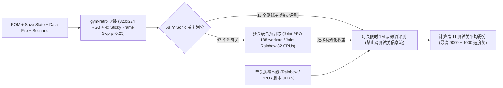

# OpenAI Gym Retro

**Gotta Learn Fast: A New Benchmark for Generalization in RL（OpenAI Gym Retro）**（Alex Nichol, Vicki Pfau, Christopher Hesse, Oleg Klimov, John Schulman，OpenAI，arXiv:1804.03720v2）收录于 [AwesomeSim2Real](https://github.com/LongchaoDa/AwesomeSim2Real) **第 069/139** 篇，分组 **Other Environments**。本页基于论文全文完成精读与数据核实。

## 一句话定义

**OpenAI Gym Retro（Gotta Learn Fast）** 是一套基于 `libretro` 模拟器接口将经典主机游戏封装为标准 Gym 环境的开源平台，并据此构建了严格划分**训练关卡与未见测试关卡（47 训练 / 11 测试）**的 **Sonic 基准**，专门用于量化评估深度强化学习与元学习算法在有限交互步数（100 万步）下的跨关卡泛化与快速适应能力。

## 英文缩写速查

| 缩写 | 英文全称 | 简要说明 |
|------|----------|----------|
| ALE | Arcade Learning Environment | 经典 Atari 强化学习基准，但普遍“在测试集上直接训练” |
| RLE | Retro Learning Environment | 基于 SNES 模拟器的早期复古游戏学习环境 |
| JERK | Just Enough Retained Knowledge | 本文提出的纯奖励驱动非深度学习脚本探索与序列回放基线 |
| PPO | Proximal Policy Optimization | 近端策略优化；本文对比单关训练与 188 进程联合训练（Joint PPO） |
| GAE | Generalized Advantage Estimation | 广义优势估计（本文 PPO 采用 $\lambda = 0.95, \gamma = 0.99$） |

## 为什么重要

- **打破 RL “在测试集上训练”的评测盲区**：传统 Atari（ALE）或单任务基准在相同环境上训练与测试，难以区分策略是真正学会泛化还是死记硬背轨迹；Sonic 基准模仿监督学习建立严格的“同分布不同布局”的 Train/Test 划分。
- **兼具高难度视觉复杂度与同源任务结构**：相比互不相关的 Atari 游戏集合，3 款 *Sonic* 游戏共享核心物理规则与视觉纹理但关卡空间布局各异，更适合检验迁移学习与少样本 RL 的正迁移收益。
- **低成本可扩展的 `gym-retro` 架构**：通过分离 `ROM`、存档状态（`Save state`）、内存映射描述（`Data file`）与奖励/终止脚本（`Scenario`），可快速把海量经典主机游戏转为 RL 环境。

## 核心信息

| 字段 | 内容 |
|------|------|
| 编号 | 069/139 |
| 分组 | Other Environments |
| 出处 | OpenAI technical report (arXiv:1804.03720v2, 2018-04-23) |
| 作者与机构 | Alex Nichol, Vicki Pfau, Christopher Hesse, Oleg Klimov, John Schulman（OpenAI） |
| 论文与项目 | <https://openai.com/index/gym-retro/> · <https://arxiv.org/abs/1804.03720> |

## 核心机制

1. **Gym Retro 环境封装规范（§3.1）**
   - `gym-retro` 通过 `libretro` API 对接主机模拟器，每个游戏由 4 部分组成：`ROM`（游戏镜像）、`Save state`（关卡起点主机快照）、`Data file`（内存地址映射，如得分/坐标位置）与 `Scenario`（引用内存字段定义的奖励与终止逻辑）。

2. **Sonic 跨关卡泛化基准设计（§3.2–3.9）**
   - **数据划分**：选取 3 款规则相近的世嘉 Genesis 游戏（*Sonic The Hedgehog*、*Sonic The Hedgehog 2*、*Sonic 3 & Knuckles*）共 **58 个关卡存档**（剔除纯 Boss 战关），从多 Act 的 Zone 中随机抽取 **11 个关卡作测试集**、其余 **47 个关卡作训练集**（测试集包含与训练集相似的贴图与机关，但空间拓扑全新）。
   - **随机粘性跳帧（Sticky Frame Skip）**：帧跳过率（Frame Skip）设为 **4**（原始 60 Hz 降至约 15 步/秒），并以 **0.25 概率**将当前动作延迟 1 帧执行（该帧沿用上一动作），防止针对确定性模拟器的固定脚本记忆作弊。
   - **观测、动作与欺骗性密集奖励**：观测为 **320 × 224 24-bit RGB** 图像；Genesis 原生 12 键二值向量在 Sonic 中精简为 8 个核心按键组合（基线算法去掉空动作使用 7 离散动作）。每关水平进度归一化为 **9000 分**，加上按 4500 步内剩余时间线性衰减的 **0–1000 分**通关速度奖励；RL 基线对环境施加 `max_x` 增量包装器，避免需要“先向左折返绕路”的机关因负奖励导致智能体卡死。
   - **100 万步有限预算评测协议**：在训练集自由预训练后，**逐一独立**在每个测试关运行 **1,000,000 时间步**（测试关之间不共享任何经验，每回合上限 4500 步 $\approx 5$ 分钟或损命/通关），取全过程回合平均分再跨 11 个测试关求均值。

3. **基准与迁移算法（§4.2–4.6）**
   - **单关从零训练**：`Rainbow`（$V_{\max}=200$，回放池缩为 0.5M，取消超参调度）、`PPO`（单 worker，Horizon/Minibatch=8192，4 epochs，$\epsilon=0.2$，熵系数 0.001，奖励缩放 0.005）以及非深度学习脚本 `JERK`（按固定步长右跑跳跃，停滞则左退，记录最高累计回报动作序列并随时间以 $\beta + T/T_{\max}$ 概率回放）。
   - **联合训练 + 微调迁移（Joint Training）**：`Joint PPO` 使用 **188 个并行 worker** 同步采样全部训练关并平均梯度（文中另提及尝试 Reptile 但效果更差）；`Joint Rainbow` 使用 **32 块 GPU**（每卡 8 个随机采样训练关的环境与独立回放池，每步梯度 `AllReduce` 同步）。

### 方法流程图

## 评测与指标

在 11 个未见测试关（每个测试关运行 100 万时间步、每算法 3 次随机种子）上的汇总得分与训练末期得分（Table 1–7）：

| 算法 / 基准 | 测试集全过程均分（Table 1） | 测试集末期均分（Final Score, Tables 2–6） | 说明与关键特征 |
|---|---|---|---|
| **PPO（单关从零）** | `1488.8 ± 42.8` | `1755.1 ± 65.2` | 样本效率低于 JERK，单关 1M 步难以突破探索瓶颈 |
| **JERK（纯奖励脚本）** | `1904.0 ± 21.9` | `2306.8 ± 74.0` | 完全忽略像素观测，靠记忆最佳回报轨迹反超标准 PPO |
| **Rainbow（单关从零）** | `2748.6 ± 102.2` | `3706.3 ± 192.7` | 离策略样本效率显著优于单关 PPO，GreenHillZone Act2 达 `6332.0` |
| **Rainbow (joint)** | `2969.2 ± 170.2` | `3704.2 ± 151.1` | 联合预训练相比单关 Rainbow 仅微幅提升（末期均分几乎无增益） |
| **PPO (joint)** | **`3127.9 ± 116.9`** | **`3926.3 ± 78.1`** | 相比单关 PPO 提升 **~110%**，反超 Rainbow 家族成为最强的学习基线 |
| **Human（人类玩家）** | **`7438.2 ± 624.2`** | — | 4 名受试者（训练集练 2 小时 + 测试每关玩 1 小时） |

- **联合预训练过拟合拐点（Fig. 4）**：`Joint PPO` 在训练集上约 **5,000 万（50M）时间步**之后，继续提升训练集分数不再带来测试集微调成绩改善，且零样本测试分数在前几百万步后即基本停滞。

## 与其他工作对比

- **对比 ALE（Atari）与 RLE（SNES）**：ALE 游戏间机制差异过大，迁移学习增益微弱；RLE 扩展性有限；`gym-retro` 借助 `libretro` 标准化数据/脚本描述，在保持真实像素视觉难度的同时构建了可系统评测同分布跨关泛化的基准。
- **Joint PPO 反超 Joint Rainbow 的反直觉现象（§4.6）**：虽然单关从零训练时 Rainbow 大幅领先 PPO，但在 47 关多任务联合训练下，异策略（Off-policy）经验回放与分布式同步反而未能像策略梯度（Joint PPO）那样有效迁移表征，显示值函数多任务联合训练在探索迁移上存在明显瓶颈。同分组环境基准见 [AwesomeSim2Real 技术地图](../overview/lc-awesome-sim2real-technology-map.md)。

## 常见误区或局限

1. **欺骗性密集奖励无法根治探索死结**：即使做了 `max_x` 增量预处理免除折返惩罚，当关卡需要长时间向左下方绕行再回到主线时（如 *Labyrinth Zone Act 2*，人类需 20–30 秒通过红橙负回报路段，Fig. 2），基于局部进度奖励的策略依然极难靠自身学会先退后进。
2. **最高分仍远未触顶且可能偏重“快速记忆”**：最强迁移基线 `Joint PPO` 均分仅 `3127.9`（人类 `7438.2`，满分 `9000–10000`）；作者也在 §5 坦承，1M 步测试窗口允许一定程度的关卡记忆，面向 *Sonic* 特化的探索技巧（如 JERK）未必能泛化到其他领域。
3. **测试关与训练关仍同属 Sonic 分布**：测试关仅检验同一游戏系列内部新布局的跨关卡适应，未覆盖跨游戏、跨物理规则的广义零样本泛化。

## 结论

**《OpenAI Gym Retro（Gotta Learn Fast）》通过 `gym-retro` 与 58 关 Sonic 基准将监督学习式的 Train/Test 泛化评测严格引入强化学习，证明联合预训练（Joint PPO）能将测试适应分翻倍，但所有基线仍大幅落后人类且距满分相去甚远。**

- **使用基准评测泛化/元学习时必须隔离训练关与测试关**：严禁在测试关上做超参调优或跨关共享回放经验，并保留粘性跳帧（$p=0.25$）以防止开环动作序列作弊。
- **多任务联合预训练需警惕过拟合窗口**：如 `Joint PPO` 在 ~50M 步后即出现训练集继续上涨但测试迁移效果饱和的现象，应以定期验证集微调曲线而非训练集回报作为早停依据。
- **离策略值函数（Rainbow）在多任务迁移上未必优于策略梯度（PPO）**：单关样本效率高不代表多关联合预训练特征迁移好，迁移基准中应同时对比 On-policy 与 Off-policy 预训练路线。
- **强欺骗性障碍与记忆型探索仍是开放难题**：在非深度学习脚本 `JERK` 都能击败单关 PPO 的关卡结构下，引入好奇心/内在探索目标与层次化子目标规划是缩小与人类（7438.2 vs 3127.9）差距的关键方向。

## 关联页面

- 列表实体：[AwesomeSim2Real](../entities/awesome-sim2real.md)
- 技术地图：[AwesomeSim2Real 技术地图](../overview/lc-awesome-sim2real-technology-map.md)
- 方法/任务：[sim2real.md](../concepts/sim2real.md)、[locomotion.md](../tasks/locomotion.md)
- [PPO（Proximal Policy Optimization）](../methods/ppo.md)：对照本文用于 47 关联合预训练与跨关卡迁移评测的核心策略优化基线 PPO。

## 参考来源

- [`sources/papers/lc_awesome_sim2real_noarxiv_069_openai-gym-retro.md`](../../sources/papers/lc_awesome_sim2real_noarxiv_069_openai-gym-retro.md) — 本条目策展摘录
- [`sources/papers/lc_awesome_sim2real_catalog.md`](../../sources/papers/lc_awesome_sim2real_catalog.md) — 列表总表
- [`sources/repos/awesome-sim2real.md`](../../sources/repos/awesome-sim2real.md)
- 论文：<https://openai.com/index/gym-retro/>

## 推荐继续阅读

- [AwesomeSim2Real 仓库](https://github.com/LongchaoDa/AwesomeSim2Real)
- [原文](https://openai.com/index/gym-retro/)
