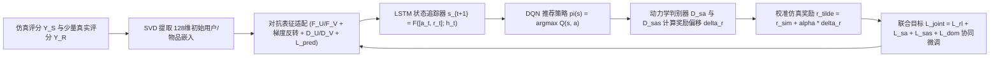

# Sim-to-Real Interactive Recommendation via Off-Dynamics Reinforcement Learning

**Sim-to-Real Interactive Recommendation via Off-Dynamics Reinforcement Learning**（NeurIPS 2021 / Offline RL Workshop，NYU, SJTU & Adobe Research）收录于 [AwesomeSim2Real](https://github.com/LongchaoDa/AwesomeSim2Real) **第 073/139** 篇，分组 **Recommender System Benchmarks**。本页基于论文全文完成结构化精读与核实。

## 一句话定义

**S2R-Rec** 是一种将机器人领域 **Off-Dynamics RL** 引入交互式推荐系统（IRS）的 Sim2Real 迁移框架：通过**域判别器诱导的奖励偏移修正**对齐仿真与真实用户的状态转移动力学，同时利用**对抗表征适配与联合训练**对齐无重叠物品潜空间，从而仅在仿真器中交互即可训练出适配新业务真实用户的推荐策略。

## 英文缩写速查

| 缩写 | 英文全称 | 简要说明 |
|------|----------|----------|
| IRS | Interactive Recommender System | 交互式推荐系统，关注用户偏好随时间动态漂移的长期收益 |
| MAB | Multi-Armed Bandit | 多臂老虎机，常假设偏好平稳而难以显式建模状态转移 |
| SVD | Singular Value Decomposition | 奇异值分解，用于从仿真/真实评分矩阵提取 128 维初始嵌入 |
| LSTM | Long Short-Term Memory | 长短期记忆网络，本文用来将历史推荐–反馈序列递归编码为用户状态 $s_t$ |
| DQN | Deep Q-Network | 深度 Q 网络，在去重动作空间 $\hat{A}$ 上估计长期交互回报 |

## 为什么重要

- 与机器人仿真和真机共享物理定律不同，推荐系统的“Sim2Real”往往发生在新旧业务品类之间（如用电影交互仿真器训练，却要上线推荐全新电视剧）：此时**两域之间几乎没有重叠物品**，且同一用户在不同品类下的评分分布与动态转移特性截然不同。
- S2R-Rec 将“表征对齐”与“动力学对齐”纳入统一联合目标，验证了无需与线上真实用户做昂贵试错交互，仅凭大量仿真数据与极少量真实日志（200 名真实用户）即可显著降低跨品类推荐的 Sim2Real 落差。

## 核心信息

| 字段 | 内容 |
|------|------|
| 编号 | 073/139 |
| 分组 | Recommender System Benchmarks |
| 出处 | 35th Conference on Neural Information Processing Systems (NeurIPS 2021) / Offline RL Workshop |
| 作者与机构 | Junda Wu（NYU）, Zhihui Xie（SJTU）, Tong Yu（Adobe Research）, Shuai Li, Qizhi Li（SJTU） |
| 论文 | <https://offline-rl-neurips.github.io/2021/pdf/50.pdf> |

## 核心机制

1. **概率推断视角下的动力学自适应（Off-Dynamics Reward Correction）**
   - 借鉴 Eysenbach 等人 [7] 的 Off-Dynamics RL，将真实与仿真轨迹分布匹配表示为最小化 $D_{\text{KL}}(p_{\text{sim}} \| p_{\text{real}})$，导出等价的仿真奖励修正项 $\tilde{r}_{\text{sim}} = r_{\text{sim}} + \alpha \Delta r(s_t, a_t, s_{t+1})$（$\alpha_{\text{dyn}} \in \{0.6, 0.7, 0.8, 0.9\}$），其中：
     $$\Delta r(s_t, a_t, s_{t+1}) = \log p_{\text{real}}(s_{t+1}|s_t, a_t) - \log p_{\text{sim}}(s_{t+1}|s_t, a_t) \approx \log \frac{D_{sas}(s_t, a_t, s_{t+1})}{1 - D_{sas}(\cdot)} - \log \frac{D_{sa}(s_t, a_t)}{1 - D_{sa}(\cdot)}$$
   - 利用交叉采样仿真轨迹 $\tau_{\text{sim}}$ 与少量真实轨迹 $\tau_{\text{real}}$（每 $K_{\text{interval}} \in \{2,3,4\}$ 步采样一次真实数据）训练判别器 $D_{sas}$ 与 $D_{sa}$，当某转移在仿真中常见但真实用户极少出现时给出负偏移 $\Delta r < 0$，防止策略“钻仿真器漏洞”。
2. **对抗表征自适应（Representation Adaptation）**
   - 先对仿真与真实评分矩阵 $Y^S, Y^R$ 分别做 **SVD** 提取 $D_{\text{rep}}=128$ 维用户与物品初始嵌入 $u^S, v^S, u^R, v^R$。
   - 学习映射网络 $F_U^S, F_V^S, F_U^R, F_V^R$，通过梯度反转层 $\Phi$ 与域判别器 $D_U, D_V$ 做对抗训练（$L_{\text{dom}}$），同时最小化双域评分重构误差（$L_{\text{pred}}$），在无共享物品的前提下提取跨域不变表征。
3. **LSTM-DQN 策略与两阶段联合训练（Joint Adaptation）**
   - 用 **LSTM** 递归聚合已推荐物品嵌入与用户反馈奖励：$s_{t+1}, h_{t+1} = F([a_t, r_t]; h_t)$，由 **DQN** 在屏蔽已推荐物品的动作集 $\hat{A}$ 上选择 $\arg\max Q(s, a)$。
   - **联合优化**：不同于将表征对齐与 RL 割裂的两阶段做法，联合目标 $L_{\text{joint}} = L_{\text{rl}} + L_{\text{sa}} + L_{\text{sas}} + L_{\text{dom}}$ 允许下游交互奖励与动力学判别误差反传微调 $F_V^S, F_V^R$，使共享物品表征更聚焦于跨任务动力学相关模式。

### 方法流程图

## 评测与指标

在 **Movielens-25M** 与 **ANIME** 各 3 组跨类别 Sim→Real 组合上评测（会话长度 $T=32$；训练集仅抽样 **200 名**真实用户，90% 真实用户作测试；全文较基线平均提升约 **33.18%**，Table 2 & Table 3）：

| 数据集与 Sim → Real 任务 | MF (Reward) | DARec (Reward) | DQN-R (Reward) | w/o DynAda (Reward) | w/o RepAda (Reward) | w/o JntTrn (Reward) | **S2R-Rec** (Reward / P@32 / R@32 / F1@32) | 相对 DQN-R Reward 提升 |
|------|------|------|------|------|------|------|------|------|
| **Movielens**: Adventure → Crime | 0.1554 | 0.2325 | 0.2909 | 0.3320 | 0.3103 | 0.3363 | **0.3413 / 0.4654 / 0.2261 / 0.2867** | **+17.32%** |
| **Movielens**: Drama → Comedy | 0.1325 | 0.1572 | 0.1879 | 0.2182 | 0.2181 | 0.2264 | **0.2359 / 0.3370 / 0.1312 / 0.1734** | **+25.55%** |
| **Movielens**: Thriller → Action | 0.1671 | 0.2140 | 0.3002 | 0.3211 | 0.3109 | 0.3336 | **0.3399 / 0.4777 / 0.1722 / 0.2430** | **+13.22%** |
| **ANIME**: Movie → TV | 0.1509 | 0.2550 | 0.2286 | 0.3194 | 0.2518 | 0.3373 | **0.3396 / 0.4868 / 0.1122 / 0.1767** | **+48.56%** |
| **ANIME**: TV → OVA | 0.0498 | 0.0539 | 0.0597 | 0.0695 | 0.0669 | 0.0725 | **0.0756 / 0.1306 / 0.3493 / 0.1672** | **+26.63%** |
| **ANIME**: OVA → Movie | 0.1448 | 0.2025 | 0.2471 | 0.2590 | 0.2521 | 0.2855 | **0.2905 / 0.4505 / 0.2529 / 0.3108** | **+17.56%** |

- **动力学差距压力测试（RQ2/RQ3）**：按用户历史交互聚类距离划分 Sim2Real 难度梯度，当用户行为差距增大时，`DQN-R` 与仅做表征对齐的 `w/o DynAda` 持续掉点，而带动力学修正的 `w/o RepAda` 退化最缓；联合训练 `S2R-Rec` 在差距最大的前 1,000 名用户上相比分离训练 `w/o JntTrn` 再获 **+4.52%** 增益（差距最小组为 +1.241%）。

## 与其他工作对比

- **对比静态矩阵分解与跨域推荐（MF / DARec [28]）**：MF 与 DARec 贪心单步匹配评分，缺乏多步长期交互规划，回报显著低于 RL 方案；且 DARec 仅对齐表征而不对齐转移概率。
- **对比无自适应仿真 RL（DQN-R [31]）与两阶段分离版本（w/o JntTrn）**：DQN-R 直接把仿真器学到的策略用于新域，面对物品不重合与评分习惯差异时容易崩溃（如 Movie→TV 中甚至低于 DARec）；联合端到端训练使 S2R-Rec 在所有 6 个任务上均超越任意单模块消融与分离训练版本。同分组横向对照见 [技术地图](../overview/lc-awesome-sim2real-technology-map.md)。

## 常见误区或局限

1. **并非完全“零真实数据”**：虽然在线阶段仅在仿真器中做 RL 交互优化，但训练域判别器 $D_{sas}/D_{sa}$ 与 SVD 表征对齐仍需要少量离线真实交互数据（实验中采样了 200 名真实用户，约占 1.2万–3.2万条评分）。
2. **离线重放式仿真评测局限**：实验基于 Movielens-25M 和 ANIME 离线评分日志划分品类模拟跨任务 Sim2Real，而非真实线上 A/B 流量；离散物品动作空间未覆盖极大规模候选集的检索–重排两级耦合延迟。
3. **无官方代码仓库链接**：论文正文提供了数据集官方源链接，但未附带 S2R-Rec 实现仓库 URL，复现时需依据第 4 节公式自行实现双判别器与梯度反转联合优化。

## 结论

**S2R-Rec 证实了机器人领域基于域分类器奖励修正的 Off-Dynamics RL 可有效迁移至“零共享物品、动态偏移显著”的交互式推荐 Sim2Real 场景，并在 6 组跨类评测中全面领先。**

- 当源域与目标域不仅转移概率不同、连动作/观测实体本身都无重叠时，单独做对抗表征对齐（DARec / `w/o DynAda`）或单独做动力学奖励修正（`w/o RepAda`）都不够，必须将两者纳入联合端到端目标。
- 用 $D_{sas}$ 与 $D_{sa}$ 两个分类器的对数几率差构造 $\Delta r$ 是一种通用的轻量 Off-Dynamics 校准手段，可避免为目标域从头拟合高维显式转移模型。
- 在用户群体动力学差异越大的冷启动迁移分片上，联合反向微调表征映射能带来更明显的相对收益（最高 +4.52%）。

## 关联页面

- 列表实体：[AwesomeSim2Real](../entities/awesome-sim2real.md)
- 技术地图：[AwesomeSim2Real 技术地图](../overview/lc-awesome-sim2real-technology-map.md)
- 方法/任务：[sim2real.md](../concepts/sim2real.md)、[reinforcement-learning.md](../methods/reinforcement-learning.md)、[locomotion.md](../tasks/locomotion.md)、[manipulation.md](../tasks/manipulation.md)

## 参考来源

- [`sources/papers/lc_awesome_sim2real_noarxiv_073_sim-to-real-interactive-recommendation-v.md`](../../sources/papers/lc_awesome_sim2real_noarxiv_073_sim-to-real-interactive-recommendation-v.md) — 本条目策展摘录
- [`sources/papers/lc_awesome_sim2real_catalog.md`](../../sources/papers/lc_awesome_sim2real_catalog.md) — 列表总表
- [`sources/repos/awesome-sim2real.md`](../../sources/repos/awesome-sim2real.md)
- 论文：<https://offline-rl-neurips.github.io/2021/pdf/50.pdf>

## 推荐继续阅读

- [AwesomeSim2Real 仓库](https://github.com/LongchaoDa/AwesomeSim2Real)
- [原文](https://offline-rl-neurips.github.io/2021/pdf/50.pdf)
