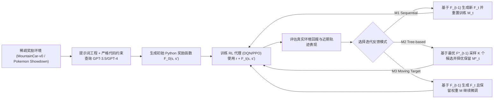

# A simple framework for intrinsic reward-shaping for rl using llm feedback

**A Simple Framework for Intrinsic Reward-Shaping for RL using LLM Feedback**（Princeton University preprint）收录于 [AwesomeSim2Real](https://github.com/LongchaoDa/AwesomeSim2Real) **第 081/139** 篇，分组 **Reward / Reward Shaping**。本页基于论文全文完成结构化精读与核实。

## 一句话定义

**A Simple Framework for Intrinsic Reward-Shaping for RL using LLM Feedback** 是一套轻量级、单卡可运行的 LLM 代码生成奖励塑形框架：在不篡改环境真实稀疏奖励 $r$ 的前提下，通过顺序反馈、树状反馈与移动目标反馈三种迭代策略向 GPT-3.5/GPT-4 请求可执行 Python 内在奖励函数 $F_t(s, s')$，将文本领域先验接地为 DQN 与 PPO 的密集探索引导信号。

## 英文缩写速查

| 缩写 | 英文全称 | 简要说明 |
|------|----------|----------|
| LLM | Large Language Model | 大语言模型（本文使用 GPT-3.5 Turbo / GPT-4 生成奖励代码） |
| DQN | Deep Q-Network | 深度 Q 网络，本文通过经验回放中的 $r + F_t(s, s')$ 接入塑形奖励 |
| PPO | Proximal Policy Optimization | 近端策略优化（PPO-Clip），本文在 rewards-to-go $\hat{R}_l$ 中叠加 $F_t$ |
| TD | Temporal Difference | 时序差分误差，利用塑形后转移回报更新价值函数 |
| EV | Effort Value | 宝可梦对战中的努力值属性，真实天梯环境高维变量之一 |

## 为什么重要

- 在状态空间组合爆炸且仅在终局给出胜负稀疏奖励的任务（如 `Pokemon Showdown` 对战、`NetHack`、`Minecraft`）中，纯试错探索面临极严重的信用分配困难；而传统人工手工设计稠密奖励又容易引发次优局部行为（例如 AlphaGo 第 37 手很难被人类先验规则捕获）。
- 相比依赖高度分布式大规模仿真的 **Eureka**（Ma et al. 2023），本文证明了仅在**单张 RTX 3080Ti** 上运行标准非并行 DQN / PPO，借助代码形式的内在奖励函数也能把维基/论坛中的文字策略先验稳定注入智能体，且生成的奖励代码完全人类可读。

## 核心信息

| 字段 | 内容 |
|------|------|
| 编号 | 081/139 |
| 分组 | Reward / Reward Shaping |
| 出处 | Princeton University (preprint) |
| 作者与机构 | Alex Zhang, Ananya Parashar, Dwaipayan Saha（Department of Computer Science & Department of ORFE, Princeton University） |
| 论文与代码 | <https://alexzhang13.github.io/assets/pdfs/Reward_Shaping_LLM.pdf> · <https://github.com/alexzhang13/reward-shaping-rl> |

## 核心机制

1. **加法内在奖励形式化与算法接入（Algorithm 4 & Algorithm 5）**
   - 保持环境原生稀疏奖励 $r$ 不变，仅在每步状态转移 $(s, s')$ 上叠加由 LLM 生成的可执行 Python 函数 $F_t(s, s')$（正值鼓励、负值抑制），整条轨迹塑形回报为 $G = \sum_{i=0}^\infty \gamma^i (r_i + F_t(s_i, s_{i+1}))$。
   - **PPO-Clip**：直接将 rewards-to-go 重定义为 $\hat{R}_l = \sum_{i=l}^L (R(s_i, a_i, s_{i+1}) + F_t(s_i, s_{i+1}))$ 用于计算优势与价值回归。
   - **DQN**：在经验回放缓冲区直接存储塑形后的转移回报 $r_t + F_t(s_t, s_{t+1})$ 并计算 TD 目标 $y_j$。
2. **三种迭代 LLM 奖励函数精炼策略**
   - **方法 1：顺序反馈（Sequential Feedback, M1, Algorithm 1）**：初始查询 LLM 生成 $F_0(s, s')$，训练模型 $M_0$ 固定回合 $L$（Pokemon 实验 $L=1000$，共 10 轮）后，将 $F_{t-1}$ 与近期轨迹表现送回 LLM 采样 $F_t \sim P(F_t|F_{t-1})$ 并**重新训练**新模型 $M_t$。
   - **方法 2：树状反馈（Tree-based Feedback, M2, Algorithm 2）**：受 Eureka 演化搜索启发但面向单机精简——每轮基于上一轮最佳奖励函数 $F_{t-1}^*$ 让 LLM 并行采样 $K$ 个候选函数 $\{F_t^i\}_{i=1}^K$（Pokemon 实验 $L=500, K=5$，共 4 轮 = 10,000 回合），分别训练并保留真实评估表现最高的 $M_t^*$ 与 $F_t^*$（例如生成了基于“击倒对手宝可梦数量 + 削减对手总 HP”的可解释奖励代码）。
   - **方法 3：移动目标反馈（Moving Target Feedback, M3, Algorithm 3）**：每隔 $L$ 回合（1000 回合）向 LLM 请求更新奖励函数 $F_t$，但**保留并继续更新同一模型参数权重 $M$**，避免冷启动重置丢失已学表征。

### 方法流程图

## 评测与指标

1. **MountainCar-v0 概念验证（表格 Q-Learning + GPT-3.5 Turbo）**：LLM 生成针对位置/速度与左右加速方向的 3 分支逻辑奖励函数（Fig. 3），显著加速收敛并超越纯稀疏奖励 Q-Learning（Fig. 4）。
2. **Pokemon Showdown 固定队伍 1v1 单打交叉对战评测（`poke-env`，58 维状态向量 $O_t \in \mathbb{R}^{58}$，全方法各训 10,000 回合，两两对战 50 局胜率，Table 1）**：

| 对战方（行胜率 vs 列） | DQN | DQN+M1 | DQN+M2 | DQN+M3 | PPO | PPO+M1 | PPO+M2 | PPO+M3 |
|------|------|------|------|------|------|------|------|------|
| **DQN** | - | 0.16 | 0.08 | 0.14 | 0.46 | 0.60 | 0.14 | 0.18 |
| **DQN+M1** | **0.84** | - | **0.90** | **0.88** | 0.60 | 0.56 | 0.06 | 0.12 |
| **DQN+M2** | **0.92** | 0.10 | - | 0.22 | 0.14 | 0.60 | 0.36 | 0.24 |
| **DQN+M3** | **0.86** | 0.12 | 0.78 | - | 0.54 | 0.64 | 0.54 | 0.52 |
| **PPO** | 0.54 | 0.44 | 0.40 | 0.32 | - | 0.26 | 0.16 | 0.18 |
| **PPO+M1** | 0.40 | 0.44 | 0.40 | 0.36 | **0.74** | - | 0.30 | 0.22 |
| **PPO+M2** | **0.86** | **0.94** | 0.64 | 0.46 | **0.84** | **0.70** | - | 0.38 |
| **PPO+M3** | **0.82** | **0.88** | **0.76** | 0.48 | **0.82** | **0.78** | **0.62** | - |

> 注：三种 DQN 塑形变体（M1/M2/M3）对抗基础 DQN 的胜率全部超过 **80%**（84%、92%、86%）；而在 PPO 家族内部，M2 与 M3 分别对基础 PPO 取得 **84%** 与 **82%** 胜率，其中 **PPO+M3** 对所有对照方（除 DQN+M3 的 0.48 外）胜率均在 52%–88% 之间，综合表现最稳健。

## 与其他工作对比

- **对比 Eureka（Ma et al. 2023）与 Language to Rewards（Yu et al. 2023）**：Eureka 针对连续物理控制并强依赖大规模分布式 GPU 集群做高频演化搜索；本文聚焦非并行单卡训练流程（RTX 3080Ti），验证了离散/策略博弈域中无需多节点并发亦可通过 M1/M2/M3 显著提升样本效率。
- **对比基于规则的启发式算法（Random / Random Attack / Max Attack，Fig. 6）**：所有 RL+LLM 变体均轻松击败 `Random` 并与 `Random Attack` 持平，但**均不敌 `Max Attack`**（基于属性克制倍率与技能威力的显式伤害计算启发式）——因为 10,000 回合内智能体倾向收敛到“多放攻击技能”的局部极小，且状态输入中未直接提供伤害乘数表。同分组横向对照见 [技术地图](../overview/lc-awesome-sim2real-technology-map.md)。

## 常见误区或局限

1. **LLM 生成代码存在语法与 API 报错（Reproducibility 风险）**：作者明确指出 LLM 生成的奖励函数经常出现编译错误、语法错误或错误 API 调用，必须严格约束提示词“只输出函数代码、不执行、不附带解释”，且训练过程仍需人工从检查点重启兜底（三种方法中 M2 因每轮生成 5 个候选而最稳定）。
2. **上下文窗口与非真实天梯限制**：多轮迭代反馈受限于 LLM 上下文窗口，只能截断保留最近几轮奖励与轨迹历史；同时实验固定了双方宝可梦阵容且忽略特性/道具，作者尝试把 bot 挂上线上天梯对战真实玩家时发现胜局多源于对手掉线或故意送分，尚无法泛化至随机全阵容对抗。
3. **手工低维特征偏置与局部最优**：58 维紧凑向量虽降低算力门槛，但也引入特征选择先验且缺失属性克制细节，导致无法学出击败 `Max Attack` 的高阶属性克制与换宠博弈策略。

## 结论

**本文验证了在单卡非分布式环境下，用 GPT-3.5/GPT-4 迭代生成并精炼 Python 内在奖励函数代码，能够为 DQN 与 PPO 注入领域文本先验并在 Pokemon Showdown 上对基础 DQN 取得 >80% 胜率。**

- 在样本效率受限的稀疏奖励任务中，优先使用**树状采样（M2）**过滤 LLM 偶发幻觉或低质奖励代码，或采用**移动目标（M3）**保留策略权重持续微调以兼顾稳定性（PPO+M3 综合胜率最优）。
- 工程落地 LLM-in-the-loop 奖励生成时，必须在代码执行前加入自动化沙箱语法/API 校验与失败回退机制，不能假定大模型零样本输出 100% 可运行。
- 当环境存在精确领域物理/规则乘数（如属性克制）而紧凑状态表征未显式暴露时，仅靠奖励塑形难以在有限步数内突破局部最优（仍不敌 `Max Attack` 规则基线），需同步丰富状态观测或引入显式前瞻搜索。

## 关联页面

- 列表实体：[AwesomeSim2Real](../entities/awesome-sim2real.md)
- 技术地图：[AwesomeSim2Real 技术地图](../overview/lc-awesome-sim2real-technology-map.md)
- 方法/任务：[sim2real.md](../concepts/sim2real.md)、[reinforcement-learning.md](../methods/reinforcement-learning.md)、[locomotion.md](../tasks/locomotion.md)、[manipulation.md](../tasks/manipulation.md)

## 参考来源

- [`sources/papers/lc_awesome_sim2real_noarxiv_081_a-simple-framework-for-intrinsic-reward.md`](../../sources/papers/lc_awesome_sim2real_noarxiv_081_a-simple-framework-for-intrinsic-reward.md) — 本条目策展摘录
- [`sources/papers/lc_awesome_sim2real_catalog.md`](../../sources/papers/lc_awesome_sim2real_catalog.md) — 列表总表
- [`sources/repos/awesome-sim2real.md`](../../sources/repos/awesome-sim2real.md)
- 论文：<https://alexzhang13.github.io/assets/pdfs/Reward_Shaping_LLM.pdf>

## 推荐继续阅读

- [AwesomeSim2Real 仓库](https://github.com/LongchaoDa/AwesomeSim2Real)
- [官方代码仓库 reward-shaping-rl](https://github.com/alexzhang13/reward-shaping-rl)
- [原文](https://alexzhang13.github.io/assets/pdfs/Reward_Shaping_LLM.pdf)
