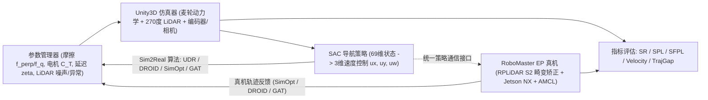

# NeuronsGym

**NeuronsGym: A Hybrid Framework and Benchmark for Robot Navigation with Sim2Real Policy Learning**（IEEE Transactions on Emerging Topics in Computational Intelligence, 2024，arXiv:2302.03385v2，中科院自动化所）收录于 [AwesomeSim2Real](https://github.com/LongchaoDa/AwesomeSim2Real) **第 087/139** 篇，分组 **Robotics Benchmarks**。本页基于论文全文完成结构化精读与核实。

## 一句话定义

**NeuronsGym** 是一套打通 Unity3D 物理仿真与 **RoboMaster EP** 高机动实体轮式机器人平台的开源 Sim2Real 导航混合框架与基准，通过对麦克纳姆轮非对称摩擦/电机/控制延迟、LiDAR 高斯噪声+泊松异常点的精细化参数建模，以及提出的 **SFPL** 安全指标，实现对高速导航策略虚实迁移能力的定量评估。

## 英文缩写速查

| 缩写 | 英文全称 | 简要说明 |
|------|----------|----------|
| SFPL | SaFety weighted by Path Length | 路径长度加权安全性指标，按无碰撞行进距离占比惩罚连续碰撞与擦墙行为 |
| SR / SPL | Success Rate / Success weighted by Path Length | 目标激活成功率 / 路径长度加权成功率 |
| UDR / DROID / SimOpt | Uniform DR / DROID / Simulation Optimization | 三类对比的域随机化方法（无数据随机化 / 离线轨迹优化 / 在线分布优化） |
| GAT | Grounded Action Transformation | 基于真实离线数据在仿真器外学习的动作变换器 |
| AMCL | Adaptive Monte Carlo Localization | 自适应蒙特卡洛定位，用于在物理场地获取真机位姿真值 |

## 为什么重要

- 传统具身导航平台（如 TurtleBot、LoCoBot）受限于差速轮上限速度（通常 $\le 0.5\text{ m/s}$），难以暴露高速运动下的轮地打滑、电机饱和、通信延迟与雷达运动畸变等核心动力学 Sim2Real 落差；而纯 Sim2Sim 实验则回避了真实控制延迟与传感器异常点。
- 常用安全性指标“碰撞次数”无法公平对比不同路径长度任务，且面对机器人贴墙连续滑行时严重失真；NeuronsGym 提出的 **SFPL** 与 **TrajGap**（Wasserstein 轨迹分布距离），结合 2022 IEEE CoG RoboMaster Sim2Real 挑战赛，建立了高机动室内导航的虚实对标基准。

## 核心信息

| 字段 | 内容 |
|------|------|
| 编号 | 087/139 |
| 分组 | Robotics Benchmarks |
| 出处 | IEEE Transactions on Emerging Topics in Computational Intelligence (2024, arXiv:2302.03385v2) |
| 作者与机构 | Haoran Li, Guangzheng Hu, Shasha Liu, Mingjun Ma, Yaran Chen, Dongbin Zhao（中国科学院自动化研究所 MAIS 实验室、中国科学院大学） |
| 论文与代码 | <https://ieeexplore.ieee.org/document/1389727> · <https://arxiv.org/abs/2302.03385> · <https://github.com/DRL-CASIA/NeuronsGym> |

## 核心机制

1. **仿真–真机同构平台与 5 目标按序激活任务**
   - **场地与任务**：$5\text{ m} \times 8\text{ m}$ 矩形场地内含固定障碍（高 10 cm 仅遮挡 LiDAR、高 20 cm 同时遮挡相机与 LiDAR），机器人在每轮须按字母顺序依次到达距目标 $<1.0\text{ m}$ 且朝向偏差 $<30^\circ$ 以激活 **A–E 五个随机摆放目标块**；按目标落入 1 m 方形遮挡区（blocking zone）数量划分为 **Level 1 / 2 / 3**（0 / 1 / 3 个）。
   - **实体硬件**：采用 **RoboMaster EP**（全向麦轮，最高速度测试至 $1.5\text{ m/s}$）搭载前置 **RPLiDAR S2**（用里程计矫正高速点云畸变，下采样对齐仿真）、**NVIDIA Jetson NX** 与 **AMCL** 真值定位。仿真提供轻量几何场景与 RealityCapture 三维重建高视觉保真场景两种渲染模式。
2. **动力学参数化与双分布 LiDAR 传感器建模**
   - **麦轮运动与控制链路**：建立电机电流–轮速积分模型（含静/动摩擦切换 $|\omega_i| > \omega_e$、两组对角麦轮各自的滑动摩擦 $f_q$ 与滚动摩擦 $f_\perp$ 分段公式、PID 轮速控制器 $k_p, k_i, k_d$），并显式模拟纵向/横向/角速度及发射控制 **4 路随机响应延迟** $(\zeta_{vx}, \zeta_{vy}, \zeta_{vw}, \zeta_s)$；核心标定参数如表 I：$f_\perp=0.069, f_q=0.082, C_T=0.375, M=0.45, \rho_w=0.096$。
   - **LiDAR 噪声与异常点**：270° 视场角共 61 线（$4.5^\circ$ 分辨率），同时建模**高斯测距噪声**（实测误差在 $[-0.05, 0.05]$）与**泊松分布异常点**（低反射率/大入射角丢帧，与真机异常分布 KL 散度仅 **$-0.0051$**），并开放参数管理器与策略解耦通信协议供 DR/自适应方法调用。
3. **安全性与迁移落差评测指标（SFPL 与 TrajGap）**
   - **SFPL**：统计每条轨迹中未碰撞步的位移占比 $\text{SFPL} = \frac{1}{N}\sum_{i=1}^N \frac{\sum_{t=1}^T (1 - \alpha_{i,t})\delta_{i,t}}{p_i}$，其中 $\alpha_{i,t} \in \{0,1\}$ 为碰撞标识、$\delta_{i,t}$ 为单步位移、$p_i$ 为总路径长，从而对长距离擦墙滑行施加持续惩罚。
   - **TrajGap**：计算仿真轨迹与真机轨迹状态（位姿+速度）分布间的 **Wasserstein 距离**，直接衡量动力学分布偏移。

### 方法流程图

## 评测与指标

策略统一基于 **SAC**（69 维状态含 LiDAR+位姿+速度+目标，3 维线/角速度动作），在真机与仿真上开展多维度对比（Tables II–VI）：

1. **仿真并行吞吐效率（Table VI，i9-13900K + RTX 3070 + Ray，单回合 1000 步）**：Headless 模式在 `N=1 / 4 / 8 / 16 / 32` 并行环境下的耗时分别为 `5.12 / 5.51 / 6.53 / 10.98 / 19.25 s`（Render 模式为 `11.04 / 13.13 / 13.88 / 16.67 / 26.80 s`）。
2. **模块消融与 SFPL 有效性（Table II & Table IV）**：
   - 在 4 条典型碰撞轨迹上，Trajectory 1（20 次离散短碰）碰撞数多于 Trajectory 2（13 次含擦墙），但安全度相近（SFPL `0.854` vs `0.842`）；Trajectory 3/4 碰撞数与 2 相近（14/12 次）却因长距离贴墙滑行导致 SFPL 骤降至 `0.770 / 0.726`，验证了 SFPL 的合理性。
   - Level 1（20 trials，1 m/s）消融中，无动力学与无雷达模型（`None`）仿真虚高过拟合，真机 SR 跌至 `0.90`、SPL `0.70`、SFPL `0.38`；仅加动力学（`w. RD`）真机 SR `0.85`、SPL `0.65`、SFPL `0.40`；仅加雷达模型（`w. LiDAR`）真机 SR 升至 `1.0`、SPL `0.80`、SFPL `0.49`；两者全开（`w. ALL`）达到最佳：**SR 1.0（gap 0.0）、SPL 0.83（gap 0.11）、SFPL 0.51（gap 0.29）**。
3. **五种 Sim2Real 算法三难度对比（Table V，2000 轮训练，最高速 1.0 m/s，真机测试均值）**：

| 场景难度 | 方法 | SR (sim / real) | SPL (sim / real / |gap|↓) | SFPL (sim / real / |gap|↓) | Velocity (sim / real) | TrajGap ↓ |
|------|------|------|------|------|------|------|
| **Level 1** | None | 1.0 / 1.0 | 0.94 / 0.83 / 0.11 | 0.80 / 0.51 / 0.29 | 1.10 / 0.93 | 1.77 |
| **Level 1** | UDR | 1.0 / 1.0 | 0.86 / 0.79 / 0.07 | 0.75 / 0.75 / **0.0** | 1.16 / 0.99 | 1.90 |
| **Level 1** | DROID | 1.0 / 1.0 | 0.83 / 0.79 / 0.04 | 0.77 / 0.75 / 0.02 | 1.00 / 0.81 | 1.89 |
| **Level 1** | SimOpt | 1.0 / 1.0 | 0.95 / **0.92** / **0.03** | 0.88 / **0.76** / 0.12 | 1.05 / 1.00 | **0.59** |
| **Level 1** | GAT | 1.0 / 1.0 | 0.91 / 0.83 / 0.08 | 0.85 / 0.62 / 0.23 | 0.96 / 0.94 | 1.76 |
| **Level 2** | None / UDR / DROID / SimOpt / GAT | 全 1.0 / 1.0 | Real: 0.65 / **0.84** / 0.78 / 0.81 / 0.74 | Real: 0.49 / 0.58 / **0.68** / 0.67 / 0.58 | Real: 0.84 / 0.88 / 0.99 / 0.96 / 0.90 | 1.97 / 1.56 / 1.93 / 1.76 / **1.06** |
| **Level 3** | None / UDR / DROID / SimOpt / GAT | 全 1.0 / 1.0 | Real: 0.64 / 0.85 / **0.88** / 0.79 / 0.61 | Real: 0.59 / 0.63 / 0.70 / **0.84** / 0.59 | Real: 0.86 / 0.97 / 1.01 / 0.93 / 0.80 | 3.07 / 2.97 / **1.21** / 1.71 / 1.27 |

## 与其他工作对比

- **对比常规视觉导航平台（Habitat、AI2-THOR、RoboTHOR / LoCoBot）与开源赛车/小车（Duckietown、DeepRacer）**：Habitat 等侧重视觉逼真度但缺乏精细麦轮摩擦/随机控制延迟及高机动实体对照；RoboTHOR/LoCoBot 上限仅 ~0.5 m/s，NeuronsGym 覆盖 1.0–1.5 m/s 区间并首次把物理安全性指标 **SFPL** 纳入基准评测核心。
- **对比五种基准方法在高速（1.0 → 1.5 m/s）下的表现**：随着最大速度升高，电机高负载脱离线性区、打滑加剧、随机控制延迟效应放大且雷达点云运动畸变增大，**所有方法**的真实 SPL、SFPL 下降且 TrajGap 均上升；`UDR` 对速度变化的仿真-真机 gap 较稳定但保守度较高，而 `SimOpt` 和 `GAT` 在 1.0→1.5 m/s 区间性能落差急剧扩大。同分组横向对照见 [技术地图](../overview/lc-awesome-sim2real-technology-map.md)。

## 常见误区或局限

1. **只看成功率（SR）会严重误判 Sim2Real 迁移效果**：Table V 中从 `None` 到 `SimOpt` 在全部难度下真机 SR 均达 **1.0**，但无域随机化的 `None` 在 Level 1 的 SFPL 仅 `0.51`（远低于 `SimOpt` 的 `0.76`）且 Level 3 TrajGap 高达 `3.07`，实机碰撞与绕路严重。
2. **仿真目标块与真机物理属性存在微小不对称**：原文明确指出，真机中目标块可被机器人推离原位，而仿真器中的目标块位置固定不可推动；此外主表仅在 `2 trials/level`（Level 1–3）与静态场地布局上评测，缺少动态行人/障碍与随机生成场地测试。
3. **纯视觉导航赛道难度依然极高**：尽管平台提供了高保真 RealityCapture 场景与第一视角相机，论文在 2022 IEEE CoG 竞赛中发现极少参赛队伍能完成纯视觉追踪任务，当前基准主实验仍以 69 维 LiDAR + 位姿状态为主。

## 结论

**NeuronsGym 通过建立高机动麦轮动力学、随机控制延迟与高斯/泊松 LiDAR 噪声模型，并提出路径加权安全指标 SFPL，证实了传感器误差建模与自适应域随机化对高速实体导航 Sim2Real 安全性的决定性作用。**

- 做移动机器人 Sim2Real 时，**LiDAR 测距噪声与异常点建模对真机迁徙的影响甚至大于单独的动力学建模**（Table IV 中 `w. LiDAR` 单独把真机 SR 从 0.90 拉到 1.0、SFPL 从 0.38 提到 0.49）。
- 评估实体导航安全性应以 **SFPL** 取代单一碰撞次数计数，防止算法通过长距离贴墙滑行绕过碰撞计数惩罚。
- 当机器人运行速度超过 $1.0\text{ m/s}$ 时，电机非线性饱和、随机延迟与点云畸变会显著放大 Sim2Real 轨迹偏移（TrajGap）；工程上除用里程计矫正点云外，还应在训练期显式随机化控制延迟并控制策略激进速度上限。
- 官方开源代码位于 `github.com/DRL-CASIA/NeuronsGym`，可直接用于复现 UDR/DROID/SimOpt/GAT 对标实验。

## 关联页面

- 列表实体：[AwesomeSim2Real](../entities/awesome-sim2real.md)
- 技术地图：[AwesomeSim2Real 技术地图](../overview/lc-awesome-sim2real-technology-map.md)
- 方法/任务：[sim2real.md](../concepts/sim2real.md)、[reinforcement-learning.md](../methods/reinforcement-learning.md)、[locomotion.md](../tasks/locomotion.md)、[manipulation.md](../tasks/manipulation.md)

## 参考来源

- [`sources/papers/lc_awesome_sim2real_noarxiv_087_neuronsgym-a-hybrid-framework-and-benchm.md`](../../sources/papers/lc_awesome_sim2real_noarxiv_087_neuronsgym-a-hybrid-framework-and-benchm.md) — 本条目策展摘录
- [`sources/papers/lc_awesome_sim2real_catalog.md`](../../sources/papers/lc_awesome_sim2real_catalog.md) — 列表总表
- [`sources/repos/awesome-sim2real.md`](../../sources/repos/awesome-sim2real.md)
- 论文：<https://ieeexplore.ieee.org/document/1389727>

## 推荐继续阅读

- [AwesomeSim2Real 仓库](https://github.com/LongchaoDa/AwesomeSim2Real)
- [NeuronsGym 官方开源仓库](https://github.com/DRL-CASIA/NeuronsGym)
- [原文](https://ieeexplore.ieee.org/document/1389727)
