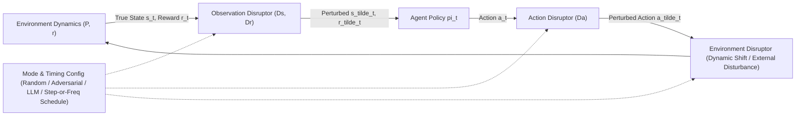

# Robust Gymnasium

**Robust Gymnasium: A Unified Modular Benchmark for Robust Reinforcement Learning**（Shangding Gu, Laixi Shi, Muning Wen, Ming Jin, Eric Mazumdar, Yuejie Chi, Adam Wierman, Costas Spanos；UC Berkeley / Caltech / 上海交通大学 / Virginia Tech / CMU）收录于 [AwesomeSim2Real](https://github.com/LongchaoDa/AwesomeSim2Real) **第 090/139** 篇，分组 **Robotics Benchmarks**，发表于 **ICLR 2025**。本文针对现有鲁棒 RL 往往只在单一扰动、一次性定制环境中评估的问题，构建了一个覆盖全交互链路、高度模块化、兼容最新 Gymnasium API 的统一基准平台。

## 一句话定义

Robust-Gymnasium 基于「带干扰马尔可夫决策过程（Disrupted-MDP）」形式化，提供涵盖观测（状态/奖励）、动作与环境动力学四类阶段及随机/对抗/内部偏移/外部扰动（含 LLM 对抗攻击）的 60+ 模块化鲁棒强化学习基准任务。

## 英文缩写速查

| 缩写 | 英文全称 | 简要说明 |
|------|----------|----------|
| Disrupted-MDP | Markov Decision Process with Disruption | 带观测、动作与环境干扰器的有限时域 MDP 统一形式化 |
| RL | Reinforcement Learning | 强化学习 |
| Safe RL | Safe Reinforcement Learning | 带安全代价约束的强化学习（如 PCRPO、CRPO） |
| MARL | Multi-Agent Reinforcement Learning | 多智能体强化学习（如 MAPPO、IPPO） |
| LLM | Large Language Model | 大语言模型（本文用于构造基于奖励反馈的自适应状态对抗攻击器） |

## 为什么重要

- 真实部署与 Sim2Real 迁移中，不确定性不仅发生在物理动力学层面，还会同时冲击传感器观测、奖励/代价反馈与执行器动作；此前缺少能在同一接口下统一评估这几类扰动及组合扰动的标准平台。
- 该基准同时横跨**单智能体控制、灵巧手/人形操作、安全 RL 与多智能体协作**四大板块，且原生支持训练期扰动（In-training）与仅测试期扰动（Post-training）以及自定义触发频率，可直接作为 Sim2Real 鲁棒算法的压力测试床。
- 顺着列表实体 [AwesomeSim2Real](../entities/awesome-sim2real.md)、[AwesomeSim2Real 技术地图](../overview/lc-awesome-sim2real-technology-map.md) 与站内 [sim2real.md](../concepts/sim2real.md)、[reinforcement-learning.md](../methods/reinforcement-learning.md) 页面，可将此标准测试基准与各鲁棒控制方法对接。

## 核心信息

| 字段 | 内容 |
|------|------|
| 编号 | 090/139 |
| 分组 | Robotics Benchmarks |
| 作者 | Shangding Gu, Laixi Shi, Muning Wen, Ming Jin, Eric Mazumdar, Yuejie Chi, Adam Wierman, Costas Spanos |
| 机构 | UC Berkeley / Caltech / Shanghai Jiao Tong University / Virginia Tech / Carnegie Mellon University |
| 出处 | ICLR 2025 |
| 论文 / 主页 | <https://robust-gym.github.io/> |
| 代码 | <https://github.com/SafeRL-Lab/Robust-Gymnasium> |

## 核心机制（归纳）

### 1. Disrupted-MDP 统一框架（Section 2.1）

基准将标准有限时域 MDP 扩展为 $M_{dis} = (S, A, T, P, r, D_s(\cdot), D_r(\cdot), D_a(\cdot))$，在智能体–环境每步交互中插入三类正交干扰器（Disruptor）：

- **观测干扰器（Observation-disruptor）**：篡改智能体观测状态 $\tilde{s}_t = D_s(s_t)$ 与即时奖励/安全代价 $\tilde{r}_t = D_r(r_t)$。
- **动作干扰器（Action-disruptor）**：在送入环境执行前扰动策略输出动作 $\tilde{a}_t = D_a(a_t)$。
- **环境干扰器（Environment-disruptor）**：修改实际状态转移核与奖励函数 $(P, r)$ 偏离名义环境 $(P^0, r^0)$，模拟 Sim2Real 偏差与非平稳外界干扰。

### 2. 四大扰动模式与多频次接口（Section 3.2）

- **随机扰动（Random disturbance）**：支持高斯 $\mathcal{N}(\cdot,\cdot)$ 与有界均匀 $U(\cdot,\cdot)$ 噪声，可作用于全部三类干扰器。
- **对抗扰动（Adversarial disturbance）**：双人零和博弈最坏情况攻击；特色内置 **LLM 驱动状态对抗器**（将任务背景、当前/上一步奖励及当前状态输入 LLM，在规定扰动范围内生成最具破坏性的伪造观测状态，Listing 2）。
- **内部动力学偏移（Internal dynamic shift）**：作用于环境干扰器，按定常或正弦周期（如重力 $14.715 + 4.905\sin(0.5 i_{ep})$、风速 $1.0 + 0.2\sin(0.5 i_{ep})$、Walker/Hopper 躯干与脚长变化）更改本体模型。
- **外部扰动（External disturbance）**：改变工作区几何或引入外部干扰体（如 Robosuite 中新增 `MultiRobustDoor` 对抗机械臂、以及门把高度/物体颜色与位置的语义关联偏移任务 `DoorCausal-v1`、`LiftCausal-v1`）。
- **时序与评测模式**：支持 **In-training**（训练与测试均加扰）与 **Post-training**（仅测试期加扰）两种评估协议，支持按步、按回合、固定间隔（如每 50/100/500 步）或随机频率触发，且支持多个干扰器叠加组合与矢量化并行环境。

### 3. 任务套件全景（Section 3.1 & Appendix D，共 60+ 任务基底）

涵盖 11 大套件：`Gymnasium-Box2D`（3–4 任务）、`Gymnasium-MuJoCo`（11 任务）、`Maze`（2 任务：Point-Maze / Ant-Maze）、`Fetch`（4 任务）、`Franka Kitchen`、Shadow `Dexterous Hand`（5 任务）、`Adroit`（4 任务）、`HumanoidBench`（4 任务：Unitree H1 + Shadow Hands）、`Robosuite`（12 任务含 `MultiRobustDoor`）、`Safety MuJoCo`（9 任务）及 `MAMuJoCo`（12+ 多智能体协同任务）。

### 方法流程图

## 评测与指标

原文在单智能体（3 种子）与多智能体（5 种子）设置下对多类 SOTA 基线开展了系统基准测试（Section 4 & Appendix B）：

- **标准 RL（PPO / SAC on `HalfCheetah-v4`，Fig. 5 & Fig. 10–11）**：
  - **Post-training 脆弱性**：无扰动训练的 PPO 平均回报为 **5751**；测试期施加强度为 `0.1` 与 `0.15` 的状态高斯噪声时，回报断崖式跌至 **901** 与 **616**；施加动作高斯噪声 `0.1` 与 `0.15` 时降至 **3790** 与 **3072**。
  - **In-training 正则效应（Fig. 10）**：训练期向奖励施加适量噪声（`R=0.1` 或 `R=0.15`）再回测无扰动环境，回报反由 5751 升至 **6351** 与 **6812**，提示适度训练扰动可充当隐式正则化器。
- **鲁棒 RL（OMPO / RSC / ATLA / DBC，Fig. 6）**：
  - OMPO 在 `Ant-v5` 风力/重力非平稳偏移与 `Hopper-v5` 躯干/脚长动态变化下性能较静态基线大幅下滑。
  - 在 Robosuite 外部语义攻击（`DoorCausal-v1`、`LiftCausal-v1`）中，**RSC** 保持了显著优于 ATLA 与 DBC 的稳定奖励曲线，但因在线生成数据增强导致训练吞吐偏慢。
- **安全 RL（PCRPO vs CRPO on `SafetyWalker2d-v4`，Fig. 7 & Fig. 12，Cost Limit=40）**：在动作扰动与安全代价扰动（$\sigma \in \{0.15, 0.3\}$）下，CRPO 迅速退化，而 **PCRPO** 保持更高奖励且满足代价约束（且在恰当扰动下优于无扰动训练）。
- **多智能体 RL（MAPPO / IPPO on `MA-HalfCheetah-2x3`，Fig. 8 & Fig. 13）**：全员受状态/动作/奖励扰动时性能均显著下跌；若仅攻击部分智能体（partial attack），性能损失明显小于全员攻击。
- **LLM 对抗攻击与频率攻击（`Ant-v4`，Fig. 9 & Fig. 15）**：在相同约束幅值区间 `[0.2, 0.8]` 与相同频率（每 100 步）下，**LLM 生成的对抗状态扰动导致 PPO 性能下降明显大于同区间均匀随机噪声 $U(0.2, 0.8)$**；且更高频率攻击（`100F` vs `500F`、`F50` vs `F100`）造成更严重的回报衰减。

## 与其他工作对比

- 同在 **Robotics Benchmarks** 分组下的横向对照可回到 [AwesomeSim2Real 技术地图](../overview/lc-awesome-sim2real-technology-map.md) 展开。
- 区别于仅关注静态领域泛化的 Meta-World、LIBERO 或只覆盖 6 个环境偏移任务的 RRLS（Zouitine et al. 2024），Robust-Gymnasium 是首个将**观测–奖励–动作–动力学全链路干扰、多智能体与安全约束、频率控制及 LLM 对抗干扰**统一于同一 Gymnasium API（`env.step({"action": action, "robust_config": args})`）下的开源基准。

## 结论

**Robust-Gymnasium 通过统一的 Disrupted-MDP 接口揭露了“即便在单一扰动下，现有标准 RL、鲁棒 RL、安全 RL 与 MARL 算法依然远未达到真机级稳健”的现实，为 Sim2Real 与抗扰动策略评测提供了标准化试金石。**

- **务必补测 Post-training 评估**：In-training 抗噪只能测试训练鲁棒性；Sim2Real 部署前必须按 Post-training 协议对训练好的策略做零预知状态/动作/动力学压力测试（文中 PPO 仅在 `S=0.15` 下即从 5751 跌至 616）。
- **关注高频与语义相关性攻击**：不仅要测独立高斯白噪声，更应启用定期高频扰动（如 `F50`）与语义相关干扰（`DoorCausal`、`LiftCausal`）或 LLM 对抗探测潜在盲区。
- **利用环境接口做消融对比**：基于统一 `robust_config` 即可零改动将标准 RL（PPO/SAC）与鲁棒/安全 RL（RSC/OMPO/PCRPO）置于同一非平稳动力学或外部干扰下公平比较。

## 常见误区或局限

1. **并非真机硬件在环测试台**：全库 60+ 任务均构建在 Box2D、MuJoCo 与 Robosuite 物理引擎上，用于系统性仿真抗扰动评测而非直接替代实机物理验证。
2. **并非每个任务基底都支持全部干扰器**：原文第 3 节与附录 Tables 1–8 明确指出，部分任务集主要支持状态、动作与奖励干扰（如 Box2D、Robosuite、Safety、Adroit、Hand、Fetch），而本体物理动力学参数连续偏移（如重力/风速/连杆长度）主要集中在 MuJoCo 套件实现。
3. **随机种子数与 LLM 攻击成本限制**：为兼顾算力，基线评测采用单智能体 3 种子、多智能体 5 种子；同时在线调用 LLM API 作为高频步级对抗干扰器会引入高额延时与接口开销，暂不适合直接嵌入百万步级高频 RL 训练主循环。

## 关联页面

- 列表实体：[AwesomeSim2Real](../entities/awesome-sim2real.md)
- 技术地图：[AwesomeSim2Real 技术地图](../overview/lc-awesome-sim2real-technology-map.md)
- 方法/任务：[sim2real.md](../concepts/sim2real.md)、[locomotion.md](../tasks/locomotion.md)

## 参考来源

- [`sources/papers/lc_awesome_sim2real_noarxiv_090_robust-gymnasium-a-unified-modular-bench.md`](../../sources/papers/lc_awesome_sim2real_noarxiv_090_robust-gymnasium-a-unified-modular-bench.md) — 本条目策展摘录
- [`sources/papers/lc_awesome_sim2real_catalog.md`](../../sources/papers/lc_awesome_sim2real_catalog.md) — 列表总表
- [`sources/repos/awesome-sim2real.md`](../../sources/repos/awesome-sim2real.md)
- 论文：<https://github.com/SafeRL-Lab/Robust-Gymnasium>

## 推荐继续阅读

- [Robust-Gymnasium 项目主页](https://robust-gym.github.io/)
- [Robust-Gymnasium 官方仓库](https://github.com/SafeRL-Lab/Robust-Gymnasium)
- [AwesomeSim2Real 仓库](https://github.com/LongchaoDa/AwesomeSim2Real)
