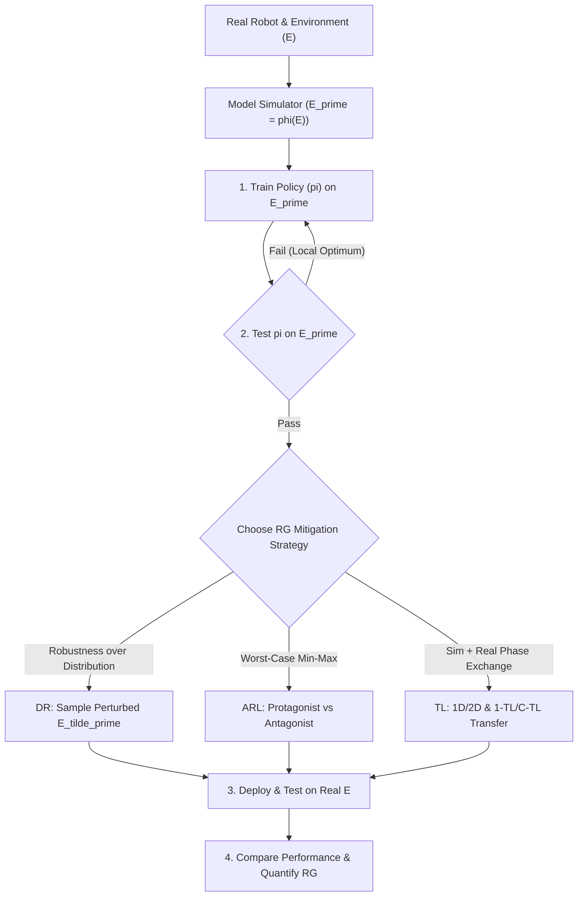

# Crossing the reality gap

**Crossing the Reality Gap: A Survey on Sim-to-Real Transferability of Robot Controllers in Reinforcement Learning**（Erica Salvato, Gianfranco Fenu, Eric Medvet, Felice Andrea Pellegrino，University of Trieste，*IEEE Access* Vol. 9, 2021, pp. 153171–153187，DOI: `10.1109/ACCESS.2021.3126658`）收录于 [AwesomeSim2Real](https://github.com/LongchaoDa/AwesomeSim2Real) **第 106/139** 篇，分组 **Survey Papers**。本页基于论文全文完成精读与数据核实。

## 一句话定义

一篇以**控制论形式化视角**系统梳理强化学习机器人控制器「现实差距（Reality Gap, RG）」的综述论文，将现有 Sim-to-Real 解决方案归纳为**域随机化（DR）**、**对抗强化学习（ARL）**与**迁移学习（TL）**三大范式，并在统一符号体系下剖析各类方法的数学含义、适用边界与开放挑战。

## 英文缩写速查

| 缩写 | 英文全称 | 简要说明 |
|------|----------|----------|
| RG | Reality Gap | 仿真环境与真实机器人闭环性能之间的失配差距 |
| DR | Domain Randomization | 域随机化：在随机扰动的仿真模型集合上训练鲁棒控制器 |
| ARL | Adversarial Reinforcement Learning | 对抗强化学习：由对抗智能体主动生成最坏扰动提升策略鲁棒性 |
| TL | Transfer Learning | 迁移学习：在仿真与真机间单向或双向交换策略/表征/轨迹以消除失配 |
| MDP / POMDP | (Partially Observable) Markov Decision Process | （部分可观测）马尔可夫决策过程，本文在控制框架中以状态/输出反馈表述 |

## 为什么重要

- **用统一控制论符号打通不同流派**：现有 Sim2Real 论文往往各自使用截然不同的任务和符号，极难横向比较；本文用环境映射算子 $E' = \phi(E)$ 与受损仿真器 $\tilde{E}' = \tilde{\phi}(E)$ 把 DR、ARL 与 TL 统一到同一闭环框图下，清晰区分「提升鲁棒性」与「对齐物理失配」两条路线。
- **纠偏“训练收敛即迁移成功”的常见盲区**：在 §III 中明确强调真机部署前必须在仿真内独立测试收敛策略（防止陷入局部最优或过拟合奖励指标），并给出四步 RG 诊断流程（Fig. 4）。
- **直指领域评测碎片化痛点**：明确指出大量工作只做了 Sim-to-Sim 扰动鲁棒性测试而非真正 Sim-to-Real 部署，且不同任务缺少可比性与统一的 RG 量化指标，可配合 [Sim2Real 概念页](../concepts/sim2real.md) 与 [强化学习方法页](../methods/reinforcement-learning.md) 阅读。

## 核心信息

| 字段 | 内容 |
|------|------|
| 编号 | 106/139 |
| 分组 | Survey Papers |
| 出处 | IEEE Access, Vol. 9, pp. 153171–153187 (2021), DOI: 10.1109/ACCESS.2021.3126658 |
| 作者与机构 | Erica Salvato, Gianfranco Fenu, Eric Medvet, Felice Andrea Pellegrino（University of Trieste, Italy） |
| 论文 | <https://ieeexplore.ieee.org/document/9606868> |

## 核心机制

论文在离散时间动力系统 $E = (X, A, O, f, g, h)$（§II–III）中定义仿真映射 $E' = \phi(E)$，将策略学习算法记为 $L$、可迁移控制器记为 $\pi^*$，并将 RG 归因为两类根源：（a）建模算子 $\phi$ 不真实（$f \ne f'$ 或 $g \ne g'$）；（b）学习算法 $L$ 对微小误差缺乏鲁棒性。由此将现有研究分为三类技术路线（§IV）：

1. **域随机化（Domain Randomization, DR，§IV-A）**
   - **形式化机制**：构建含过程扰动 $Z'$、测量扰动 $\Upsilon'$ 与随机参数 $(\xi', \psi')$ 的受损仿真器 $\tilde{E}' = \tilde{\phi}(E)$（式 7–9），从分布中采样多组环境训练策略 $\pi^*$，使迁移后的性能退化低于阈值（本质对应控制理论中的参数/非参数不确定性鲁棒控制）。
   - **代表方法**：视觉域随机化与规范域映射（CAD2RL [39]、RCAN [46]）、对抗课程扰动（ARPL [50] 结合 FGSM 与 TRPO）、仿真优化偏差上界评估（SPOTA [53] 引入 SOB / UCSOB）、动力学随机化与记忆策略（Peng et al. [44] HER+RDPG、Siekmann et al. [61] LSTM 盲走楼梯）、自动域随机化（ADR [57] 动态扩展参数分布 $\kappa$ 解魔方）、以及结合系统辨识与延迟/地形扰动的真机迁移（Minitaur 四足 [54]、可变形布料折叠 [45]、轮式崎岖地形导航 [41]、弹珠迷宫 [56]）。

2. **对抗强化学习（Adversarial RL, ARL，§IV-B）**
   - **形式化机制**：将学习主体拆分为主角 $L_P$（学习控制策略 $\pi_P$）与对抗者 $L_A$（学习最坏扰动策略 $\pi_A: \tilde{O}' \to Z' \times \Upsilon' \times \Xi' \times \Psi'$，常取零和奖励 $\tilde{r}_A' = -\tilde{r}_P'$），求解极小极大问题 $\max_{\pi_P} \min_{\pi_A} J_{\pi_P, \pi_A}$，对应控制理论中的 $H_\infty$ 最坏情况最优控制（式 10–11）。
   - **代表方法**：RARL（Pinto et al. [51]）交替固定 $\pi_A$ 与 $\pi_P$ 迭代训练，在 OpenAI Gym 上均值与方差优于普通 TRPO；RARARL（Pan et al. [58]）进一步引入集成 $Q$ 网络方差 $\text{Var}_\kappa(Q)$，使主角风险厌恶、对抗者风险偏好，提升仿真自动驾驶鲁棒性。

3. **迁移学习（Transfer Learning, TL，§IV-C）**
   - **形式化机制**：不假设仅靠纯仿真一次性训练就能跨过 RG，而是通过仿真与真机两个相继或并行的训练阶段交换信息 $u_{\text{exch}}^{(k)} = [u'^{(k)}, u^{(k)}]^T$，按**四维特征**分类：交换内容类型、传递时机（连续 `C-TL` vs 一次性 `1-TL`）、传递方向（双向 `2D-TL` vs 单向 `1D-TL`）以及真实端主体（学习算法 $L$ vs 固定控制器如 MPC）。
   - **代表方法**：双向连续（`2D C-TL`）包括学习深度逆动力学对齐真实与仿真观测（Christiano et al. [49] Fetch 机器人）、Grounded Action Transformation 动作映射（GAT [60] 双足行走）及 GAN 判别器对齐序列观测的 MATL（Wulfmeier et al. [52]）；单向一次性（`1D 1-TL`）包括渐进网络侧向连接（Progressive Nets [43] Jaco 机械臂）、LSTM 残差修正仿真状态的 NAS（Golemo et al. [55] Poppy Ergo Jr）、固定视觉感知权重 + 真机数据训练 MPC 奖励预测器（Kang et al. [40] 微型无人机避障）及 $Q_{\text{sim}} \to Q_{\text{real}}$ 价值函数微调（Yuan et al. [47] Baxter 推物体）。

### 方法流程图

## 评测与指标

本综述系统梳理了机器人 RL Sim2Real 文献中常用的任务类型与评测口径（§III–IV），并汇总各路线在实验覆盖度与工程代价上的定性对比（注：原文因被综述论文任务与指标高度异构，未做统一数值排行榜）：

| 技术范式 | 核心机理与控制论类比 | 真机交互需求 | 实验验证覆盖现状（§IV-A–D） | 主要优势与代价 |
|---|---|---|---|---|
| **DR（域随机化）** | 采样参数/过程/观测扰动 $\tilde{E}'$；类比不确定性鲁棒控制 | 零真机训练（Zero-shot 为主） | 多数有真机评测（无人机、Fetch、Minitaur、双足、魔方手等），少数仅 Sim-to-Sim（ARPL、SPOTA） | 免真机试错风险；但过度随机化导致收敛变慢甚至迁移失败（[45][54]），且大观测空间可能加剧 RG |
| **ARL（对抗强化学习）** | 双智能体 $\max_{\pi_P}\min_{\pi_A}$ 零和博弈；类比 $H_\infty$ 最坏情况控制 | 零真机训练（Zero-shot 为主） | 综述统计中 RARL、RARARL 主要在 Gym 与仿真驾驶中验证，缺少充分真机评估 | 无需手工枚举所有扰动组合即可覆盖最坏情形；但可能过于保守、且假定最坏仿真扰动对应真实误差 |
| **TL（迁移学习）** | 单向/双向（`1D/2D`）、单次/连续（`1-TL/C-TL`）复用策略、动力学或感知模块 | 需要真机采样或真机微调 | 多篇含真机验证（Fetch、Jaco、Poppy、Baxter、微型无人机、双足） | 通过真机数据从根源修补 $\phi$ 失配，样本需求远低于真机从零训练；但引入真机安全风险且常缺系统鲁棒性评测 |

- **关键实证规律提炼（§IV-A & §IV-D）**：
  - **系统辨识仍是基石**：Minitaur 四足实验 [54] 表明若物理模型严重失真，单靠 DR 仍无法避免巨大 RG；缩小观测空间反而有助于真机迁移。
  - **鲁棒性 vs 样本效率权衡**：Van Baar et al. [56] 验证了 DR 在真机微调阶段所需步数明显少于无 DR 基线，但仿真训练本身需要更大样本量与计算开销。
  - **新兴融合方向（§IV-D）**：贝叶斯优化自适应 DR（Muratore et al. [114] 用真机表现反调仿真分布，结合 DR 与 TL）、Meta-RL（快速跨任务适应，但计算与真机评估昂贵）以及概率动力学建模 PILCO（存在未来状态不确定性低估风险）。

## 与现有工作的对比

- **对比早期 Sim2Real 综述（Zhao et al., 2020 [22]）**：[22] 仅对深度学习时代的 Sim2Real 做了简要概览；本文聚焦**机器人控制 + 强化学习**交集，给出了严格的离散时间环境与受损仿真器数学定义，并将 TL 细分为 4 维属性（内容、时机 `C-TL/1-TL`、方向 `2D/1D`、真机侧主体）。
- **对比进化计算 / MPC 领域**：本文指出现实差距最早源于进化机器人学（Jakobi et al., 1995 [9]）并在 MPC 模型–工厂失配（model-plant mismatch）中长期研究，但 RL 的连续高维无模型试错特性使真机训练风险与耗时尤为突出。同分组综述可参考 [AwesomeSim2Real 技术地图](../overview/lc-awesome-sim2real-technology-map.md)。

## 常见误区或局限

1. **把“对仿真扰动鲁棒”等同于“能 Sim-to-Real 迁移”**：综述在 §IV-D 明确警告，如果 DR 或 ARL 所施加的扰动分布并没有准确覆盖真实物理建模误差（例如未建模的接触动力学或反射玻璃 [39]），即使在仿真测试中极具鲁棒性的策略也会在真机上失效。
2. **盲目扩大观测空间或过度随机化**：Minitaur [54] 与布料折叠 [45] 实验均表明，过大的观测维度和过重的相机/动力学随机化会破坏策略可迁移性。
3. **跨论文数值不可直接横向对比**：由于各研究各自选择特定机器人、仿真器（MuJoCo、PyBullet、Gazebo、DART、TORCS 等）与自定义任务，现有文献尚无法给出“哪一类方法绝对最优”的统一定量排名。
4. **时效边界**：本综述收稿于 2021 年 10 月，重点覆盖经典深度 RL（TRPO/PPO/DDPG/A3C/QT-Opt）与 2016–2021 年代表性工作，未涵盖 2022 年后的大语言模型/世界模型驱动 Sim2Real 及 Isaac Gym 大规模并行特权蒸馏（Teacher–Student）新范式。

## 结论

**《Crossing the Reality Gap》的价值在于用一套严格的控制论符号拆解了 RL Sim2Real 的三大技术路线，并点破了该领域最大的结构性缺口——缺少可量化现实差距（RG）的统一指标与跨任务基准。**

1. **真机部署前先做仿真内独立测试** — 仅看训练滑动平均回报收敛容易陷入局部最优，必须按四步流程先验证仿真测试达标后再对比真机性能差距。
2. **模型不准时别只靠“暴力加噪声”** — 优先通过系统辨识与精简观测空间压缩真实失配，再在合理区间内施加 DR（尤其相机外参、延迟与关键动力学参数）。
3. **零样本优先选 DR/ARL，真机可采数据时结合 TL 或贝叶斯自适应 DR** — 纯仿真鲁棒策略无法兜底未知结构误差，用少量真机轨迹校准仿真参数分布（2D-TL / 混合路线）往往更稳妥。
4. **建立可量化的 RG 评估口径** — 研究与工程落地时应同时记录仿真测试表现、真机零样本表现与真机微调步数，避免只报 Sim-to-Sim 扰动分数掩盖真实迁移成本。

## 关联页面

- 列表实体：[AwesomeSim2Real](../entities/awesome-sim2real.md)
- 技术地图：[AwesomeSim2Real 技术地图](../overview/lc-awesome-sim2real-technology-map.md)
- 方法/任务：[sim2real.md](../concepts/sim2real.md)、[reinforcement-learning.md](../methods/reinforcement-learning.md)、[locomotion.md](../tasks/locomotion.md)、[manipulation.md](../tasks/manipulation.md)

## 参考来源

- [`sources/papers/lc_awesome_sim2real_noarxiv_106_crossing-the-reality-gap-a-survey-on-sim.md`](../../sources/papers/lc_awesome_sim2real_noarxiv_106_crossing-the-reality-gap-a-survey-on-sim.md) — 本条目策展摘录
- [`sources/papers/lc_awesome_sim2real_catalog.md`](../../sources/papers/lc_awesome_sim2real_catalog.md) — 列表总表
- [`sources/repos/awesome-sim2real.md`](../../sources/repos/awesome-sim2real.md)
- 论文：<https://ieeexplore.ieee.org/document/9606868>

## 推荐继续阅读

- [AwesomeSim2Real 仓库](https://github.com/LongchaoDa/AwesomeSim2Real)
- [原文](https://ieeexplore.ieee.org/document/9606868)
