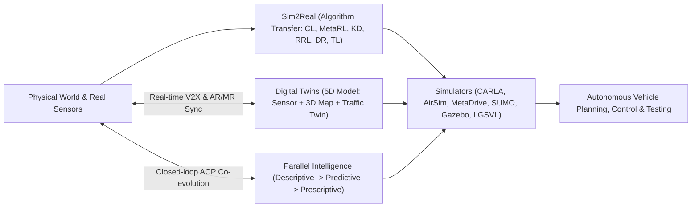

# How simulation helps autonomous driving

**How simulation helps autonomous driving: A survey of sim2real, digital twins, and parallel intelligence**（Xuemin Hu, Shen Li, Tingyu Huang, Bo Tang, Rouxing Huai, Long Chen；湖北大学 / 伍斯特理工学院 / 北京怀柔平行传感研究院 / 中国科学院自动化研究所）收录于 [AwesomeSim2Real](https://github.com/LongchaoDa/AwesomeSim2Real) **第 107/139** 篇，分组 **Survey Papers**。本文聚焦自动驾驶仿真如何缩小虚实鸿沟（Reality Gap, RG），首次将算法迁移层的 Sim2Real、场景同步建模层的数字孪生（DT）与基于 ACP 方法的平行智能（PI）纳入统一演进脉络进行综述。

## 一句话定义

本文从算法迁移（Sim2Real）、虚实同步（Digital Twins）与描述–预测–引导并行闭环（Parallel Intelligence）三个递进层级，全面综述了仿真技术缩小自动驾驶现实鸿沟的方法体系、应用实践、主流仿真器及开放挑战。

## 英文缩写速查

| 缩写 | 英文全称 | 简要说明 |
|------|----------|----------|
| RG | Reality Gap | 现实鸿沟（仿真与真实在光照、纹理、动力学及智能体行为上的差异） |
| DT | Digital Twin | 数字孪生，物理实体与虚拟模型通过实时数据流双向同步 |
| PI | Parallel Intelligence | 平行智能，具备描述、预测与引导三重智能的虚实并行系统 |
| ACP | Artificial societies, Computational experiments, Parallel execution | 人工社会–计算实验–平行执行方法论 |
| AR/MR | Augmented Reality / Mixed Reality | 增强现实与混合现实，用于虚实叠加交互与驾驶验证 |
| V2X | Vehicle to Everything | 车路/车车协同通信，支撑低时延数字孪生数据同步 |

## 为什么重要

- 自动驾驶兼具算法安全性极高、实车传感器与碰撞测试成本高昂以及极端事故长尾数据稀缺三大痛点，单一的离线仿真迁移往往不足以覆盖开放道路复杂动态。
- 本文打通了机器人社区熟悉的 **Sim2Real** 与智能交通/系统工程领域成熟的 **Digital Twins** 及 **Parallel Intelligence（ACP）** 三套话语体系，理清了从“单向离线迁移”向“双向同步描述”再向“虚实闭环预测与引导”演进的路径。
- 顺着列表实体 [AwesomeSim2Real](../entities/awesome-sim2real.md)、[AwesomeSim2Real 技术地图](../overview/lc-awesome-sim2real-technology-map.md) 与站内 [sim2real.md](../concepts/sim2real.md) 页面，可与通用机器人 DRL 综述 [paper-as-109](paper-as-109-sim-to-real-transfer-in-deep-reinforcement-learn.md) 互为补充。

## 核心信息

| 字段 | 内容 |
|------|------|
| 编号 | 107/139 |
| 分组 | Survey Papers |
| 作者 | Xuemin Hu, Shen Li, Tingyu Huang, Bo Tang, Rouxing Huai, Long Chen |
| 机构 | Hubei University / Worcester Polytechnic Institute / Beijing Huairou Academy of Parallel Sensing / CASIA |
| 出处 | IEEE Transactions on Intelligent Vehicles |
| 预印本 | `arXiv:2305.01263v2` |
| 论文 | <https://ieeexplore.ieee.org/document/10242366> |

## 核心机制（归纳）

### 1. 三大技术范式的递进定位（Fig. 1）

| 范式 | 核心关注点 | 关键机制 / 组成 | 功能层级 |
|------|------------|----------------|----------|
| **Sim2Real**（Section II） | 算法级策略与感知迁移 | 课程学习（CL）、元学习（Meta-learning）、知识蒸馏（KD）、鲁棒 RL（RARL / RRL-Stack）、域随机化（静态/动态 DR）、迁移学习（TL） | 将仿真学得知识单向迁移至实车 |
| **Digital Twins (DTs)**（Section III） | 场景与实体实时同步建模 | 五维模型 $M_{DT}=(PE, VM, Ss, DD, CN)$；在自动驾驶中含**传感器模型孪生、3D 地图孪生、交通流逻辑孪生**；结合 AR/MR 与 V2X 边缘计算 | 以**描述（Descriptive）**与虚实同步测试为主 |
| **Parallel Intelligence (PI)**（Section IV） | 基于 CPSS 与 **ACP** 的虚实闭环 | 人工社会建模（A）→ 计算实验评估（C）→ 平行执行反馈（P）；衍生出平行学习、平行视觉、平行驾驶（**数字四胞胎**）、平行测试与平行规划/控制 | 兼具**描述、预测与引导（Prescriptive）**三重智能 |

### 2. 六类 Sim2Real 细分方法（Section II & Table I）

- **课程学习（CL）**：如自动生成课程（AGC）、三阶段高速超车、五阶段端到端驾驶及自步学习（Self-paced learning）目标检测。
- **元学习**：如 MAML 在线动力学快速适应、结合上下文的 MetaRL（CARLA）及自动合成下游适配数据集的 Meta-Sim。
- **知识蒸馏**：除常规教师–学生暗知识迁移（如可信度加权蒸馏）外，重点涵盖激光雷达点云图蒸馏与 Transformer 体素编码自监督跨模态蒸馏（TransVFE）。
- **鲁棒强化学习**：含约束对抗策略（RARL 高速匝道并道）、风险厌恶博弈与 Stackelberg 序贯博弈（RRL-Stack）。
- **域随机化与迁移学习**：涵盖金字塔一致性视觉 DR、动态障碍物 DR（ROADS）以及分阶段权重微调迁移。

### 3. 十大自动驾驶仿真器生态（Section V & Table IV）

论文对照整理了 **AirSim**（Unreal 高保真）、**Gazebo**（强物理建模/ROS）、**CARLA**（Unreal 开源高保真传感器）、**LGSVL**（Unity 全栈与高精度地图）、**TORCS**（轻量可改赛车）、**MetaDrive**（轻量级随机地图适合大规模 RL 训练）、**SUMO**（宏观/微观复杂交通流）、**SUMMIT**（CARLA+SUMO 城市人群车流扩展）、**Autoware**（成熟开源框架）及 **Apollo**（大规模视频与 3D 点云生态）。

### 方法流程图

## 评测与指标

作为领域综述，本文未自行运行实车对比基准，而是通过 **4 张结构化综述总表** 汇总关键工程与学术指标：

- **Table I（19 项 Sim2Real 代表工作，2017–2022）**：覆盖 NGSIM、CARLA、MuJoCo、KITTI、SUMO、TORCS、GTA5 等环境；其中引述 Saputra 等人的可信知识蒸馏框架在自动驾驶位姿/轨迹预测任务上报告了 **92.95%** 的蒸馏率（distillation rate，Section II-C）。
- **Table II（16 项 DT 应用，2010–2022）**：归类模型驱动设计（MBD）、信息物理系统（CPS）与虚拟试验场（VPG）方案；正文指出自动驾驶数字孪生可提供安全多样化测试并将时间成本**降低至少 80%**（Section III-B）。
- **Table III（11 项 PI 虚实协同代表系统，2010–2022）**：涵盖平行学习、平行视觉（如结合 GAN 背景减除）、平行驾驶（iHorizon、PanoSim、PDOS）、平行测试与基于 GTA5/ETS2 的紧急场景平行规划。
- **Table IV（10 个自动驾驶仿真平台）**：按底座引擎与核心优势提供工程选型索引。

## 与其他工作对比

- 同在 **Survey Papers** 分组下的 [paper-as-109](paper-as-109-sim-to-real-transfer-in-deep-reinforcement-learn.md) 主要面向通用机器人操作/导航的 DRL 迁移（2017–2020），而本文延展至 2023 年并专注于**自动驾驶**场景，补充了数字孪生（AR/MR/V2X）与平行智能（ACP / 数字四胞胎）两块大篇幅体系。
- 与只关注单车物理或视觉渲染的传统 Sim2Real 综述相比，本文强调“交通流逻辑、驾驶员认知与车路协同（V2X）”在自动驾驶虚实迁移中的决定性作用。

## 结论

**自动驾驶的仿真落地正从“单向离线 Sim2Real 迁移”，经由“虚实数据同步的数字孪生（DT）”，演进至“兼具描述、预测与在线引导能力的平行智能（PI）闭环”。**

- **按任务选仿真器**：大规模 RL 策略训练优先轻量化且支持随机地图的 **MetaDrive**；高保真多传感器感知与 OpenScenario 动态场景选 **CARLA / AirSim / LGSVL**；混合交通流博弈叠加 **SUMO / SUMMIT**。
- **超越纯离线随机化**：单靠离线 DR 难以穷举极端长尾交通交互，可引入数字孪生实时流（V2X/边缘计算）将实车边缘事件回注虚拟测试场做闭环迭代。
- **重视孪生体三大构件**：构建自动驾驶 DT 时需同步覆盖传感器物理模型、3D 高精地图与交通流逻辑三层，而非仅做 3D 视景还原。
- **紧急工况利用人工社会计算实验**：针对实车难以复现的危险/事故场景，可借鉴平行规划思路在人工社会中批量合成并提前演练应急避险策略。

## 常见误区或局限

1. **误区：数字孪生（DT）等同于高保真 3D 渲染或平行智能（PI）**：正文明确区分 DT 仅停留在 ACP 体系中的“描述性”实时映射与同步，尚不具备 PI 所强调的“预测未来演化”与“在线处方式引导”完整闭环（Section I & IV-A）。
2. **缺乏统一的 Reality Gap 定量指标**：作者在 Section VI 指出，当前方法多针对特定任务手工设计，尚无公认的定量度量来衡量不同仿真器或算法对 RG 的实际缩小幅度，导致跨工作难以直接对比。
3. **极端真实数据依然稀缺且平台碎片化**：Sim2Real 与 PI 校准均依赖真实长尾数据；同时 DT 模型与控制算法常呈工程割裂状态，且 PI 多模态海量并行计算面临数据冗余与实时算力瓶颈。

## 关联页面

- 列表实体：[AwesomeSim2Real](../entities/awesome-sim2real.md)
- 技术地图：[AwesomeSim2Real 技术地图](../overview/lc-awesome-sim2real-technology-map.md)
- 方法/任务：[sim2real.md](../concepts/sim2real.md)、[locomotion.md](../tasks/locomotion.md)

## 参考来源

- [`sources/papers/lc_awesome_sim2real_noarxiv_107_how-simulation-helps-autonomous-driving.md`](../../sources/papers/lc_awesome_sim2real_noarxiv_107_how-simulation-helps-autonomous-driving.md) — 本条目策展摘录
- [`sources/papers/lc_awesome_sim2real_catalog.md`](../../sources/papers/lc_awesome_sim2real_catalog.md) — 列表总表
- [`sources/repos/awesome-sim2real.md`](../../sources/repos/awesome-sim2real.md)
- 论文：<https://ieeexplore.ieee.org/document/10242366>

## 推荐继续阅读

- [arXiv 全文（2305.01263v2）](https://arxiv.org/abs/2305.01263)
- [AwesomeSim2Real 仓库](https://github.com/LongchaoDa/AwesomeSim2Real)
- [原文（IEEE Xplore）](https://ieeexplore.ieee.org/document/10242366)
