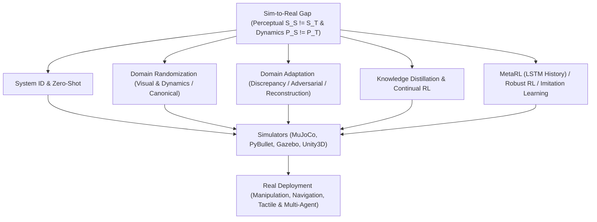

# Sim-to-Real Transfer in Deep Reinforcement Learning for Robotics

**Sim-to-Real Transfer in Deep Reinforcement Learning for Robotics: a Survey**（Wenshuai Zhao, Jorge Peña Queralta, Tomi Westerlund；University of Turku / TIERS Lab）收录于 [AwesomeSim2Real](https://github.com/LongchaoDa/AwesomeSim2Real) **第 109/139** 篇，分组 **Survey Papers**。本综述聚焦深度强化学习（DRL）策略从仿真环境向物理机器人迁移的核心方法、常见仿真器选型、典型机器人应用以及未解决瓶颈。

## 一句话定义

本文系统综述了深度强化学习在机器人领域的 Sim2Real 迁移方法论，将其归纳为系统辨识与零样本迁移、域随机化、域适应、策略蒸馏与持续学习、元强化学习及鲁棒/模仿学习等主线，并对比分析操作与导航落地案例。

## 英文缩写速查

| 缩写 | 英文全称 | 简要说明 |
|------|----------|----------|
| DRL | Deep Reinforcement Learning | 深度强化学习 |
| Sim2Real | Simulation to Real | 仿真策略迁移到真实机器人 |
| DR | Domain Randomization | 域随机化（视觉随机化与动力学随机化） |
| DA | Domain Adaptation | 域适应（差异度量、对抗学习、重建三类） |
| MetaRL | Meta Reinforcement Learning | 元强化学习，借循环状态记忆快速适应新动力学/任务 |
| MDP | Markov Decision Process | 马尔可夫决策过程 `(S, A, P, R)` |

## 为什么重要

- 早期多篇综述侧重纯监督迁移学习或安全 RL，而本文是较早专门面向**机器人端到端 DRL 策略迁移**、把视觉感知差距与物理作动差距放在同一框架下梳理的综述。
- 清晰界定了易混淆概念之间的关系（Fig. 2）：Sim2Real 与域随机化、域适应、鲁棒 RL、元 RL、知识蒸馏和模仿学习存在大量交叉组合空间。
- 顺着列表实体 [AwesomeSim2Real](../entities/awesome-sim2real.md)、[AwesomeSim2Real 技术地图](../overview/lc-awesome-sim2real-technology-map.md) 与站内 [sim2real.md](../concepts/sim2real.md)、[reinforcement-learning.md](../methods/reinforcement-learning.md)，可快速构建 Sim2Real 知识树。

## 核心信息

| 字段 | 内容 |
|------|------|
| 编号 | 109/139 |
| 分组 | Survey Papers |
| 作者 | Wenshuai Zhao, Jorge Peña Queralta, Tomi Westerlund |
| 机构 | Turku Intelligent Embedded and Robotic Systems Lab (TIERS), University of Turku |
| 出处 | IEEE Symposium Series on Computational Intelligence (SSCI 2020) |
| 预印本 | `arXiv:2009.13303v2` |
| 论文 | <https://ieeexplore.ieee.org/document/9308468> |

## 核心机制（归纳）

### 1. 虚实差距的双源形式化（Section II）

论文将源域与目标域分别形式化为 MDP $D_S \equiv (S_S, A_S, P_S, R_S)$ 与 $D_T \equiv (S_T, A_T, P_T, R_T)$，其中真实策略退化主要源自两类失配：
- **感知现实差距（Perceptual-reality gap）**：观测状态空间不同（$S_S \neq S_T$），如渲染光照、纹理、镜头畸变与真实视觉差异。
- **动力学/作动差距**：环境转移概率 $P_S \neq P_T$，由碰撞接触建模误差、连杆磨损、温湿度与延迟引起。

### 2. 五大 Sim2Real 迁移路线（Section III）

| 技术路线 | 核心思想 | 代表手段 / 特点 |
|----------|----------|----------------|
| **零样本迁移与系统辨识** | 精细标定物理参数缩小仿真误差 | 遗传算法/参数辨识；但温湿度及设备磨损导致参数漂移，且高保真渲染成本高 |
| **域随机化（DR）** | 令足够宽的仿真随机分布覆盖真实分布 | **视觉 DR**（色彩、纹理、光照、相机位姿）与 **动力学 DR**（质量、摩擦、阻尼、增益）；或将二者同向映射至规范仿真空间（RCAN） |
| **域适应（DA）** | 在无/少目标标注下统一源域与目标域特征或像素空间 | **基于差异度量**（MMD、CORAL）、**基于对抗**（DANN、PixelDA、CycleGAN）、**基于重建**（共享特征重建原图） |
| **策略蒸馏与持续学习** | 教师–学生监督迁移与网络压缩 | 缓解视觉大模型推理开销与多任务灾难性遗忘（如 DisCoRL） |
| **元学习、鲁棒与模仿学习** | 提升跨任务快速适应与抗扰动能力 | **MetaRL** 将 $(r_{t-1}, a_{t-1})$ 喂入 LSTM 隐状态记忆轨迹；**Robust RL** 优化最坏/对抗扰动回报；**IL**（BC/IRL）回避手工奖励失真 |

### 3. 仿真器生态定位（Section III-F）

- **Gazebo**：与 ROS 中间件深度集成，传感器模型与真机软件栈兼容性最好，适合复杂多传感器导航，但物理/渲染吞吐较慢。
- **PyBullet / MuJoCo / Unity3D**：与深度学习及 OpenAI Gym RL 接口衔接紧密、仿真步进速度极快，主导灵巧操作与运动控制训练。

### 方法流程图

## 评测与指标

作为综述类论文，本文未自建统一实机测试台，核心实证脉络通过 **Table I 横向矩阵** 与应用场景剖析呈现：

- **文献横评规模（Table I）**：系统对比 **20 余项** 2017–2020 年代表性工作，覆盖所用 RL 算法（PPO、TRPO、MPO、SAC、A3C、DDPG/DDPGfD、IMPALA、DAPG）、仿真器（MuJoCo、PyBullet、Gazebo、Unity3D、V-REP、RoboMaker）、任务（如穿孔装配 peg-in-hole、柔性体操作、灵巧手、无地图深度导航、六足运动、等离子体控制、光学触觉传感等）及真机平台（Panda、Sawyer+TacTip、UR5、KUKA LBR iiwa、ABB YuMi、Kinova、ADROIT 24-DoF、DeepRacer 等）。
- **操作 vs 导航的基准成熟度差异（Section IV）**：
  - 机械臂操作任务受益于有限工作空间与 OpenAI Gym 等成熟环境积累更丰富；但在柔性物体操作案例（引述 Matas et al.）中，仿真器难以准确刻画材料刚度，导致无法抓取更硬实物，且**过度视觉随机化（颜色种类过多）反而显著拉低真机性能**。
  - 移动与导航任务缺乏标准仿真基准，大量工作依赖定制仿真器或 Unity/Unreal/Gazebo 搭建场景，实践中**课程学习（Curriculum Learning）**、**渐进环境复杂度**与**多任务策略蒸馏**被反复证明有效。

## 与其他工作对比

- 同分组的横向对照可查看 [AwesomeSim2Real 技术地图](../overview/lc-awesome-sim2real-technology-map.md) 的 **Survey Papers** 分组，例如聚焦自动驾驶视角的 [How simulation helps autonomous driving](paper-as-107-how-simulation-helps-autonomous-driving-a-survey.md)。
- 与偏重传统迁移学习综述或安全 RL 综述相比，本文突出 DRL 控制策略迁移、MetaRL/知识蒸馏在机器人控制中的融合，以及感知随机化与动力学随机化的分离视角；对“DR 调参成本 vs 简易替代方案”的实证批判可交叉参考 [Crossing the Gap](paper-as-116-crossing-the-gap-a-deep-dive-into-zero-shot-sim.md)。

## 结论

**域随机化是当前机器人 DRL 工程落地的首选主力，但单靠盲目扩大随机分布已触及瓶颈，未来增益来自 DR 与 DA、渐进课程/持续学习及元学习的有机组合。**

- **工程选型起点**：优先针对任务主导瓶颈选择随机化维度（视觉瓶颈用纹理/光照 DR 或像素级 DA；动力学瓶颈用质量/摩擦/延迟 DR），并避开“全量暴力随机化”。
- **结构组合路线**：当输入为高维图像或需部署多任务时，用“仿真大教师策略 + 策略蒸馏”压缩小网络部署到机载端；当动力学在线漂移显著时，考虑引入历史状态动作记忆（MetaRL）或与 DA 联合使用。
- **导航任务避坑**：由于导航缺乏统一标准仿真器，建议用渐进复杂度场景（课程学习）配合 ROS-Gazebo 联合验证传感器接口一致性。

## 常见误区或局限

1. **误区：随机化范围越宽越好**：正文 Section IV-A 明确引用柔性体操作实证，证明随机色彩数量过大时策略在真机性能反而明显下降；且目前缺乏形式化理论指导随机化分布设计。
2. **误区：域适应天然适用于任意机器人形态**：现有深度 DA 算法大多假设源域与目标域拥有**同构特征空间**（Section V），当仿真与真机传感器模态或机器人构型不一致时这一假设不再成立。
3. **综述时间与生态覆盖边界**：成文至 2021 年中（v2），未涵盖近年兴起的 GPU 大规模并行仿真器（Isaac Gym / Isaac Lab）、扩散/VLA 策略以及大模型驱动的仿真场景生成进展。

## 关联页面

- 列表实体：[AwesomeSim2Real](../entities/awesome-sim2real.md)
- 技术地图：[AwesomeSim2Real 技术地图](../overview/lc-awesome-sim2real-technology-map.md)
- 方法/任务：[sim2real.md](../concepts/sim2real.md)、[locomotion.md](../tasks/locomotion.md)

## 参考来源

- [`sources/papers/lc_awesome_sim2real_noarxiv_109_sim-to-real-transfer-in-deep-reinforceme.md`](../../sources/papers/lc_awesome_sim2real_noarxiv_109_sim-to-real-transfer-in-deep-reinforceme.md) — 本条目策展摘录
- [`sources/papers/lc_awesome_sim2real_catalog.md`](../../sources/papers/lc_awesome_sim2real_catalog.md) — 列表总表
- [`sources/repos/awesome-sim2real.md`](../../sources/repos/awesome-sim2real.md)
- 论文：<https://ieeexplore.ieee.org/document/9308468>

## 推荐继续阅读

- [arXiv 全文（2009.13303v2）](https://arxiv.org/abs/2009.13303)
- [AwesomeSim2Real 仓库](https://github.com/LongchaoDa/AwesomeSim2Real)
- [原文（IEEE Xplore）](https://ieeexplore.ieee.org/document/9308468)
