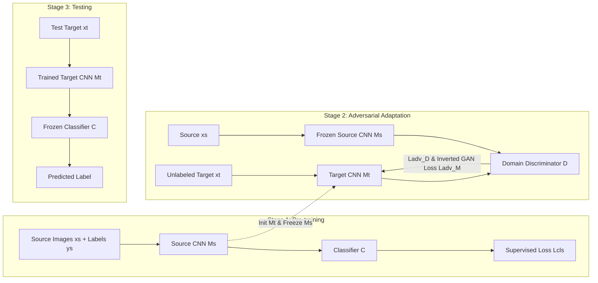

# Adversarial discriminative domain adaptation

**Adversarial discriminative domain adaptation（ADDA）**（Eric Tzeng, Judy Hoffman, Kate Saenko, Trevor Darrell；UC Berkeley / Stanford University / Boston University）收录于 [AwesomeSim2Real](https://github.com/LongchaoDa/AwesomeSim2Real) **第 111/139** 篇，分组 **Transition / Domain Adaptation**。本文从生成/判别基础模型、权重共享约束与对抗损失形式三个正交维度统一了对抗域适应方法，并提出结构简洁、支持大域移与跨模态对齐的 ADDA 算法。

## 一句话定义

ADDA 先在有标签源域预训练判别式编码器与分类器，随后冻结源域模型，利用反转标签 GAN 对抗损失独立训练非共享权重的目标域编码器，将无标注目标域特征非对称地映射至源域特征空间。

## 英文缩写速查

| 缩写 | 英文全称 | 简要说明 |
|------|----------|----------|
| ADDA | Adversarial Discriminative Domain Adaptation | 对抗判别域适应，本文提出的非对称特征对抗方法 |
| GAN | Generative Adversarial Network | 生成对抗网络 |
| DANN | Domain-Adversarial Neural Network | 梯度反转对称对抗域适应方法（原文又称 Gradient reversal） |
| CoGAN | Coupled Generative Adversarial Networks | 耦合生成对抗网络（共享高层权重的双生成器方法） |
| NYUD | NYU Depth Dataset | 室内 RGB-D 场景数据集，本文用于验证 RGB 到深度图跨模态迁移 |

## 为什么重要

- 既往对抗域适应存在明显两难：生成式方法（如 CoGAN）被迫建模像素分布，难以在 SVHN→MNIST 等大域移下收敛；而传统判别式方法（如梯度反转、域混淆）强制源/目标共享全部或部分权重，优化受限且难适应剧烈的低层模态差异。
- ADDA 证明对判别任务而言无需像素重建，且采用源预训练初始化 + 非共享权重 + 标准 GAN 损失即可高效跨越大域移乃至 RGB→Depth 跨模态鸿沟。
- 顺着列表实体 [AwesomeSim2Real](../entities/awesome-sim2real.md)、[AwesomeSim2Real 技术地图](../overview/lc-awesome-sim2real-technology-map.md) 与站内 [sim2real.md](../concepts/sim2real.md) 页面，可与像素级路线 [PixelDA](paper-as-040-unsupervised-pixel-level-domain-adaptation-with.md) 形成对称对照。

## 核心信息

| 字段 | 内容 |
|------|------|
| 编号 | 111/139 |
| 分组 | Transition / Domain Adaptation |
| 作者 | Eric Tzeng, Judy Hoffman, Kate Saenko, Trevor Darrell |
| 机构 | UC Berkeley / Stanford University / Boston University |
| 出处 | IEEE Conference on Computer Vision and Pattern Recognition (CVPR 2017) |
| 预印本 | `arXiv:1702.05464v1` |
| 论文 | <https://ieeexplore.ieee.org/document/8099799> |

## 核心机制（归纳）

### 1. 对抗域适应三维统一设计空间（原文 Table 1）

| 方法 | 基础模型 | 权重共享 | 对抗损失 |
|------|----------|----------|----------|
| Gradient reversal (DANN) | 判别式 | 共享（shared） | Minimax 梯度反转 |
| Domain confusion | 判别式 | 共享（shared） | 均匀分布混淆损失 |
| CoGAN | 生成式 | 非共享（unshared） | GAN 损失 |
| **ADDA（本文）** | **判别式** | **非共享（unshared）** | **GAN 损失（反转标签）** |

### 2. 三阶段分步训练与优化目标（原文式 9 & Figure 3）

1. **阶段 1：源域监督预训练**：在有标签源域 $(X_s, Y_s)$ 上最小化标准分类交叉熵 $L_{cls}(M_s, C)$，得到源编码器 $M_s$ 与分类器 $C$。
2. **阶段 2：非对称对抗适应**：
   - 使用 $M_s$ 的权重初始化目标编码器 $M_t$，并在对抗阶段**固定 $M_s$ 与 $C$ 的参数**（避免目标分支缺乏标签监督而坍缩至退化解）。
   - 域判别器 $D$ 最小化二分类损失 $L_{adv_D} = -\mathbb{E}_{x_s}[\log D(M_s(x_s))] - \mathbb{E}_{x_t}[\log(1 - D(M_t(x_t)))]$。
   - 目标编码器 $M_t$ 采用**反转标签的 GAN 损失** $L_{adv_M} = -\mathbb{E}_{x_t}[\log D(M_t(x_t))]$ 进行优化：相比直接取反 minimax 损失，可在训练早期判别器迅速收敛时提供更强梯度；且因源特征分布固定，规避了双分布同时漂移引发的震荡。
3. **阶段 3：无监督测试推理**：目标样本直接经过适应后的 $M_t$ 与冻结源分类器 $C$ 得到类别预测 $C(M_t(x_t))$。

### 方法流程图

## 评测与指标

以下实验结果均直接来自原文 Tables 2–3（数字任务采用 LeNet 骨架 + `[500, 500, 1]` 判别器；NYUD 采用 ImageNet 预训练 VGG-16 微调 + `[1024, 2048, 1]` 判别器）：

### 1. 跨领域数字分类准确率（原文 Table 2）

| 方法 | `MNIST → USPS` | `USPS → MNIST` | `SVHN → MNIST` |
|------|----------------|----------------|----------------|
| Source only | 0.752 ± 0.016 | 0.571 ± 0.017 | 0.601 ± 0.011 |
| Gradient reversal | 0.771 ± 0.018 | 0.730 ± 0.020 | 0.739 |
| Domain confusion | 0.791 ± 0.005 | 0.665 ± 0.033 | 0.681 ± 0.003 |
| CoGAN | **0.912 ± 0.008** | 0.891 ± 0.008 | did not converge（不收敛） |
| **ADDA（本文）** | 0.894 ± 0.002 | **0.901 ± 0.008** | **0.760 ± 0.018** |

### 2. NYUD RGB → HHA 深度图跨模态 19 类物体分类（原文 Table 3）

- 数据配置：训练集 RGB（2,186 张标注源样本）→ 验证集 HHA 编码深度图（2,401 张无标注目标样本，确保同实例不跨 split），批量 128 训练 20,000 步。
- **总体类别平均准确率**：从 Source only 的 **13.9%** 跃升至 **21.1%**（相对提升超过 **50%**；全监督目标域上限 `Train on target` 为 **46.8%**）。
- **典型类别与混淆变化**：`counter` 从 2.9% 升至 **44.7%**、`chair` 从 18.8% 升至 **34.4%**、`lamp` 从 6.9% 升至 **29.2%**、`bed` 从 1.0% 升至 **14.6%**；原本 Source only 严重坍缩到高频猜 `pillow`（58.7%）的病态被显著缓解（适应后 `pillow` 降至 29.7%，错分类多发生在如 `chair` 与 `table` 等语义合理边界）。

## 与其他工作对比

- 与对称共享权重的梯度反转（DANN）相比，ADDA 解除了源/目标低层卷积核必须共享的束缚，在 `USPS→MNIST`（0.901 vs 0.730）和 RGB→Depth 跨模态对齐中展现更强表达自由度。
- 与依赖像素级生成的 CoGAN 及 [PixelDA](paper-as-040-unsupervised-pixel-level-domain-adaptation-with.md) 相比：CoGAN 在域差巨大的 `SVHN→MNIST` 上无法收敛而 ADDA 稳定达 0.760；但 PixelDA 在像素空间直接输出合成图，对视觉可解释性与 3D 姿态回归（LineMod）有优势，二者分别代表“纯特征对齐”与“像素重绘”两条互补主线。

## 结论

**ADDA 通过“判别式编码器 + 非共享非对称权重 + 源初始化与冻结 + 反转标签 GAN 损失”的简洁组合，解决了以往对称权重难适应大域移以及生成式对齐难收敛的问题。**

- **初始化与冻结铁律**：切勿随机初始化目标编码器或同时放开源编码器联合无监督更新——必须用预训练好的 $M_s$ 初始化 $M_t$ 并冻结 $M_s, C$，否则极易退化或震荡。
- **跨模态迁移首选机制**：当仿真与真机、或不同传感器（如 RGB 到深度图）存在较大低层统计/通道差异但共享高层语义分类头时，优先解绑前端特征提取器权重。
- **长尾类别预警**：若源域未适应模型在目标域某些极少数类上完全零召回（如 NYUD 的 `bathtub`/`toilet`/`dresser`），无监督特征对齐无法凭空恢复这些类的判别边界，需结合少量目标域标注或类别重加权。

## 常见误区或局限

1. **误区：ADDA 因为不共享权重所以完全不需要任何关联约束**：恰好相反，如果不用源域预训练权重初始化 $M_t$ 且不固定 $M_s$，无标签目标域的对抗匹配会迅速坍缩到忽略类别语义的退化解（Section 4）。
2. **对极端长尾和零命中类别无能为力**：在 NYUD 实验中，源模型准确率为 0.000 的三个极小样本类（`bathtub` 19 例、`dresser` 25 例、`toilet` 17 例）经 ADDA 后仍为 0.000，且部分原本占优的类别（`pillow`、`night stand`）准确率下降。
3. **缺少直观像素可视化且假设类别空间一致**：ADDA 仅在隐特征空间拉齐分布，不如像素级域适应（如 PixelDA）直观可审计，且仍假定目标域共享源域预定义的 $K$ 类分类头。

## 关联页面

- 列表实体：[AwesomeSim2Real](../entities/awesome-sim2real.md)
- 技术地图：[AwesomeSim2Real 技术地图](../overview/lc-awesome-sim2real-technology-map.md)
- 方法/任务：[sim2real.md](../concepts/sim2real.md)、[locomotion.md](../tasks/locomotion.md)
- [Sim-to-Real Domain Adaptation · Sim2Real 域适应](../methods/domain-adaptation-for-sim2real.md)：了解利用目标域信息减小源域与目标域特征偏差的 Sim2Real 域适应方法框架。

## 参考来源

- [`sources/papers/lc_awesome_sim2real_noarxiv_111_adversarial-discriminative-domain-adapta.md`](../../sources/papers/lc_awesome_sim2real_noarxiv_111_adversarial-discriminative-domain-adapta.md) — 本条目策展摘录
- [`sources/papers/lc_awesome_sim2real_catalog.md`](../../sources/papers/lc_awesome_sim2real_catalog.md) — 列表总表
- [`sources/repos/awesome-sim2real.md`](../../sources/repos/awesome-sim2real.md)
- 论文：<https://ieeexplore.ieee.org/document/8099799>

## 推荐继续阅读

- [arXiv 全文（1702.05464v1）](https://arxiv.org/abs/1702.05464)
- [AwesomeSim2Real 仓库](https://github.com/LongchaoDa/AwesomeSim2Real)
- [原文（IEEE Xplore）](https://ieeexplore.ieee.org/document/8099799)
