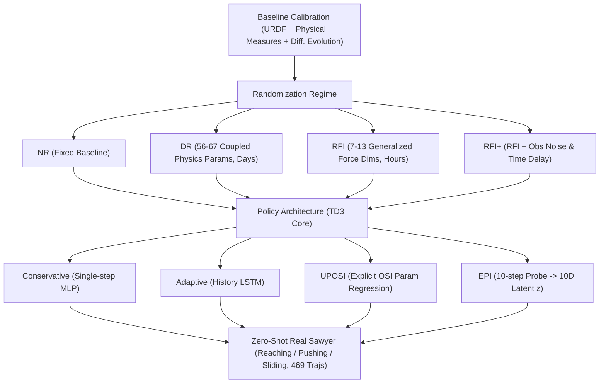

# Crossing the gap

**Crossing the gap: A deep dive into zero-shot sim-to-real transfer for dynamics**（Eugene Valassakis, Zihan Ding, Edward Johns；帝国理工学院 Imperial College London）收录于 [AwesomeSim2Real](https://github.com/LongchaoDa/AwesomeSim2Real) **第 116/139** 篇，分组 **Transition / Domain Randomization**。本文对动力学零样本 Sim2Real 方法开展了系统而客观的实机对照实验，揭示了传统论文中常被低估的工程调参代价，并验证了“随机力注入（RFI）”这一极简替代方案的实用价值。

## 一句话定义

在限定至多 2 轮训练后调参的受控协议下，本文在 7-DOF 机械臂三项动力学任务上对比了 DR、RFI、自适应 LSTM、UPOSI 与 EPI，证明仅向仿真刚体方程注入零均值随机广义力（RFI）即可取得比复杂方法更优或相当的真机零样本迁移表现。

## 英文缩写速查

| 缩写 | 英文全称 | 简要说明 |
|------|----------|----------|
| RFI | Random Force Injection | 随机力注入，每步向仿真刚体广义坐标注入均匀随机广义力 |
| RFI+ | RFI with Observation Noise | 在 RFI 基础上叠加观测白噪声与时间延迟 |
| DR | Domain Randomization | 动力学域随机化（每回合采样质量、摩擦、PID 增益等 56–67 维参数） |
| UPOSI | Universal Policy with Online System Identification | 基于历史状态–动作在线回归显式物理参数的通用策略 |
| EPI | Environment Probing Interaction Policies | 先执行探测策略提取隐式动力学嵌入 `z` 的通用策略 |

## 为什么重要

- 既往部分动力学 Sim2Real 工作要么仅停留在 Sim-to-Sim 仿真对比，要么隐藏了长达数天、高度依赖任务专属手工调参的细节，导致读者误判方法的可扩展性。
- 本文是较早将“工程调参预算”显式纳入约束、并在 469 条真机轨迹上横向评估保守策略、循环自适应策略与在线系统辨识方法（UPOSI / EPI）的实证研究。
- 顺着列表实体 [AwesomeSim2Real](../entities/awesome-sim2real.md)、[AwesomeSim2Real 技术地图](../overview/lc-awesome-sim2real-technology-map.md) 与站内 [sim2real.md](../concepts/sim2real.md)、[manipulation.md](../tasks/manipulation.md) 页面，可将该实证结论接入控制与随机化工程实践。

## 核心信息

| 字段 | 内容 |
|------|------|
| 编号 | 116/139 |
| 分组 | Transition / Domain Randomization |
| 作者 | Eugene Valassakis, Zihan Ding, Edward Johns |
| 机构 | The Robot Learning Lab, Imperial College London |
| 出处 | IEEE/RSJ International Conference on Intelligent Robots and Systems (IROS 2020) |
| 预印本 | `arXiv:2008.06686v1` |
| 论文 | <https://ieeexplore.ieee.org/document/9341617> |
| 主页/代码 | <https://www.robot-learning.uk/crossing-the-gap> |
| 硬件/仿真 | 7-DOF Sawyer 机械臂（10 Hz 主控，AprilTag 双相机追踪位姿）；MuJoCo + Robosuite，TD3（EPI 探测用 PPO） |

## 核心机制（归纳）

### 1. 受控仿真标定与两轮上限调参协议（图 2）

- **基线环境构建**：先以 URDF 初始化运动学参数、实测外部物体几何尺寸，再利用差分进化（Differential Evolution）优化关节控制器增益、阻尼比与摩擦等内部动力学参数以拟合真机阶跃响应。
- **三步调参约束**：各随机化体制统一经历「初始猜测 → 预训练硬编码轨迹对齐（肉眼对齐仿真与真机末端/物体轨迹包络）→ 训练后微调」，且严格限制**最多只允许 2 轮训练后调参**，杜绝无上限特调。

### 2. 四种随机化体制与四种迁移策略

- **随机化体制（Section IV-A）**：
  - `NR`（无随机化）：使用固定基线参数。
  - `DR`（动力学域随机化）：随机化控制频率、PID 增益、观察/动作噪声、连杆质量、关节阻尼/摩擦/转子惯量，以及物体质量/尺寸/摩擦/观测时延等，Reaching 需整定 **56 个参数**、Pushing 需 **67 个参数**，且参数间强耦合、耗时数天。
  - `RFI`（随机力注入，式 1）：保持固定基线物理参数，仅在刚体广义动力学方程 $M(q)\dot{v} + c(q, v) = \tau + \sum_k J_k^\top(q) f_k + f_r$ 中每时间步加入零均值均匀分布随机广义力 $f_r \sim P$。仅需整定 **7–13 个**直观力幅值参数，数小时即可调妥。
  - `RFI+`：在 RFI 基础上补充观测白噪声与时间延迟（增加 2–7 个参数），显式应对 POMDP 发射概率 $P_O$ 差异。
- **策略结构（Section IV-B）**：`Conservative`（单帧观测 5 层 512 维 MLP）、`Adaptive`（含历史观测–动作序列的 LSTM 分支）、`UPOSI`（OSI 4 层网络 `[512, 256, 128, 64]` 显式预测物理参数喂给通用策略 UP）、`EPI`（PPO 探测策略先交互 10 步，将轨迹编码为 10 维隐向量 $z$ 再交由任务策略执行）。

### 方法流程图

## 评测与指标

所有任务均采用 7-DOF Sawyer 机械臂（3,500 条仿真轨迹 + 469 条真机轨迹，每任务每目标真机各测 7 次），结果直接摘自原文 Tables I–III：

| 方法与策略 | Reaching 仿真 / 真机成功率 | Pushing 仿真 / 真机成功率 | Sliding 仿真 / 真机成功率（真机掉落率） |
|------------|----------------------------|---------------------------|---------------------------------------|
| `Conservative NR` | 1.0 / 0.19 | 1.0 / 0.19 | 1.0 / 0.0 (1.0) |
| `Adaptive NR` | 1.0 / 0.0 | 0.67 / 0.10 | 0.94 / 0.0 (1.0) |
| `Conservative DR` | 0.99 / 0.62 | 0.55 / 0.33 | 0.40 / 0.0 (0.0) |
| `Adaptive DR` | 0.99 / 0.14 | 0.33 / 0.33 | 0.68 / 0.0 (0.85) |
| **`Conservative RFI`** | **1.0 / 0.86** | **1.0 / 0.81** | **0.78 / 0.14 (0.57)** |
| `Adaptive RFI` | 1.0 / 0.10 | 0.33 / 0.38 | 0.80 / 0.0 (1.0) |
| `Conservative RFI+` | 0.99 / 0.71 | 0.64 / 0.38 | 0.56 / 0.0 (0.14) |
| `Adaptive RFI+` | 0.99 / 0.29 | 0.33 / 0.38 | 0.44 / 0.0 (0.43) |
| `UPOSI` | 0.0 / 0.0 | 0.33 / 0.14 | 0.22 / 0.0 (1.0) |
| `EPI` | 0.97 / 0.05 | 0.34 / 0.38 | 0.0 / 0.0 (0.0) |

*(注：成功判定为回合最后 0.5 s 维持在目标阈值内——Reaching 1 cm、Pushing 3 cm、Sliding 2.3 cm。)*

- **在线系统辨识失效诊断（Tables II–III & Fig. 6）**：
  - 将 UP 的识别输入替换为白噪声会令仿真成功率暴跌（Table II，如 EPI 在 Reaching 从 0.95 降至 0.02），证实策略确实在使用识别信号；然而 **OSI 参数预测平均相对误差高达 10.9%（Reaching）、11.0%（Pushing）和 12.7%（Sliding）**（Table III）。
  - 在 Reaching 任务 3 组差异很大的动力学参数下收集 EPI 的 10 维隐变量 $z$ 做 t-SNE 可视化（Fig. 6），三组点云高度混叠、无法有效区分动力学参数，印证了从短时状态–动作轨迹反推动力学参数具有高度**病态性（ill-posed）**。

## 与其他工作对比

- 与同一分组下在动作空间做真实轨迹对齐的 [SGAT](paper-as-123-stochastic-grounded-action-transformation-for-ro.md) 相比，RFI 完全保持**零样本**（策略训练期间不采集真机闭环轨迹），只通过向刚体广义方程施加白噪声力实现状态分布覆盖，而非显式拟合真实环境转移。
- 与在 Sim-to-Sim 中表现优异的 UPOSI（Yu et al.）和 EPI（Zhou et al.）相比，本文首次将其置于真实 7-DOF 机械臂对比，揭示了在有限超参调优预算下，在线辨识与循环自适应策略显著落后于无记忆保守策略 + RFI。

## 结论

**在人工调参预算受限的零样本动力学 Sim2Real 场景中，向刚体广义坐标注入随机力（`Conservative + RFI`）在效果上持平乃至全面领先于 56–67 维域随机化与在线系统辨识方法，同时将参数整定周期从数天压缩到数小时。**

- **工程首选基线**：启动新机器人的动力学迁移任务时，先以 `Conservative MLP + RFI` 作为标准基线，仅调整与自由度/物体对应的少量广义力幅值范围即可。
- **慎用短时域在线自适应**：在 6–8 秒短回合（60–80 步 @ 10 Hz）下，LSTM `Adaptive`、UPOSI 与 EPI 往往因来不及辨识参数且超参敏感而在真机上远差于保守单步策略（如 Reaching：RFI Conservative 0.86 vs Adaptive 0.10）。
- **警惕“参数越多越强”的错觉**：理论上覆盖更全面的 `RFI+` 在 Pushing（0.38 vs 0.81）与 Sliding（0.0 vs 0.14）上反而因未充分精调而弱于纯粹 `RFI`；增加参数维度往往会成倍放大调参难度。
- **接触敏锐任务边界**：对极依赖精准摩擦力与倾斜角控制的 Sliding 任务，所有零样本方法真机表现均较弱（最高仅 0.14），需结合少量真机适应或更高频控制。

## 常见误区或局限

1. **误区：RFI 也能学会针对不同真实物理参数的自适应行为**：原文明确指出 RFI 并未改变底层仿真质量/摩擦或赋予策略在线识别能力，它只是通过随机力扰动让策略访问更广的状态空间从而覆盖真机分布。
2. **误区：自适应网络（LSTM / UPOSI / EPI）只要加上就能自动抗动力学变化**：实验显示由于多组不同动力学参数在短轨迹下可产生近似观测轨迹（反演病态性），在线系统辨识模块误差超过 10% 且隐空间混叠，不经大量专属调参极易在真机失效。
3. **控制频率与任务覆盖限制**：实验主控仅运行在 10 Hz 且未测试动态高速腿足运动或精细灵巧手操作；此外所有策略均未利用高维视觉端到端输入（位姿通过 AprilTag 提取）。

## 关联页面

- 列表实体：[AwesomeSim2Real](../entities/awesome-sim2real.md)
- 技术地图：[AwesomeSim2Real 技术地图](../overview/lc-awesome-sim2real-technology-map.md)
- 方法/任务：[sim2real.md](../concepts/sim2real.md)、[locomotion.md](../tasks/locomotion.md)

## 参考来源

- [`sources/papers/lc_awesome_sim2real_noarxiv_116_crossing-the-gap-a-deep-dive-into-zero-s.md`](../../sources/papers/lc_awesome_sim2real_noarxiv_116_crossing-the-gap-a-deep-dive-into-zero-s.md) — 本条目策展摘录
- [`sources/papers/lc_awesome_sim2real_catalog.md`](../../sources/papers/lc_awesome_sim2real_catalog.md) — 列表总表
- [`sources/repos/awesome-sim2real.md`](../../sources/repos/awesome-sim2real.md)
- 论文：<https://ieeexplore.ieee.org/document/9341617>

## 推荐继续阅读

- [arXiv 全文（2008.06686v1）](https://arxiv.org/abs/2008.06686)
- [项目主页与代码](https://www.robot-learning.uk/crossing-the-gap)
- [AwesomeSim2Real 仓库](https://github.com/LongchaoDa/AwesomeSim2Real)
- [原文（IEEE Xplore）](https://ieeexplore.ieee.org/document/9341617)
