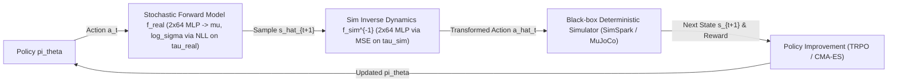

# Stochastic grounded action transformation for robot learning in simulation

**Stochastic grounded action transformation for robot learning in simulation（SGAT）**（Siddharth Desai, Haresh Karnan, Josiah P. Hanna, Garrett Warnell, Peter Stone；UT Austin / University of Edinburgh / Army Research Laboratory / Sony AI）收录于 [AwesomeSim2Real](https://github.com/LongchaoDa/AwesomeSim2Real) **第 123/139** 篇，分组 **Transition / Grounding Methods**。本文指出经典黑盒接地方法 GAT 在随机性真实环境中因使用确定性前向模型而选出高风险激进策略，并提出 SGAT 将单步转移随机性建模为高斯分布后采样注入黑盒仿真。

## 一句话定义

SGAT 将经典接地动作变换（GAT）中的确定性真实前向动力学模型替换为基于负对数似然训练的随机高斯前向模型，使确定性黑盒仿真器能够在单步转移粒度忠实复现真实环境的随机性与风险，从而学出稳健控制策略。

## 英文缩写速查

| 缩写 | 英文全称 | 简要说明 |
|------|----------|----------|
| SGAT | Stochastic Grounded Action Transformation | 随机接地动作变换，本文提出的多态随机前向接地算法 |
| GAT | Grounded Action Transformation | 接地动作变换（采用确定性真实前向模型 + 仿真逆模型） |
| GSL | Grounded Simulation Learning | 接地仿真学习，用真机数据校正黑盒仿真动态的框架 |
| NLL | Negative Log Likelihood | 负对数似然损失，本文用于训练输出均值与对数标准差的随机前向模型 |
| CMA-ES | Covariance Matrix Adaptation Evolution Strategy | 协方差矩阵自适应演化策略，用于 NAO 步态参数优化 |

## 为什么重要

- 真实机器人执行往往受齿轮间隙、不平整地面与接触摩擦波动影响而呈现随机转移特性；忽略随机性的确定性接地算法（如 GAT）会低估激进动作的跌倒/碰撞代价，导致真机频繁失效。
- 区别于传统域随机化（DR）仅在每回合初采样静态物理参数、转移仍保持确定性，SGAT 在**每一步状态转移**层面显式复现真实随机分布，无需修改黑盒仿真器内部源码。
- 顺着列表实体 [AwesomeSim2Real](../entities/awesome-sim2real.md)、[AwesomeSim2Real 技术地图](../overview/lc-awesome-sim2real-technology-map.md) 与站内 [sim2real.md](../concepts/sim2real.md)、[locomotion.md](../tasks/locomotion.md) 页面，可将该接地路线与零样本动力学随机化（如 [Crossing the Gap](paper-as-116-crossing-the-gap-a-deep-dive-into-zero-shot-sim.md)）对比学习。

## 核心信息

| 字段 | 内容 |
|------|------|
| 编号 | 123/139 |
| 分组 | Transition / Grounding Methods |
| 作者 | Siddharth Desai, Haresh Karnan, Josiah P. Hanna, Garrett Warnell, Peter Stone |
| 机构 | UT Austin / University of Edinburgh / Army Research Laboratory / Sony AI |
| 出处 | IEEE/RSJ International Conference on Intelligent Robots and Systems (IROS 2020) |
| 预印本 | `arXiv:2008.01281v1` |
| 论文 | <https://ieeexplore.ieee.org/document/9340780> |
| 硬件/仿真 | SoftBank NAO 双足机器人（SimSpark 3D 仿真器 + rUNSWift 16 维步态引擎）、MuJoCo（TRPO）、Cliff Walking |

## 核心机制（归纳）

### 1. GAT 在随机环境下的失效根源（Section II-D & Fig. 4）

- 经典 GAT 由真实前向模型 $\hat{s}_{t+1} = f_{real}(s_t, a_t)$ 与仿真逆动力学模型 $\hat{a}_t = f_{sim}^{-1}(s_t, \hat{s}_{t+1})$ 串接组成黑盒动作变换器 $g(s_t, a_t)$。
- 当真实环境同一动作具有概率分支（例如 80% 概率高回报、20% 概率跌落或高惩罚，Fig. 4）时，确定性 $f_{real}$ 只拟合最可能下一状态（或均值），屏蔽了小概率高风险分支；结果接地仿真器最优动作与真实最优动作发生错位，甚至诱导策略紧贴风险边界行动。

### 2. SGAT 迭代接地与策略更新（Section III & Algorithm 1）

1. **真机采样与随机前向模型训练**：用当前策略 $\pi_\theta$ 在真机采集轨迹 $\tau_{real}$，以负对数似然损失 $L = -\log p(s_{t+1} \mid s_t, a_t)$ 训练 $f_\phi^{real}$。连续域采用两层 64 神经元 MLP，末层输出状态各维的多元对角高斯均值 $\mu$ 与对数标准差 $\log(\sigma)$。
2. **仿真采样与逆动力学训练**：用同一策略在仿真采集轨迹 $\tau_{sim}$，以均方误差（MSE）损失训练两层 64 神经元仿真逆模型 $f_\psi^{-1}(s_t, s_{t+1})$。
3. **随机接地执行**：仿真运行期间，策略给出 $a_t$ 后，先从 $f_\phi^{real}(s_t, a_t)$ 分布**采样**下一状态 $\hat{s}_{t+1}$，再经 $f_\psi^{-1}(s_t, \hat{s}_{t+1})$ 映射为变换动作 $\hat{a}_t$ 送入黑盒确定性仿真器，驱动策略规避高方差危险转移。
4. **策略改进**：固定接地模型，在接地仿真器上优化 $\pi_\theta$（MuJoCo 采用 TRPO；NAO 真机以 CMA-ES 种群 150 优化 16 个步态参数，前向速度加跌倒提前终止惩罚 `-15`），循环迭代。

### 方法流程图

## 评测与指标

以下定量与真机实验结果均直接摘自原文 Section IV 与 Table I：

### 1. SoftBank NAO 不平坦草地双足行走（原文 Table I）

在实验室足球场草皮下垫入泡沫包装制造随机不平坦地面，测试 300 cm 赛道（每轮测 10 次）。初始未优化步态参数 $\theta_0$ 速度为 `14.66 ± 1.65 cm/s` 且总是跌倒：

| 接地阶段 | 算法 | 真机平均速度 (cm/s) | 跌倒次数 / 总测试 | 行为特征 |
|----------|------|---------------------|-------------------|----------|
| Grounding Step 1 | GAT | 15.7 ± 2.98 | 6 / 10 | 步态前倾激进 |
| **Grounding Step 1** | **SGAT** | **16.9 ± 0.678** | **0 / 10** | 步幅更短更稳 |
| Grounding Step 2 | GAT | 18.5 ± 3.63 | 10 / 10 | 一味追求高速、全数跌倒 |
| **Grounding Step 2** | **SGAT** | **18.0 ± 2.15** | **1 / 10** | **9/10 完赛且保持高速** |

### 2. Cliff Walking 与 MuJoCo 基准（Fig. 6–9）

- **Cliff Walking（每方法评估 10,000 回合）**：目标 `+100`、坠崖 `-10`、每步 `-0.1`。在随机转移概率处于 `(0, 1)` 的全部非极端区间内，SGAT 平均回报一致高于 GAT——GAT 始终走最贴近悬崖的激进路径，而 SGAT 学会绕行上方安全路径。
- **MuJoCo（Sim-to-NoisySim 与 Sim-to-NoisyReal，10 种子，对比 GAT 与动作噪声包络 ANE）**：
  - `InvertedPendulum`（“真机”摆锤质量设为仿真 **10 倍** + 高斯动作噪声）与 `HalfCheetah`（“真机”质量增重 **43%** + 高斯动作噪声）：随着目标域噪声强度升高，SGAT 表现持续显著优于 GAT；而 ANE 依赖人工网格搜索预设噪声幅值，在非匹配噪声水平下表现较差，SGAT 则能从真实数据中自动学出噪声尺度。

## 与其他工作对比

- 与直接向仿真动力学强行注入人工均匀力的零样本方法 [Crossing the Gap (RFI)](paper-as-116-crossing-the-gap-a-deep-dive-into-zero-shot-sim.md) 相比，SGAT 属于**少量真机数据接地（Grounding）**范式：自动从真机轨迹拟合转移随机分布并针对特定目标环境精准优化，避免了 RFI 调参试错；但代价是需要数轮真机采样，不属于纯零样本。
- 与仅在回合初随机采物理参数但单步转移仍确定的白盒 DR 相比，SGAT 是黑盒算法且在单步转移粒度刻画随机过程，同时原文指出该方法理念可直接扩展至 RGAT（Reinforced GAT）等后续接地算法。

## 结论

**在真实世界不可避免存在过程噪声与转移随机性的场景下，应将 SGAT 作为黑盒仿真接地的默认方案——它在确定性环境中退化为与 GAT 等价，而在随机环境中以极简的高斯前向改造换取压倒性的真机生存率。**

- **默认用随机前向替代确定性前向**：即使不确定目标环境随机程度，采用输出 `(\mu, \log\sigma)` + NLL 损失的 SGAT 也不会损失确定性域性能，却能防止跌倒/碰撞等高方差灾难（NAO 跌倒率由 10/10 降至 1/10）。
- **单峰不足时换分布头**：连续域存在明显双峰/多模态接触反弹（如刚体碰撞后多向滑移）时，按原文脚注建议将单一高斯输出头替换为混合密度网络（MDN）。
- **保持迭代接地节奏**：两步接地迭代即可在真机上同时提升步速（14.66 → 18.0 cm/s）与稳定性，无需无限采集真机数据。

## 常见误区或局限

1. **单峰高斯假设无法直接表达多模态转移**：本文连续控制实现假设下一状态服从单峰对角高斯分布，若环境转移呈多峰分布可能产生平滑平均效应，需改用 MDN 等多峰密度模型（Section III 脚注 1）。
2. **假设底层基础仿真器本身是确定性的**：原文 Section V 明确指出，若仿真器内部已经带有随机过程噪声，动作变换架构不能简单地先采样 $\hat{s}_{t+1}$ 再输入单点逆模型，而需要逆模型接收状态分布并输出动作分布。
3. **非跨环境通用策略**：接地类方法面向特定目标部署环境收集数据并优化策略，并不像宽泛 DR 那样旨在一次训练适配多种未采样环境。

## 关联页面

- 列表实体：[AwesomeSim2Real](../entities/awesome-sim2real.md)
- 技术地图：[AwesomeSim2Real 技术地图](../overview/lc-awesome-sim2real-technology-map.md)
- 方法/任务：[sim2real.md](../concepts/sim2real.md)、[locomotion.md](../tasks/locomotion.md)

## 参考来源

- [`sources/papers/lc_awesome_sim2real_noarxiv_123_stochastic-grounded-action-transformatio.md`](../../sources/papers/lc_awesome_sim2real_noarxiv_123_stochastic-grounded-action-transformatio.md) — 本条目策展摘录
- [`sources/papers/lc_awesome_sim2real_catalog.md`](../../sources/papers/lc_awesome_sim2real_catalog.md) — 列表总表
- [`sources/repos/awesome-sim2real.md`](../../sources/repos/awesome-sim2real.md)
- 论文：<https://ieeexplore.ieee.org/document/9340780>

## 推荐继续阅读

- [arXiv 全文（2008.01281v1）](https://arxiv.org/abs/2008.01281)
- [AwesomeSim2Real 仓库](https://github.com/LongchaoDa/AwesomeSim2Real)
- [原文（IEEE Xplore）](https://ieeexplore.ieee.org/document/9340780)
