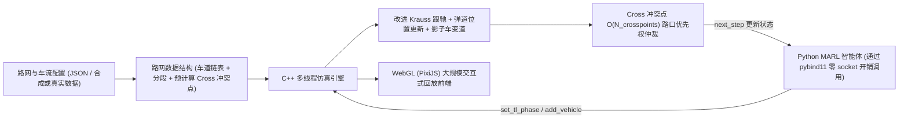

# CityFlow

**CityFlow: A Multi-Agent Reinforcement Learning Environment for Large Scale City Traffic Scenario**（WWW '19，arXiv:1905.05217v1，上海交通大学 & 宾夕法尼亚州立大学）收录于 [AwesomeSim2Real](https://github.com/LongchaoDa/AwesomeSim2Real) **第 128/139** 篇，分组 **Transportation Environments**。本页基于论文全文完成结构化精读与核实。

## 一句话定义

**CityFlow** 是一款专为大规模城市级多智能体交通信号控制（及智能交通 RL 研究）设计的多线程微观交通仿真引擎：通过车道链表/分段索引、交叉口冲突点预计算、改进 Krauß 弹道跟驰更新与 `pybind11` 无缝 C++/Python 绑定，在 30×30 路网上取得相对 SUMO **约 25 倍**加速（8 线程达 72 步/秒）并保持极高动力学一致性。

## 英文缩写速查

| 缩写 | 英文全称 | 简要说明 |
|------|----------|----------|
| SUMO | Simulation of Urban Mobility | 经典开源微观交通仿真器，单线程+socket 通信致城市级规模受限 |
| MARL | Multi-Agent Reinforcement Learning | 多智能体强化学习，本文面向千路口协同信号灯控制提供高速环境 |
| GUI | Graphical User Interface | 图形用户界面，CityFlow 基于 WebGL/PixiJS 提供大规模回放渲染 |
| API | Application Programming Interface | 应用程序接口，本文经 `pybind11` 暴露毫秒级步进与状态读取接口 |

## 为什么重要

- 城市真实路网动辄包含上千路口（如杭州主干道达 30×40 交叉口）与数十万车辆，但真实城市一天每分钟仅能采样 1,440 个样本且试错成本极高；而既往主流开源仿真器 **SUMO** 在 30×30 网格、数万车辆规模下仅能跑约 **3 步/秒**，若通过 Python socket 抽取 RL 状态速度更慢。
- **CityFlow** 是首个开源支持**多线程城市级微观交通仿真**的 RL 平台，除交通信号配时外，也可支撑动态路径规划、拥堵预防、网约车派单与混合自治交通等 Sim2Real 算法验证。

## 核心信息

| 字段 | 内容 |
|------|------|
| 编号 | 128/139 |
| 分组 | Transportation Environments |
| 出处 | Proceedings of the 2019 World Wide Web Conference (WWW '19, pp. 3620–3624, arXiv:1905.05217v1) |
| 作者与机构 | Huichu Zhang, Siyuan Feng, Chang Liu, Yaoyao Ding, Yichen Zhu, Zihan Zhou, Weinan Zhang, Yong Yu, Haiming Jin（上海交通大学）, Zhenhui Li（宾夕法尼亚州立大学） |
| 论文与代码 | <http://dx.doi.org/10.1145/3308558.3314139> · <https://arxiv.org/abs/1905.05217> · <https://github.com/cityflow-project/CityFlow/> |

## 核心机制

1. **高并发路网数据结构设计（Road Network）**
   - **车道链表 + 分段（Segment）**：每条车道维护一个车辆**链表**以支持快速插入与前车查找；同时将车道划分为若干小**分段（Segments）**，变道时仅需常数时间检索相邻车道的至多 3 个分段，避免全车道遍历。
   - **交叉口预计算（Cross Points）**：路口内部由多组 `roadlink`（道路级连接）与 `lanelink`（进出车道级路径）组成，系统离线**预计算**任意两条 `lanelink` 的交汇点（`Cross`）。车辆接近路口时仅向相关 `Cross` 通知到达并由其仲裁优先通行权（转弯让直行、红灯全停、黄灯尽可能停），碰撞检查复杂度降为 $O(N_{\text{crosspoints}})$。
2. **改进 Krauß 跟驰、弹道位置更新与影子变道模型**
   - **安全无碰撞跟驰速度**：基于前车速度 $v_L$、本车速度 $v_F$、双方最大减速度 $d_L, d_F$、车距 $\text{gap}$ 与时间步长 $\text{interval}$，通过求解二次方程（Eq. 1）解析计算满足最大加速度、道路限速、车头时距与路口约束的无碰撞最大速度。
   - **弹道积分更新（Ballistic Update）**：不同于 SUMO 采用的欧拉位置更新，CityFlow 使用弹道位置更新规则，在较大时间步长（如 1 秒）下更忠实于连续物理动力学。
   - **影子车辆变道（Shadow Vehicle）**：借用 SUMO 机制，变道时在目标车道同步放置一个耦合了速度约束的“影子车”作为后车跟驰参考，变道完成后移除原车由影子车接管。
3. **多线程引擎、`pybind11` Python 接口与 WebGL 前端**
   - 底层 C++ 引擎原生支持多线程并行仿真，并通过 **pybind11** 无缝暴露 `Engine(config_file)`、`set_tl_phase`、`next_step`、`get_lane_vehicle_count`、`get_lane_waiting_vehicle_count`、`get_lane_vehicles`、`get_vehicle_speed` 等 RL 控制与观测 API，消除 SUMO 的进程间 socket 通信瓶颈；回放端采用 **PixiJS**（WebGL）实现数万车辆与信号灯的流畅可视化监控。

### 方法流程图

## 评测与指标

在 **Intel(R) Xeon(R) CPU E5-2686 v4 @ 2.30GHz** 上与 **SUMO** 对比运行效率与交通流模拟一致性（Section 3 & Table 1）：

1. **仿真吞吐加速比**：从小型路网到大型路网，CityFlow 单线程即全面领先 SUMO；在 **30×30 大规模网格路网（数万车辆）** 上启用 **8 线程**取得相对 SUMO **约 25 倍**加速（达 **72 步/秒**，而 SUMO 仅约 3 步/秒），且经由 `pybind11` 读取 RL 状态的耗时优势更为显著。
2. **模拟有效性（车辆平均通行时长 Duration，秒，Table 1）**：

| 车流量（Vehicles / Hour） | 100 | 200 | 300 | 400 | 500 |
|------|------|------|------|------|------|
| **SUMO**（平均通行时长） | 40.76 | 41.57 | 42.75 | 44.08 | 45.93 |
| **CityFlow**（平均通行时长） | 40.79 | 41.58 | 42.62 | 43.84 | 45.45 |
| **相对差异（Difference）** | **0.07%** | **0.04%** | **0.30%** | **0.54%** | **1.06%** |

## 与其他工作对比

- **对比 SUMO（Lopez et al. 2018）**：SUMO 功能全面且被交通领域广泛认可，但单线程瓶颈与 Python socket 交互开销使其难以支撑千路口级别深度 MARL 训练；CityFlow 在车辆通行统计与 SUMO 差异 $\le 1.06\%$ 的前提下，将城市级仿真吞吐量拉升至 25 倍以上。
- **对比宏观/高度简化交通仿真器**：相比忽略单车跟驰与车道级变道逻辑的简化环境，CityFlow 保留了微观车辆动力学、碰撞安全约束与交叉口礼让逻辑，更贴近真实城市交通流。同分组横向对照见 [技术地图](../overview/lc-awesome-sim2real-technology-map.md)。

## 常见误区或局限

1. **WWW '19 论文发布时的功能范围尚处于早期扩展期**：论文撰写时 Python 控制接口主要支持信号灯相位切换与在线加车，而车辆级行为控制、可变车道/限行策略以及利用真实观测数据自动标定仿真参数（Sim2Real 参数校准）均列为未来规划功能。
2. **仅评测了 100–500 veh/h 中低流量下的平均通行时长一致性**：Table 1 只对照了单指标“平均通行时长”且流量仅测至 500 辆/小时，在极端拥堵溢出或复杂非规范驾驶行为下与 SUMO / 真实路网的细腻度差异仍需结合具体路网标定验证。
3. **非机器人物理引擎**：CityFlow 面向城市信号灯与车流多智能体调度，不模拟机器人学意义上的刚体接触力或传感器噪声，将其归入 `AwesomeSim2Real` 的意义主要在于大尺度交通数字孪生与跨真机/现实流量的低落差环境构造。

## 结论

**CityFlow 以多线程 C++ 路网引擎、`pybind11` 原生绑定和弹道跟驰模型，在不损失微观交通流真实性的前提下（与 SUMO 平均通行时长差异 $\le 1.06\%$）实现了 30×30 城市路网 ~25× 的 RL 采样加速（72 步/秒）。**

- 在大规模多智能体交通信号控制（MARL）或城市出行调度研究中，用 `CityFlow` 替代 `SUMO` 可直接消除 Python socket 通信与单线程仿真的采样瓶颈。
- 工程实现高并发微观仿真器时，将车道检索切分为分段（Segment）以及预计算路口 `lanelink` 冲突点（`Cross`），是把动态碰撞检测从全量遍历降为局部常数/$O(N_{\text{crosspoints}})$ 复杂度的关键数据结构技巧。
- 当仿真步长较大（如 $1\text{ s}$）时，应优先采用**弹道位置更新**而非欧拉积分，以减轻离散步长带来的车辆动力学失真；开源项目位于 `github.com/cityflow-project/CityFlow/`。

## 关联页面

- 列表实体：[AwesomeSim2Real](../entities/awesome-sim2real.md)
- 技术地图：[AwesomeSim2Real 技术地图](../overview/lc-awesome-sim2real-technology-map.md)
- 方法/任务：[sim2real.md](../concepts/sim2real.md)、[reinforcement-learning.md](../methods/reinforcement-learning.md)、[locomotion.md](../tasks/locomotion.md)、[manipulation.md](../tasks/manipulation.md)

## 参考来源

- [`sources/papers/lc_awesome_sim2real_noarxiv_128_cityflow-a-multi-agent-reinforcement-lea.md`](../../sources/papers/lc_awesome_sim2real_noarxiv_128_cityflow-a-multi-agent-reinforcement-lea.md) — 本条目策展摘录
- [`sources/papers/lc_awesome_sim2real_catalog.md`](../../sources/papers/lc_awesome_sim2real_catalog.md) — 列表总表
- [`sources/repos/awesome-sim2real.md`](../../sources/repos/awesome-sim2real.md)
- 论文：<http://dx.doi.org/10.1145/3308558.3314139>

## 推荐继续阅读

- [AwesomeSim2Real 仓库](https://github.com/LongchaoDa/AwesomeSim2Real)
- [CityFlow 官方开源仓库](https://github.com/cityflow-project/CityFlow/)
- [原文](http://dx.doi.org/10.1145/3308558.3314139)
