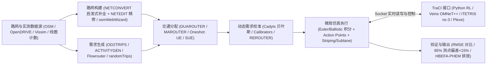

# Microscopic Traffic Simulation using SUMO

**Microscopic Traffic Simulation using SUMO**（Pablo Alvarez Lopez 等，IEEE ITSC 2018，pp. 2575–2582）收录于 [AwesomeSim2Real](https://github.com/LongchaoDa/AwesomeSim2Real) **第 134/139** 篇，分组 **Transportation Environments**。本页基于 IEEE ITSC 2018 原文全文核对补全 SUMO 核心工作流、方法流程图、校准验证口径与工程局限。

## 一句话定义

本文是开源微观多模态交通仿真器 **SUMO**（Simulation of Urban MObility，EPL-2.0 协议，年下载超 35,000 次）在 IEEE ITSC 2018 发表的系统性技术综述，以「Real-World Bologna」真实路网与线圈数据为贯穿案例，涵盖路网准备、需求生成与动态校准、行人及多式联运、积分与反应时间增强，以及基于 **TraCI** 的闭环外部控制与通信联合仿真体系。

## 英文缩写速查

| 缩写 | 英文全称 | 简要说明 |
|------|----------|----------|
| SUMO | Simulation of Urban MObility | 开源微观与多模态交通仿真软件（Eclipse Public License V2） |
| TraCI | Traffic Control Interface | SUMO 基于 Socket 的实时在线控制接口（支持 Python / ns-3 / OMNeT++ 耦合） |
| O-D | Origin-Destination | 起讫点矩阵，交通需求预测中描述区域间各交通方式出行量的经典输入 |
| SUE | Stochastic User Equilibrium | 随机用户均衡（SUMO 路径分配模块 DUAROUTER / MAROUTER 支持的均衡准则） |
| HBEFA | Handbook Emission Factors for Road Transport | 道路交通排放因子手册模型，SUMO 用于计算 CO / CO2 / NOx / PMx / HC 与油耗 |
| Sim2Real | Simulation to Real | 仿真到现实迁移（SUMO 为智能交通信号控制与自动驾驶决策提供可扩展环境底座） |

## 为什么重要

- **微观与多模态交通仿真的开源基石**：相比商用软件 PTV Vissim，SUMO 在保持单车动力学（跟驰、换道、信号控制与尾气排放）高保真度的同时完全开源，并支持汽车、自行车、公交、行人、铁路与集装箱的统一多式联运建模。
- **内置完善的「路网-需求-在线校准-验证」工具链**：针对现实交通数据缺失与格式异构痛点，提供 `NETCONVERT`、`NETEDIT`、`osmWebWizard`、`OD2TRIPS`、`Cadyts`、`Calibrators` 与 `REROUTER` 全套命令行及 GUI 工具，并提供公开的 **Real-World Bologna** 与 **San Pablo Dam Road** 标定基准场景。
- **通过 TraCI 支撑智能交通与网联自动驾驶闭环研究**：在 [AwesomeSim2Real](../entities/awesome-sim2real.md) 的 `Transportation Environments` 分组中，SUMO 凭借 **TraCI** 实时通信接口成为交通信号强化学习控制、V2V/V2I 通信（Veins / iTETRIS）与车辆编队（Plexe）的标准仿真底座。

## 核心信息

| 字段 | 内容 |
|------|------|
| 编号 | 134/139（AwesomeSim2Real） |
| 分组 | Transportation Environments |
| 作者 / 机构 | Pablo Alvarez Lopez, Michael Behrisch, Laura Bieker-Walz, Jakob Erdmann, Yun-Pang Flötteröd, Robert Hilbrich, Leonhard Lücken, Johannes Rummel, Peter Wagner, Evamarie Wießner（DLR） |
| 出处 | 2018 21st International Conference on Intelligent Transportation Systems (ITSC), pp. 2575–2582 |
| 论文 | <https://ieeexplore.ieee.org/document/8569938> |
| 开源主页与协议 | <http://sumo.dlr.de/>（Eclipse Public License V2，当时年下载 > 35,000 次） |
| 贯穿示例场景 | **Real-World Bologna**（意大利博洛尼亚 Andrea Costa–Pasubio 城区，含体育场、医院与 2008 年 11 月 11–13 日实测感应线圈构建的 8am–9am 早高峰 1 小时数据） |

## 核心机制（归纳）

> 注：以下机制与验证标准均依据 IEEE ITSC 2018 原文全文（Sections I–XI）核对整理。

1. **四层交通仿真粒度与路网构建管线（§I, IV）**：
   - SUMO 定位为**微观（Microscopic）**仿真器（单车动力学独立建模），同时可输出轨迹、线圈检测器、边/车道聚合、行程聚合、信号灯切换日志及基于 **HBEFA / PHEM** 数据库的逐车排放（CO、CO2、NOx、PMx、HC）与燃油消耗。
   - **路网表示**：由节点与单向边构成（含车道、人行道、非机动车道、轨道、水路），因车道宽度/限速/通行权限（如公交专用道）沿边恒定，属性变化处自动切分为边序列。**`NETCONVERT`** 从 OpenStreetMap（OSM）、OpenDRIVE、Shapefile、Vissim 或 MATSim 导入路网，并启发式补全路口几何、路权与信号灯配时；**`NETEDIT`** 负责图形化手工修补交叉口、公交站与 POI；**`osmWebWizard`** 可在浏览器中框选区域一键生成含随机交通及 10 分钟/班公交的初始场景。
2. **多源交通需求生成、路径分配与动态适配（§V）**：
   - **需求导入与生成**：`OD2TRIPS` 将 Vissim/Visum 格式 O-D 矩阵转化为单车或行人出行；支持耦合基于智能体的需求模型 **TAPAS**；内置 4 类需求工具——`ACTIVITYGEN`（基于人口、学校、就业统计生成工作/上学/休闲活动）、`Flowrouter`（基于检测器容量的最大流求解，推荐用于网状城市路网）、`DFROUTER`（面向高速公路与匝道检测器）、`JTRROUTER`（按路口转向比生成路径）及 `randomTrips.py`（按边长/限速/车道数加权随机采样）。随后交由 `DUAROUTER`、`MAROUTER` 或 `Oneshot` 按 UE（用户均衡）、**SUE**（随机用户均衡）或瞬时最快路径完成分配。
   - **三类需求自适应机制**：（1）耦合开源贝叶斯校准器 **Cadyts**，通过与 SUMO 多轮迭代调整先验路径选择分布以匹配实测流量；（2）内置 **Calibrators**，依据实测速度/流量动态插入或移除车辆（防拥堵回溢）并类似可变限速牌调整路段车速；（3）**REROUTER**，支持车辆行进中基于实时行程时间变更路径、目的地、寻找空余停车场或模拟突发封路。
3. **多式联运、三类行人模型与亚车道扩展（§VI, VIII）**：
   - 以 `person` 为核心统一调度步行、自驾/骑行与公交（支持基于 OSM 的固定时间惩罚公铁换乘站与人工编制路径的集装箱货运）。
   - 行人接口内置三类实现：**Non-Interacting**（无交互仅追踪行程）、**Striping**（默认模型：沿步行方向划分为窄条带，每条带最多与 1 个交通对象交互，计算复杂度随行人数**线性增长**），以及针对无严格车道纪律混合交通流的 **Sublane** 亚车道模型（按横向分辨率实现单车道内超车与横向间距保持）。另有可选的对向借道超车模型（Overtaking through oncoming lane）。
4. **数值积分、动作点解耦与 TraCI 联机耦合（§IX–X）**：
   - **数值积分（SUMO 0.28+）**：除默认一阶欧拉积分 $\Delta x(t)=\Delta t \cdot v(t+\Delta t)$ 外，引入恒定加速度假设的 **ballistic（弹道）积分** $\Delta x(t)=\Delta t \cdot (v(t)+\Delta t \cdot a(t)/2)$，轨迹更平滑且在大步长 $\Delta t$ 下表现更稳健。
   - **Action Points 机制（SUMO 0.32+）**：允许将最大有效反应时间（action step length，仿真步长的整数倍）与物理位置积分步长 $\Delta t$ 解耦——在非动作点仅按恒定加速度推进位置而不执行周围环境决策逻辑，从而既保证细粒度物理推进又大幅加速大规模仿真。
   - **模拟器在线耦合**：通过基于 Socket 的 **TraCI** 接口允许 Python 等外部程序在线读取、启停与改写仿真状态，已支撑 **iTETRIS（iCS + ns-3）**、**Veins（OMNeT++）** 与 **Plexe**（自动驾驶车辆编队 platooning 与巡航控制）等 V2V/V2I 联合仿真平台。

### 方法流程图

## 工程实践与标定准则

- **Real-World Bologna 标定范式（§III–IV, VII）**：利用博洛尼亚市政提供的 Vissim 路网与信号配时遥测数据转换而来，显式增补**公交专用道**，并将 2008 年 11 月 11–13 日每 5 分钟采样、经 **Savitzky-Golay 滤波**平滑的感应线圈计数浓缩为 **8am–9am** 典型早高峰 1 小时需求（Fig. 2）。
- **使用自动化非线性优化而非手工调参（§VII）**：论文强烈建议避免人工手调参数（结果几乎不可复现），推荐结合 **San Pablo Dam Road**（Daganzo 实测数据集）与 **RMSE** 目标调用非线性最小二乘等数值优化工具标定跟驰模型自由参数。

## 评测与指标

> 本文为系统架构与方法综述，未设置 RL 算法排行榜对比表；以下为原文 §VII 给出的定量验证口径与基准参考：

- **微观层车辆动力学误差（§VII，引用 [3]）**：在分析车间距（gap）、速度与加速度等微观指标时，现有不同微观交通流模型预测双车间距的典型验证误差区间为 **10%–20%**。
- **路网宏观计数一致性标准（§VII，引用 FHWA [8] & Fig. 3）**：在路网级验证中（如 Bologna 感应线圈实测计数 vs 仿真计数散点回归），常用的工程验收门槛为 **超过 85% 的检测点仿真流量与实测流量偏差小于 15%**。
- **基本图与手册复现（§VII）**：以 **RMSE** 度量贴合度时，SUMO 仿真可较好复现美国 **HCM**（Highway Capacity Manual）与德国 **HBS** 手册中的基本图曲线（但在交通流崩溃 breakdown 区间各模型仍存在显著分歧）。

## 与其他工作对比

- **对比 PTV Vissim / MATSim（§I）**：PTV Vissim 为商业闭源工具（具备成熟 3D 可视化）；MATSim 开源但偏向宏观/中观基于活动的智能体仿真；SUMO 则在 EPL-2.0 开源协议下提供高精度单车微观动力学、尾气排放模型及丰富的路网/需求工具箱。
- **与站内对照**：可结合 [AwesomeSim2Real 技术地图](../overview/lc-awesome-sim2real-technology-map.md) 查看 SUMO 在 `Transportation Environments` 分组中的位置，并结合 [Sim2Real 概念页](../concepts/sim2real.md) 评估交通环境仿真器向现实路网控制迁移的校准需求。

## 结论

**SUMO 通过将「开源路网启发式转换 + 多算法需求生成与动态校准 + 步长/反应时间解耦的微观引擎 + TraCI 实时外部控制接口」整合为一体，构成了智能交通控制与车路协同 Sim2Real 领域事实上的基础仿真底座。**

1. **城市场景需求建模优先选用 `Flowrouter` 或 O-D 分配**：在高度网状的城市路网中，`DFROUTER` 存在已知缺陷、`JTRROUTER` 易产生绕圈，应优先采用求解最大流的 `Flowrouter` 配合 `Cadyts` / `Calibrators` 校准。
2. **切换数值积分（Euler vs Ballistic）后必须重新标定参数**：SUMO 0.28 起提供的弹道积分与默认欧拉积分在大步长 $\Delta t$ 下会产生不同的加减速与跟驰特性，跨设置不可直接沿用旧标定参数。
3. **利用 Action Points 平衡精细物理与仿真吞吐量**：将反应时间（action step）设为物理步长的整数倍，可在不牺牲碰撞/跟驰物理连续性的前提下加速大规模路网（或 RL 采样）运行。
4. **用自动化数值优化 +「85% 测点偏差 < 15%」取代主观视觉调参**：路网验证应以线圈数据的 RMSE 最小化和 FHWA 偏差阈值作为可复现判据，而非仅靠 SUMO-GUI 肉眼观察。

## 常见误区或局限

1. **路网导入并非全自动无损（§IV）**：尽管 `NETCONVERT` 具备启发式补全能力，但 OpenStreetMap 等来源常缺失信号配时、精确转向与专用道信息，复杂路口仍需用 `NETEDIT` 人工修补。
2. **部分微观特性存在互斥与尚未实现的功能（§VI, IX, XI）**：**对向借道超车模型尚不兼容 Sublane 亚车道模型**；货物集装箱（containers）暂不支持自动多式联运路径搜索，只能手工指定路线；铁路双向轨道与车辆编组等扩展截至该文发表时仍处于规划阶段。
3. **交通崩溃过渡区间与原始综述边界（§VII）**：在接近通行能力极限的交通流崩溃（breakdown）区域，不同微观模型的行为差异依然较大；且本文聚焦 SUMO 仿真系统自身，不包含强化学习策略训练或真车部署指标。

## 关联页面

- 列表实体：[AwesomeSim2Real](../entities/awesome-sim2real.md)
- 技术地图：[AwesomeSim2Real 技术地图](../overview/lc-awesome-sim2real-technology-map.md)
- 方法/任务：[sim2real.md](../concepts/sim2real.md)、[locomotion.md](../tasks/locomotion.md)

## 参考来源

- [`sources/papers/lc_awesome_sim2real_noarxiv_134_microscopic-traffic-simulation-using-sum.md`](../../sources/papers/lc_awesome_sim2real_noarxiv_134_microscopic-traffic-simulation-using-sum.md) — 本条目策展摘录
- [`sources/papers/lc_awesome_sim2real_catalog.md`](../../sources/papers/lc_awesome_sim2real_catalog.md) — 列表总表
- [`sources/repos/awesome-sim2real.md`](../../sources/repos/awesome-sim2real.md)
- 论文：<https://ieeexplore.ieee.org/document/8569938>

## 推荐继续阅读

- [AwesomeSim2Real 仓库](https://github.com/LongchaoDa/AwesomeSim2Real)
- [原文](https://ieeexplore.ieee.org/document/8569938)
