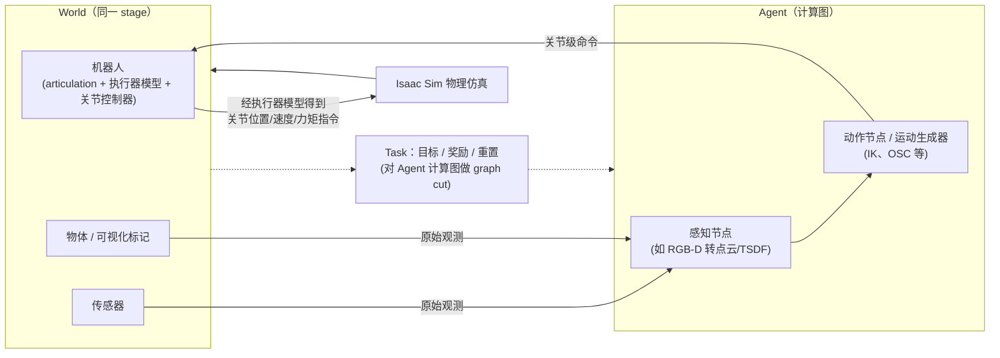

# Orbit: A Unified Simulation Framework for Interactive Robot Learning Environments

**Orbit: A Unified Simulation Framework for Interactive Robot Learning Environments** 收录于 [AwesomeSim2Real](https://github.com/LongchaoDa/AwesomeSim2Real) **第 094/139** 篇，分组 **Robotics Environments**。本页是 **清单索引**：给出它在清单中的位置与原文入口，方法细节和量化结果请看原文。

## 一句话定义

ORBIT 是基于 NVIDIA Isaac Sim 的开源、统一且模块化的机器人学习仿真框架，提供 16 个机器人平台、4 类传感器模态、10 种运动生成器、20 多个基准任务及 4 个学习库的封装（摘要）。

## 英文缩写速查

| 缩写 | 英文全称 | 简要说明 |
|------|----------|----------|
| Sim2Real | Simulation to Real | 仿真策略迁移到真机 |
| RL | Reinforcement Learning | 强化学习 |
| LfD / IL | Learning from Demonstrations / Imitation Learning | 从示范中学习 |
| IK | Inverse Kinematics | 逆运动学（运动生成器之一） |
| OSC | Operational-Space Control | 操作空间控制 |
| USD | Universal Scene Description | Omniverse 使用的分层资产文件格式 |
| PBR | Physically-Based Rendering | 基于物理的渲染 |

## 为什么重要

- 论文把照片级渲染、刚体/可变形体仿真与 GPU 并行集成到同一框架，用于强化学习、模仿学习与运动规划，并展示了 ANYmal 四足策略的 sim-to-real 迁移（§I、§V-D）。
- 想横向对照同一分组的其他工作，可以从 [AwesomeSim2Real 技术地图](../overview/lc-awesome-sim2real-technology-map.md) 逐条展开。
- 顺着列表实体 [AwesomeSim2Real](../entities/awesome-sim2real.md) 与站内 Sim2Real 方法/任务页，可以接回对应的学习主线。

## 流程总览

图依据：论文 §III Fig.3（World / Agent / graph cut 抽象）与 Fig.4（关节控制器经执行器模型下发指令）、§III-a/b/c 正文。

## 核心信息

| 字段 | 内容 |
|------|------|
| 编号 | 094/139 |
| 分组 | Robotics Environments |
| 出处 | IEEE Robotics and Automation Letters (RA-L) Vol. 8 No. 6, 2023（arXiv journal_ref；DOI 10.1109/LRA.2023.3270034） |
| 作者 | Mayank Mittal, Calvin Yu, Qinxi Yu, Jingzhou Liu, Nikita Rudin, David Hoeller 等（ETH Zurich / NVIDIA / Univ. of Toronto） |
| 论文 | <https://arxiv.org/abs/2301.04195> |
| 代码/项目 | <https://isaac-orbit.github.io/>（论文给出的文档与代码入口） |

## 核心机制（归纳）

### 方法要点（据论文 §III–IV）

- **World / Agent / Task 抽象：** World 含机器人、传感器、物体与可视化标记，可程序化、用扫描网格或 Isaac Sim GUI 搭建；Agent 是由感知节点与动作节点组成的计算图，节点各有内部计时器以支持不同更新频率；Task 指定目标、奖励与重置，通过对 Agent 计算图做 graph cut，使同一 World 可定义不同任务。
- **执行器与 sim-to-real：** 关节级控制器的命令先经执行器模型（含 DC 电机与 SEA，可模拟延迟、力矩饱和）再下发到仿真器。
- **运动生成器：** GPU 实现的 differential IK、操作空间控制与关节级控制，另有 RMPFlow、OCS2 的 CPU 实现。
- **工作流（§V）：** RL（rl-games、RSL-rl、stable-baselines3 封装）、遥操作与模仿学习（robomimic 格式）、运动规划、ZMQ 实机部署。

本页不复述完整实验表；若需工程落地，请回到原文并对照站内相关方法页（见关联页面）。

## 评测与指标

- 本页 **没有搬运** 原文的量化 benchmark 与实机指标。
- 评测口径与具体数值以 [原文 / 项目页](https://arxiv.org/abs/2301.04195) 为准。
- 横向对照请回到 [技术地图](../overview/lc-awesome-sim2real-technology-map.md) 同分组条目。

## 与其他工作对比

- 本页 **不做** 与具体基线的逐项数值对比；同分组的横向对照请回到 [技术地图](../overview/lc-awesome-sim2real-technology-map.md) 的 **Robotics Environments** 分组逐条展开。
- 如果站内已经有这篇的深读页（含机构、实验表与源码运行时序图），请以那一页为准；本页只保留清单要点。
- 与清单内相邻条目孰优孰劣，本页不下结论：Awesome 列表可能滞后于论文最新版本，差异应以各自原文的问题设定与评测口径为准。

## 结论

**这一页能给你的是「Orbit: A Unified Simulation Framework for Interactive Robot Learning Environments」在策展清单里的坐标与要点：够你判断要不要去读原文，但不能替代原文。**

- 可确证的有清单坐标（分组 **Robotics Environments**）与论文方法层面的框架设计；性能数字（如吞吐对比）请查原文 §V-E。
- 适用边界：本页不能替代原文 PDF；开源状态以项目页实际链接为准（清单可能滞后）。
- 要深读这篇，建议直接从原文入手，再回到下方关联的方法 / 任务页对照。

## 常见误区

1. 不要把 Awesome 条目的分组标签当成完整方法证明——它只是策展导读。
2. 若站内已有这篇的深读页，以那一页为准——本页只是清单入口，不含实验数据。

## 关联页面

- 列表实体：[AwesomeSim2Real](../entities/awesome-sim2real.md)
- 技术地图：[AwesomeSim2Real 技术地图](../overview/lc-awesome-sim2real-technology-map.md)
- 方法/任务：[sim2real.md](../concepts/sim2real.md)、[locomotion.md](../tasks/locomotion.md)

## 参考来源

- [`sources/papers/lc_awesome_sim2real_2301_04195_delving-deeper-into-out-of-distribution.md`](../../sources/papers/lc_awesome_sim2real_2301_04195_delving-deeper-into-out-of-distribution.md) — 本条目策展摘录
- [`sources/papers/lc_awesome_sim2real_catalog.md`](../../sources/papers/lc_awesome_sim2real_catalog.md) — 列表总表
- [`sources/repos/awesome-sim2real.md`](../../sources/repos/awesome-sim2real.md)
- 论文：<https://arxiv.org/abs/2301.04195>
- [arXiv PDF](https://arxiv.org/pdf/2301.04195)：已通读方法部分（实验与附录以略读为准）：摘要、§I 引言、§II 相关工作（略读）、§III 抽象与接口设计（World / Agent / Task / 执行器）、§IV 特性、§V 示例工作流（略读）；§V-E 仿真评测、§VI 讨论与 §VII 未来工作未细读
- 核对（2026-11-02）：上游清单该条目标题/作者/代码链接对应 OOD 检测相关论文（MCM），与其 arXiv 编号 2301.04195（实为 ORBIT）不一致；本页按 arXiv 记录以 ORBIT 为准。

## 推荐继续阅读

- [AwesomeSim2Real 仓库](https://github.com/LongchaoDa/AwesomeSim2Real)
- [原文](https://arxiv.org/abs/2301.04195)
