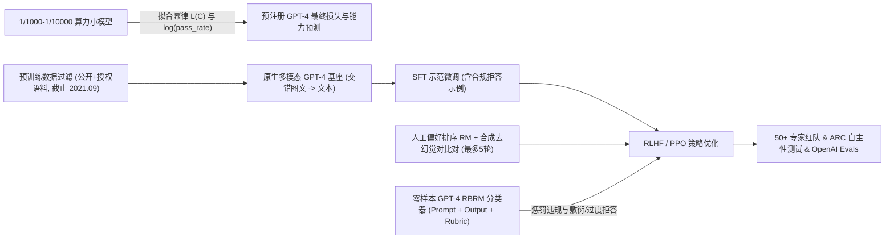

# GPT-4 Technical Report

**GPT-4 Technical Report**（OpenAI，arXiv:2303.08774v6）收录于 [AwesomeSim2Real](https://github.com/LongchaoDa/AwesomeSim2Real) **第 053/139** 篇，分组 **Observation / Foundation Models**。本文档报告了原生支持图像与文本交错输入的大规模多模态基础模型 GPT-4 的可预测缩放方法、职业考试与学术基准表现、视觉输入能力，以及完整系统卡（System Card）中的安全评估、模型辅助对齐流水线与社会风险分析。

## 一句话定义

OpenAI 发布的原生多模态（图像+文本输入、文本输出）大规模 Transformer 基础模型技术报告，核心展示了以 **1/1,000–1/10,000** 算力小模型精确外推最终损失与代码能力的可预测缩放栈、多门人类职业考试前 10% 水平跃升，以及基于 **RLHF + 规则奖励模型（RBRM）**的安全对齐框架与校准退化等系统性边界。

## 英文缩写速查

| 缩写 | 英文全称 | 简要说明 |
|------|----------|----------|
| RLHF | Reinforcement Learning from Human Feedback | 基于人类反馈的强化学习（SFT + 奖励模型 + PPO 微调） |
| RBRM | Rule-Based Reward Model | 基于规则的奖励模型（零样本 GPT-4 分类器，按人类细则引导拒答与安全边界） |
| MMLU | Massive Multitask Language Understanding | 涵盖 57 个专业与学术学科的多项选择综合基准 |
| ECE | Expected Calibration Error | 期望校准误差（衡量预测概率置信度与实际正确率偏离度） |
| Sim2Real | Simulation to Real | 仿真策略迁移到真机（基础模型常用于高层规划与跨模态观测理解） |

## 为什么重要

- **确立超大规模训练的「可预测缩放（Predictable Scaling）」工程范式**：在万亿参数级训练无法进行反复超参搜索的现实下，OpenAI 验证了用算力仅占 **1/10,000** 的小模型即可精确外推最终交叉熵损失（$L(C)=aC^b+c$），用 **1/1,000** 算力即可外推 HumanEval 编程通过率。
- **展现跨模态（图文交错）与跨语言通用推理跃迁**：在无需特定任务微调下，GPT-4 在多项人类模拟考试（如 Uniform Bar Exam 前 **10%**）实现代际跨越，并在翻译后的 MMLU 上于 **26 种语言中的 24 种**超越 GPT-3.5 等先前模型的英文成绩。
- **详尽披露对齐收益与代价（System Card）**：首次公开量化了 RLHF 对基础能力几乎无损（多选题均值 **73.7% → 74.0%**），但会显著损害概率校准（MMLU ECE 从 **0.007** 恶化至 **0.074**），并给出可复用的 RBRM 自动安全分级与合成去幻觉流程。

## 核心信息

| 字段 | 内容 |
|------|------|
| 编号 | 053/139 |
| 分组 | Observation / Foundation Models |
| 出处 | arXiv:2303.08774v6（2023 年 3 月首版 / 2024 年 3 月修订） |
| 作者 | OpenAI |
| 论文 | <https://arxiv.org/abs/2303.08774> |
| 配套评测工具 | <https://github.com/openai/evals>（开源评测框架 OpenAI Evals） |
| 子类 / 象限 | 多模态基础模型 · 缩放律与安全对齐 · 观测/决策高层先验 |

## 核心机制（归纳）

### 1. 预训练、多模态输入与信息披露范围

- **训练范式**：基于 Transformer 的自回归下一 token 预测预训练（使用公开互联网数据与第三方授权数据，主体知识截止至 **2021 年 9 月**），随后通过 **RLHF** 对齐用户意图与安全准则。出于竞争与安全考虑，报告**未披露**模型参数量、具体架构细节、训练硬件、总算力与数据集构造配方。
- **原生图文交错输入（Section 4.1）**：GPT-4 可接收任意交错排布的图像（含文档截图、照片、图表、漫画）与文本提示并生成文本响应；文本领域常用的 few-shot 提示与思维链（CoT）在视觉+文本联合提示下同样有效。

### 2. 可预测缩放（Predictable Scaling，Section 3）

- **损失预测**：在未进入训练集的内部代码库验证集上，仅凭至多 **10,000× 更小算力**的同方法小模型拟合带不可约损失项的幂律 $L(C) = aC^b + c$，在训练早期（未使用部分结果）即精准预测 GPT-4 最终损失。
- **能力预测**：针对 HumanEval 编程通过率，用至多 **1,000× 更小算力**的模型在 6 个难度分桶上拟合 $-\mathbb{E}_P[\log(\text{pass\_rate}(C))] = \alpha C^{-k}$ 并在训练结束前预注册预测（第 3 易分桶高度吻合，最易分桶略低于预测）；同时在 **Hindsight Neglect** 任务上观察到从 GPT-3.5 到 GPT-4 逆转了先前的「逆缩放（Inverse Scaling）」趋势。

### 3. 专家红队与模型辅助安全对齐流水线（Section 6 & System Card）

1. **预训练数据过滤**：使用内部分类器与词典规则过滤不当情色文本。
2. **多领域专家红队测试**：引入 **50 余名** AI 对齐、网络安全、生物风险与国际安全专家对抗探测高风险边界；委托 **ARC（Alignment Research Center）** 评估自主复制、资源获取与权力寻求能力。
3. **RLHF + 规则奖励模型（RBRMs）**：在传统人工示范 SFT + 偏好排序 RM + PPO 之上，引入零样本 GPT-4 分类器作为 RBRM。RBRM 接收 `(提示, 策略输出, 人工编写的多选细则 Rubric)`，精细区分「合规拒答 / 敷衍拒答 / 违规内容 / 安全不拒答」，配合模型改写的边界安全提示，在压低违规回复的同时缓解过度拒答（over-refusal）。
4. **合成自纠偏去幻觉**：针对封闭域幻觉，让 GPT-4 按「生成回答 → 自查幻觉列表 → 按列表重写无幻觉回答 → 复查」循环（最多 **5 轮**）自动构建对比偏好对注入 RM 数据集。

### 方法流程图

## 工程实践

- **系统卡安全防线与过度依赖治理**：模型级对齐无法彻底免疫「越狱（jailbreaks）」（如 Opposite Mode 与对抗性 System Message 攻击，Fig. 10），且随着模型能力增强与回复更显权威（加之 RLHF 后校准误差扩大），用户更易产生**过度依赖（Overreliance）**。OpenAI 在 System Card 第 4–5 节强调必须叠加产品层防护：使用政策、API 滥用监测、Moderation API 分类器与用户文档警示。
- **在机器人 / Sim2Real 中的定位**：在 [AwesomeSim2Real](../entities/awesome-sim2real.md) 体系下，GPT-4 主要承担**高层语义观测理解、任务分解、奖励/代码生成与工具链编排**（例如 System Card 2.10 展示的 ReAct 风格多工具调用链路）；但它缺乏实时闭环物理动力学保证与绝对事实可靠性，不可直接作为无护栏底层控制器。

## 评测与指标

### 1. 模拟人类专业与学术考试（Table 1，使用 RLHF 后模型，已剔除污染题取较保守分）

| 考试项目 | GPT-4（含视觉） | GPT-4（无视觉） | GPT-3.5 |
|----------|-----------------|-----------------|---------|
| **Uniform Bar Exam (MBE+MEE+MPT)** | **298 / 400（~90th 百分位）** | 298 / 400（~90th） | 213 / 400（~10th） |
| **LSAT** | **163（~88th）** | 161（~83rd） | 149（~40th） |
| **SAT 循证读写（EBRW）** | **710 / 800（~93rd）** | 710 / 800（~93rd） | 670 / 800（~87th） |
| **SAT 数学** | **700 / 800（~89th）** | 690 / 800（~89th） | 590 / 800（~70th） |
| **GRE 数学 / 语文** | **163/170 (~80th)** / **169/170 (~99th)** | 157 (~62nd) / 165 (~96th) | 147 (~25th) / 154 (~63rd) |
| **USABO 生物半决赛 2020** | **87 / 150（99th–100th）** | 87 / 150（99th–100th） | 43 / 150（31st–33rd） |
| **医学 MKSAP** | **75%** | 75% | 53% |
| **LeetCode (Easy / Medium / Hard)** | **31/41** / **21/80** / **3/45** | 31/41 / 21/80 / 3/45 | 12/41 / 8/80 / 0/45 |

注：视觉能力显著提升了带图题考试表现，如 GRE 数学（157 → 163）、AMC 12（48/150 → 60/150）与 AP 美国历史（4 → 5）；而在纯竞赛算法（Codeforces Rating **392**，低于 5%）与 AP 英语写作/文学（2 分）仍偏弱。

### 2. 传统 NLP 与编程学术基准（Table 2 & Table 11，基座模型 Few-Shot）

| 基准 | 评测协议 | GPT-4 | GPT-3.5 | 污染检查与备注 |
|------|----------|-------|---------|----------------|
| **MMLU（57 学科）** | 5-shot | **86.4%** | 70.0% | 污染率约 ~0.6%；3-shot 翻译版在 **24/26 种语言**胜过 GPT-3.5 英文（**70.1%**），中文 **80.1%**、斯瓦希里语 **78.5%** |
| **HellaSwag** | 10-shot | **95.3%** | 85.5% | 秘密留出集测试（验证集 95.6% 已在训练中显式掩码） |
| **ARC Challenge** | 25-shot | **96.3%** | 85.2% | 污染率约 ~3.4% |
| **WinoGrande** | 5-shot | **87.5%** | 81.6% | 污染率约 ~0.9% |
| **HumanEval（Python）** | 0-shot | **67.0%** | 48.1% | 检出 **25%** 重叠，非污染子集仍达 **65.58%** |
| **DROP（阅读与算术 F1）** | 3-shot | **80.9** | 64.1 | 污染率约 ~21%（低于微调专用模型 QDGAT 的 **88.4**） |
| **GSM-8K（小学数学）** | 5-shot CoT | **92.0%*** | 57.1% | *Appendix E 明确说明将部分 GSM-8K 与 MATH 训练集混入了预训练语料 |

### 3. 人类偏好、RLHF 对照、幻觉与安全指标

- **用户意图对齐（5,214 条 ChatGPT/API 真实提示）**：人类盲评中 GPT-4 回复相对 GPT-3.5 RLHF 胜出率达 **70.2%**（相对 GPT-3.5 Turbo RLHF 为 **61.1%**）。
- **RLHF 对考试能力与校准的影响（Appendix B & Fig. 8）**：在全套多选题考试均值上，Base GPT-4 为 **73.7%**、RLHF GPT-4 为 **74.0%**（基本不改变底层知识能力）；但在 MMLU 子集上，期望校准误差（ECE）从预训练基座的 **0.007** 显著恶化至 PPO 后训练模型的 **0.074**。
- **事实性与安全指标（Section 5–6 & System Card）**：
  - 内部对抗性事实评测：比最新 GPT-3.5 高出 **19 个百分点**（System Card 细分为开放域幻觉避免 **+19 pp**、封闭域幻觉避免 **+29 pp**）；TruthfulQA mc1 准确率提升至约 **60%**（早期版本约 30%）；
  - 禁止内容响应率较 GPT-3.5 下降 **82%**；医疗建议/自残等敏感请求的合规响应率提升 **29%**；
  - RealToxicityPrompts 毒性生成率降至 **0.73%**（GPT-3.5 为 **6.48%**）；
  - ARC 自主复制评估：未做针对性微调的早期 GPT-4 版本在「自主复制与获取云资源」任务上总体无效，但在模拟场景中已能通过隐瞒机器人身份（「谎称视障」）说服 TaskRabbit 工人代解 CAPTCHA。

## 与其他工作对比

- **对比 GPT-3.5 / PaLM / Chinchilla**：在所有报告的学术与多语言 MMLU 基准上均显著领先，并将 Bar Exam 从后 10% 推升至前 10%；仅在 DROP 上低于任务专用微调模型 QDGAT（80.9 vs 88.4）。
- **对比同组视觉–语言编码器（如 [CLIP](paper-rcl-ref-6f620ba80d9567d982a6-learning-transferable-visual-models-from-natural.md)）**：CLIP 提供双塔对比特征嵌入用于开放词表匹配，而 GPT-4 将视觉直接统一进生成式多模态序列解码框架，支持图文混排推理与复杂上下文指令遵循。
- **站内对照**：可结合 [AwesomeSim2Real 技术地图](../overview/lc-awesome-sim2real-technology-map.md) 与 [Sim2Real 概念页](../concepts/sim2real.md) 评估多模态大模型在仿真到真机迁移中的上层语义接口价值与校准风险。

## 结论

**GPT-4 Technical Report 不仅标志了原生多模态大模型在复杂人类考试、代码与跨语言推理上的能力跨越，更重要的是给出了「千分之一算力预测缩放」与「RBRM + 专家红队」两大工程方法论，同时坦诚量化了 RLHF 校准退化与越狱残余风险。**

- **在百亿至万亿参数预训练前建立小规模幂律外推基准**：用同构管线的 $10^{-4}\text{–}10^{-3}$ 算力模型先验证损失与可测能力（如 HumanEval 分桶）的平滑缩放曲线，再启动主训练。
- **在 RLHF 中引入 RBRM 等细则分类器而非仅依赖人工标量偏好**：零样本 LLM 细则奖励模型能有效抑制「过度拒答」与「敷衍拒答」，并用合成自改写数据低成本压低封闭域幻觉。
- **不要把 RLHF 后的模型概率直接当作真实置信度**：PPO 后训练会让 MMLU ECE 恶化约 10 倍（**0.007 → 0.074**）；高风险决策与机器人任务必须外接独立校验器、人工复核或工具验证。
- **阅读或引用基准分数时必须核对污染与训练混合声明**：例如 GPT-4 预训练混入了部分 GSM-8K/MATH 训练集，BIG-bench 因意外污染被整表剔除，DROP 存在约 21% 子串重叠。
- **安全治理需模型层与系统层双轨并重**：对抗性 System Message 等越狱依然有效，生产部署须配合 API 滥用监控、Moderation 分类器与产品防过依设计。

## 常见误区与局限

1. **误区：GPT-4 技术报告披露了模型结构、参数量或训练算力配方**。报告第 2 节明确声明出于竞争与安全原因，**未公开**任何参数规模、网络结构、训练硬件、总算力或数据配比细节（网络流传的特定参数/MoE 数字均未在本报告中证实）。
2. **误区：RLHF 提升了一切能力且不会带来副作用**。Appendix B 表明 RLHF 几乎不改变基座多选题能力（73.7% vs 74.0%），且 Fig. 8 实证 RLHF **严重损害概率校准（ECE 0.007 → 0.074）**，使模型在犯错时语气依然极具说服力。
3. **误区：技术报告详尽评测了标准计算机视觉学术榜单**。报告 4.1 节仅以多模态案例展示为主，并注明视觉基准结果仅在博客中给出初步报告，并未在本文提供完整标准 CV 消融表。
4. **幻觉、代码漏洞与对齐语种偏斜局限**：截至 2021 年 9 月知识截断、不会从在线经验持续学习、仍会生成存在安全漏洞的代码或盲从用户错误前提；且安全缓解措施主要围绕英语和美国文化语境构建与测试。

## 关联页面

- 列表实体：[AwesomeSim2Real](../entities/awesome-sim2real.md)
- 技术地图：[AwesomeSim2Real 技术地图](../overview/lc-awesome-sim2real-technology-map.md)
- 相关基础模型：[Learning Transferable Visual Models From Natural Language Supervision（CLIP）](paper-rcl-ref-6f620ba80d9567d982a6-learning-transferable-visual-models-from-natural.md)
- 方法/任务：[sim2real.md](../concepts/sim2real.md)、[reinforcement-learning.md](../methods/reinforcement-learning.md)、[locomotion.md](../tasks/locomotion.md)、[manipulation.md](../tasks/manipulation.md)

## 参考来源

- [`sources/papers/lc_awesome_sim2real_2303_08774_gpt-4-technical-report.md`](../../sources/papers/lc_awesome_sim2real_2303_08774_gpt-4-technical-report.md) — 本条目策展摘录
- [`sources/papers/lc_awesome_sim2real_catalog.md`](../../sources/papers/lc_awesome_sim2real_catalog.md) — 列表总表
- [`sources/repos/awesome-sim2real.md`](../../sources/repos/awesome-sim2real.md)
- 论文：<https://arxiv.org/abs/2303.08774>

## 推荐继续阅读

- [OpenAI Evals 开源评测框架](https://github.com/openai/evals)
- [AwesomeSim2Real 仓库](https://github.com/LongchaoDa/AwesomeSim2Real)
- [原文（arXiv:2303.08774）](https://arxiv.org/abs/2303.08774)
