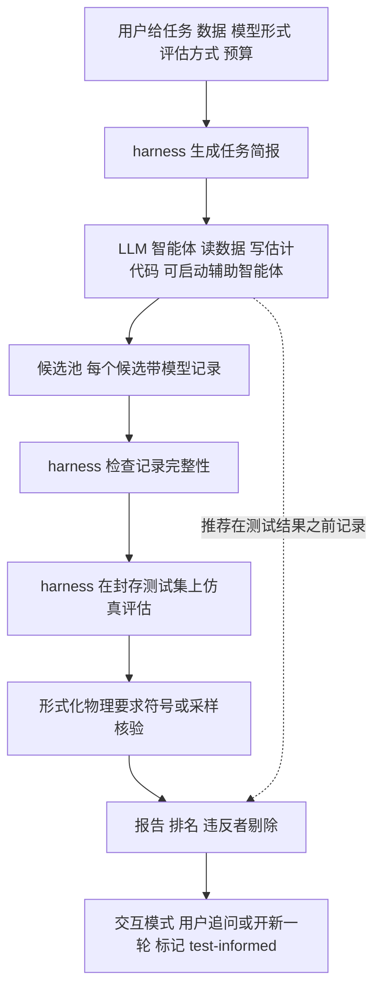
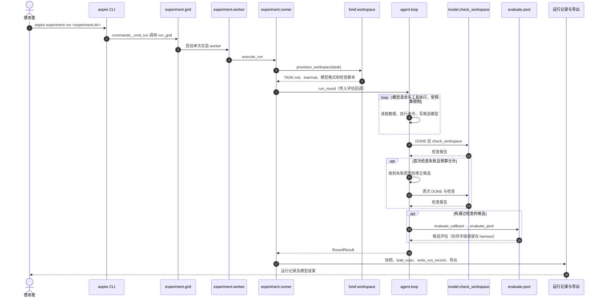

# ASPIRE：智能体式系统辨识（arXiv:2611.13114）

**ASPIRE**（*An Agentic System-Identification Platform for Iterative Reasoning and Exploration*，[arXiv:2611.13114](https://arxiv.org/abs/2611.13114)，Derner、Kubalík、Babuška，v1，2026-11-09）。本页依据论文全文与 [归档](../../sources/papers/aspire_arxiv_2611_13114.md) 写成，第 N 节指论文章节。

## 一句话定义

一个由 LLM 智能体加软件 harness 组成的系统辨识框架：智能体自选并实现辨识方法，输出带参数表与估计记录的闭式模型；harness 负责封存测试数据、核验形式化物理要求、评估并记录全过程（第 1、4 节）。

## 英文缩写速查

| 缩写 | 英文全称 | 简要说明 |
|------|----------|----------|
| ASPIRE | Agentic System-identification Platform for Iterative Reasoning and Exploration | 本文框架（脚注 1：与同名机器人技能系统无关） |
| SR | Symbolic Regression | 符号回归，搜索闭式表达式 |
| SINDy | Sparse Identification of Nonlinear Dynamics | 稀疏回归辨识，对照方法 PySINDy |
| NARX | Nonlinear AutoRegressive with eXogenous inputs | 带外部输入的非线性自回归模型（第 3 节） |
| RMSE | Root Mean Squared Error | 均方根误差，测试得分 S 的基础（式 6） |
| LLM | Large Language Model | 大语言模型，此处充当智能体 |

## 为什么重要

- 闭式模型可解释、可对照物理知识、可外推、可嵌入模型控制，但选方法、引入先验、验证都要专家决策（第 1 节，作者自述）。
- 作者指出已有智能体方程发现方法缺少：物理要求的声明与核验、对智能体封存的测试集、辨识过程文档（第 1 节）。ASPIRE 把这三点做成 harness 功能。
- 对机器人读者：被辨识的是真实机器人 / 实验装置数据（TurtleBot 2、转动盘），属于 [系统辨识](../concepts/system-identification.md) 里「用数据拟合可检查模型」的一类，而非策略学习。

## 核心原理与流程总览

要点（均出自第 3-4 节）：

- **任务**：必填训练数据、模型形式、评估模式、预算；可选验证 / 测试数据、系统描述、用途、物理要求（第 4.2 节）。
- **九类形式化要求**：对称、单调、奇偶、精确值、不等式、凸性、极限、方程、给定点关系（Table 2）；harness 能符号证明就证明，否则采样，采样未发现违反只算「未决」（4.5）。
- **模型记录**：参数表（fitted / fixed / tied）、估计记录、讨论（4.3）。harness 只查符号声明、参数使用、表达式在训练数据上实数有限，不查内容。
- **评估**：动态模型默认用 RK4 仿真；可指定视界 H 把训练 / 验证轨迹切段（4.5）。智能体的推荐与测试排名分开；测试集上最低 S 称「基于 oracle 的选择」（4.5）。
- **预算**：默认 60 轮、3600 s、10 美元（4.4）。

## 源码运行时序图

官方已发布可运行 Python harness。下图依据 `aspire/pyproject.toml`、`cli.py`、`experiment/commands.py`、`worker.py`、`runner.py`、`agent/loop.py`、`brief/workspace.py` 和 `evaluate/pool.py` 的实际入口与调用绘制；是**静态源码审阅**，没有执行实验。

`aspire experiment run` 是自主实验入口；另有 `aspire session` / `aspire web` 交互入口。候选文件为 `models/<label>.json` 与 `models/pool.json`。具体路径和调用证据见[官方源码归档](../../sources/repos/erik-derner-aspire-sysid.md)。

## 工程实践

- 复现入口：仓库 README（静态读）列出 `aspire web`、`aspire session`、`aspire experiment run/aggregate/report`、`aspire record verify`（离线重算评估，无需 API key）。默认需要 OpenAI 账号有 `gpt-6.1-sol` 权限（README）。**已静态审阅主要运行入口与调用链，但未实际运行代码**；详见[源码归档](../../sources/repos/erik-derner-aspire-sysid.md)。
- **测试数据隔离的安全边界：** harness 正常工作目录只供给 train/val，不主动向智能体提供测试集与测试误差；但官方 `aspire/README.md` 明示**没有操作系统级沙箱**：agent 命令与 harness 为同一 OS 用户，且有网络权限，故恶意脚本可能越过工具/目录分隔读取测试文件，事后泄露扫描也无法检测静默读取。不能将“sealed evaluation”理解为对抗性安全隔离；强隔离需额外容器、虚拟机或独立 OS 用户。
- 数据：机器人与摩擦系统数据由作者录制；发酵罐数据出自 van Can 等 1995（README）。
- 实验设置（第 5 节）：TurtleBot 2 离散时间 3 状态，训练 3 条轨迹 450 样本，测试 12 条 25 样本（H=25，Ts=0.2 s）；摩擦系统连续时间，训练 13 条 3522 样本，测试 4 条 978 个得分样本，含三条形式化要求 R1-R3（Table 3、4）；发酵罐单状态压力，训练 / 验证 / 测试各 1 条轨迹，Ts=5 s，五条自然语言要求 R1-R5（Table 3、5.3）。均为实测数据，仿真评估用的是已记录输入下的开环仿真，非闭环控制。
- 「盲」任务：同数据、同划分，变量名改 x1、x2…，去掉单位、描述、用途与要求（5.4）。

## 关键结果（论文数字，章节 / 表号）

- 30 次运行全部在预算内交付通过检查的池，126 个候选全部合格，无仿真失败（第 6 节开头）。
- 推荐模型测试得分 S（Table 5，均值±样本标准差，5 次）：机器人 0.0430±0.0010 m（有描述）/ 0.0401±0.0015 m（盲）；摩擦 0.0417±0.0070 / 0.0408±0.0079 rad；发酵罐 0.0232±0.0006 / 0.0225±0.0010 bar。
- 对照（Table 6，6.1）：机器人上 5 个 PySR 默认模型 0.0458-0.0612 m，高于智能体推荐模型；摩擦系统 PySR matched 为 0.0363±0.0039 rad，作者称与智能体无可见差异（差值小于智能体标准差）；但两工具的 12 个模型全都违反 R2，会被 ASPIRE 剔除，而智能体的 22 个候选无已证明违反（6.1、6.2）。发酵罐上智能体推荐模型 S 均不超过 0.0239 bar，低于两工具所有模型。「未应用统计检验」（Table 6 注）。
- 形式化核验（6.2）：摩擦系统 66 次核验里 30 次得到证明，36 次未决（采样无反例但不算满足）。
- 模型记录评估（5.6、Table 7、6.3）：30 条推荐记录 5 项共 150 个标记，132 yes、18 partly、0 no；9 条记录在「结构来源」一项与执行日志有一处出入；13 个非 yes 标记来自盲任务。该评估最初由 Claude Code（Opus 5.5）完成，作者手动复核（5.6）。
- 成本（6.4）：单次 0.96-3.38 美元，30 次共 61.10 美元，计价把缓存输入按全价计，故为上限估计。
- 测试集泄露扫描（第 6 节）：16 条发现、7 次运行，经检查均为智能体由训练 / 验证数据算出或抄入的数，未发现访问测试数据。
- 有描述与盲任务（7.1）：有描述并未降低测试误差（描述任务均值反而略高，差值在小样本下不显著）；差别在模型形式与物理性质，如盲模型 5 个都违反 R2。

## 与文章说法的核对

文章对该论文的说法（claims 文件）：「把模型结构搜索、参数拟合与物理约束核验串成智能体流程，并封存测试集。实测系统验证了可执行性，也暴露推理理由缺乏证据的问题；适合研究可审计的建模过程。」

| 文章说法 | 论文核对 |
|----------|----------|
| 模型结构搜索、参数拟合、物理约束核验串成智能体流程 | 基本成立，但有细化：结构搜索与拟合由智能体自选（可用 SR、稀疏回归或自写代码），实际 30 次运行没有一次调用 gplearn / PySINDy（6.2）；物理约束核验由 harness 独立完成而非智能体流程内部，且仅对形式化要求；自然语言要求只靠用户评估（4.2）。 |
| 封存测试集 | 成立（第 4.1、4.5 节）。补充：对智能体封存，对作者不封存，作者开发中用过测试数据（7.3）。 |
| 实测系统验证了可执行性 | 成立：三个实测系统，30/30 运行交付有效模型（第 6 节开头、摘要）。限定：只有一个语言模型（gpt-6.1-sol）、每任务 5 次、单输出且状态可测（7.3、第 3 节）。「可执行」不等于精度领先：对 PySR 的优势随系统而异，摩擦系统上与 PySR matched 无可见差异（6.1）。 |
| 暴露推理理由缺乏证据的问题 | 大体成立，但程度要写准：150 个标记 0 个 no，18 个 partly；9 条记录的「结构来源」陈述与日志有一处出入，如把先后顺序说反，或把只在部分数据上做的比较说成全局（6.3、7.2）。论文自己的表述是「记录对方法与结果的记载比对决策顺序的记载更可靠」，没有说推理理由「缺乏证据」，也没有出现整体性虚构（所有参数值与脚本计算值一致）。评估由作者所做，且最初由 Claude Code 完成，非独立第三方。 |
| 适合研究可审计的建模过程 | 与论文定位一致（完整记录请求、响应、命令、脚本，`aspire record verify` 可离线重算评估，见 README）。这是对用途的评价，论文未做第三方审计验证。 |

claims 文件未提任何数字，此处无数字不符。

## 局限

论文自己承认的（7.2、7.3、第 8 节）：

- 仅用一个语言模型，且厂商无日期快照；其他模型只有初步实验、未大规模评估。
- 假设 A1-A3：单一评分输出、状态可测、测量方程给定；多输出与未测状态留作未来工作。
- 测试集对智能体封存，对作者不封存。
- 交互评估只由开发者之一充当用户；以后各轮标记 test-informed。
- 记录内容只能人工核验；harness 不核验估计过程是否真照所述执行。
- 作者没有证据说明 harness 本身降低了误差（7.3）；对照 SR-Scientist、KeplerAgent、ASIA 因条件不同未运行（2.4），对比只有 PySINDy 与 PySR。

我的观察（推测，非论文结论）：

- 每个实验只有 5 次运行、3 个系统，测试集很小（发酵罐仅 1 条测试轨迹），均值差异难作强结论；论文自己也未做统计检验。
- 18/20 次运行在选完结构后合并训练与验证数据重估参数（6.3），推荐模型的验证误差因此不是独立泛化估计，论文已在记录里提到。
- 发酵罐参数 ρ 被声明为「fitted」，实际取到智能体设的数值稳定性上界 0.5 s^-1（6.3、附录 B），说明「fitted」标签不能保证由数据决定。
- 数据集为小型实验室装置，向复杂机器人（多输出、未测状态）迁移未验证。

## 与其他工作对比

| 工作 | 关注点 | 与 ASPIRE 的区别 |
|------|--------|------------------|
| PySR（符号回归工具，Table 6 对照） | 演化搜索闭式表达式 | 不声明也不核验物理要求；摩擦系统上 PySR matched 0.0363±0.0039 rad 与智能体无可见差异，但 12 个工具模型全部违反 R2（6.1、6.2） |
| PySINDy（稀疏回归工具，Table 6 对照） | 在候选函数库上稀疏回归动力学 | 方法固定、需人选函数库；ASPIRE 让智能体自选方法，30 次运行实际没有调用 PySINDy（6.2） |
| SR-Scientist / KeplerAgent / ASIA（第 2.4 节） | LLM 智能体做方程发现 | 作者称其缺少物理要求核验、封存测试集与过程记录；因条件不同未运行对比 |
| 传统 [系统辨识](../concepts/system-identification.md) 流程 | 专家选模型结构、拟合并验证 | ASPIRE 把选方法与拟合交给智能体，把验证交给独立 harness |

## 结论

**ASPIRE 的贡献主要在 harness：封存测试集、独立核验形式化物理要求、强制模型记录，让 LLM 智能体做出的系统辨识结果可审计。**

1. 三个实测系统 30 次运行全部在预算内交付合格模型，单次成本 0.96–3.38 美元（第 6 节、6.4）。
2. 精度对 PySR 的优势随系统而异（机器人、发酵罐占优，摩擦系统持平），真正的差别在物理要求是否满足（Table 6、6.2）。
3. 模型记录 150 个标记 0 个 no，但 9 条记录的决策顺序与日志有出入，记录对方法与结果比对决策过程更可靠（6.3）。
4. 局限：只用一个语言模型、每任务 5 次、3 个小型装置，未做统计检验，测试集对作者不封存，多输出与未测状态未覆盖。

## 关联页面

- [系统辨识（System Identification）](../concepts/system-identification.md)
- [AI 智能体评估](../concepts/ai-agent-evaluation.md)
- [智能体式编程软件基础](../concepts/agentic-coding-software-fundamentals.md)
- [物理保真度与 sim2real 差距](../concepts/physics-fidelity-sim2real-gap.md)
- [Sim2Real](../concepts/sim2real.md)

## 参考来源

- [aspire_arxiv_2611_13114.md](../../sources/papers/aspire_arxiv_2611_13114.md)
- [arXiv:2611.13114](https://arxiv.org/abs/2611.13114)
- [官方源码归档与调用链](../../sources/repos/erik-derner-aspire-sysid.md)
- 代码：[erik-derner/aspire-sysid](https://github.com/erik-derner/aspire-sysid)（静态阅读入口及关键模块，未运行）

## 推荐继续阅读

- [arXiv PDF](https://arxiv.org/pdf/2611.13114)
- [系统辨识概念页](../concepts/system-identification.md)
