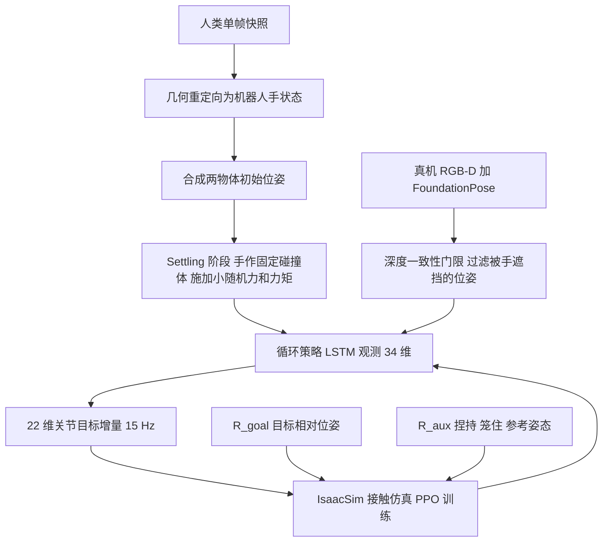

# 单手双件装配（arXiv:2609.10137）

## 一句话定义

**单手双件装配**（[Assembling Two Parts in One Hand](https://arxiv.org/abs/2609.10137)，HKU / HKUST(GZ) / ETH 的 Pei、Wu 等）：让一只多指灵巧手同时握住并配合两个刚体（瓶盖与瓶身、注射器、笔帽与笔身），不借助第二只手或夹具；用「由目标相对位姿驱动的 RL + 按手指分工的功能奖励 + 单帧人类快照」在仿真训练，零样本迁移到只有一台 RGB-D 相机的真机（论文摘要，§1）。

## 英文缩写速查

| 缩写 | 英文全称 | 简要说明 |
|------|----------|----------|
| RL | Reinforcement Learning | 强化学习，本文用 PPO 在 IsaacSim 训练 |
| POMDP | Partially Observable Markov Decision Process | 部分可观测马尔可夫决策过程，本文因遮挡与缺速度/接触观测而采用（§3.1） |
| PPO | Proximal Policy Optimization | 近端策略优化，经 rl_games 实现（附录 A） |
| LSTM / RNN | Long Short-Term Memory / Recurrent Neural Network | 循环策略骨干，两层 LayerNorm-LSTM（附录 A） |
| PD | Proportional-Derivative | 关节位置目标由隐式 PD 控制器跟踪（式 2） |
| DoF | Degrees of Freedom | 自由度，Sharpa Wave Hand 为 22（§4.1） |
| held / fixed | O_h / O_f | 被手指操纵的零件 / 被笼住的零件（§3.1） |
| FoundationPose | 6-DoF pose estimator | 真机位姿跟踪（§3.3，附录 B） |
| DR | Domain Randomization | 域随机化，含观测噪声、质量、摩擦等（表 3） |

## 为什么重要

- 把「单手内配合两个物体」作为灵巧操作基准：以往的手内任务多为单物体重定向或旋转，装配要求两件的相对位姿收敛（作者自述，§1、§2）。
- 一套奖励公式覆盖三种几何与公差不同的任务（作者自述 §1；三任务实验见 §4.5、附录 C）。
- 在仿真中比较四种手，论证装配对手形态（第五指、外展/内收关节）更敏感（§4.2，仅 Syringe 任务，仿真）。
- 判断（本页）：真机成功率是小样本（每任务 20 次，且需人工扶持起步），适合当作「可行性证据」而非性能基准。

## 核心原理与流程总览

- **任务与分工（§3.1–3.2）：** held 集 {拇指, 食指} 在 O_h 顶部捏持并做精细对齐；fixed 集 {中指, 无名指, 小指} 笼住 O_f 抵抗反作用力，并可辅助对齐与插入（小指助推深度）。
- **观测（式 1）：** 34 维 = 两物体质心(3+3) + 两物体体 z 轴(3+3) + 22 关节角；无关节速度、无接触力；绕对称轴的自转不估计。
- **动作（式 2）：** 22 维关节目标增量，α=0.1 rad，15 Hz。
- **奖励（式 3–4）：** R_goal 为两个不同尺度的指数项之和；R_aux = ρ_pinch × ρ_grasp × ρ_pose 在全回合起作用。
- **初始化（§3.5）：** 人类快照重定向（食指关节角减 30%）+ 估计物体位姿 + settling（手作固定碰撞体，N=2 步随机力/力矩）。

图依据：论文 §3.1–§3.5、附录 A、B。

## 工程实践

| 项 | 论文口径（章节） |
|----|------------------|
| 硬件 | Sharpa Wave Hand（22 DoF）+ Franka Research 3，RealSense D435，RTX-3090 工作站（§4.1） |
| 仿真 | IsaacSim，PhysX，SDF 碰撞，物理步 1/120 s，沿用 [33] 的装配仿真设置（附录 A） |
| 训练 | PPO，256 环境（随机倾角 1024），rollout 128，γ=0.995，λ=0.95，lr 1e-4 自适应 KL（表 2） |
| 回合 | Bottle 20 s、Syringe 10 s、Marker 20 s，物体离手 0.5 m 提前终止（附录 A） |
| 域随机化 | 物体位置观测噪声 σ=0.01 m，摩擦 0.5–2.0 倍，质量 0.05–0.15 kg，延迟 0–3 步，外力 0–0.3 N 事件触发等（表 3） |
| 位姿 | FoundationPose，深度一致性门限 8 cm，帧间跳变门限 6 cm，指数滤波 0.7（附录 B） |
| 部署 | 动作限幅 0.12 rad/步，插值到 60 Hz，stall-relax 防过热；ArUco 标定相机外参（附录 B） |
| 起步方式 | 人工把两件放进手指间并**持续扶住，直到神经网络控制启动**（附录 B） |

实验结果（均来自论文）：

- **真机闭环 vs 开环重放（§4.5，表 1，每任务 20 次）：** 闭环 对齐/装配 成功为 Bottle 18/15、Syringe 18/17、Marker 16/16；开环重放仿真成功轨迹为 2/2、1/0、0/0。
- **仿真消融（§4.3，图 5）：** 去掉视觉对 Bottle 影响显著；LSTM 优于 8 帧历史 MLP；去掉手指功能奖励或参考姿态奖励降低效率与最终表现。Marker（附录 C，图 11，每变体 500 回合）：完整 65%，仅本体感觉 11%（goal 奖励 1280.1 对 338.0，正文明确）；其余三个变体的成功率为 49%、27%、40%，正文称去掉手指功能奖励或参考姿态奖励也会降低表现，但各数值与具体变体的对应本页未能从图 11 文本层确认，以原图为准。
- **噪声（§4.4）：** 训练噪声 σ=1 cm；Marker 3 cm 高斯噪声 goal 奖励 963.7，加 3 cm 常量偏移 670.9，仅本体感觉基线 338.0（附录 C）。
- **手形态（§4.2，图 4）：** Sharpa 与 Wuji 最好，Allegro 缺第五指难深插，XHand 缺外展/内收关节、常对不齐。

## 评测证据与清单说法的对比核对

清单（CoRL 2026 Glen Berseth 阅读清单 P2 档，作者说明为 LLM 据摘要起草）一句话：「RL for in-hand assembly of two parts in a single dexterous hand, with function-based rewards and sim-to-real.」

| 清单措辞 | 与论文核对 |
|----------|------------|
| RL for in-hand assembly of two parts in a single dexterous hand | 属实：同一只手同时握两件，PPO 训练（摘要、§3.1、附录 A）。 |
| function-based rewards | 属实但需限定：摘要称 function-based **auxiliary** reward，主奖励是目标相对位姿 R_goal，辅助项 ρ_pinch·ρ_grasp 按手指功能分组，另有 ρ_pose 向单帧人类姿态正则（式 3–4）。 |
| sim-to-real | 属实：纯仿真训练、零样本真机、单 RGB-D 相机（§4.5）。限定：真机起步需人工扶持物体（附录 B），且样本为每任务 20 次。 |
| （清单未提）三个任务、倾角、手形态 | 论文有 Bottle/Syringe/Marker 三任务、手倾角随机化实验与四种手的仿真对比；其中手形态对比只在仿真 Syringe 任务。 |

另：清单作者栏写「Pei, Wu, Zhang et al.」，论文作者为 Pei、Wu（共同一作）、Zhang、Luo、Song；清单未给出 arXiv 号，本页的 arXiv:2609.10137 经首页标题与作者核对一致。

## 结论

该工作展示了单手双物体插接的可行性，尚不能替代包含抓取、初始化和装配的完整系统。

- 奖励设计应保留目标相对位姿主项，把手指功能与人类快照作为辅助约束。
- 真机验收单独记录人工支撑、初始姿态和遮挡跟踪失败，不能只统计策略接管后的成功。
- 扩展到螺纹或过盈装配前重新验证接触模型与精度，三项插接任务的结果不能直接外推。

## 局限

**论文自己承认的：**

- 只研究手内操作片段，不含从桌面抓取多物体并调整朝向的完整流程；部分真机实验需要人工支撑力直到策略介入（§5，附录 B）。
- 仅三个任务，均为 plug-in 装配；螺纹、过盈配合需要更精确的仿真（§3.2、§5）。
- 刚体仿真无法建模面接触，捏持退化为两点接触，导致某些手倾角下无法学到果断的捏持，真机因而失败；软指腹缓解了真机不稳但引入 sim-to-real 差距（§4.5）。
- 真机常见失败：帽子初始姿态不利导致无法稳定捏持；有手指挡住插入路径而策略未学会让开（§4.5）。
- 严重遮挡下位姿估计会大幅出错或跟丢，有效估计的小误差不代表任何可见度下都可靠（附录 D）。

**本页观察到的未验证之处（判断，非论文结论）：**

- 真机每任务仅 20 次试验，未报告置信区间或跨物体实例泛化；开环重放只与仿真成功轨迹对比，未对比其它闭环基线。
- 图 5、图 6 的柱/曲线无逐点数值，本页无法复核「3 cm 噪声下仍高于 60%」的具体数值（正文给出，附录 C 中仅 Marker 给了数字）。
- 表 3 列有关节速度观测噪声，而 §3.3 称观测不含关节速度，二者口径对不上（论文未解释，本页推测表 3 为通用随机化模板）。
- 引言称「stereo vision from a single camera」，§4.5 与附录 B 描述为 RGB-D 流与深度一致性门限，措辞不一致。
- 项目页代码按钮标注「Code (before November)」，本次未能验证仓库是否已公开。

## 关联页面

- [Manipulation](../tasks/manipulation.md)
- [接触丰富操作](../concepts/contact-rich-manipulation.md)
- [域随机化](../concepts/domain-randomization.md)
- [Sim2Real](../concepts/sim2real.md)
- [奖励设计](../concepts/reward-design.md)
- [PPO](../methods/ppo.md)
- [Sharpa Robotics](../entities/sharpa-robotics.md)
- [Learning Dexterous In-Hand Manipulation（OpenAI）](../entities/paper-pai-1808-00177-learningdexterousinhandmanipulat.md)
- [VLM 与操作 11 篇技术地图](../overview/vlm-manipulation-11-papers-technology-map.md)

## 参考来源

- [assembling-two-parts-in-one-hand_arxiv_2609_10137.md](../../sources/papers/assembling-two-parts-in-one-hand_arxiv_2609_10137.md)（全文通读归档）
- [wechat 11篇盘点](../../sources/blogs/wechat_embodied_station_11_papers_vlm_manipulation_2026-09-10.md)
- [arXiv:2609.10137](https://arxiv.org/abs/2609.10137)

## 继续阅读

- [arXiv PDF](https://arxiv.org/pdf/2609.10137)
- [项目页](https://ltbgbird.github.io/in-hand-assembly-page/)
- [代码仓库（待发布，未验证）](https://github.com/LTBGbird/in-hand-assembly)
