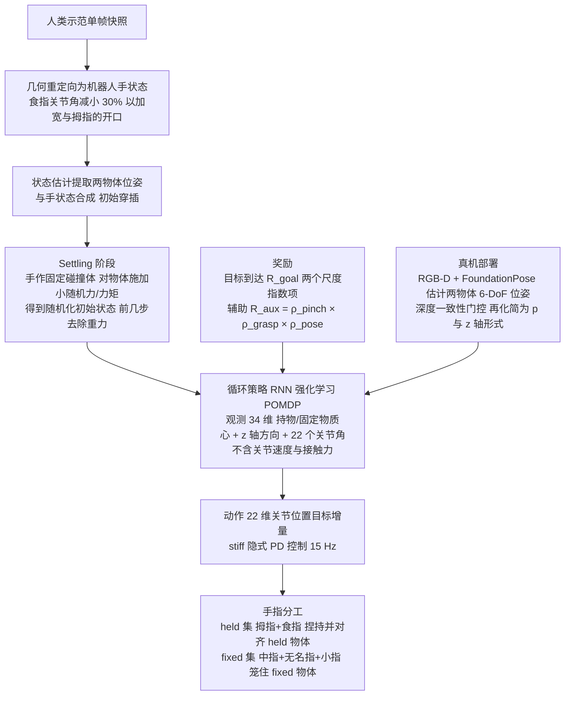

# 单手双件装配（arXiv:2609.10137）

**单手双件装配**（[Assembling Two Parts in One Hand](https://arxiv.org/abs/2609.10137)）来自 [具身智能小站 11 篇盘点](../../sources/blogs/wechat_embodied_station_11_papers_vlm_manipulation_2026-09-10.md)。灵巧手在无第二只手/夹具下完成 Bottle/Syringe/Marker 装配；仿真训练零样本单摄像头真机。

## 一句话定义

**三项装配任务纯仿真训练，强调遮挡下状态估计与多指分工。**

## 英文缩写速查

| 缩写 | 英文全称 | 简要说明 |
|------|----------|----------|
| IL | Imitation Learning | 从专家示范学习策略 |
| VLM | Vision-Language Model | 视觉-语言多模态模型 |
| WM | World Model | 预测未来观测或表征的动力学模型 |
| RL | Reinforcement Learning | 强化学习 |
| CEM | Cross-Entropy Method | 采样优化动作/轨迹的规划器 |
| DoF | Degrees of Freedom | 自由度 |

## 为什么重要

- 纳入本期 **VLM 控制 / 世界模型 / 灵巧操作 / 规划 / 评测** 主线之一。
- 开源状态：**待发布**（步骤 2.5 核查，2026-09-10）。
- 与 [11 篇技术地图](../overview/vlm-manipulation-11-papers-technology-map.md) 中同类工作可横向对照。

## 流程总览

图依据：论文 §3.1–§3.5（含 Eq. 1–4 与真机位姿跟踪段）。

## 核心机制

| 项 | 内容 |
|----|------|
| **arXiv** | [2609.10137](https://arxiv.org/abs/2609.10137) |
| **项目页** | https://ltbgbird.github.io/in-hand-assembly-page/ |
| **代码** | 待发布 |
| **开源** | **待发布** |
| **文内指标** | 三项装配任务纯仿真训练，强调遮挡下状态估计与多指分工。 |

## 源码运行时序图

**不适用**（项目页已上线；截至入库日未见官方 GitHub/权重链接。）。

## 实验与评测

| 项 | 文内口径 |
|----|----------|
| 任务 | **三项** 装配：Bottle / Syringe / Marker |
| 训练 | **纯仿真**训练 |
| 迁移 | **零样本** 到真机，感知仅 **单摄像头** |
| 难点 | 遮挡下的 **状态估计** 与多指 **分工** |

- **读法：** 本页为清单摘要，上表取自 [公众号盘点](../../sources/blogs/wechat_embodied_station_11_papers_vlm_manipulation_2026-09-10.md) 与项目页；逐任务成功率、消融与真机重复次数以 **原文 PDF** 为准（[参考来源](#参考来源)）。
- **约束是评测的一部分：** 「无第二只手 / 无夹具 / 单摄像头」三条同时成立才是本文的难度设定，抽掉任一条数字都不可横比。

## 与其他工作对比

| 对照路线 | 差异 |
|----------|------|
| 双臂 / 夹具辅助装配 | 第二只手或工装提供固定基准，装配退化为单件对准；本文要求 **同一只手内** 完成握持与配合。 |
| 多相机 + 触觉重度方案 | 用冗余感知绕开遮挡；本文只给 **单摄像头**，把遮挡下的状态估计当作要解的问题而非要回避的条件。 |
| 真机采数的模仿学习 | 需在真机上采装配示范；本文 **纯仿真训练 + 零样本迁移**，代价是接触参数的 sim2real 风险（见 [sim2real](../concepts/sim2real.md)）。 |
| 单件 in-hand reorientation | 经典手内操作只重定向 **一个** 物体；双件装配额外要求两件的 **相对位姿** 收敛。 |

## 结论

**单手双件装配 值得按「待发布」边界阅读：先核对仓库是否可跑，再引用文内成功率数字。**

1. 索引来源为公众号导读，实验细节以 arXiv PDF 为准。
2. 开源结论：**待发布** — 项目页已上线；截至入库日未见官方 GitHub/权重链接。。
3. 选型时对照 [11 篇地图](../overview/vlm-manipulation-11-papers-technology-map.md) 中相邻节点，避免重复造页。

## 关联页面

- [VLM 与操作 11 篇技术地图](../overview/vlm-manipulation-11-papers-technology-map.md)
- [模仿学习 (Imitation Learning)](../methods/imitation-learning.md)
- [Generative World Models](../methods/generative-world-models.md)
- [Manipulation](../tasks/manipulation.md)

## 参考来源

- [assembling-two-parts-in-one-hand_arxiv_2609_10137.md](../../sources/papers/assembling-two-parts-in-one-hand_arxiv_2609_10137.md)
- [wechat 11篇盘点](../../sources/blogs/wechat_embodied_station_11_papers_vlm_manipulation_2026-09-10.md)
- [arXiv:2609.10137](https://arxiv.org/abs/2609.10137)
- [arXiv PDF](https://arxiv.org/pdf/2609.10137)：已通读方法部分（实验与附录以略读为准）：§3 方法（问题表述、任务实例、观测与动作空间、奖励、快照初始化）、§4.1–§4.5 实验设置与结果

## 推荐继续阅读

- [arXiv PDF](https://arxiv.org/pdf/2609.10137)
- [项目页](https://ltbgbird.github.io/in-hand-assembly-page/)

