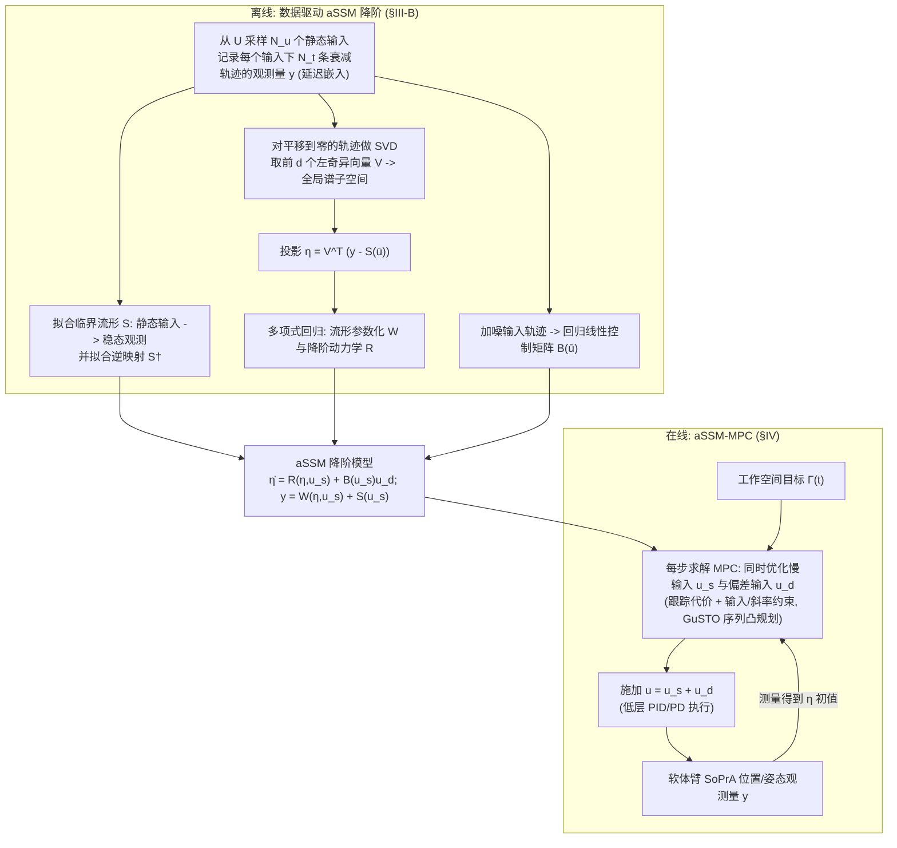

# aSSMPy：软体机器人姿态 aSSM-MPC

**aSSMPy**（[arXiv:2609.14376](https://arxiv.org/abs/2609.14376)，[代码](https://github.com/karakaron/aSSMPy)）——扩展 aSSM 降阶 + 姿态控制；FEM 相对误差 2.6%/2.4%；100 Hz；文内 GitHub 入库日 404。

## 一句话定义

**扩展 aSSM 降阶 + 姿态控制。**

## 英文缩写速查

| 缩写 | 英文全称 | 简要说明 |
|------|----------|----------|
| aSSMPy | 软体机器人姿态 aSSM-MPC | 本文方法简称 |
| VLA | Vision-Language-Action | 视觉-语言-动作（若适用） |
| Sim2Real | Simulation to Reality | 仿真到真机迁移（若适用） |

## 为什么重要

- 纳入 [2026-09-15 十篇盘点](../../sources/blogs/wechat_embodied_station_9_papers_resources_effvla_2026-09-15.md) 索引。
- 公众号推荐跟踪方向之一。

## 流程总览

图依据：论文 §III-B、§IV、§V（图为据 §III-B 与 §IV 的方法描述绘制）。

## 核心原理（方法）

软体机器人要做安全关键交互，位置与 **姿态** 都得控准；但它的动力学是 **无穷维非线性** 的，MPC 需要的模型必须 **同时准确且便宜**——这对矛盾正是全篇要解的：

| 环节 | 机制 | 解决什么 |
|------|------|----------|
| **降阶** | **adiabatic spectral submanifold（aSSM）** — 数据驱动地把无穷维动力学约化到低维不变流形上 | 这是「便宜」的来源：MPC 在低维流形上求解，而非在 FEM 自由度上 |
| **辨识扩展** | 从 **更大的可观测量数据集（enlarged observable datasets）** 辨识 aSSM | 这是本文贡献之一：观测量集合变大，流形拟合更准，也才够描述姿态 |
| **控制升级** | 升级既有 **aSSM-MPC** 方案，把 **姿态** 纳入跟踪目标 | 贡献之二：此前的 aSSM-MPC 主要做位置；姿态是新加的那一维 |

**读法：** aSSM 是 **物理约化** 而非黑箱拟合——它假设系统轨迹会被吸引到低维谱子流形上。这个假设成立时精度与算力双赢；不成立（强接触、大变形跳变）时降阶模型会系统性偏。

## 实验与评测

评测在 **压力驱动软体臂** 的 **高保真有限元（FEM）仿真** 上进行，不是真机：

| 口径 | 结果 | 读法 |
|------|------|------|
| **相对数据驱动基线**（abstract 口径） | 位置与姿态跟踪误差 **均下降 >60%** | 本文主结果。注意对照组是 **数据驱动** 基线，不是解析模型或工业控制器 |
| **绝对误差**（索引来源口径） | FEM 两项任务相对误差 **2.6% / 2.4%** | 与上一行是 **不同口径**，不要相乘或并列成同一列 |
| **离散化** | **100 Hz** | 决定 MPC 实时性的关键参数；换频率需重新评估降阶模型的有效带宽 |

**验收提醒：** 全部证据来自 **FEM 仿真**——高保真 FEM 与真实软体臂之间仍有材料本构、迟滞、气动延迟等 gap，本文未跨过这一步。文内 GitHub 链接在 **入库日（2026-09-15）404**，开源状态记为 **待核实**，因此无法独立验数。

## 与其他工作对比

> 下表只做 **定位对照**：软体机器人控制缺少共同基准，各工作的机器人形态、驱动方式与任务定义都不同，**误差数字不可横比**。

| 对照 | 差异读法 |
|------|----------|
| **数据驱动降阶基线**（论文对照组） | 同样用数据学低维模型，但不带 aSSM 的谱子流形结构；本文 **>60%** 的误差下降就是相对这一组。选型时该问的是「我的系统是否满足流形吸引假设」 |
| **本文前作 aSSM-MPC**（只控位置） | 最直接的增量：本文把 **姿态** 纳入，并把辨识扩到更大的可观测量集合。若任务只需位置，前作已够 |
| **全阶 FEM 模型 + MPC** | 精度上限最高但 **算不动**——这正是要降阶的原因。本文用 FEM 当 **评测环境** 而非控制模型，读法上不要混淆 |
| **Cosserat / PCC 等解析降阶** | 靠几何假设（常曲率等）压维数，不需要数据但受限于假设成立与否；aSSM 靠 **数据 + 谱结构** 压维数，更贴合真实变形，代价是要采辨识数据 |
| [MPC](../methods/model-predictive-control.md) | 方法入口：本文换的不是优化器而是 **预测模型**。读本页时应把「MPC 本身的调参」与「降阶模型的保真度」分开归因 |
| [系统辨识](../concepts/system-identification.md) | aSSM 辨识属该页谱系里的 **结构化降阶辨识** 一支：辨识对象不是刚体参数，而是低维不变流形与其上的动力学 |

## 结论

**aSSMPy 的核心贡献需与重建/仿真指标分开读；开源状态为 **待核实**（截至 2026-09-15）。**

1. 先核对项目页与仓库是否已更新（尤其待发布项）。
2. 读数时区分仿真主结果与真机/feasibility 子集。
3. 交叉对比同盘点内相关工作，避免孤立引用单点数字。

## 工程实践

| 项 | 内容 |
|----|------|
| 开源 | **待核实** |
| 复现 | 若有官方仓库，从 README 环境 → 数据 → 训练/评测顺序推进 |

## 局限与风险

- 结论范围以 arXiv 与项目页为准；待发布代码无法独立验数。

## 关联页面

- [十篇资源技术地图](../overview/embodied-resources-10-papers-technology-map.md)

## 参考来源

- [aSSMPy 论文摘录](../../sources/papers/assmpy_arxiv_2609_14376.md)
- [具身智能小站 2026-09-15 盘点](../../sources/blogs/wechat_embodied_station_9_papers_resources_effvla_2026-09-15.md)
- [arXiv PDF](https://arxiv.org/pdf/2609.14376)：已通读方法部分（实验与附录以略读为准）：§II 问题设定、§III 数据驱动 aSSM 降阶（A、B）、§IV aSSM-MPC、§V 软体臂控制设置

## 推荐继续阅读

- 论文 PDF：<https://arxiv.org/pdf/2609.14376>
