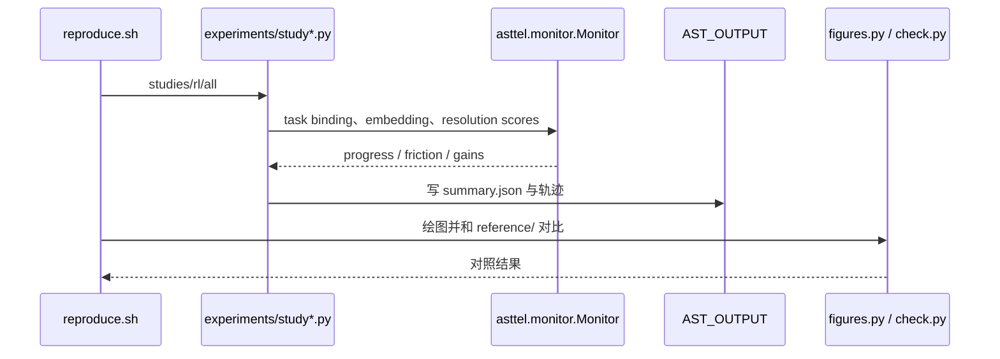

# Model-Free Runtime Measurement of Task-Relevant Information｜AST 任务相关信息在线监测

## 一句话定义

Acquisition-State Telemetry 将实时观测映射到任务需求坐标，分别度量前瞻信息进展和无效重复的信息摩擦。

## 英文缩写速查

| 缩写 | 英文全称 | 简要说明 |
|---|---|---|
| AST | Acquisition-State Telemetry | 本研究涉及的AST术语 |
| RL | Reinforcement Learning | 本研究涉及的RL术语 |
| API | Application Programming Interface | 本研究涉及的API术语 |

## 为什么重要

领域接口把观测和目标转为可比较的任务解析状态。

## 核心原理与方法

1. 领域接口把观测和目标转为可比较的任务解析状态。
2. 固定因果监测器输出 progress 和 friction 两个连续指标。
3. 可将 friction 用作运行诊断或 RL 惩罚，但需要领域任务接口。

## 流程总览

> 根据论文方法与作者公开资料重绘，非作者原图。

## 实验与评测

作者在八类领域使用同一监控配置，覆盖网格探索、搜索救援、机械操作与意图估计；论文摘要报告对无效停滞的区分能力。

上述结果均为作者报告或用户附件转载，**不是本次复测**。

## 结论

**Acquisition-State Telemetry 将实时观测映射到任务需求坐标，分别度量前瞻信息进展和无效重复的信息摩擦。**

1. 领域接口把观测和目标转为可比较的任务解析状态。
2. 固定因果监测器输出 progress 和 friction 两个连续指标。
3. 任务信息坐标需人为定义，假设已获得证据持续有效；无法代替实测成功率。

## 与其他工作对比

比较本文与相关基线时应在相同任务、数据、样本量、传感器和部署条件下评估；不能把论文中的单个数字解释为真实部署的通用进步。待全文表格核对后补足逐项量化对照。

## 源码运行时序图

按官方 README/启动入口绘制，尚未独立执行。

## 工程实践

- 对齐版本、传感器、动作/观测空间和评测预算后再尝试复现。
- 正式应用应增加跨分布扰动与任务安全边界检查；原文完整复现步骤待核对。
- 已通读可获取的原文方法、实验及附录；尚未独立运行代码。

## 局限与风险

任务信息坐标需人为定义，假设已获得证据持续有效；无法代替实测成功率。

已核对论文正文与附录；源码运行和真实部署仍需独立验证。

## 全文核验补记

论文框架 Acquisition-State Telemetry（AST）先由领域 **task binding** 将观测投影为任务坐标的 resolution score 与单位范数 evidence embedding，再由固定 Monitor 输出 progress、friction、gains；无须拟合被监控的策略，不等于不需要任务 schema。附录的贝叶斯进度估计对各需求坐标的收益率赋 Beta(1,1) 先验，根据有收益次数更新，辅以历史证据相似度和检查点直行度评估无效重复。覆盖 SAR、MapTask、MultiWOZ、AnnoMI、MiniGrid、Crafter、MetaWorld、BOIR 及 RL 控制；MetaWorld 对动作前停滞与完成后停住的区分存在差异。**官方源码并非无可运行入口：** GitHub 的嵌套目录 `ast_telemetry_anonymous_repo/ast-telemetry/` 包含 `reproduce.sh`；`./reproduce.sh studies` 调用各 study1–3 脚本，`JOBS=16 ./reproduce.sh rl` 调用 study4 训练/评测，最终运行 figures.py 与 check.py。运行前必须设置 AST_DATA 指向独立数据集。

## 关联页面

- [robot-safety-state-machine](../concepts/robot-safety-state-machine.md)
- [vla](../methods/vla.md)

## 参考来源

- [原论文及阅读进度](../../sources/papers/ast_task_information_arxiv_2611_14111.md)
- [官方源码入口](../../sources/repos/ast-task-information.md)
- [用户附件 13 篇原始资讯整理](../../sources/blogs/embodied-research-digest-2026-11-12.md)

## 推荐继续阅读

- [arXiv 原文](https://arxiv.org/abs/2611.14111)
- [官方源码](https://github.com/dimipan/ast-telemetry)
