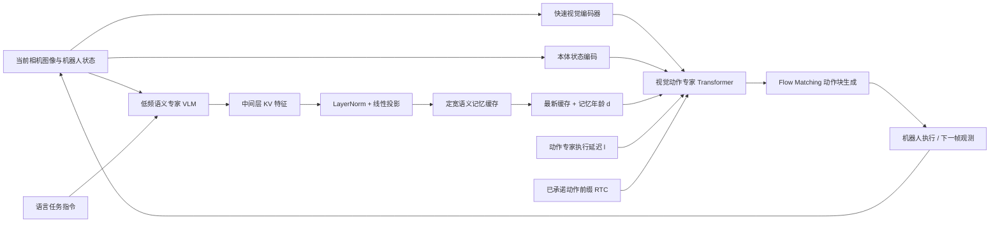

# ARP：异步机器人策略（Asynchronous Robot Policies）

> INSAIT · Sombit Dey、Luc Van Gool、Danda Pani Paudel · arXiv:2611.05155v1（2026-11-03）· [官方项目页](https://arp.insait.ai/)

## 一句话定义

**ARP 将 VLA 分成独立的低频语义推理与高频视觉动作两条循环：大 VLM 异步写入语义记忆，小动作专家直接读取最新相机画面和最近一次记忆来输出动作，不必等待下一次 VLM 推理。**

## 英文缩写速查

| 缩写 | 英文全称 | 简要说明 |
|------|----------|----------|
| ARP | Asynchronous Robot Policies | 本文的双频率异步机器人策略架构 |
| VLA | Vision-Language-Action | 把视觉、语言指令映射为机器人动作的模型 |
| VLM | Vision-Language Model | 低频语义专家，生成任务上下文 |
| VA-E | Vision-Action Expert | 带独立视觉输入的快速动作专家 |
| KV | Key-Value | 从 VLM 中间层缓存获取语义特征 |
| AdaRMS | Adaptive RMS Normalization | 将流匹配时间、记忆年龄和计算延迟注入动作网络 |
| RTC | Real-Time Chunking | 利用已承诺动作前缀平滑异步重规划 |

## 为什么重要

- **传统 VLA 的反应延迟叠加**：一次视觉到动作更新要等待 VLM 再等待动作头，近似为 `t_VLM + t_AE`；模型越大，闭环越慢。ARP 让反应路径只经过快速视觉动作专家。
- **语义与反射分工**：VLM 保留任务语义，动作专家用独立相机输入处理物体突然移动等局部变化；前者不必每个动作块都重新运行。
- **真正难点是跨时间一致性**：异步缓存可能变旧，动作预测也存在计算延迟；因此训练必须模拟陈旧记忆和动作前缀，而非只把两进程并行运行。

## 核心信息

| 项目 | 内容 |
|------|------|
| 论文 | [Asynchronous Robot Policies](https://arxiv.org/abs/2611.05155)，v1 / [HTML 全文](https://arxiv.org/html/2611.05155v1) |
| 作者 / 机构 | Sombit Dey、Luc Van Gool、Danda Pani Paudel；INSAIT（索非亚大学） |
| 范式 | 双进程、多频率、共享最新语义记忆的 VLA |
| 仿真语义专家 | InternVL3.5 系列（1B–14B）；LIBERO 训练 |
| 真机语义专家 | PaliGemma-3B；视觉动作专家使用 DINOv3 特征；DROID 训练 / Franka 部署 |
| 官方实现状态 | **待发布**：截至 2026-11-16，项目页显示 Code (soon)、Models (soon)，未给出可运行代码或权重下载地址 |

## 流程总览

图示的是论文第 3 节所描述的模块及条件输入：慢循环写入缓存；快循环独立读取最新观测、缓存及延迟变量，再生成动作块。图中循环表示运行时重新观测，不代表已公开的可执行源码。

## 核心原理

### 1. 慢循环：固定接口的语义记忆

VLM 周期性读取图像与语言指令，抽取中间层 KV 特征，用 LayerNorm 与线性投影压缩为固定维度语义记忆；再加入位置编码与记忆年龄信息。缓存使动作网络不必重新执行 VLM 前向推理。**语义记忆是潜在特征，不是自然语言文本规划。**

### 2. 快循环：能看见当前画面的动作专家

视觉动作专家有独立视觉编码器，将实时视觉 token、本体状态、可学习 register token 和动作 token 输入双向 Transformer，并在各层 cross-attention 到语义记忆。AdaRMS 同时编码流匹配时刻、记忆年龄 `d = t - τ(t)` 和专家执行延迟 `ℓ`，用 flow matching 预测未来动作块。论文仿真设置：12 层、约 183M 参数，预测 20-step 动作块并以 5 个 Euler 步推断；注意这些是实验配置，**不等于底层驱动固定 5 Hz**。

### 3. 训练：把时间错配变成数据增强

训练时从同一示范轨迹取当前视觉帧、较早时刻生成的语义记忆。论文的默认年龄采样为 `d ~ 0.2·δ(0) + 0.8·Uniform{1,...,40}`（以控制步计），并采样执行延迟；部分样本固定已执行动作前缀、只训练后续动作，以维持重规划时的连续性。**只添加视觉输入而不训练陈旧缓存，降频时仍会崩溃**。

## 实验与评测

以下数字均来自 [arXiv v1 原文第 4 节及附录](https://arxiv.org/html/2611.05155v1)，请勿将不同数据或预训练设置的结果当成严格公平的架构消融。

| 设置 / 指标 | ARP | 对照 | 读法 |
|------------|-----|------|------|
| LIBERO-Perturb，目标突然横移 5 cm | **51.5%**（ARP-1B） | 9.5%（同配方 π0 风格 1B） | 特别检验运动中动态反应 |
| Dyn-Bump，必定施加速度扰动 | **44.7%**（ARP-1B） | 12.7%（π0 风格 1B） | 约 3.5 倍成功率 |
| LIBERO 静态平均 | **84.8%**（ARP-1B） | 80.2%（同配方 π0 风格 1B） | 不能与使用不同预训练的公开 π0 直接归因比较 |
| VLM 降到每 4 秒刷新一次（项目页统计口径） | **79.0%**（ARP-1B） | 45.3%（π0 风格基线） | 快路径仍利用实时视觉 |
| RoboLab 120 任务 / 960 回合 | **20.0%**（ARP-3B） | 37.9%（公开 π0.5-DROID） | 广泛泛化显著落后；两者训练数据不同 |
| RoboLab 中 ARP-DROID 加 RTC 前缀 | **37.5%**（RTC） | 31.9%（无 RTC） | 同 checkpoint 的部署消融，+5.6 个百分点 |

Franka FR3 真机采用 DROID 相机配置（桌面外部相机与腕相机），三项任务各 10 次：蔬菜入碗、叠杯、马克笔入碗的最终任务进度，ARP 分别为 **78% / 73% / 80%**，π0.5-DROID 为 **32% / 80% / 50%**；叠杯任务 π0.5 反而较优。这里是**进度**，不等同每项任务成功率。

## 结论

**ARP 的价值是把语义计算与闭环反应解耦，并通过时间错配训练让快循环真正容忍旧语义；它尚未证明优于高能力通用 VLA 的总体表现。**

1. 对动态目标优先检查快速策略是否直接接入相机的最新观测，而不只比较 VLM 规模。
2. 训练时显式随机化缓存年龄及执行延迟；不做这一步，单纯缓存与并行难以稳健降频。
3. 如果动作采用 chunk 重规划，增加已承诺动作前缀条件，关注成功率和运动连续性。
4. 性能报告要分开写动态扰动、静态成功率、真机进度和通用 benchmark，避免把局部收益夸大成全面 SOTA。
5. 代码和模型仍待官方发布，工程复现只能先依据论文设计接口与测试协议。

## 工程实践

- 设计**慢循环语义缓存**（带更新时刻、最新完成版本）与**快循环视觉推理**（当前帧、本体状态、最新缓存、记忆年龄、执行延迟）之间的非阻塞接口；这是依据论文的架构拆解，而非已验证的实现教程。
- 在目标硬件分别测量 VLM 时间、动作专家时间、缓存交接延迟和感知到下发端到端延迟；论文附录 A 报告 A6000 上 1B/8B 的 VLM 调用量级约 64/125 ms，快专家约 55 ms，**不可直接视为目标设备保证值**。
- 复现时按原文在 LIBERO-Perturb（末端进入 10 cm 范围后目标移 5 cm）和 Dyn-Bump（移动目标速度方向突变）验证响应性，再回到无扰动任务防止静态退化。
- 源码尚未开放，不能声称具备可运行的 ROS 2 / Franka 部署入口，也不能以论文流程图充当源码时序图。

## 源码运行时序图

**不适用（待发布）**：截至 2026-11-16，官方项目页的 Code / Models 均标注 “soon”，没有可核实的运行入口、实现文件或 checkpoint 下载链接。发布后需阅读 README、训练/推理入口与关键模块，再补真实运行时序图。

## 与其他工作对比

| 路线 | 动作专家是否独立读最新图像 | 处理延迟的主策略 |
|------|--------------------------|------------------|
| 传统顺序 VLA / 本文 π0 风格对照 | 对照不独立读快循环图像 | 每个动作块需经 VLM → 动作专家 |
| ARP | **是** | 异步语义缓存 + 记忆年龄/执行延迟训练 + RTC 前缀 |
| AsyncVLA、AR-VLA、VLASH（相关工作） | 架构与部署背景各不相同 | 分别关注云边异步、自回归动作专家或未来状态对齐；不能概括为与 ARP 同一实现 |

详见原文 §2.2，注意 ARP 的对照实验有时使用**作者复现的 π0 风格 baseline**，有时使用**公开 π0.5-DROID**，不是同一个模型。

## 局限与风险

- 真实机器人仅 1 个实验配置、3 类任务、每项 10 次；样本小，不能推断全面泛化或稳定性。
- RoboLab 上 ARP-3B（20.0%）低于 π0.5-DROID（37.9%）；训练数据与模型设置不同，无法仅把差距归因于异步架构。
- 项目页明确说明 LIBERO-Perturb 中异步执行的额外收益有限，主要收益来自动作专家自己的相机输入；异步相对同步的停滞率差异未显著（12.0% vs 12.5%）。
- 论文承认进程间通信、双向记忆流、长时程持久记忆，以及最低可用 VLM 更新频率尚未解决；代码与模型待发布。
- 论文 v1 与项目页有部分展示口径不完全一致（例如 LIBERO-Perturb 任务数），本页优先按 arXiv v1 章节的协议和数值，并对仅见于项目页的口径单独标注。

## 关联页面

- [VLA 方法](../methods/vla.md)
- [模仿学习](../methods/imitation-learning.md)
- [具身模型延迟–泛化权衡](../concepts/embodied-fm-latency-generalization-tradeoff.md)
- [仿真评测基础设施](../concepts/simulation-evaluation-infrastructure.md)
- [具身评测基准选型闭环](../overview/hub-embodied-eval-benchmark.md)
- [VLA 纵深路线 Stage 4：部署与系统整合](../../roadmap/depth-vla.md)
- [具身智能小站 2026-11-05 43 篇技术地图](../overview/embodied-station-2026-11-05-43-papers-technology-map.md)

## 参考来源

- [原论文资料归档（已核对全文及附录）](../../sources/papers/asynchronous_robot_policies_arxiv_2611_05155.md)
- [官方项目页归档及代码开放状态](../../sources/sites/asynchronous-robot-policies.md)
- [arXiv:2611.05155v1（原文）](https://arxiv.org/html/2611.05155v1)

## 推荐继续阅读

- [论文 PDF（v1）](https://arxiv.org/pdf/2611.05155v1)
- [项目页、视频与实验详情](https://arp.insait.ai/)
